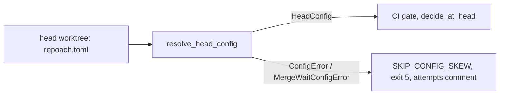

# An unknown key in the head's repoach.toml is a named refusal

## Intent

The merge gate reads the pull request head's `repoach.toml` with the
released code's config model, every section `extra="forbid"`. A key
that `develop` taught the model and the release does not know is a
`ConfigError` that no gate handler catches: a traceback, exit 1, a red
`merge-on-ci` run no pull request check shows. The repository already
lives around this: `[auto_merge]` is kept commented in `repoach.toml`
"because an older installed repoach refuses an unknown key". This spec
makes that refusal a gate outcome, `SKIP_CONFIG_SKEW`, exit 5, written
on the pull request with the key, the head and the reader version.

## Context

Measured 2026-11-17 on `origin/develop` `5cea5a7`.

| # | Fact | Where |
|---|---|---|
| F1 | `merge-on-ci.yml` runs `review merge` with `working-directory` set to the head worktree; the gate resolves `repo_root or Path.cwd()` for `resolve_required_checks` (→ `required_checks(root)` → `load_project_config(root)`), for `load_gates_config(checkout)`, `resolve_refuter_budget(checkout)` and `resolve_refuter_max_judged(checkout)` | `.github/workflows/merge-on-ci.yml:214-216`; `src/repoach/review/auto_merge.py:976-977,991,1005,1013-1014`; `src/repoach/review/merge_wait.py:329-339` |
| F2 | `_Section` has `model_config = ConfigDict(frozen=True, extra="forbid")`; `load_project_config` raises `ConfigError` (a `ValueError`) naming the key and its line | `src/repoach/project/config.py:168,189-192,746-822` |
| F3 | `review merge` catches `ForgeError` only; `merge_exit_code` maps unrecognised outcomes to 1; so a `ConfigError` is a traceback and exit 1 (the same path as the `note` crash, run 43995248874) | `src/repoach/cli/review_cmds.py:834-851`; `src/repoach/review/auto_merge.py:204-214` |
| F4 | `repoach.toml` keeps `# [auto_merge]` commented, SP-PR-RUNS-AFFECTED-JOBS F14: "an older installed repoach refuses an unknown key"; `[[review.generated]]` was added on 2026-11-17 by #309, a key release 12 already knew | `repoach.toml:61,87`; `git log -1 --format=%h origin/main..origin/develop` |
| F5 | `MergeWaitConfigError` (a required check no re-arming workflow produces) is raised by `assert_rearmed` and is also uncaught in `review merge` | `src/repoach/review/merge_wait.py:91-92,372-378` |
| F6 | The release gate already degrades a `ConfigError` by name: `affected-jobs misses: cannot say: <why>` | `src/repoach/cli/release_cmds.py:75-105` |

## Decisions (2026-11-17)

- D1. Refuse by name, never ignore (umbrella Q2). A `ConfigError` or
  `MergeWaitConfigError` raised while the gate reads the head's
  `repoach.toml` becomes `OUTCOME_SKIP_CONFIG_SKEW = "SKIP_CONFIG_SKEW"`,
  exit 5, reason `config skew: repoach.toml at <sha7> — <the
  ConfigError message, which names the key and line>; this gate is
  repoach <version>; a release that knows the key is needed before
  this lane can judge this head`. Recorded in `pr_merges` and in the
  attempts comment like every outcome; `review gate` prints the same
  line and exits 5.
- D2. The reads are gathered. The four reads of F1 happen in one
  place, `resolve_head_config(root) -> HeadConfig` (the project
  config, the gates config, the refuter budget and cap, the required
  names and producers), called once before the CI gate; the error is
  caught there. Each read keeps its function; only the call site
  moves, so a later new read of the head's file is added to one
  function and inherits the refusal.
- D3. The fixture is the shape of the incident, not the key of today:
  `tests/fixtures/head_config_skew/repoach.toml` is the committed
  `repoach.toml` plus one section `[later]` with `x = 1` and one key
  `[auto_merge].later = true`; the test feeds it to the current model.
  No live key is used, so the fixture stays a skew whatever `develop`
  learns next.

## End state

A pull request whose `repoach.toml` declares a key the released gate
does not know shows `SKIP_CONFIG_SKEW — config skew: repoach.toml at
abc1234 — [later] is not a section repoach 0.1.0 knows (line 97) …` in
its merge attempts comment, exits 5 in `merge-on-ci.yml` (a green job,
a named non-merge), and merges after the release by the next re-arm.
`[auto_merge]` can be uncommented in `repoach.toml` on the day the
release that reads it is out, with the gate naming the lag until then
instead of crashing.

## Easy solution rejected

Read the head's `repoach.toml` with `extra="ignore"` in the gate so an
older reader skips what it does not know. Rejected (umbrella Q2): the
key may be a gate rule (`[auto_merge].required_checks`,
`[gates]`), and a gate judging under rules the repository no longer
declares is the silent-green class; `extra="forbid"` is the right model
and the refusal is the right outcome, it only lacked a name and an exit
code.

Also rejected: reading the **checkout**'s `repoach.toml` (`main`'s) in
`merge-on-ci.yml` instead of the head's. The head's file is the one
the pull request is judged under (`required_checks`, the gates
config); `main`'s would judge a head by rules it does not carry.

## Hard part

Knowing which reads are the head's. `auto_merge.py` resolves its roots
in four places (F1), and `review gate` has its own entry; a refusal
caught around one read leaves the next uncaught. D2 gathers them so the
contract is one `try`, and T4 holds that no `load_project_config`,
`load_gates_config`, `resolve_refuter_*` or `required_checks` call
remains in `auto_merge.py` outside `resolve_head_config` — the guard
that keeps a future read from reopening the crash.

## Goals

- G1: a `ConfigError` or `MergeWaitConfigError` from the head's `repoach.toml` is `SKIP_CONFIG_SKEW`, exit 5, named on the pull request; never a traceback.
- G2: the head's config is read in one function, so the refusal covers every read.

## Non-Goals

- NG1: no change to `extra="forbid"` or to the config model.
- NG2: no reading of `.github/affected-jobs.toml` by the gate (it does not read it today; `repoach ci affected` and the release gate do, with `TableError` and `cannot say` already named).
- NG3: no change to which code `merge-on-ci.yml` runs (umbrella Q1).

## Assumptions

- A1: `ConfigError` messages keep naming the key and the line (F2, `_generated_location` and its siblings).

## Interface

```python
# src/repoach/review/auto_merge.py
OUTCOME_SKIP_CONFIG_SKEW: str = "SKIP_CONFIG_SKEW"      # in the exit-5 set of merge_exit_code

class HeadConfig(BaseModel):
    project: ProjectConfig
    gates: GatesConfig
    refuter_budget: int
    refuter_max_judged: int
    required_names: list[str]
    producers: dict[str, str]

class HeadConfigSkewError(RuntimeError):
    """The head's repoach.toml carries what this reader does not define; the message names the key, the head and the reader version."""

def resolve_head_config(root: Path, head_sha: str, *, forge: Forge, required_names: Sequence[str] | None) -> HeadConfig: ...
    # raises HeadConfigSkewError from ConfigError | MergeWaitConfigError
```

`run_auto_merge` and `review gate` catch `HeadConfigSkewError` and
return the outcome of D1; the `review merge` docstring's exit table
gains the tag.

## Behavior

### Nominal
A head whose `repoach.toml` the reader knows → `HeadConfig`, the gate
proceeds as today.

### Edge cases
- a head with no `repoach.toml` → defaults, as today.
- a head whose `repoach.toml` is syntactically invalid TOML → the same `ConfigError` path → `SKIP_CONFIG_SKEW` naming the parse error (a refusal, not a skew by origin, but the same named shape; the reason says `invalid TOML` when the error is one).
- `[auto_merge].required_checks` names a check no re-arming workflow produces → `MergeWaitConfigError` → `SKIP_CONFIG_SKEW` naming the check (F5).

### Failure scenarios
- the checkout's own `repoach.toml` (not the head's) is unreadable → not this spec: the gate runs from the head worktree, and the checkout is read for nothing else in `merge-on-ci.yml`.

## Tests

| # | File | Test | Mutation that turns it red |
|---|---|---|---|
| T1 | `tests/unit/test_head_config_skew.py` | `resolve_head_config` on a root holding `tests/fixtures/head_config_skew/repoach.toml` → `HeadConfigSkewError` naming `later` and the reader version | catch `ConfigError` and return defaults |
| T2 | same | `run_auto_merge` with a forge fake on that root → outcome `SKIP_CONFIG_SKEW`, `merge_exit_code` 5, one attempt recorded with the reason, no traceback (`capsys`) | let the error propagate |
| T3 | same | `review gate` (CLI runner) on that root → the `config skew:` line, exit 5 | print nothing |
| T4 | same | `auto_merge.py` calls `load_project_config`, `load_gates_config`, `resolve_refuter_budget`, `resolve_refuter_max_judged`, `required_checks` and `resolve_required_checks` only inside `resolve_head_config` (an AST walk of the module) | add a direct call elsewhere |
| T5 | same | a `[auto_merge].required_checks` naming an unproduced check → `SKIP_CONFIG_SKEW` naming the check | leave `MergeWaitConfigError` uncaught |
| T6 | same | the committed `repoach.toml` resolves without error (the fixture differs from it by the two additions only, asserted by diff) | break the committed file |

## Success conditions

- C1 (external oracle: the gate on a real tree): on a throwaway branch whose `repoach.toml` adds `[later]\nx = 1`, `repoach review gate <n>` (any open pull request number, `--forge` fake or `REPOACH_FORGE_READ_ONLY`) run from that tree prints `config skew: repoach.toml at <sha7> — …later… this gate is repoach <v>` and exits 5; the command line and output are written beside this line. The branch is deleted after.
- C2: `pytest -q tests/unit/test_head_config_skew.py tests/unit/test_review_auto_merge.py` green with T1–T6 in `-v`; `repoach arch check --base origin/develop` → `edge-honesty: ok`; `docs/merge_gate.md` carries a dated section "The head's configuration is read by the release" naming the outcome; the `[auto_merge]` comment in `repoach.toml` cites this spec as the reason the section can be uncommented once released.

## Architecture Impact
- Adds dependency: SP-HEAD-CONFIG-SKEW-IS-NAMED -> SP-MERGE-EXIT-CONTRACT (the new outcome is one of its exit-5 skips)
- `auto_merge.py`, `review_cmds.py` and `project/config.py` are frontier (owned by no spec); the test imports them. No new table, no cycle.

## Diagram


## Acceptance Criteria
- [ ] AC1: `pytest -q tests/unit/test_head_config_skew.py` → green. Today: no such file.
- [ ] AC2: `pytest -q tests/unit/test_review_auto_merge.py` → green with the reads gathered.
- [ ] AC3: `repoach arch check --base origin/develop` → `edge-honesty: ok`.

## Open Questions
- None of its own. The umbrella's Q2 (refuse or ignore an unknown key) decides D1; this spec is written to the recommendation and is amended if the owner decides otherwise.
