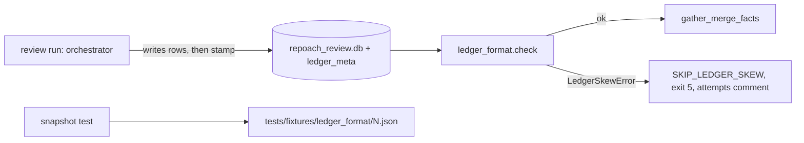

# An unknown ledger value is a named refusal, not a traceback

## Intent

The ledger a review run uploads is read by `main`'s merge gate. When
`develop` added the severity `note`, `main`'s reader crashed on the
first ledger carrying it (`ValueError: 'note' is not a valid Severity`,
exit 1), and the pull request was admin-merged. This spec gives the
ledger a format number and the writer's version, in a one-row table the
writer stamps and the reader checks before any row is materialised, and
makes every value the reader cannot place — a newer format, an enum
value outside its enum, a column it expects and does not find — one
refusal, `SKIP_LEDGER_SKEW`, exit 5, written in the pull request's merge
attempts comment with the writer version, the reader version and the
value. The format number is held honest by a committed snapshot: an enum
or column change without a bump is a red test. A script feeds a ledger
written by one ref to the reader of another, so the skew is measured
at release time, not discovered on a pull request.

## Context

Measured 2026-11-17 on `origin/develop` `5cea5a7`.

| # | Fact | Where |
|---|---|---|
| F1 | `_rows_to_findings` builds each `Finding` with `ClaimType(row["claim_type"])`, `Severity(row["severity"])`, `FindingStatus(row["status"])`; `StrEnum` raises `ValueError` on an unknown value; every reader goes through it (`fetch_findings`, `fetch_all_findings`, `fetch_findings_if_recorded`) | `src/repoach/review/findings.py:781-806,810-860` |
| F2 | The gate's first read is `gather_merge_facts` → `fetch_findings(db_path, pr_number)`; `review merge` catches `ForgeError` only, so the `ValueError` is a traceback and exit 1; `merge-on-ci.yml` turns exit 1 into a red run | `src/repoach/review/merge_gate.py:398-403`; `src/repoach/cli/review_cmds.py:834-838`; `.github/workflows/merge-on-ci.yml:214-240` |
| F3 | Run 43995248874 (2026-11-17 01:24Z, `main` at `74cf2be`): traceback at `findings.py:765` (that release's line), `ValueError: 'note' is not a valid Severity`, `Process completed with exit code 1`; the writer was PR #302's code (`3c0ba97`, merged 2026-11-16), the reader release 11's predecessor; release #304 (`b963130`) cleared it | `gh run view 43995248874 --log-failed` |
| F4 | The enums the ledger stores: `Severity` 3 values, `FindingStatus` 10 values, `ClaimType` 8 values; `pr_findings` has 19 columns; four columns were added after creation by `ALTER TABLE` migrations named with their spec; `init_findings_schema` runs them on every open | `src/repoach/review/findings.py:51-61,90-102,143-153,269-291,450-493` |
| F5 | One table is already versioned: `pr_spec_coverage.rule_version` (`SPEC_COVERAGE_RULE_VERSION = 2`), a stale row is re-graded (`refresh_stale_coverage`) and a row that cannot be re-graded is `StaleCoverageRecomputeError`, caught by the gate | `src/repoach/review/spec_gate.py:63,92,103,263`; `src/repoach/review/auto_merge.py:118,860` |
| F6 | The gate reads, from the ledger, `pr_findings`, `pr_review_integrity`, `pr_spec_coverage` and `pr_merges`; SQLAlchemy `select(table)` names the declared columns, so an extra column written by a newer writer is never read, and a declared column the file lacks is an `OperationalError` at query time | `src/repoach/review/merge_gate.py:33-34,402,469`; `src/repoach/review/findings.py:269-316`; `src/repoach/review/persistence.py:112`; `src/repoach/review/spec_gate.py:79` |
| F7 | `repoach.__version__` is the installed metadata (`hatch-vcs`, `release-branch-semver`): `0.1.0` on the tag, `0.2.0.devN+g<sha>` after it | `src/repoach/__init__.py:6-8`; `pyproject.toml:3,78,85`; `docs/releasing.md` |
| F8 | The attempts comment records every outcome through `upsert_attempt`, inside a `try` that logs and never changes the outcome; `merge_exit_code` maps `SKIP_*` to 5 and anything unrecognised to 1 | `src/repoach/review/auto_merge.py:204-214,1155-1176`; `src/repoach/review/merge_wait.py:496-520` |

## Decisions (2026-11-17)

- D1. One integer, `LEDGER_FORMAT`, over every ledger table the gate
  reads (F6), starting at 1. Its definition is a committed snapshot,
  `tests/fixtures/ledger_format/<N>.json`: for each table its column
  names and types, and for each enum column its values, derived from
  the live `Table` objects and enums by `ledger_format.snapshot()`.
  Snapshots are append-only (one file per format ever defined). A test
  derives the live snapshot and compares it to `<LEDGER_FORMAT>.json`:
  any enum value, column or table change without a bump and a new file
  is red. The umbrella's Q3 decides between one integer and one per
  table; this spec is written to one.
- D2. The stamp. A table `ledger_meta(key TEXT PRIMARY KEY, value TEXT)`
  created by `ledger_format.stamp(db_path)` with rows `format` (the
  integer), `written_by` (`repoach.__version__`), `written_at` (UTC
  ISO-8601). The writer stamps after its last write of a run: the
  review orchestrator, before the artifact upload. A ledger with no
  `ledger_meta` is format 0, "unstamped", and is read as today (the
  bootstrap, Hard part).
- D3. The check. `ledger_format.check(db_path, pr_number)` runs before
  any `fetch_*` in the gate and returns a `LedgerCheck` or raises
  `LedgerSkewError` naming, in this order, the first of:
  `format <n> is newer than this reader's <LEDGER_FORMAT>`;
  `pr_findings.<column> missing` for a declared column the file lacks;
  `pr_findings.<column>='<value>' is not a <Enum> this reader knows`
  for a distinct value of an enum column of this pull request's rows
  (`SELECT DISTINCT`, three columns, one query each), outside the
  reader's enum. Every message carries `written by repoach <v>; this
  gate is repoach <v>`. A newer format is refused even when every value
  is known: the writer declared a shape the reader has no snapshot for.
- D4. The outcome. `LedgerSkewError` is caught by `run_auto_merge` and
  `review gate` (the two gate entry points) and becomes
  `OUTCOME_SKIP_LEDGER_SKEW = "SKIP_LEDGER_SKEW"`, exit 5, reason
  `ledger skew: <message>; a release carrying format <n> is needed
  before this lane can judge this head`. It is recorded in `pr_merges`
  and in the attempts comment (F8) like every outcome. `review gate`
  prints the same line and exits 5. The `review merge` docstring's
  exit table gains the tag.
- D5. The replay. `scripts/skew_replay.sh <reader-ref> <writer-ref>
  [--keep]` makes two detached worktrees under `tmp/skew/`, writes a
  ledger with the **writer**'s code (`PYTHONPATH=<writer>/src python -m
  repoach.review.ledger_format demo --db <path>`: one finding per enum
  value of each enum, one coverage row, one integrity row, stamped),
  then checks it with the **reader**'s code (`PYTHONPATH=<reader>/src
  python -m repoach.review.ledger_format check --db <path> --pr 0`). It
  prints `ledger: ok (format <n>, writer <v>, reader <v>)` or `ledger:
  <the LedgerSkewError message>` and exits 0 or 5. The release
  procedure runs it with `origin/main origin/develop` before the release
  pull request (umbrella Q5); the exit code is the verdict.
- D6. `pr_spec_coverage.rule_version` keeps its own number and its own
  re-grading (F5): it versions a **rule**, re-computed at the head; the
  ledger format versions a **shape**, which cannot be re-computed by an
  older reader. The snapshot includes the column, not the rule.

## End state

A review run's `repoach_review.db` carries `ledger_meta` with its
format, writer version and time. `main`'s gate, on a ledger of a newer
format or with a value outside its enums, writes on the pull request
`SKIP_LEDGER_SKEW — ledger skew: pr_findings.severity='later' is not a
Severity this reader knows (written by repoach 0.2.0.dev14+gabc1234;
this gate is repoach 0.1.0); a release carrying format 2 is needed
before this lane can judge this head`, exits 5, and the pull request
merges after the release by the next re-arm, with no admin merge. A
developer who adds an enum value sees
`test_live_snapshot_matches_the_committed_format` red until
`LEDGER_FORMAT` is bumped and `2.json` committed. `scripts/skew_replay.sh
origin/main origin/develop` prints `ledger: ok` or the refusal, and
`docs/releasing.md` runs it.

## Easy solution rejected

Make the reader tolerant: map an unknown severity to `blocking` (or
`advisory`), an unknown status to `open`, and go on. Rejected: a
mapping chosen by the older reader is a judgement the writer did not
make; `note` mapped to `blocking` would have held #303 on findings that
hold nothing, and the reverse mapping would have merged over a severity
the writer meant to block. The reader cannot know what a value it does
not define means, and the honest output is to say so and wait for the
code that does.

Also rejected: `PRAGMA user_version` alone (an integer with no writer
version, so the refusal could not name who wrote the ledger); catching
`ValueError` in `_rows_to_findings` and returning the known rows (a
silent drop of the unknown ones is the silent-green class); and a
format per table (Q3: `rule_version` already exists for coverage and
is a different kind of number, D6).

## Hard part

The stamp lands on the writer first. This spec merges into `develop`,
so the review runs stamp from that day on, while `main`'s reader, until
the next release, has neither `check` nor `ledger_meta` in its
metadata. An unknown **table** is harmless to it (F6: `select(table)`
never reads `ledger_meta`), so the stamp itself cannot crash the older
reader; but this pull request must add no enum value and no column,
or it would be the last crash of the kind it closes. After one release
both sides carry the contract. The test T7 holds that line: the
snapshot committed by this spec equals the live shape of `develop`
without this spec, format 1 is "what the ledger already was".

And `SELECT DISTINCT` over the enum columns is the honest check, not a
schema version alone: a writer that forgot the bump (D1's test exists
so it does not, but the reader cannot see the writer's tests) still
cannot pass an unknown value through, and the refusal names the value.
The cost is three short queries on the pull request's rows, before a
gate that already re-verifies every blocking finding on disk.

## Goals

- G1: the ledger carries `format`, `written_by`, `written_at`; the gate checks them before reading rows.
- G2: a newer format, an unknown enum value or a missing declared column is `SKIP_LEDGER_SKEW`, exit 5, named on the pull request; never a traceback.
- G3: `LEDGER_FORMAT` cannot drift from the shape: the snapshot test is red on an un-bumped change.
- G4: the skew between two refs is measurable in one command, at release time.

## Non-Goals

- NG1: no migration of values; the reader refuses, the release clears.
- NG2: no change to `pr_spec_coverage.rule_version` (D6).
- NG3: no change to which code `merge-on-ci.yml` runs (umbrella Q1).
- NG4: no change to the artifact transport (SP-LEDGER-TRANSPORT).

## Assumptions

- A1: the ledger file is SQLite written by one review run at a time (SP-FINDINGS-INIT-RACE handles the creation race; the stamp is one `INSERT OR REPLACE` per key after the run's writes).
- A2: `repoach.__version__` is readable in the review job and in the gate job (`pip install -e ".[dev]"` records the metadata, F7).

## Interface

```python
# src/repoach/review/ledger_format.py
LEDGER_FORMAT: int = 1
ledger_meta = Table("ledger_meta", metadata, Column("key", String, primary_key=True), Column("value", String, nullable=False))

class LedgerSkewError(RuntimeError):
    """The ledger carries a format, column or value this reader does not define; the message names them with both versions."""

class LedgerCheck(BaseModel):
    format: int                 # 0 when unstamped
    written_by: str             # "" when unstamped
    written_at: str             # "" when unstamped
    reader: str                 # repoach.__version__
    rows_checked: int           # pr_findings rows of the pull request whose enum columns were read

def snapshot() -> dict[str, object]: ...                 # tables -> columns (name, type); enum columns -> values; from the live metadata and enums
def stamp(db_path: Path) -> None: ...                    # creates ledger_meta if absent, upserts the three keys
def check(db_path: Path, pr_number: int) -> LedgerCheck: ...   # raises LedgerSkewError (D3); an absent file or absent pr_findings is an empty, unstamped ledger
def demo_ledger(db_path: Path, pr_number: int = 0) -> None: ...  # one finding per enum value of each enum, one coverage and one integrity row, stamped (D5)

# python -m repoach.review.ledger_format {snapshot | stamp --db P | check --db P --pr N | demo --db P}
#   stdout: one JSON object (SP-CLI-STDOUT-ONE-JSON); check exits 5 on LedgerSkewError with the message on stderr

# src/repoach/review/auto_merge.py
OUTCOME_SKIP_LEDGER_SKEW: str = "SKIP_LEDGER_SKEW"      # in the exit-5 set of merge_exit_code

# scripts/skew_replay.sh <reader-ref> <writer-ref> [--keep]   # exit 0 ok, 5 skew, 2 a ref does not resolve or a worktree cannot be made
```

The gate: `run_auto_merge` and the `review gate` command call
`check(db, pr_number)` right after the ledger is located and before
`decide_at_head`; `LedgerSkewError` → the outcome of D4.

## Behavior

### Nominal
A stamped ledger of format `LEDGER_FORMAT` with known values →
`LedgerCheck`, the gate proceeds as today; `review gate` prints
`ledger: format 1, written by repoach 0.1.0`.

### Edge cases
- unstamped ledger (format 0), known values → proceeds, `review gate` prints `ledger: unstamped (pre-format), values known`.
- stamped with a lower format than the reader's → proceeds (an older writer; the reader's snapshots cover it), printed.
- format equal, an enum value unknown → refusal naming the value (a writer that forgot the bump).
- format newer, every value known → refusal naming the format (D3, last sentence).
- a pull request with no rows → `rows_checked 0`, proceeds.

### Failure scenarios
- `ledger_meta` present with a non-integer `format` → `LedgerSkewError: ledger_meta.format='x' is not an integer`.
- the SQLite file is unreadable → the existing `OperationalError` path, unchanged (not a skew).
- `scripts/skew_replay.sh` cannot resolve a ref → exit 2 naming it, no worktree left behind.

## Tests

| # | File | Test | Mutation that turns it red |
|---|---|---|---|
| T1 | `tests/unit/test_ledger_format_skew.py` | `test_live_snapshot_matches_the_committed_format`: `snapshot()` equals `tests/fixtures/ledger_format/1.json` | add `Severity.LATER = "later"` without bumping |
| T2 | same | the newer-shaped payload: `tests/fixtures/ledger_skew/format_2_with_later_severity.sql` (a text dump: `ledger_meta` format 2, writer `repoach 9.9.9`, a `pr_findings` row with `severity='later'`) loaded into a temp SQLite → `check` raises naming `format 2 is newer than this reader's 1` and both versions | skip the format comparison |
| T3 | same | same format, one row `severity='later'` → raises naming `pr_findings.severity='later'`; same for `status` and `claim_type` | drop one of the three queries |
| T4 | same | a declared column dropped from the fixture (`ALTER TABLE … DROP COLUMN budget_used`) → raises naming the column before any row is read | let `select` raise `OperationalError` |
| T5 | same | `run_auto_merge` with a forge fake and a skewed ledger → outcome `SKIP_LEDGER_SKEW`, `merge_exit_code` 5, one attempt recorded with the reason; `review gate` prints the line and exits 5; no traceback (`capsys`) | let `LedgerSkewError` propagate |
| T6 | same | an unstamped ledger with known values proceeds; a stamped lower format proceeds; `rows_checked` counts the pull request's rows only | refuse format 0 |
| T7 | same | format 1 is what the ledger already was: `1.json` lists exactly 3 severities, 10 statuses, 8 claim types and the 19 `pr_findings` columns of F4, plus the columns of `pr_review_integrity`, `pr_spec_coverage` and `pr_merges` as they are on `origin/develop` `5cea5a7` | add an enum value or a column in this pull request |
| T8 | same | `demo_ledger` writes one finding per value of every enum, stamped; `check` on it passes with `rows_checked == 3 × …` | leave an enum out |
| T9 | same | `scripts/skew_replay.sh HEAD HEAD` exits 0 with `ledger: ok`; the test runs it in a temp clone of the working tree, `--keep` absent, and asserts `tmp/skew/` is removed | leave the worktrees behind |

## Success conditions

- C1 (external oracle: the ledger that crashed the live gate): the verifier downloads the artifact of PR #303 (`gh api repos/repoachhq/repoach/actions/artifacts?name=findings-ledger-303`, the zip, `repoach_review.db`) and runs `python -m repoach.review.ledger_format check --db repoach_review.db --pr 303` under this branch's code → `ledger: unstamped (pre-format), values known`, exit 0, `rows_checked` equal to the 8 findings release 11 read (F3). Then, on a copy, `sqlite3 repoach_review.db "UPDATE pr_findings SET severity='later' WHERE id=(SELECT min(id) FROM pr_findings WHERE pr_number=303)"` → exit 5, the message naming `pr_findings.severity='later'`, the writer (`unstamped`) and the reader version. Both command lines and outputs are written beside this line.
- C2 (external oracle: `scripts/skew_replay.sh`): `scripts/skew_replay.sh HEAD HEAD` → `ledger: ok (format 1, …)`, exit 0; `scripts/skew_replay.sh HEAD <throwaway commit adding Severity.LATER and bumping LEDGER_FORMAT to 2 with its 2.json>` → exit 5 naming `format 2 is newer than this reader's 1`; `scripts/skew_replay.sh origin/main HEAD` → exit 2 naming `reader origin/main has no ledger_format module`, the measured bootstrap of Hard part, written beside this line with the `origin/main` SHA.
- C3: `pytest -q tests/unit/test_ledger_format_skew.py tests/unit/test_findings_schema_race.py tests/unit/test_review_auto_merge.py tests/unit/test_merge_attempts_ledger.py` green with T1–T9 in `-v`; `repoach arch check --base origin/develop` → `edge-honesty: ok`; `docs/merge_gate.md` carries a dated section "The ledger names its format" and `docs/releasing.md` the `skew_replay.sh` step; `shellcheck scripts/skew_replay.sh` clean (the `ShellCheck` workflow judges it).

## Architecture Impact
- Adds dependency: SP-LEDGER-FORMAT-IS-VERSIONED -> SP-FINDINGS-INIT-RACE (`ledger_format.py` imports the `Table` objects, the enums and `init_findings_schema` from `findings.py`, that spec's file)
- Adds dependency: SP-LEDGER-FORMAT-IS-VERSIONED -> SP-MERGE-EXIT-CONTRACT (the new outcome is one of its exit-5 skips; the tag joins the table in the `review merge` docstring)
- New resource: `db:table:ledger_meta` (created and read only by `ledger_format.py`); `format:ledger-format` (the snapshot files). The gate (`auto_merge.py`, `merge_gate.py`, `review_cmds.py`, frontier) imports `ledger_format`; the orchestrator (frontier) calls `stamp`. No cycle: `findings.py` imports nothing from the new module.

## Diagram


## Acceptance Criteria
- [ ] AC1: `pytest -q tests/unit/test_ledger_format_skew.py` → green. Today: no such file.
- [ ] AC2: `python -m repoach.review.ledger_format snapshot` equals `tests/fixtures/ledger_format/1.json`.
- [ ] AC3: `scripts/skew_replay.sh HEAD HEAD` → `ledger: ok`, exit 0.
- [ ] AC4: `repoach arch check --base origin/develop` → `edge-honesty: ok`; `pytest -q tests/unit/test_review_auto_merge.py tests/unit/test_merge_attempts_ledger.py` green.

## Open Questions
- None of its own. The umbrella's Q3 (one format integer or one per table) and Q5 (the replay as a hand step or a release-gate line) decide D1 and D5; this spec is written to the recommendations and is amended if the owner decides otherwise.
