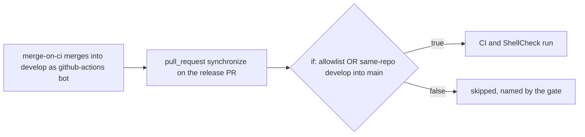

# The release pull request's CI runs on a bot-pushed head

## Intent

`ci.yml` and `shellcheck.yml` run a `pull_request` event only for an
actor on `REPOACH_ALLOWED_ACTORS`, so that untrusted pull request code
never runs on the self-hosted runner. The release pull request
`develop` → `main` is synchronised by whoever last pushed `develop`,
and since the event-driven gate merges with the Actions token that is
`github-actions[bot]`: on #307 both workflows concluded `skipped`, the
check runs read `skipped` under unexpanded names, and the owner had to
close and reopen the pull request to get a real run. The code on that
head is `develop`'s, merged through the gate and already run by `ci.yml`
on every push to `develop`; admitting it exposes nothing new. This spec
admits the bot actor on exactly that event, in one clause the same for
both workflows, judged by a test over the YAML.

## Context

Measured 2026-11-17 on `origin/develop` `5cea5a7`.

| # | Fact | Where |
|---|---|---|
| F1 | Every job of `ci.yml` and the one job of `shellcheck.yml` carries `if: github.event_name != 'pull_request' \|\| contains(fromJSON(vars.REPOACH_ALLOWED_ACTORS \|\| '["jwfaye"]'), github.actor)`; the comment: "Untrusted PR code runs on a self-hosted runner: gate pull_request events to the maintainer allowlist" | `.github/workflows/ci.yml:29-35,120-122`; `.github/workflows/shellcheck.yml:24-32` |
| F2 | Release PR #307 (`develop` → `main`, head `79b9321`): `CI` run 44071742332 and `ShellCheck` run 44071742312 (`pull_request`, 11:11Z) concluded `skipped`, every job `skipped` with `steps: 0`; after the owner's close/reopen, runs 44081266335 and 44081266349 (12:14Z) concluded `success`. The head commit is the squash merge of #308, committed by `web-flow`; the push to `develop` that synchronised #307 was the gate's merge | `gh run list --commit 79b9321`; `gh api repos/repoachhq/repoach/actions/runs/44071742332/jobs`; `gh api repos/repoachhq/repoach/commits/79b9321` |
| F3 | `merge-on-ci.yml` admits `github-actions[bot]` as the actor of a completed run for the same reason, with the same argument: the merge is re-verified at head, never trusted from the event | `.github/workflows/merge-on-ci.yml:68-77` |
| F4 | After SP-CI-JOBS-NO-OP-WHEN-NOT-AFFECTED (owner decision O2), `ci.yml` runs on `push` to `main` and `develop` with the full set; every commit of `develop` therefore runs on the self-hosted runner on the day it lands, as a trusted `push` event | `docs/specs/2026-11-16_SP-PR-RUNS-AFFECTED-JOBS_*.md`, decision g; `.github/workflows/ci.yml:4-9` |
| F5 | `docs/releasing.md` and the delivery state record the workaround: "fix = gh pr close + reopen (actor jwfaye) gives real runs" | the delivery state of 2026-11-17, section 8 |
| F6 | The release gate reads `ci_green` as a fact; under SP-SKIPPED-REQUIRED-CHECK-IS-NOT-GREEN a skipped run is `required_check_failed`, so without this spec every release pull request opens red until a close/reopen | `src/repoach/cli/release_cmds.py:176`; SP-SKIPPED-REQUIRED-CHECK-IS-NOT-GREEN D1 |

## Decisions (2026-11-17)

- D1. One more clause, the same in both files (umbrella Q4):

  ```yaml
  if: >-
    github.event_name != 'pull_request'
    || contains(fromJSON(vars.REPOACH_ALLOWED_ACTORS || '["jwfaye"]'), github.actor)
    || (github.actor == 'github-actions[bot]'
        && github.event.pull_request.head.repo.full_name == github.repository
        && github.event.pull_request.head.ref == 'develop'
        && github.event.pull_request.base.ref == 'main')
  ```

  Admitted: the bot, on a pull request whose head is this repository's
  `develop` and whose base is `main`. Nothing else changes: a fork, a
  feature branch pushed by the bot, any other actor keep today's rule.
- D2. The branch names are the committed ones, not `vars`: `develop`
  and `main` are the integration and release branches of
  `repoach.toml` (`[repoach].integration_branch`) and of the rulesets;
  a workflow `if` cannot read `repoach.toml`, so the literal is held
  equal to the config by the test (T3).
- D3. The procedure line is removed: `docs/releasing.md` no longer
  tells the owner to close and reopen; it says the pull request's `CI`
  runs on its own and what to do when it does not (read the actor of
  the skipped run).
- D4 (owner, 2026-11-17). O4: `github-actions[bot]` is admitted by the
  `if` clause of D1 only, for the same-repo `develop` → `main` pull
  request; the close/reopen procedure goes. Last of the four to be
  implemented, after PR #310 has merged (SP-GATE-NAMES-FORMAT-SKEW
  decision f; A2).

## End state

The next release pull request opens with `CI` and `ShellCheck` running
on its bot-merged head, `pull_request` event, conclusion `success`, no
close/reopen; `repoach release gate` reads `ci_green: true` on the first
try. The allowlist still refuses every other actor on `pull_request`.

## Easy solution rejected

Keep the close/reopen as the written procedure (F5). Rejected: it is a
manual step to obtain the gate's own evidence, taken on every release
(six in fifteen days), and once SP-SKIPPED-REQUIRED-CHECK-IS-NOT-GREEN
lands the release pull request opens red every time (F6), with a red
whose cause is the actor of a merge the gate made itself.

Also rejected: merging with a personal token in `merge-on-ci.yml` so
the actor is the owner (every merge then carries the owner's identity
and a long-lived secret the workflow does not need today); and
`pull_request_target` for the release pull request (it runs the base's
workflow with write permissions on a head's code, the pattern the
allowlist exists to avoid).

## Hard part

Saying exactly what is trusted. The allowlist's purpose is that code
nobody vetted never runs on the owner's machine with the owner's
runner. A head that is this repository's `develop` is code the gate
merged: reviewed, CI-green on its own pull request, and run again as a
`push` on `develop` (F4). The clause therefore adds no code to the set
that already runs; it only lets the `pull_request` event of the release
report what the `push` event already proved. The three conjuncts are
each load-bearing: `head.repo.full_name` excludes a fork's `develop`,
`head.ref == 'develop'` excludes a bot-pushed feature branch, `base.ref
== 'main'` excludes a bot-opened pull request into `develop`. T1 holds
all three present in every job of both files.

## Goals

- G1: the release pull request's `CI` and `ShellCheck` run on a bot-pushed head, `pull_request` event, without a manual toggle.
- G2: the allowlist admits nothing else new: a test enumerates the clause's conjuncts in every job.

## Non-Goals

- NG1: no change to the review workflow's allowlist (`auto-review.yml`): the release pull request is not reviewed by the bots, and that workflow mounts the provider keys (SP-CI-SECRETS-ISOLATION).
- NG2: no change to the coder fix loop's `action_required` handling of bot-pushed feature heads (SP-CI-FIX-LOOP-CLOSURE).
- NG3: no new runner, token or variable.

## Assumptions

- A1: GitHub evaluates `github.event.pull_request.head.repo.full_name`, `head.ref` and `base.ref` in a job `if` on `pull_request` events (documented context fields; the test cannot run GitHub, so C1 is the live oracle).
- A2: SP-CI-JOBS-NO-OP-WHEN-NOT-AFFECTED (#310) lands first; this spec edits the same `if` lines of `ci.yml` and would otherwise conflict.

## Interface

No code interface. Two workflow files gain the clause of D1 in every
job `if`; `docs/releasing.md` loses the close/reopen step.

```python
# tests/unit/test_ci_admits_the_release_head.py (tree judge: reads the YAML from the repository root)
def test_every_pull_request_job_admits_the_same_repo_develop_head_into_main() -> None: ...
def test_no_other_actor_is_admitted() -> None: ...          # the `if` is exactly the three alternatives, no fourth
def test_the_branch_literals_match_the_config() -> None: ...  # 'develop' == [repoach].integration_branch; 'main' == the release branch named in docs/releasing.md
```

## Behavior

### Nominal
A push to `develop` by the gate synchronises the open release pull
request; `CI` and `ShellCheck` run, conclude on their own merits.

### Edge cases
- a fork whose branch is named `develop` opens a pull request into `main` → `head.repo.full_name` differs → skipped, as today.
- the bot pushes a feature branch (coder fix loop) → `head.ref != 'develop'` → today's rule (`action_required`, released by the loop).
- the owner pushes `develop` by hand → admitted by the allowlist, as today.

### Failure scenarios
- GitHub changes the context field names → the clause is false, the run is skipped, and SP-SKIPPED-REQUIRED-CHECK-IS-NOT-GREEN names it `required_check_failed: …=SKIPPED` on the release gate instead of reading it green; the fix is the clause, not the gate.

## Tests

| # | File | Test | Mutation that turns it red |
|---|---|---|---|
| T1 | `tests/unit/test_ci_admits_the_release_head.py` | every job of `ci.yml` and `shellcheck.yml` has an `if` whose text, whitespace-normalised, holds the allowlist clause and the three conjuncts of D1 | drop `head.repo.full_name` from one job |
| T2 | same | the `if` holds exactly three `\|\|` alternatives (no fourth admission) | add `\|\| github.actor == 'github-actions[bot]'` alone |
| T3 | same | the literals `'develop'` and `'main'` equal `[repoach].integration_branch` of `repoach.toml` and the release branch `docs/releasing.md` names | change one literal |
| T4 | same | `docs/releasing.md` holds no "close" + "reopen" procedure line and names this spec | restore the line |

## Success conditions

- C1 (external oracle: the forge): the first release pull request after this lands has `gh run list --commit <head> --workflow CI --event pull_request --json conclusion,actor` showing `success` with actor `github-actions[bot]`, and `gh api repos/repoachhq/repoach/issues/<n>/events --jq '.[].event'` holds no `closed`/`reopened` pair; the pull request number and run id are written beside this line.
- C2 (external oracle: the forge, the negative): a throwaway fork pull request, or a bot-pushed feature branch's `pull_request` run after the change, is `skipped` as before (`gh run list --commit <head> --json conclusion`); the verifier cites one such run, or writes that none occurred and judges T2 instead.
- C3: `pytest -q tests/unit/test_ci_admits_the_release_head.py tests/unit/test_affected_workflow_wiring.py tests/unit/test_ci_checkname_sync.py` green; the `ShellCheck` workflow green on the branch (no shell is edited, the YAML is); `repoach arch check --base origin/develop` → `edge-honesty: ok`.

## Architecture Impact
- Adds dependency: SP-RELEASE-PR-CI-RUNS-FOR-THE-BOT-ACTOR -> SP-CI-JOBS-NO-OP-WHEN-NOT-AFFECTED (`ci.yml` is that spec's file; this one edits its job conditions after it lands)
- `shellcheck.yml`, `docs/releasing.md` are frontier. No code, no table, no cycle.

## Diagram


## Acceptance Criteria
- [ ] AC1: `pytest -q tests/unit/test_ci_admits_the_release_head.py` → green. Today: no such file.
- [ ] AC2: `pytest -q tests/unit/test_affected_workflow_wiring.py tests/unit/test_ci_checkname_sync.py` → green with the clause added.
- [ ] AC3: `repoach arch check --base origin/develop` → `edge-honesty: ok`.

## Open Questions
- None. The owner decided O4 (the `if` clause) on 2026-11-17 as recommended, recorded in D4; approved with the family (SP-GATE-NAMES-FORMAT-SKEW decision g).
