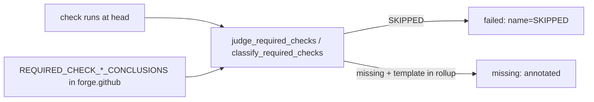

# A required check that never ran is a named failure

## Intent

Both GitHub readers of the required checks count `SKIPPED` as a
success conclusion. A job whose `if` is false (an actor outside the
allowlist, a fork) or whose `needs` failed is reported `skipped` by
GitHub, so the merge gate reads a check that produced no verdict as
green. Today the gate fails closed on such a head by accident only: the
matrix jobs report under their unexpanded template name, so the
expanded names are `missing`; a required job without a matrix
(`wheel-build`, and `gate` once SP-CI-JOBS-NO-OP-WHEN-NOT-AFFECTED
lands) is already read green. This spec makes a `SKIPPED` required
check a failure named `<name>=SKIPPED`, as the GitLab forge already
does, in one constant both readers share, and makes the template-name
fact readable in the refusal.

## Context

Measured 2026-11-17 on `origin/develop` `5cea5a7`.

| # | Fact | Where |
|---|---|---|
| F1 | `_SUCCESS_CONCLUSIONS = frozenset({"SUCCESS", "NEUTRAL", "SKIPPED"})` in `merge_wait.py` and, a second copy, in `forge/github.py`; `judge_required_checks` counts a success conclusion green and `classify_required_checks` `continue`s on it | `src/repoach/review/merge_wait.py:83-85,215-224`; `src/repoach/forge/github.py:95-98,250-258` |
| F2 | The GitLab forge reads `skipped` as a failure: `_PIPELINE_FAILURE = frozenset({"failed", "canceled", "skipped"})` | `src/repoach/forge/gitlab.py:96-97` |
| F3 | Release PR #307, head `79b9321`: `CI` run 44071742332 (`pull_request`, actor `github-actions[bot]`, 2026-11-17 11:11Z) concluded `skipped`; its five jobs have `steps: 0` and conclusion `skipped`. The commit's check runs for that run: `Test suite (Python ${{ matrix.python-version }})` `skipped`, `wheel-build` `skipped` twice (two `wheel-build` check runs, the second a re-queue), `wheel-smoke (${{ matrix.python-version }})` `skipped` twice. The later run 44081266335 (actor `jwfaye`, 12:14Z) reports `Test suite (Python 3.11)`, `(3.13)`, `wheel-build`, `wheel-smoke (3.11)`, `(3.13)` `success` | `gh api repos/repoachhq/repoach/commits/79b9321150c9bb88aa79f6d96aeef238d9c45395/check-runs`; `gh api repos/repoachhq/repoach/actions/runs/44071742332/jobs` |
| F4 | Replaying F3's skipped run alone against the five names with today's code: `wheel-build` green, the four matrix names `missing` → `required_check_missing`, exit 5 (SP-MERGE-EXIT-CONTRACT). With `gate` in the list (six names after #310), `gate` would read green too | `src/repoach/review/merge_wait.py:162-237`; `src/repoach/review/auto_merge.py:360-366` |
| F5 | `classify_required_checks` keeps the latest `startedAt` per name; `judge_required_checks` ignores `CANCELLED` runs when a live one exists and names `cancelled` when none does. Neither reads a name that is not required, so a template name present in the rollup (`wheel-smoke (${{ matrix.python-version }})`) is invisible | `src/repoach/forge/github.py:236-245`; `src/repoach/review/merge_wait.py:196-210` |
| F6 | SP-PR-RUNS-AFFECTED-JOBS A2 relies on a job whose **steps** are skipped concluding `success`; that is a different conclusion from a **job** skipped by `if` or `needs`, which is `skipped` | `docs/specs/2026-11-16_SP-PR-RUNS-AFFECTED-JOBS_*.md`, A2; F3 |

## Decisions (2026-11-17)

- D1. A non-judgement is a failure. `SKIPPED` leaves the success set
  and joins the failure set in one constant, `REQUIRED_CHECK_FAIL_CONCLUSIONS`
  and `REQUIRED_CHECK_SUCCESS_CONCLUSIONS`, defined in
  `src/repoach/forge/github.py` and imported by `merge_wait.py`
  (which already imports `DEFAULT_REQUIRED_CHECK_NAMES` from there);
  the two private copies are deleted. `NEUTRAL` stays a success: it is
  what a check posts when it has nothing to say about the head, a
  verdict.
- D2. The reason names it: `required_check_failed: wheel-build=SKIPPED
  (the job never ran: a false job condition or a failed need)`. The
  outcome stays `SKIP_CI_FAILED`, exit 5, recorded in the attempts
  comment like any failed check. No new outcome tag: a skipped check
  re-arms exactly as a failed one does, by a new run at the head.
- D3. The template name is read as a fact. When a required name is
  `missing` and the rollup holds a name containing `${{` whose prefix
  before ` (` equals the missing name's prefix, the `missing` entry
  carries it: `wheel-smoke (3.11): missing; the job reported unexpanded
  as "wheel-smoke (${{ matrix.python-version }})"=SKIPPED`. The verdict
  state is unchanged (`missing`, or `failed` when D1 also applies);
  only the line a person reads changes.
- D4. The fixture is the live head. `tests/fixtures/check_runs/head_79b9321_skipped.json`
  holds the check runs of F3's skipped run, recorded from the forge
  answer and reduced to `name`, `status`, `conclusion`, `started_at`,
  `completed_at`, `head_sha` and the workflow name (no URLs, no ids,
  no tokens); `head_79b9321_green.json` holds the later run's. The
  test replays both.
- D5 (owner, 2026-11-17). Approved with the family
  (SP-GATE-NAMES-FORMAT-SKEW decision g); first of the four to be
  implemented, as a live defect (decision f).

## End state

On a head whose `CI` run was skipped, `repoach review gate <n>` and
`review merge <n>` print `required_check_failed: Test suite (Python
3.11): missing; the job reported unexpanded …, wheel-build=SKIPPED …`
and record `SKIP_CI_FAILED`; nothing on that head reads green. The
fork pull request, the bot-actored head and a failed `needs` all land
on the same named line. The GitHub and GitLab forges agree on what
`skipped` means. `SKIPPED` appears in exactly one constant.

## Easy solution rejected

Leave `SKIPPED` green and rely on the matrix accident of F4: the
expanded names stay `missing`, so the gate fails closed anyway.
Rejected: SP-CI-JOBS-NO-OP-WHEN-NOT-AFFECTED adds `gate`, a required
job with no matrix, and `wheel-build` already has none; a head whose
required jobs were all skipped and whose list held no matrix job would
read green. A rule that holds only while the workflow keeps a matrix is
not a rule.

Also rejected: a new state `skipped` with its own outcome tag
(`SKIP_CI_SKIPPED`). A skipped check and a failed check re-arm the
same way and hold the merge the same way; a fourth bucket adds a
vocabulary for no decision. The word `SKIPPED` is in the reason line
(D2), which is where a person reads it.

## Hard part

Telling a non-judgement from a judgement in a rollup that carries
both. A matrix job that never expands reports once, under its
template name, with `skipped`; the same head, after a re-run that did
expand, carries the expanded names too. `classify_required_checks`
collapses duplicates per **name** by `startedAt`, so the template name
and the expanded names never collide and the later green run wins on
each expanded name — which is right. D3 therefore only annotates a
`missing` name; it never promotes a template-name entry into a verdict
on the expanded names, because a skipped template entry and a later
green expanded entry both exist on F3's head and the green one is the
truth.

## Goals

- G1: a `SKIPPED` required check is `failed`, named, in both readers (`judge_required_checks`, `classify_required_checks`), from one constant.
- G2: the F3 skipped-run fixture replays as `failed` with `wheel-build=SKIPPED` and four `missing` names annotated with their template; the F3 green-run fixture replays as `green`; the two fixtures together (one head, both runs) replay as `green`.
- G3: `grep -rn '"SKIPPED"' src/repoach` finds exactly one definition.

## Non-Goals

- NG1: no change to how `CANCELLED` is read (a cancelled run is a cancelled run, SP-AUTO-MERGE-WAITS-FOR-CHECKS-NOT-ITSELF).
- NG2: no change to `expand_job_names`; a `ci.yml` shape the expander does not know still yields a `missing` name, already a named refusal.
- NG3: no change to the GitLab forge (F2).
- NG4: no change to the actor allowlist; that is SP-RELEASE-PR-CI-RUNS-FOR-THE-BOT-ACTOR.

## Assumptions

- A1: GitHub reports a job skipped by `if` or by `needs` with conclusion `skipped`, and a matrix job that never expanded under its template name (F3; SP-PR-RUNS-AFFECTED-JOBS F10).
- A2: a job whose every step is skipped concludes `success` (F6), so the no-op legs of SP-CI-JOBS-NO-OP-WHEN-NOT-AFFECTED are unaffected.

## Interface

```python
# src/repoach/forge/github.py
REQUIRED_CHECK_FAIL_CONCLUSIONS: frozenset[str]      # {"FAILURE", "SKIPPED", "TIMED_OUT", "ACTION_REQUIRED", "STARTUP_FAILURE", "STALE"}; never CANCELLED:
                                                     # classify_required_checks adds it locally (a cancelled check fails there),
                                                     # judge_required_checks keeps its own `cancelled` bucket (unchanged)
REQUIRED_CHECK_SUCCESS_CONCLUSIONS: frozenset[str]   # {"SUCCESS", "NEUTRAL"}
SKIPPED_NOTE: str = "the job never ran: a false job condition or a failed need"
def classify_required_checks(rollup, required_names=...) -> tuple[list[str], list[str], list[str]]: ...
    # unchanged signature; a SKIPPED required name lands in `failed` as f"{name}=SKIPPED ({SKIPPED_NOTE})"

# src/repoach/review/merge_wait.py
def judge_required_checks(check_runs, required, head_sha, *, producers=None) -> RequiredChecksVerdict: ...
    # unchanged signature; SKIPPED -> failed as above; a missing name whose template is in the rollup
    # is listed as f'{name}: missing; the job reported unexpanded as "{template}"={conclusion}'
def template_of(name: str, rollup_names: Iterable[str]) -> str | None: ...
    # the rollup name containing "${{" whose prefix before " (" equals name's, else None
```

`RequiredChecksVerdict.note()` and `evaluate_ci_gate`'s reasons carry
the new lines unchanged in shape: `required_check_failed: <a>, <b>` and
`required_check_missing: <a>, <b>`.

## Behavior

### Nominal
A head with the six expanded names `success` → `green`, as today.

### Edge cases
- a required name whose latest run is `SKIPPED` → `failed`, `name=SKIPPED (…)`.
- a required name whose runs are a `SKIPPED` template entry only → the expanded names are `missing`, each annotated with the template (D3).
- the same head carries a skipped template entry and later green expanded entries → `green` (F5: per-name latest wins; the template name is not required).
- `NEUTRAL` → `green` (D1).

### Failure scenarios
- a rollup entry with an empty conclusion and a terminal status → `failed` as `name=EMPTY` (unchanged).
- the rollup is empty → every required name `missing` (unchanged).

## Tests

| # | File | Test | Mutation that turns it red |
|---|---|---|---|
| T1 | `tests/unit/test_skipped_required_check.py` | `judge_required_checks` on `head_79b9321_skipped.json` with the five names → state `failed`, `failed == ["wheel-build=SKIPPED (…)"]`, four `missing` lines each holding `${{ matrix.python-version }}` | put `SKIPPED` back in the success set |
| T2 | same | `classify_required_checks` on the same fixture → `wheel-build=SKIPPED (…)` in `failed`, four `missing` | same |
| T3 | same | both fixtures concatenated (one head, two runs) → `green` in both readers | drop the per-name latest-wins rule |
| T4 | same | the two constants are imported by `merge_wait`, not redefined: `merge_wait._SUCCESS_CONCLUSIONS` does not exist and `grep` of `"SKIPPED"` over `src/repoach` is one line | re-add the private copy |
| T5 | same | `NEUTRAL` → green; `CANCELLED` only → `cancelled` (unchanged) | treat `NEUTRAL` as failed |
| T6 | same | `template_of("wheel-smoke (3.11)", [...])` → the template; `template_of("gate", [...])` → `None` | match on any `${{` |

## Success conditions

- C1 (external oracle: the forge): the fixture of D4 equals, field for field, `gh api repos/repoachhq/repoach/commits/79b9321150c9bb88aa79f6d96aeef238d9c45395/check-runs` reduced to the kept fields; the verifier re-runs the `gh api` call and diffs.
- C2 (external oracle: `repoach review gate <n>` on a live head): on the next pull request head whose `CI` run concluded `skipped` (`gh run list --commit <sha> --json conclusion` shows `skipped` and no later run), the gate prints `required_check_failed: … =SKIPPED` and the attempts comment records `SKIP_CI_FAILED`; the head and the run id are written beside this line. Head `79b9321` cannot serve: its later green run wins per name (F5). If no such head occurs before delivery, C2 is judged on T1 over the recorded fixture, and that is written here instead.
- C3: `pytest -q tests/unit/test_skipped_required_check.py tests/unit/test_merge_wait_required_checks.py tests/unit/test_review_auto_merge.py` green; `repoach arch check --base origin/develop` → `edge-honesty: ok`; `docs/merge_gate.md` carries a dated section "A skipped required check is a failed check".

## Architecture Impact
- Adds dependency: SP-SKIPPED-REQUIRED-CHECK-IS-NOT-GREEN -> SP-AUTO-MERGE-WAITS-FOR-CHECKS-NOT-ITSELF (the test imports `judge_required_checks` and `RequiredChecksVerdict` from `merge_wait.py`, that spec's file)
- `forge/github.py` is frontier (owned by no spec); the constants move there and `merge_wait.py` imports them as it already imports `DEFAULT_REQUIRED_CHECK_NAMES`. No new table, no cycle.

## Diagram


## Acceptance Criteria
- [ ] AC1: `pytest -q tests/unit/test_skipped_required_check.py` → green. Today: no such file.
- [ ] AC2: `pytest -q tests/unit/test_merge_wait_required_checks.py tests/unit/test_review_auto_merge.py` → green with `SKIPPED` moved.
- [ ] AC3: `grep -rn '"SKIPPED"' src/repoach | wc -l` → 1.
- [ ] AC4: `repoach arch check --base origin/develop` → `edge-honesty: ok`.

## Open Questions
- None. Approved by the owner on 2026-11-17 with the family (SP-GATE-NAMES-FORMAT-SKEW decision g); none of its questions touched this spec. Implemented first (decision f).
