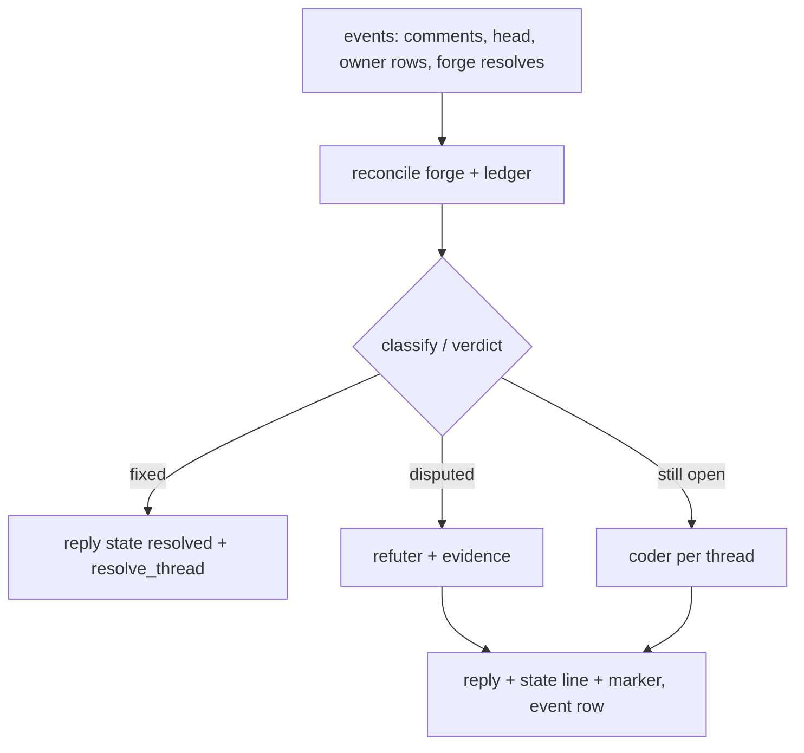

# The role that opened a thread answers in it and closes it

## Intent

Child 8b of SP-PR-THREADS-REMEMBER-AND-CLOSE. A finding's thread is
answered today by a human or by nobody: the bot posts, the author
replies, and the merge waits for a click. This spec makes the role that
raised the finding answer from the ledger row, bounded, re-verify at
each head, send a standing finding to a coder, mirror a maintainer's
`/resolve` on the forge, undo a closure by someone who may not close,
and resolve the thread when the head settles it. Two tables remember
every exchange; `repoach threads` shows them.

## Context

Measured on `origin/develop` `92cd241` (2026-11-17); parent F1–F13
hold.

| # | Fact | Where |
|---|---|---|
| F1 | Owner commands are applied by `review pr` through `apply_owner_commands` before the re-check of older heads; `/resolve` moves the finding to `owner_resolved`, `/reopen` restores it; `owner_commands` records comment id, command, login, finding id, reason, head, outcome; the forge thread is not resolved by it | `src/repoach/review/orchestrator.py:150`; `owner_commands.py:524`; `owner_store.py:48-68`; SP-OWNER-SETTLES-A-FINDING G4, NG2 |
| F2 | `detect_closed_threads` marks a `finding_posts` row closed when the forge reports its thread resolved by the bot or a maintainer (`_resolver_counts`); a thread resolved by anyone else is reported and left as it is | `finding_post_threads.py:262-300`; `finding_posts.py:372` |
| F3 | `reverify_older_findings` judges `_UNSETTLED` findings of older heads at the head: `resolved` (status `resolved_at_head`), `still_open`, `needs_judgement` | `head_reverify.py:15-18`, `:66`, `:135` |
| F4 | The refuter judges a finding from `build_evidence`'s window (cited file, grep hits, hunks, spec section), naming what the budget left out | `refuter_evidence.py:1025`, `:1100`; `refuter.py` |
| F5 | The coder path: `run_coder_fix_from_findings(pr_number, forge, repo_root, coder, db_path, ...)` takes the PR's open blocking findings, commits and pushes with `git_commit_and_push`; rounds are counted per PR in `stuck.py` under `MAX_CODER_ROUNDS = 3` | `coder_findings.py:78`, `:430-470`, `:723`; `stuck.py:48`, `:125`, `:183` |
| F6 | `opens_thread(comment)` is false for a `nit` (`NOTE`); `finding_posts` links a posted finding to its thread (`thread_id`, `root` by `in_reply_to is None`); `thread_index` joins forge roots to posts | `findings_bridge.py:87`; `finding_posts.py:74-91`, `:325-359` |
| F7 | The gate reads the forge's unresolved threads only (`OpenThreads`), fails closed when unread; `MergeFacts.open_threads` is the one stored read | `open_threads.py:51-61`; SP-OPEN-THREADS-BLOCK-THE-MERGE D7 |
| F8 | `finding_key(finding)` = `F-` + sha256(claim type, file, normalised claim)[:7], derived and stored nowhere; `finding_events` holds `reraise_suppressed` / `supersedes` per finding; both land with order row 6 (`settled.py` absent on `92cd241`) | SP-REVIEW-SETTLED-STAYS-SETTLED D11, D14; `git cat-file -e origin/develop:src/repoach/review/settled.py` → absent |
| F9 | `review pr` is the per-event run on GitHub (`pull_request_review_comment`, `issue_comment`, `pull_request_review`); on Yoob it runs in the MR pipeline, started by a push, which 8c completes with a note-started pipeline | `.github/workflows/auto-review.yml:17-30`, `:566`; SP-GITLAB-NOTE-RECEIVER |
| F10 | `thread_context.py` reads threads by the `[role/severity]` tag and posts the refutation sentinel reply (`post_refuted_finding_sentinels`, called by the orchestrator) through `_format_finding_evidence_reply`; its docstring names a writer that no longer exists | `thread_context.py:37`, `:90`, `:457`, `:582`; `orchestrator.py:1077` |
| F11 | A `pr_findings` row is per head (a re-raised finding is a new row); `FindingStatus` has ten values, `owner_resolved` and `noted` among them | `findings.py:144-153`; SP-OWNER-SETTLES-A-FINDING A2 |

## Decisions (2026-11-17; the composite's D1–D13 applied)

- D1. **One row per `(pr_number, finding_key)`**, `finding_threads`,
  created when the first `pr_findings` row of that key is posted as a
  thread (F6) and living across heads: `state` `open` / `resolved` /
  `escalated`; `resolution` `fixed` / `refuted` / `file_removed` /
  `owner_resolve` / `""`; `rounds`, `disputed_rounds`, `coder_rounds`;
  `opened_head`, `last_head`; `finding_id` (the latest row of the key
  at `last_head`); `opening_role`; `co_roles`; `summary`,
  `summary_upto_event`. The forge thread is reached through the key's
  `finding_posts` row (`thread_id`, root `comment_id`), never stored
  twice.
- D2. **One event row per exchange**, `finding_thread_events`,
  append-only, unique on `(thread_row_id, event_key)`: `kind` `opened`
  / `author_comment` / `owner_command` / `agent_reply` / `new_head` /
  `forge_resolved` / `coder_result`; `voice` `role` / `author` / `owner`
  / `coder`; `classification`; `head_sha`; `body` verbatim;
  `forge_comment_id`; `state_after`; `created_at`. It holds the
  conversation; it never copies `finding_events` (`reraise_suppressed`,
  `supersedes` stay there, F8) and `owner_commands` rows (the command is
  referenced by `event_key = owner:<comment id>` and its reason read
  from F1's table). One table per responsibility.
- D3. **The handler is one function**, `handle_thread_events(forge,
  db_path, *, pr_number, head_sha, post, judge, coder)`, called by
  `review pr` right after `apply_owner_commands` and the re-check of
  older heads (so an owner settlement and a head verdict are in the
  ledger before any thread is answered), and by `repoach threads reply
  <pr>` alone. Both paths read the same forge threads, reconcile them
  with the ledger, and handle every unhandled event in creation order.
- D4. **Classification** of an author comment by the opening role,
  contract `{"class": "fixed-at-head|disputed|question|deferral",
  "answer": "<markdown>"}`, model tier of the replies
  (SP-REVIEW-FABLE-TIER places replies on Sonnet; until it lands, the
  refuter's tier). A failed call is not a judgement: no reply, no state
  change, the event stays unhandled (SP-JUDGE-FAILURE-IS-RETRIED).
- D5. **Owner mirror.** For every applied `owner_commands` row with no
  `owner:<comment id>` event: `/resolve` → the role posts one line
  `settled by @<login>: <reason>` ending `state: resolved (owner: <reason
  cut at 120>)`, resolution `owner_resolve`, and resolves the forge
  thread; `/reopen` → `state: open`, rounds reset to 0 (`coder_rounds`
  kept), the thread unresolved. The agent applies no command (F1).
- D6. **Bounded window.** The reply context is `system` (the role's
  prompt `prompts/review/thread_reply_0.1.0.md` plus the closure
  protocol) + the replayed turns + the current `user` turn (event +
  evidence from `build_evidence`, F4). Turns are counted with the
  provider's tokenizer estimate the refuter uses; when the replay
  exceeds `thread_history_tokens_max` (12 000, SP-REVIEW-CONVERGES O9),
  the oldest turns up to the last `summary_keeps_last_turns` are folded
  by one call of the same role, contract `{"summary": "<text>"}`, into
  one `assistant` turn headed `thread summary (<n> turns, heads
  <a7>..<b7>)`, stored in `summary` / `summary_upto_event` and reused
  until the window overflows again. The finding's `finding_events` rows
  are replayed as `user` notes `[ledger] <kind>: <detail>` at their
  head's place.
- D7. **Coder per thread.** A thread whose finding is `still_open` at
  head after re-verification, not escalated, dispatches
  `run_coder_fix_from_findings` once per `(thread, head)` restricted to
  that finding (`finding_ids=[...]`, a new keyword; the function keeps
  its PR-wide default), with a brief built from the row and the last
  turns; the per-thread cap `coder_rounds_max_per_thread` is this
  spec's and is counted in `finding_threads`, beside the PR-wide
  `MAX_CODER_ROUNDS` (F5), which stays. A push of several commits goes
  on `fix/<pr>-<key7>` merged `--no-ff`; never squash, never force.
- D8. **Closer rule at the gate.** `OpenThreads` gains
  `closed_by_non_maintainer: list[ReviewThread]`, filled by
  `read_open_threads` from `review_threads` for threads whose root
  comment is the bot's (`is_bot_login`) and whose `resolved_by` is
  neither the bot nor a maintainer (`is_maintainer`, cached per login);
  `refusal()` names them `thread <root_id> at <file>:<line> resolved by
  @<login>, not a maintainer`. No ledger table is read by the gate for
  it: the forge is the oracle, so `LEDGER_FORMAT` is untouched
  (composite G5). The handler undoes the same closures (Behavior 6).
- D9. **Retire the sentinel path.** A finding the refuter refutes at
  review time is resolved in its role's name, `state: resolved
  (refuted: <why>)`, through this handler; `post_refuted_finding_sentinels`
  and the stale docstring of F10 go (`thread_context.py` keeps its
  reading for threads that predate this spec).
- D10. **Human threads** (composite D8): listed by `repoach threads`
  with role `human`, state from the forge, no rounds; never written to.

## End state

On a Yoob MR, the author writes "the guard is on line 41, not 38" under
a Sentinel finding. Within one run the Sentinel replies with the
evidence lines of head `b2c3d4e`, ends `state: open`, and
`disputed_rounds` is 1; the author pushes a fix; the next run replies
`state: resolved (fixed at e5f6a7b)` and the thread shows resolved by
the bot. On another thread a maintainer writes `/resolve covered by
tests/unit/test_x.py::test_y`; `review pr` settles the finding, the
role mirrors it, the thread is resolved. The author resolves a third
thread by hand; the gate refuses `thread 8812 at src/a.py:12 resolved
by @author, not a maintainer`, and the next run unresolves it with
`reopened: only sentinel or a maintainer closes this thread (resolved by
@author)`. `repoach threads 371 --json` lists the three.

## Easy solution rejected

Store the thread state in `finding_posts` (add `state`, `rounds` to
SP-FINDING-THREAD-IDS's table) and skip `finding_threads`. Rejected:
`finding_posts` is one row per *post*, per head; a thread lives across
heads and several posts (the re-anchoring reply, the coder's result),
and its counters would have to be copied forward at every head. Also
rejected: a reply agent that reads the forge thread as its only memory
(no event table), because the forge does not carry the verdicts, the
evidence or the coder result, and the body of a comment can be edited.

## Hard part

Three writers move the finding (re-verification, refuter, coder,
owner) while the handler decides the thread's state from it, and the
forge can be touched by a human at any time. The handler is therefore
a reconciliation, not a state machine driven by events alone: at every
run it (1) reads the forge threads and the ledger, (2) derives the
thread state the ledger implies, (3) posts and writes only the
difference, each write keyed by an `event_key` that a replay finds
already present. A reply is posted *before* its event row is written
(the marker on the forge is the durable fact; the row is the index), so
a crash between the two leaves a reply the next run recognises by its
marker and indexes without re-posting.

## Goals

- G1: posting a `minor`-or-worse finding opens one thread row and an `opened` event; a re-raised unsettled finding joins its open row (D1).
- G2: `handle_thread_events` handles each event once, classifies (D4), acts, replies with one state line and the marker, mirrors on the forge through 8a (D3).
- G3: confirmed threads dispatch the coder once per `(thread, head)`, at most `coder_rounds_max_per_thread` times, then escalate (D7).
- G4: the window of D6 is bounded and the summary stored and reused.
- G5: the gate refuses a bot thread resolved by a non-maintainer, naming it (D8).
- G6: owner settlements are mirrored (D5); the sentinel path is retired (D9).
- G7: `repoach threads <pr> [--json]` and `repoach threads reply <pr> [--dry-run] [--json]` print one JSON document on stdout with `--json` (SP-CLI-STDOUT-ONE-JSON).
- G8: no gate table, column or enum value: `python -m repoach.review.ledger_format snapshot | jq -r '.tables|keys[]'` unchanged.

## Non-Goals

- NG1: no owner command applied here (F1); no `/wontfix`.
- NG2: no thread for a `nit` (`opens_thread` false, F6).
- NG3: no change to the refuter, the re-verification or the coder's fixing; only how they are called.
- NG4: no three-voice loop from SP-AGENT-CONTEXT-LOOP; when it lands it may replace D6's fold, as its own amendment.
- NG5: no GitLab event delivery (8c).

## Assumptions

- A1: Order rows 6 and 8a landed: `settled.finding_key`, `finding_events`, `Forge.resolve_thread`. The tests pin both modules present.
- A2: One bot identity posts for every role (composite A2).
- A3: The reply tier is the refuter's until SP-REVIEW-FABLE-TIER names Sonnet for replies.

## Interface

```python
# src/repoach/review/pr_threads.py
finding_threads: Table           # db:table:finding_threads; unique (pr_number, finding_key)
finding_thread_events: Table     # db:table:finding_thread_events; unique (thread_row_id, event_key)
class ThreadRow(BaseModel): id, pr_number, finding_key, finding_id, opening_role, co_roles: list[str], state, resolution, resolution_detail, rounds, disputed_rounds, coder_rounds, opened_head, last_head, summary, summary_upto_event, opened_at, updated_at
class ThreadEvent(BaseModel): id, thread_row_id, event_key, kind, voice, author, classification, head_sha, body, forge_comment_id, state_after, created_at
def init_threads_schema(db_path: Path) -> None: ...            # findings.py's race-proof idiom (SP-FINDINGS-INIT-RACE)
def open_thread_row(db_path, *, pr_number, finding, head_sha, role) -> ThreadRow: ...   # G1; joins an existing open row of the key
def record_event(db_path, event: ThreadEvent) -> bool: ...     # False when (thread_row_id, event_key) exists
def fetch_threads(db_path, pr_number) -> list[ThreadRow]: ...
def fetch_events(db_path, thread_row_id) -> list[ThreadEvent]: ...

# src/repoach/review/thread_reply.py
STATE_LINE_RE = r"^state: (open|resolved \((?P<reason>[^)]+)\)|escalated to owner)$"   # format:thread-state-line
def reply_marker(finding_key: str, event_key: str, round_: int) -> str: ...            # format:thread-reply-marker
class Classification(BaseModel): kind: Literal["fixed-at-head", "disputed", "question", "deferral"]; answer: str
def build_window(row, events, finding_events, *, evidence: str, budget: int) -> list[Message]: ...   # D6
def fold_summary(judge, row, events) -> str: ...                                        # D6, one call
def handle_thread_events(forge, db_path, *, pr_number, head_sha, post: bool, judge, coder) -> ThreadsRun: ...   # D3
class ThreadsRun(BaseModel): handled, replies, resolved: list[int], reopened: list[int], escalated: list[int], coder_dispatched: list[int], skipped_duplicates, refused_writes: list[str], errors: list[str]

# src/repoach/review/thread_coder.py
def dispatch_thread_coder(row, finding, events, *, head_sha, forge, repo_root, coder, db_path) -> CoderDispatch: ...   # D7, wraps run_coder_fix_from_findings(finding_ids=[finding.id])

# src/repoach/review/open_threads.py (SP-OPEN-THREADS-BLOCK-THE-MERGE's file, edited under the edge): OpenThreads.closed_by_non_maintainer; read_open_threads asks is_maintainer per resolver (D8)
# src/repoach/review/coder_findings.py (frontier): run_coder_fix_from_findings(..., finding_ids: Sequence[int] | None = None)
# src/repoach/review/orchestrator.py (SP-ORCH-DOCSTRING): calls handle_thread_events after apply_owner_commands and reverify_older_findings; TeamOutcome.threads_run
# src/repoach/cli/threads_cmds.py: `repoach threads <pr> [--forge F] [--json]`, `repoach threads reply <pr> [--forge F] [--dry-run] [--json]`; registered in cli/main.py (frontier)
```

Outputs: forge replies (each ending in the state line, then the
marker); forge resolve / unresolve calls; `finding_threads` and
`finding_thread_events` rows; `review pr` JSON key `threads`
(`ThreadsRun`); `repoach threads --json`, one row per thread with
`T<id>`, forge thread id, role, `file:line`, state, resolution, rounds,
disputed rounds, coder rounds, last head (sha7), last event.

Exit codes: `threads` 0, 2 forge or ledger unavailable; `threads reply`
0, 2 forge unavailable, 8 a write was refused (as `review pr`).

Errors: `ForgeError` (read) → nothing written, exit 2; a judge failure
→ the event is left unhandled and named in `errors`; a ledger error
escaping the handler propagates (a defect).

## Behavior

### Nominal

1. **Open.** The posting path records `finding_posts` as today and
   calls `open_thread_row` for each finding with `opens_thread` true:
   state `open`, `opened_head = last_head = head`, an `opened` event.
   A finding whose key has an `open` or `escalated` row is joined to
   it: `finding_id` and `last_head` move; if its `file:line` moved, one
   reply `re-anchored at <file>:<line> (head <sha7>)` is posted
   (`event_key head:<sha12>`).
2. **New head.** For each `open` row, the re-verification verdict (F3)
   of the row's finding: `resolved` → reply `… state: resolved (fixed
   at <sha7>)`, resolution `fixed`, `resolve_thread`; `still_open` →
   step 5; `needs_judgement` → the thread stays open and the reply
   names the reason.
3. **Author comment.** Classified (D4): `fixed-at-head` → as step 2
   at the current head; `disputed` with `disputed_rounds = 0` → the
   refuter judges with `build_evidence`; refuted → `state: resolved
   (refuted: <why>)`, the finding `refuted`, the thread resolved;
   upheld → the reply quotes the evidence lines, `state: open`,
   `disputed_rounds = 1`; `disputed` with `disputed_rounds = 1` → no
   refuter call, `state: escalated to owner`; `question` → the answer,
   `state: open`; `deferral` → at most one reply per thread and head,
   saying only a fix closes the thread; state, `rounds` and the coder
   untouched.
4. **Owner command** (D5): mirrored, no model call.
5. **Confirmed → coder** (D7): dispatched once per `(thread, head)`;
   the push is a new head, so step 2 decides. No push, or a head that
   does not settle → `coder round <n> did not settle: <reason>`,
   `state: open`; at `coder_rounds_max_per_thread` → `state: escalated
   to owner`.
6. **Forge-side resolve by a non-maintainer** (D8): `unresolve_thread`
   and one line `reopened: only <role> or a maintainer closes this
   thread (resolved by @<login>)` + `state: open`; event
   `forge-resolved:<sha12>:<login>`. A resolve by a maintainer is a
   closure: `state: resolved (owner: closed on the forge by @<login>)`,
   resolution `owner_resolve`, the finding left to
   SP-OWNER-SETTLES-A-FINDING (a maintainer who closes without
   `/resolve` leaves a blocking finding blocking: the reply says so).
7. **Bounds.** Every agent reply in steps 2–3 counts one round; at
   `agent_rounds_max_per_thread` the next qualifying event yields
   `state: escalated to owner`; an escalated thread gets no agent reply
   and is never resolved by the bot; only owner commands act on it.
8. **Refuted at review time** (D9): `state: resolved (refuted:
   <why>)`, resolution `refuted`, in the role's name.

### Edge cases

- **The author deletes the cited file** → re-verification resolves it; `state: resolved (file removed at <sha7>)`, resolution `file_removed`.
- **Two roles raise the same claim** → the same key, one row; the second role joins `co_roles`, may be quoted, cannot close.
- **A superseding finding** (SETTLED D5) → its own key is new only if the claim changed; otherwise it joins the row and the `supersedes` event is replayed from `finding_events` as a ledger note.
- **A coder push races the author's push** → the push is rejected, never forced; not a coder round; retried once at the new head after step 2.
- **Fork the coder cannot push to** (composite D13) → `coder cannot push to <fork>`, `state: escalated to owner`, `coder_rounds = 0`.
- **The thread was deleted on the forge** → the row stays; `repoach threads` shows `thread missing on forge`; the gate is unaffected (no forge thread to count); a maintainer's `/resolve #F-<key>` settles the finding and the row.
- **A crash after the reply, before the event row** → the next run finds the marker on the forge, indexes the event, posts nothing (Hard part).

### Failure scenarios

- Forge read fails → nothing written, exit 2.
- Judge call fails → event unhandled, named in `errors`, retried next run.
- Dry run → the barrier refuses every write; no `agent_reply` event stored; `refused_writes` lists them; the JSON carries the replies that would have been posted.
- Coder cannot run (no `repo_root`, GitLab job without the branch) → `coder unavailable: <why>`, `state: open`, not a coder round.

## Tests

| Test | What it pins | Mutation that must turn it red |
|---|---|---|
| `tests/unit/test_pr_threads.py::test_posting_opens_one_row_per_key_and_none_for_a_nit` | G1, NG2: 3 findings (one key shared by two roles, one `nit`) → 2 rows, the second role in `co_roles`, no row for the nit | open a row for the nit |
| `::test_reraised_unsettled_finding_joins_its_open_row_and_reanchors` | step 1 | open a second row |
| `::test_replay_posts_no_duplicate_and_indexes_an_orphan_marker` | Hard part, D2 unique key: two runs on the same forge state → 0 posts, 0 resolve calls the second time, `skipped_duplicates ≥ 1`; a reply present on the forge with no event row is indexed, not re-posted | drop the marker read |
| `::test_dry_run_writes_nothing` | failure scenario | post under dry run |
| `tests/unit/test_thread_reply.py::test_fixed_at_head_resolves_with_state_line` | step 2 | omit `resolve_thread` |
| `::test_disputed_once_then_escalated` | step 3, `disputed_rounds_before_escalation` | call the refuter twice |
| `::test_disputed_and_refuted_resolves_the_finding` | step 3 | leave the finding `verified` |
| `::test_deferral_changes_nothing_and_replies_once_per_head` | step 3, `deferral_replies_per_thread_and_head` | count a round |
| `::test_two_agent_rounds_then_escalated_and_silent` | step 7 | reply a third time |
| `::test_judge_failure_leaves_the_event_unhandled` | D4 last sentence | post a reply |
| `tests/unit/test_thread_context_window.py::test_twelve_turns_fold_into_a_stored_summary_and_last_three` | D6: 12 turns over 3 heads with a budget that fits system, the event and 3 turns → `system` + one `assistant` summary turn `thread summary (9 turns, heads <a7>..<c7>)` + the last 3 turns with `[head · timestamp]` prefixes + the current `user` turn; the summary is stored and the next reply makes no fold call | fold on every call |
| `::test_window_replays_finding_events_as_ledger_notes` | D6 last sentence: a `reraise_suppressed` row appears as `[ledger] reraise_suppressed: …` and is never written to `finding_thread_events` | copy it |
| `tests/unit/test_thread_coder_dispatch.py::test_confirmed_thread_dispatches_coder_once_per_head_restricted_to_its_finding` | D7: `finding_ids == [F.id]`, one dispatch at head A, zero on a second run at A | drop the restriction |
| `::test_two_failed_coder_rounds_escalate` | `coder_rounds_max_per_thread` | dispatch a third time |
| `::test_several_commits_go_on_a_fix_branch_merged_no_ff` | composite D11 | squash |
| `::test_fork_escalates_without_a_dispatch` | composite D13 | dispatch |
| `tests/unit/test_thread_closers.py::test_gate_refuses_a_bot_thread_resolved_by_a_non_maintainer` | D8: `OpenThreads.refusal()` names `thread <id> at <file>:<line> resolved by @author, not a maintainer`; a resolve by a maintainer or the bot passes; `is_maintainer` asked once per login | count only unresolved |
| `::test_handler_unresolves_and_names_the_closer` | step 6 | leave it resolved |
| `::test_owner_resolve_is_mirrored_on_the_forge_and_reopen_undoes_it` | D5 | resolve without the reply |
| `tests/unit/test_threads_cli.py::test_threads_table_json_and_human_rows` | G7, D10: one JSON document, a `human` row with no rounds, exit 0 on an empty PR | print a log line on stdout |
| `tests/integration/test_pr_threads_lifecycle.py::test_open_dispute_fix_resolve_end_to_end` | steps 1–3, 5 through `review pr` on the fixture forge with a fake judge and a fake coder: open at A, disputed at A (upheld), coder at A → head B, resolved at B; `finding_posts.thread_closed_by` is the bot; the gate merges | any step |
| `tests/integration/test_pr_threads_lifecycle.py::test_snapshot_lists_no_thread_table` | G8: `ledger_format.snapshot()["tables"]` has no `finding_threads` / `finding_thread_events` and equals `tests/fixtures/ledger_format/<LEDGER_FORMAT>.json` | add the table to `GATE_TABLES` |

## Success conditions

- C1 (external oracle: the forge page of a Yoob MR after this lands): on the first Yoob MR with an author reply in a finding's thread, the thread shows one bot reply whose last visible line matches `STATE_LINE_RE`, whose raw body ends with `<!-- repoach-thread:F-… event:comment:… round:1 -->`, and `glab api projects/67827362/merge_requests/<n>/discussions/<did> | jq '.notes[-1].author.username, .notes[0].resolved'` → the bot's username and the state the line says. Written beside this line with the MR number by the implementer.
- C2 (external oracle: the gate output): on a Yoob MR where the author resolved a bot thread by hand, `repoach review gate <n>` (or the Yoob `review:gate` log) prints `thread <id> at <file>:<line> resolved by @<login>, not a maintainer` and refuses; after the next `threads reply`, the thread is unresolved on the MR page and the line names `reopened: only <role> or a maintainer closes this thread`.
- C3 (oracle: the format): `python -m repoach.review.ledger_format snapshot | jq -r '.tables|keys[]'` on this branch equals the same command on `origin/develop`; `ls tests/fixtures/ledger_format/` unchanged.
- C4 (oracle: the suites): `pytest -q tests/unit/test_pr_threads.py tests/unit/test_thread_reply.py tests/unit/test_thread_context_window.py tests/unit/test_thread_coder_dispatch.py tests/unit/test_thread_closers.py tests/unit/test_threads_cli.py tests/integration/test_pr_threads_lifecycle.py tests/unit/test_open_threads_block_the_merge.py tests/unit/test_owner_commands.py tests/unit/test_ledger_format_skew.py` → green; `repoach arch check --base origin/develop` → `edge-honesty: ok`; `repoach arch graph --check 2>&1 | grep -c 'dependency cycle'` → `27`.

## Architecture Impact
- Adds dependency: SP-THREAD-REPLY-AGENT -> SP-PR-THREADS-REMEMBER-AND-CLOSE (design source and shared vocabulary)
- Adds dependency: -> SP-FORGE-RESOLVES-THREADS (`resolve_thread`, `unresolve_thread`, `ReviewThread.node_id`)
- Adds dependency: -> SP-UNIVERSAL-FORGE (`Forge`, `Comment`, `ReviewThread`, `is_bot_login`, `is_maintainer`, the barrier)
- Adds dependency: -> SP-FINDING-THREAD-IDS (`finding_posts`, `thread_index`, `mark_thread_closed`; the posting path this spec hooks)
- Adds dependency: -> SP-OWNER-SETTLES-A-FINDING (`owner_commands` rows are read for D5; `OWNER_RESOLVED`; the handler runs after `apply_owner_commands`)
- Adds dependency: -> SP-OPEN-THREADS-BLOCK-THE-MERGE (`open_threads.py` gains the closer rule, D8, an edit to its file)
- Adds dependency: -> SP-REVIEW-SETTLED-STAYS-SETTLED (`finding_key`, `fetch_finding_events`)
- Adds dependency: -> SP-REVIEW-NITS-ONE-COMMENT (declarative: a `NOTE` never reaches this spec; `opens_thread` decides)
- Adds dependency: -> SP-GATE-REVERIFIES-AT-HEAD (`reverify_older_findings` verdicts decide `fixed-at-head`)
- Adds dependency: -> SP-REFUTER-JUDGES-WHAT-IT-CAN (`build_evidence`, the refuter judges `disputed`)
- Adds dependency: -> SP-FINDINGS-INIT-RACE (`findings.py` statuses, the schema idiom the two tables are created through)
- Adds dependency: -> SP-FINDINGS-BRIDGE-DOCFIX (`opens_thread`, `normalised_claim`)
- Adds dependency: -> SP-ORCH-DOCSTRING (`orchestrator.py` calls the handler, carries `threads_run`; the sentinel call is removed)
- Adds dependency: -> SP-DRY-RUN-NEVER-POSTS (every post, resolve and unresolve goes through the barrier)
- Adds dependency: -> SP-JUDGE-FAILURE-IS-RETRIED (declarative: a failed classification is not a judgement)
- Adds dependency: -> SP-CLI-STDOUT-ONE-JSON (`threads --json` prints one document)
- Adds dependency: -> SP-DB-PATH-XDG (the CLI reads the ledger path from settings)
- Frontier edits: `coder_findings.py` (`finding_ids`), `cli/main.py` (registration); no owner, reported by the gate, not enforced.
- New shared state: `db:table:finding_threads`, `db:table:finding_thread_events` (owned here; read by no gate, G8); `format:thread-state-line`, `format:thread-reply-marker`. No cycle: nothing this spec depends on depends on it.

## Diagram


## Acceptance Criteria
- [ ] AC1: `pytest -q tests/unit/test_pr_threads.py tests/unit/test_thread_reply.py tests/unit/test_thread_context_window.py tests/unit/test_thread_coder_dispatch.py tests/unit/test_thread_closers.py tests/unit/test_threads_cli.py` → green (the tests of Tests). Today (`92cd241`): none of the files exist; `grep -rn "finding_threads\|finding_thread_events" src` → 0.
- [ ] AC2: `pytest -q tests/integration/test_pr_threads_lifecycle.py` → green.
- [ ] AC3: `pytest -q tests/unit/test_open_threads_block_the_merge.py tests/unit/test_owner_commands.py tests/unit/test_ledger_format_skew.py tests/unit/test_review_ci_mode.py::test_review_pr_json_payload_matches_documented_schema` → green with `threads` in the `review pr` JSON.
- [ ] AC4: `python -m repoach.review.ledger_format snapshot | jq -r '.tables|keys[]'` → unchanged from `origin/develop`; `repoach arch check --base origin/develop` → `edge-honesty: ok`.
- [ ] AC5: `git grep -n "post_refuted_finding_sentinels\|coder_loop._format_evidence_reply" -- src` → 0 (D9).

## Open Questions
- None.
