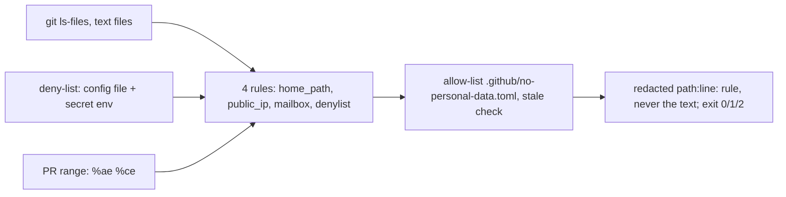

# A generic gate keeps the tree free of personal data

Amendment (0.2, 2026-11-18): the verifier's NO-GO on 0.1 re-measured.
The mailbox rule excludes scp-style remotes (21 lines at `0be2a56`
were false positives); the IPv4 rule excludes carrier NAT and
version-context tokens; `home_path` needs no trailing slash and
accepts `///home/x`; the allow-list is recounted honestly (eight
entries, the gate's own examples included) and `rule` may be a list;
the printed path is redacted too; the fixture tree's deny-list and
triple count corrected (three entries, seven triples); the fork
statement made precise.

Amendment (0.3, 2026-11-18): the verifier's NO-GO on 0.2. Stale
detection is per rule for a list-valued entry (D4), and the fixture
directory's entry lists the three rules its files exercise, not four.

## Intent

Child 3 of SP-REPO-CARRIES-NO-PERSONAL-DATA. After child 1 the tree is
clean; this gate keeps it so for every maintainer and every fork
without ever writing a maintainer's strings into the repository: the
rules are classes, the strings no class detects live in an untracked
deny-list, false positives are declared with a reason, and the output
names the class and the location, never the matched text.

## Context

### repoach, measured on `origin/develop` `0be2a56` (2026-11-18)

| # | Fact | Where |
|---|---|---|
| F1 | The tree-gate pattern: scanner module, `scripts/lint_*.py` CLI with exit 0/1/2 and a terminal `<name>: ok` line, tree suite in `[gate].pytest`, run by `gate` | `src/repoach/lint/no_inline_comments.py:51,69,97,164,172`; `scripts/lint_no_ai_attribution.py:9-21`; `tests/unit/test_no_inline_comments_gate.py:31-56`; `.github/affected-jobs.toml:3-45`; `.github/workflows/ci.yml:80-106` (four lint steps `:80-95` and the gate suites `:97-106`) |
| F2 | `rows.docs` runs no job and relies on the gate: a docs-only pull request is judged by the tree suites alone | `.github/affected-jobs.toml:47-50` |
| F3 | `.github/` is `[full]`: an edit to the allow-list runs every job | `.github/affected-jobs.toml:62-64` |
| F4 | The per-user config directory helper | `src/repoach/core/paths.py:163-170` (`user_config_dir()`) |
| F5 | `repoach.toml` refuses an unknown key at head (a new `[personal_data]` section would need the schema) | SP-HEAD-CONFIG-SKEW-IS-NAMED; `src/repoach/project/config.py` owned by SP-UNIVERSAL-PROJECT-CONFIG |
| F6 | The negative set a generic rule must not flag, all present today: `$work/home/.local/share` (`scripts/wheel_smoke.sh:64`); 21 scp-style remotes `git@gitlab.com:…` (13 lines) and `git@github.com:…` (8), every one followed by `:` and a path, 0 bare; URL userinfo `https://tok@github.com/…`, `https://s3cret@gitlab.com/…`, `https://pass@pypi.internal/…`; `127.0.0.1:8084` (`deploy/systemd/repoach-llm-proxy.service:22`); `203.0.113.9, 198.51.100.4` (`…SP-GITLAB-NOTE-RECEIVER_*.md`, Tests table); `t@example.invalid` (30), `test@example.invalid` (29), `noreply@anthropic.com` (10); three-component versions such as `8.30.1` and `0.15.20`. Absent today and pinned anyway: a carrier-NAT address (`100.64.0.0/10`, 0 lines), a bare four-component version (`4.2.1.3`: 0 lines) | `git grep` counts of the parent's F10; `git grep -c -E 'git@(github\|gitlab)\.com:'` → 21, without the `:` → 0 more |
| F7 | The positive set at `0be2a56` the generic rules of D1 flag, measured with the D1 regexes over `git ls-files`: `home_path` 8 files (the parent's F1: 6 maintainer files and 2 synthetic `HOME` values, `tests/unit/test_review_planner_cc.py:139,142`, `tests/unit/test_secret_env.py:25,38`), `public_ipv4` 1 line (`…SP-GITLAB-NOTE-RECEIVER_*.md:751`), `public_ipv6` 0, `mailbox` 0; the deny-list set: 9 files with the system login, 9 with a hostname, 42 with the handle, 10 with the layout (parent F2, F5, F7, F8) | a scanner with the D1 regexes run over the tree, 2026-11-18; the parent's table |
| F8 | The URL-userinfo exclusion already exists as a regex | `src/repoach/core/redaction.py:26` (`_URL_USERINFO`, `(?<=://)(?:(?!://)\S)+@`); the module is frontier (no owner), so the lint keeps its own copy rather than import it |
| F9 | The commit-range lint pattern (`--range BASE..HEAD`, `git rev-list`, `git log -1 --format`) | `scripts/lint_no_ai_attribution.py:51-60`; `ci.yml:84-92` passes the pull request's `base.sha..head.sha` |
| F10 | On this repository a pull request by an actor outside `REPOACH_ALLOWED_ACTORS` runs no job: `gate`'s `if` refuses it and every other job needs `gate` | `.github/workflows/ci.yml:35-39`; parent F24 |

## Decisions (2026-11-18)

- D1. **Four rules, each a class.** `src/repoach/lint/no_personal_data.py` exposes `scan_tree(root, *, allow, denylist) -> list[Finding]` and `scan_text(text, path, *, denylist) -> list[Finding]`; a `Finding` has `path`, `line`, `rule`, `reason` and no `match` field at all (D5).
  - `home_path`: `(?<![A-Za-z0-9_$.-])/(home|Users)/[A-Za-z0-9_.-]+(?![A-Za-z0-9_.-])` — an absolute home path with a user segment, trailing slash or not, so `HOME=/home/x` is a hit. The look-behind refuses `$work/home/…` (F6) and `foo/home/x/`; a `/` is not in the look-behind set, so `file:///home/x` is a hit. `/home/` alone, `~/x`, `%h/x` and `/home/<x>/` (an angle-bracket placeholder) never match.
  - `public_ipv4`: a token `(?<![\d.])(\d{1,3})\.(\d{1,3})\.(\d{1,3})\.(\d{1,3})(?![\d]|\.\d)`, every octet ≤ 255, outside `0.0.0.0/8`, `10/8`, `100.64/10` (carrier NAT), `127/8`, `169.254/16`, `172.16/12`, `192.0.0/24`, `192.0.2/24`, `192.168/16`, `198.18/15`, `198.51.100/24`, `203.0.113/24`, `224/4`, `240/4`, `255.255.255.255`; excluded when the text before it ends in a version context (`v`, `V`, `==`, `>=`, `<=`, `~=`, `!=`, `version` with an optional ` `, `:` or `=`) or the text after it starts with `-`, `+`, `.tar`, `.whl`, `.zip` or `.gz`. A bare four-component public token with no such context is a finding and, when it is a version, is declared by one allow entry: there is none in the tree today (F6). `public_ipv6`: an RFC 4291 textual address with at least two `:` groups and one hex group of 3–4 digits, outside `::1`, `::`, `2001:db8::/32`, `fe80::/10`, `fc00::/7`; a token that parses with `ipaddress.ip_address` only, so `8.30.1`, `a:b` and `12:30` never match.
  - `mailbox`: `(?<![A-Za-z0-9._%+-])[A-Za-z0-9]([A-Za-z0-9._%+-]*[A-Za-z0-9])?@([A-Za-z0-9-]+\.)+[A-Za-z]{2,}\b`, excluded when the domain is `example.com|org|net`, ends in `.invalid`, `.test`, `.example`, `.localhost`, `.internal`, is `localhost`, contains `noreply` or `no-reply` in the local part or domain, when the match sits inside URL userinfo (the F8 regex, own copy), or when the match is immediately followed by `:` and a character that is not a space or `/` (an scp-style remote `user@host:path`, F6). The local part must end in an alphanumeric, so `n+@pytest.fixture` (a decorator after a `+`) never matches.
  - `denylist`: every entry of the deny-list (D3) matched case-insensitively as a whole word with the hyphen counted as a word character (`(?<![A-Za-z0-9_-])<entry>(?![A-Za-z0-9_-])`), so a hostname entry does not flag an English compound such as `control-<entry>` (parent F5) while `<entry>.example.com`, `<entry>:` and `ssh <entry>` are hits; an entry holding a `/` (a layout such as `<dir>/<dir>`) is matched as a path fragment, same boundaries; the finding's `reason` is `deny-list entry <ordinal>`.
- D2. **The scan covers every tracked text file.** The tree is `git ls-files -z` of the root (so `tmp/`, `.venv/` and build output are never read), a file is text when its first 8 KiB holds no NUL byte, and files ending in `.png` are skipped by extension, every other binary by the NUL rule (an `.svg` is text and is scanned). Commit messages are judged by a separate mode (D7), not by the tree scan.
- D3. **The deny-list is untracked, twice.** Locally, the file `user_config_dir() / "personal-denylist"` (F4), one entry per line, `#` comments allowed; in CI, the environment variable `REPOACH_PERSONAL_DENYLIST`, newline- or comma-separated, which `gate` reads from the repository secret of the same name (`secrets.REPOACH_PERSONAL_DENYLIST`). Both sources are merged; an entry shorter than 4 characters is refused with exit 2 and the ordinal (it would match everywhere). The lint never prints an entry, never writes one anywhere, and `--print-denylist` does not exist. `.gitignore` gains nothing: the file lives outside the tree. The recommended initial deny-list (O1) has seven entries: the system login, the service account, the two hostnames, the handle, the product domain and the directory layout; the real name and the git `user.name` are not in it (parent D3), so `LICENSE`, `pyproject.toml` and the 81 `author:` lines need no allow entry.
- D4. **False positives are declared in `.github/no-personal-data.toml`** (`format:no-personal-data-allowlist`), one `[[allow]]` per declaration with `path` (a glob relative to the root), `rule` (one of the five names, or a list of them), `reason` (free text, ≥ 10 characters), and optionally `line_prefix` (the declaration applies only to lines starting with that text). The file is read with `tomllib`; a malformed file is exit 2. An entry that matched nothing in the run is reported as `stale allow entry <n>: <path> <rule>` and makes the run exit 1, so the allow-list shrinks when the tree does; an entry whose `rule` is a list is judged per rule — each listed rule must have allowed at least one finding on the entry's paths, and a listed rule that allowed none is reported as `stale allow entry <n>: <path> <that rule>` on its own line, so the author removes that rule from the list, not the entry. The initial content is eight entries, each with its measured reason: (1) `SECURITY.md`, `denylist`, attribution — the security contact; (2) `docs/languages.md`, `denylist`, attribution — the maintainer column; (3) `docs/specs/2026-11-18_SP-NO-PERSONAL-DATA-GATE_*.md`, `[home_path, public_ipv4, public_ipv6, mailbox]` — this spec's worked examples (lines of D1, D8 and the Tests table); (4) `tests/unit/test_no_personal_data_scanner.py`, the same four — the measured positive set; (5) `tests/fixtures/personal_data/**`, `[home_path, public_ipv4, mailbox]` — the synthetic tree of D8, which holds no IPv6 address; (6) `tests/unit/test_review_planner_cc.py`, `home_path` — a synthetic `HOME`; (7) `tests/unit/test_secret_env.py`, `home_path` — a synthetic `HOME`; (8) `tests/unit/test_forge_recording_redaction.py`, `home_path` — the recorder's generic-class refusal test (SP-RECORDER-REDACTS-BY-CLASS D3), which lands before this gate. `scripts/wheel_smoke.sh` needs no entry: the look-behind already excludes it, and the scanner test pins that. The terminal line counts entries used and findings allowed separately (D5).
- D5. **The output is redacted by construction, the path included.** A finding prints `<path>:<line>: <rule> (<reason>)`; the line's text is never printed, and `Finding` has no field that holds the match, so no later caller can print it. The printed path is itself passed through the deny-list: a span matching entry `n` is replaced by `[entry n]` in the output, and such a path is additionally reported as `<redacted path>:0: denylist (deny-list entry n, in the path)`, since a file name can carry a login as well as a line can. The terminal line is `personal-data: ok (<n> files, <k> findings allowed by <e> entries, <s> stale)` on exit 0, `personal-data: <k> finding(s)` on exit 1, and the error on exit 2 (`scripts/lint_no_ai_attribution.py:19-21` convention).
- D6. **Where it runs.** (a) `scripts/lint_no_personal_data.py --tree .` as a fifth lint step of `gate` in `ci.yml`, after `Lint — CONTRIBUTING cites real paths` (`:94-95`), with `env: REPOACH_PERSONAL_DENYLIST: ${{ secrets.REPOACH_PERSONAL_DENYLIST }}`, on every event (a push to `develop` or `main` is judged too, since a merge can carry what a pull request did not). (b) `tests/unit/test_no_personal_data_gate.py` in `[gate].pytest` of `.github/affected-jobs.toml`, a tree suite like `test_no_inline_comments_gate.py:41-56`, with a `MAX_FINDINGS = 0` constant and no ratchet above zero: the tree is clean on arrival (child 1). The tree suite reads the deny-list the same way, so a local `pytest` with the maintainer's file judges what CI judges. (c) `scripts/lint_no_personal_data.py --tree <dir>` over an extracted sdist and wheel in child 5. The affected-jobs table needs no new row: the lint's own files are under `src/`, `scripts/`, `tests/` (`rows.python`) and `.github/` (`[full]`), and `rows.docs` already relies on the gate (F2).
- D7. **Commit mailboxes are judged on the pull request's range.** `scripts/lint_no_personal_data.py --range <base>..<head>` reads `%ae` and `%ce` of every commit the range lists (F9 pattern) and applies the `mailbox` rule; a hit prints `commit <sha12>: mailbox (author)` or `(committer)`, never the address. `gate` passes `${{ github.event.pull_request.base.sha }}..${{ github.event.pull_request.head.sha }}` on `pull_request` like `ci.yml:84-92`. A merge commit by GitHub's noreply passes; the repository's `user.email` is already the noreply (parent F11); the 23 past commits are not in any range a pull request adds.
- D8. **The oracle that it would have caught today's tree is a fixture, not the live tree.** `tests/fixtures/personal_data/` holds a synthetic tree of eight files, written with placeholders, that reproduce the shapes of parent F1–F9: a JSON with `"corpus_root": "/home/someone/work/x"` (`home_path`); a unit with `%h/someone-layout/x`, which no class detects since `%h` is not `/home/`, caught by the entry `someone-layout` of the test's synthetic deny-list — the documented way a maintainer catches their own layout; a spec with `203.0.113.1`, `198.51.100.1`, `100.64.0.1`, `v4.2.1.3` and `pkg==4.2.1.3` (not flagged) beside `11.22.33.44`, a public address in no reserved range (flagged); a markdown with `someone@mailbox-provider.com` (flagged) beside `t@example.invalid` and `git@example.com:org/repo.git` (not); a fixture JSON with `"login": "someone-handle"` caught by a deny-list entry; a doc with `someone-host` caught by a deny-list entry, beside `control-someone-host` (not); a YAML with `'["someone-handle"]'` as a fallback, caught by the same entry; a plain file with nothing to find. Synthetic deny-list: `["someone-layout", "someone-host", "someone-handle"]`; expected findings: seven `(path, line, rule)` triples over seven files, the eighth file clean. The scanner test asserts the exact set. The verifier additionally runs the lint at `0be2a56` on their machine and writes the counts (F7: `home_path` 8 files, `public_ipv4` 1 line, `mailbox` 0, `public_ipv6` 0; with the owner's deny-list, ≥ 42 more files) beside AC2.

## End state

A pull request by an allowed actor that adds `/home/<x>`, `/Users/<x>`,
a public address, a mailbox outside the documentation domains, or a
string of the maintainer's deny-list is red in `gate` with one line per
hit, `<path>:<line>: <rule> (<reason>)`, and never the text, the path
redacted when it needs to be; a declared false positive is one
`[[allow]]` entry with a reason in `.github/no-personal-data.toml`, and
an entry nothing matches makes the gate red as stale; a maintainer's
local `pytest tests/unit/test_no_personal_data_gate.py` with their
deny-list file judges the same as CI with the secret; a fork running
the workflow in its own repository, where the secret does not exist, is
judged by the four classes; the commits a pull request adds carry no
personal mailbox.

## Easy solution rejected

A hard-coded list of the owner's strings in a test: rejected, the list
is the leak and protects one maintainer (parent). A `[personal_data]`
section in `repoach.toml`: rejected, the head config refuses unknown
keys (F5) and the schema is another spec's; the allow-list has its own
file beside the affected-jobs table (D4). A regex for "a hostname":
rejected, no generic rule separates short-hostname-shaped tokens from
identifiers; the deny-list is the honest tool for them. Printing the
matched text with a `--verbose` flag: rejected, the flag would end up
in a CI log. Gitleaks' built-in rules for personal data: rejected,
gitleaks detects secrets by entropy and prefix, not home paths or
addresses (child 4 keeps it for secrets). Excluding `git@` as a local
part: rejected, it is a fitted guard; the scp-style shape (`user@host:`
followed by a path) is the class, and it covers every one of the 21
lines (F6).

## Hard part

Every generic rule meets a negative set that today's tree is full of
(F6), and the lint must be red on the positive set (F7) without an
entry for either: the `home_path` look-behind, the IPv4 reserved
ranges and the version-context exclusion, the mailbox userinfo,
scp-remote and local-part rules are each pinned by a scanner test on
the exact strings of F6, so a rule that drifts to pass one of them is a
red test, not a quiet false negative. The second hard part is the
deny-list: the gate must judge with it in CI and locally, from two
sources, and never let one entry leave the process — hence a `Finding`
with no match field, no print path for entries, and a printed path that
is itself redacted.

## Goals

- G1: the four rules of D1 with the exclusions of D1, pinned on F6 and the fixture of D8.
- G2: the deny-list from the file and the secret, merged, never printed, the path included (D3, D5).
- G3: the allow-list format with list-valued rules and stale detection (D4).
- G4: the gate step, the tree suite in `[gate].pytest`, the range mode on pull requests (D6, D7).
- G5: the lint is callable on any directory, for child 5's artefacts (D6c).

## Non-Goals

- NG1: detecting a hostname, a handle or a layout by shape (D3 instead).
- NG2: scanning history (child 4's scanner does, for secrets; a personal string in a past commit is accepted by the owner's decision).
- NG3: a ratchet above zero: the tree is clean when this lands.
- NG4: judging a fork's own deny-list.
- NG5: running any job for a pull request by an actor outside the allow-list (F10, the existing boundary).

## Assumptions

- A1: children 1 and 2 have merged, so the live tree yields zero findings beyond the eight allow entries (otherwise this gate is red on arrival and the line stops).
- A2: `secrets.REPOACH_PERSONAL_DENYLIST` is set by the owner before this merges (O1); an unset secret is an empty deny-list, not an error, and `gate` prints `deny-list: 0 entries` so the omission is visible.
- A3: `git ls-files` lists the tree in CI (the gate checks out with `fetch-depth: 0`, `ci.yml:51-53`).

## Interface

Inputs:
- `scripts/lint_no_personal_data.py --tree <dir> [--allow <toml>]`: judge every tracked text file under `<dir>` (`git ls-files` when `<dir>` is a work tree, else every file); the allow-list defaults to `<dir>/.github/no-personal-data.toml` when present.
- `scripts/lint_no_personal_data.py --range <base>..<head>`: judge the author and committer mailboxes of the range's commits.
- `REPOACH_PERSONAL_DENYLIST`: str — newline- or comma-separated entries; `user_config_dir()/personal-denylist`: file, one entry per line.
- `.github/no-personal-data.toml`: `[[allow]]` entries `{path, rule: str | list[str], reason, line_prefix?}`.

Outputs:
- stdout: one `<path>:<line>: <rule> (<reason>)` per finding, `stale allow entry <n>: <path> <rule>` per stale entry, `deny-list: <n> entries`, `skipped: <n> binary`, then the terminal line of D5; exit 0 / 1 / 2.

Errors:
- exit 2: a deny-list entry shorter than 4 characters (`deny-list entry <n>: too short`), a malformed allow-list (`allow-list: <tomllib message>`), an unknown rule name in an entry, a range that does not resolve, a `<dir>` that is not a directory.

## Behavior

### Nominal

`gate` runs the tree lint with the secret, the range lint on the pull
request's commits, and the tree suite among the gate suites; all three
print their `ok` lines on the scrubbed tree, the tree lint with
`allowed by 8 entries, 0 stale`.

### Edge cases

- A finding on a line an allow entry covers by `path` and `rule` but whose `line_prefix` does not match → finding stands.
- Two deny-list entries where one contains the other → both reported on the same line, two ordinals.
- A deny-list entry equal to an allow-listed attribution string (the owner lists their handle) → the two attribution positions are allowed by their entries; the entry is still required for the rest of the tree, which is the point.
- A file whose name carries a deny-list entry → the path is printed with `[entry n]` in place of the span and the file is a finding at line 0 (D5).
- A binary file by the NUL rule → skipped and counted in `skipped: <n> binary`.
- A bare four-component version with no context (`pkg 4.2.1.3`) → a `public_ipv4` finding; the author writes `v4.2.1.3` or adds one allow entry with the reason.

### Failure scenarios

- The secret holds an entry of 3 characters → exit 2 before any scan, with the ordinal; the author cannot fix it in the pull request, the owner fixes the secret; the gate stays red, by design.
- `git ls-files` fails (not a work tree) → every regular file under `<dir>` is read instead, which is the extracted-sdist case of child 5.

### Operator steps

- O1 (owner, once, before this merges): create the repository secret `REPOACH_PERSONAL_DENYLIST` with the seven entries of D3, one per line; write the same lines to `$(python -c 'from repoach.core.paths import user_config_dir; print(user_config_dir())')/personal-denylist` on each of their machines. Neither file is ever added to the tree.

## Tests

| Test | What it pins | Mutation that must turn it red |
|---|---|---|
| `tests/unit/test_no_personal_data_scanner.py::test_home_path_rule_on_the_measured_negative_and_positive_set` | D1: `/home/someone/x/`, `/Users/someone/x/`, `HOME=/home/x`, `"/home/operator"` and `file:///home/someone` flagged; `$work/home/.local/share`, `foo/home/x/`, `/home/` alone, `~/x`, `%h/x`, `/home/<x>/` not | drop the look-behind, or require the trailing slash |
| `::test_public_address_rule_excludes_reserved_ranges_and_versions` | D1: `11.22.33.44`, `pkg 4.2.1.3` and `2a00:1450:4007:80e::200e` flagged; `127.0.0.1:8084`, `10.0.0.2`, `100.64.0.1`, `192.168.1.15`, `203.0.113.9`, `198.51.100.4`, `192.0.2.1`, `0.0.0.0`, `8.30.1`, `v4.2.1.3`, `pkg==4.2.1.3`, `version 4.2.1.3`, `4.2.1.3-1`, `4.3.1.2.5`, `2001:db8::1`, `::1`, `fe80::1`, `12:30` not | drop one range, or the version context |
| `::test_recorder_regexes_equal_the_gate_patterns` | D1: the three regexes copied into `scripts/record_forge_fixture.py` (SP-RECORDER-REDACTS-BY-CLASS D3) equal the scanner's patterns, so the two copies cannot diverge | unit |
| `::test_mailbox_rule_excludes_documentation_domains_userinfo_noreply_and_scp_remotes` | D1: `someone@mailbox-provider.com` and `someone@mailbox-provider.com: a sentence` flagged; `t@example.invalid`, `x@example.com`, `noreply@anthropic.com`, `12345+someone@users.noreply.github.com`, `git@gitlab.com:org/repo.git`, `git@github.com:org/repo`, `https://tok@github.com/x`, `n+@pytest.fixture`, `https://pass@pypi.internal/x` not | drop the userinfo, the scp or the local-part rule |
| `::test_denylist_merges_two_sources_and_never_appears_in_output` | D3, D5: entries from a temp `XDG_CONFIG_HOME` file and the env var are both applied, whole-word, case-insensitive, and `control-<entry>` is not a hit while `<entry>.example.com` and a `<dir>/<dir>` layout entry are; a file whose name holds an entry is printed as `[entry n]` and reported at line 0; `capsys` output contains no entry text; a 3-character entry is exit 2 with its ordinal; `Finding` has no attribute named `match` or `text` | print an entry, print the raw path, or add the field |
| `::test_allowlist_covers_declared_lines_and_reports_stale_entries` | D4: an entry with `line_prefix: "author:"` allows the `author:` line and not another line of the same file; an entry with `rule = ["home_path", "mailbox"]` allows both rules on its path and not `public_ipv4`; the same entry on a file with a home path and no mailbox → `stale allow entry 1: <path> mailbox` and exit 1, with no stale line for `home_path`; an entry nothing matches → `stale allow entry 1` and exit 1; a malformed TOML or an unknown rule name → exit 2 | apply the entry to every line or rule, or ignore a stale one |
| `::test_fixture_tree_reproduces_the_shapes_of_the_measured_tree` | D8: on `tests/fixtures/personal_data/` with the synthetic deny-list `["someone-layout", "someone-host", "someone-handle"]`, the finding set is exactly the seven expected `(path, line, rule)` triples over seven of the eight files | remove a rule, or an entry |
| `::test_range_mode_judges_author_and_committer_mailboxes` | D7: a temp repository with one commit by `someone@mailbox-provider.com` and one by `1+x@users.noreply.github.com` → one finding `commit <sha12>: mailbox (author)`, no address in the output | print `%ae` |
| `tests/unit/test_no_personal_data_gate.py::test_tree_has_no_personal_data` | D6b: `scan_tree(repo_root, allow=<the committed allow-list>, denylist=<file + env>)` → `[]`, with the eight allow entries all used | add a home path anywhere in the tree, or leave an entry stale |
| `tests/unit/test_affected_table.py` (existing, SP-AFFECTED-JOBS-TABLE) | D6b: `[gate].pytest` lists `tests/unit/test_no_personal_data_gate.py` | remove the row |
| `tests/unit/test_affected_workflow_wiring.py` (existing) | D6a: the new `gate` step is unconditional (a lint step, not gated on `job_<id>`), like the four before it | gate it on an output |

## Success conditions

- C1 (oracle: pytest, CI): `pytest -q tests/unit/test_no_personal_data_scanner.py tests/unit/test_no_personal_data_gate.py tests/unit/test_affected_table.py tests/unit/test_affected_workflow_wiring.py tests/unit/test_ci_portability.py` → green.
- C2 (oracle: the lint on a past tree, by the verifier, counts written beside AC2): `git worktree add <tmp> 0be2a56 && scripts/lint_no_personal_data.py --tree <tmp> --allow /dev/null` → exit 1 with `home_path` on 8 files, `public_ipv4` on 1 line, `public_ipv6` 0 and `mailbox` 0 (F7); with the owner's deny-list, ≥ 42 more files.
- C3 (oracle: CI log of the pull request): the `gate` job shows `deny-list: 7 entries` and `personal-data: ok (<n> files, <k> findings allowed by 8 entries, 0 stale)`; the range step shows `personal-data: ok` on the pull request's commits.
- C4 (oracle: a deliberately red pull request, closed unmerged, by the implementer, URL written beside AC3): a pull request adding one file with `HOME=/home/someone/x` is red in `gate` with exactly one finding line naming the file, the line and `home_path`, and the log does not contain the string `someone`.

## Architecture Impact

- Adds dependency: SP-NO-PERSONAL-DATA-GATE -> SP-UNIVERSAL-INSTALL (`no_personal_data.py` imports `user_config_dir` from `core/paths.py`, D3)
- Adds dependency: -> SP-AFFECTED-JOBS-TABLE (`[gate].pytest` gains one row, D6b)
- Adds dependency: -> SP-CI-JOBS-NO-OP-WHEN-NOT-AFFECTED (`ci.yml` gains one lint step and one range step in `gate`, D6a, D7)
- Adds dependency: -> SP-CONVENTIONS-GATE (the CLI and exit-code convention it set with `lint_no_ai_attribution.py`; no import)
- Adds dependency: -> SP-UNIVERSAL-PROJECT-CONFIG (the decision not to extend `repoach.toml`, F5; no import)
- New resource: `format:no-personal-data-allowlist` (D4). No table. No new cycle: the module imports `core/paths.py` only, and nothing imports the module but its CLI and its tests.

## Diagram

## Acceptance Criteria

- [ ] AC1: C1 as written; `python scripts/lint_no_personal_data.py --tree .` on the merged tree → `personal-data: ok (<n> files, <k> findings allowed by 8 entries, 0 stale)`, the line written here with its numbers.
- [ ] AC2: C2's counts written here by the verifier.
- [ ] AC3: C4's pull request URL written here; `grep -c someone <gate log>` → `0`.
- [ ] AC4: `repoach arch check --base origin/develop` → `edge-honesty: ok`; `repoach arch graph --check 2>&1 | grep -c '^dependency cycle'` → `27`; the `ownership conflict` lines are the parent's five.

## Open Questions

- None.
