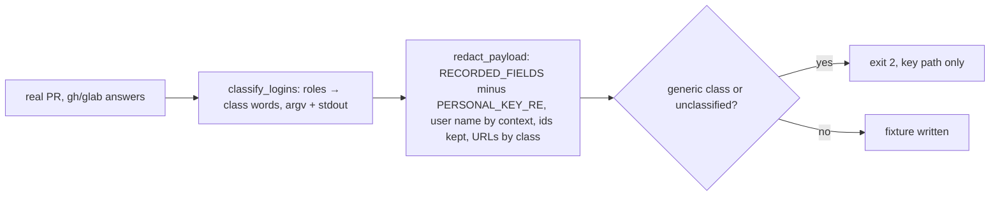

# The forge recorder redacts by class at record time

Amendment (0.2, 2026-11-18): the verifier's NO-GO on 0.1 re-measured.
The forges read `web_url` (`gitlab.py:223,982,1021`), `url`
(`github.py:501`) and `name` (`github.py:281,1776,1809`,
`gitlab.py:1016`, check-run and job names), so those keys are not
dropped: URL values are redacted by class with their path shape kept
(D1b), and `name` is dropped only inside a user object, like `id`
(D1). A test replays a redacted recording through the forge readers.

Amendment (0.3, 2026-11-18): the verifier's NO-GO on 0.2. `id` is
kept everywhere: `gitlab.py:728` builds `Review(id=_int(user.get("id")))`
from `approved_by[].user`, and `reviews_two_approvals.json` expects
11 and 12 (F1c); an id is an opaque number in none of the owner's
classes. Only `name` is dropped in a user object. The user-object keys
the readers consume are swept (F1c) and the replay test covers
approvals.

## Intent

Child 2 of SP-REPO-CARRIES-NO-PERSONAL-DATA. SP-SCRUB-PERSONAL-DATA-AT-HEAD
rewrites the recorded forge fixtures by hand to class words; this spec
makes the recorder write that shape itself, so the next
`scripts/record_forge_fixture.py` run against a real pull request
cannot bring a handle, a real name, an avatar URL or a user id back
into `tests/fixtures/forge/`.

## Context

### Measured on `origin/develop` `0be2a56` (2026-11-18)

| # | Fact | Where |
|---|---|---|
| F1 | The recorder keeps an allow-list of keys and drops everything else, recursively; `login`, `name`, `username`, `id`, `url` and `web_url` are kept | `src/repoach/forge/recording.py:32` (`RECORDED_FIELDS`), `:74` (`"login"`), `:82` (`"name"`), `:122` (`"url"`), `:124` (`"username"`), `:125` (`"web_url"`), `:142-145` (`redact_payload`) |
| F1b | The forges read `name` as a check-run or job name, `url` as a pull request's URL and `web_url` as a merge request's, a pipeline's and a job's URL; none reads `avatar_url`, `html_url`, `full_name` or `email` | `src/repoach/forge/github.py:281,1776,1809` (`entry.get("name")`, `r.get("name")`), `:501` (`payload.get("url")`); `src/repoach/forge/gitlab.py:223` (`mr.get("web_url")`), `:982` (`pipeline.get("web_url")`), `:1016` (`job.get("name")`), `:1021` (`job.get("web_url")`); `git grep -n -E '\.get\("(avatar_url\|html_url\|full_name\|email)"' src/repoach/forge` → 0 |
| F1c | The keys the readers consume from a user object (`user`, `author`, `approved_by[].user`): `login` (`github.py:239,489`), `username` (`gitlab.py:171,725`) and the numeric `id` (`gitlab.py:728`, `Review(id=_int(user.get("id")) or 0)`); no reader consumes a user's `name`. The GitLab approvals fixture expects the user ids `11` and `12`; a dropped user `id` would replay as `0` | `git grep -n -E '(user\|author)\.get\("' src/repoach/forge/{github,gitlab}.py` → those five lines; `tests/fixtures/forge/gitlab/reviews_two_approvals.json` (`"id": 11`, `"id": 12`); the GitHub GraphQL `author.id` is the user's node id (`MDQ6…`), read by nothing, present in the three fixtures of F3 |
| F2 | Secret-shaped keys are dropped by name: token, secret, password, private_key, api_key, `node_id`, email | `src/repoach/forge/recording.py:138` (`SECRET_KEY_RE`), `:191-194` (`_secret_keys`) |
| F3 | Three fixtures carry the maintainer's handle as `login`, the real name as `name` and the GitHub user node id as the `id` of the recorded `author` object | `tests/fixtures/forge/gate/pr202_capture.json:17`; `tests/fixtures/forge/github/open_pull_requests.json:24`; `tests/fixtures/forge/github/pull_request.json:19` (parent F9) |
| F4 | Twelve fixtures carry the handle, in `login`/`username` values and in recorded argv (`collaborators/<handle>/permission`, `members/all?query=<handle>`) | `tests/fixtures/forge/github/*.json` (7), `tests/fixtures/forge/gitlab/is_maintainer*.json` (4), `tests/fixtures/forge/gate/pr202_capture.json` (parent F8) |
| F5 | Replay is argv-for-argv: the first argv that differs from the recording fails the conformance suite | `src/repoach/forge/recording.py:1-13` (module docstring), `:285-300` (`ReplaySpawn.__call__`) |
| F6 | The recording script is a frontier file (no owner) and imports the recording module; the recording module is owned by SP-UNIVERSAL-FORGE | `scripts/record_forge_fixture.py:18,29-37`; `Registry.owner_of("src/repoach/forge/recording.py")` → `SP-UNIVERSAL-FORGE`, `owner_of("scripts/record_forge_fixture.py")` → `None` |
| F7 | The redaction rule the fixtures follow is SP-SCRUB-PERSONAL-DATA-AT-HEAD D1 (`format:redaction-rule`): login → class word, name and user id dropped, host → placeholder | that spec's D1 table |

## Decisions (2026-11-18)

- D1. **Personal keys are dropped by name, beside the secret keys;
  `name` by context; `id` kept everywhere.** `src/repoach/forge/recording.py`
  gains `PERSONAL_KEY_RE = re.compile(r"^(full_name|avatar_url|email|
  public_email|node_id)$", re.I)` next to `SECRET_KEY_RE` (`:138`), and
  `redact_payload` (`:142`) drops a key matching it. In an object that
  also holds `login` or `username` (a user object), `name` is dropped
  too; elsewhere `name` is kept, since the forges read it as a check-run
  or job name (F1b). `id` is kept in every object: the readers consume
  it as a user id (`gitlab.py:728`), a thread, note, comment, review or
  pipeline id (F1b, F1c), and an id — the GitLab integer or the GitHub
  node-id string alike — is an opaque identifier in none of the owner's
  five classes. The user-object keys left after D1 and D2 are exactly
  what the readers consume (`login`/`username` as a class word, `id`),
  and nothing else. `RECORDED_FIELDS` is unchanged. This is an edit to
  SP-UNIVERSAL-FORGE's file, declared in `depends_on`.
- D1b. **URL values are redacted by class, their shape kept.** A string
  value under `url`, `web_url` or `html_url` goes through
  `redact_url(value) -> str`: the scheme is kept, the host becomes
  `forge.example.com`, the namespace (every path segment before the
  repository name — the first segment on GitHub, everything before the
  last segment preceding `/-/` or the last segment on GitLab) becomes
  `org`, and the rest of the path is kept, so
  `https://<forge>/<owner>/<repo>/pull/12` records as
  `https://forge.example.com/org/<repo>/pull/12` and
  `https://<gitlab>/<group>//<repo>/-/merge_requests/7` as
  `https://forge.example.com/org/<repo>/-/merge_requests/7`. A value
  that does not parse as an `http(s)` URL is dropped. The forges pass
  these strings through (`url=str(mr.get("web_url") or "")`,
  `gitlab.py:223`), so a replayed recording yields the redacted URL
  unchanged, which the test pins by replaying through the readers.
- D2. **Logins are classified at record time.** `classify_logins(payload,
  roles: dict[str, str]) -> object` replaces, recursively, every value of
  a `login`, `username`, `author`, `resolved_by` or `user` key that is a
  string by `roles[value]`; the recorder builds `roles` from what it
  knows: the change request's author is `author`, the account whose
  `is_maintainer` call it records is `maintainer`, a login ending in
  `[bot]` is `bot`, and every further distinct login is `author-2`,
  `author-3`, … in order of first appearance. The same mapping is applied
  to the recorded argv (F4), so `collaborators/<handle>/permission`
  becomes `collaborators/maintainer/permission`, and to the recorded
  stdout before `redact_payload`.
- D3. **The recorder refuses what it cannot classify.**
  `scripts/record_forge_fixture.py` raises `UnclassifiedValueError`
  (exit 2, naming the key path, never the value) when a login-bearing
  value is not in `roles` after D2, or when any recorded string matches
  one of the generic classes of SP-NO-PERSONAL-DATA-GATE D1 (a home path,
  a public address, a mailbox outside the documentation domains): the
  three regexes are copied into the script with a comment naming their
  source, since that module lands later and the script must not import
  a module that may be absent.
- D4. **The existing fixtures already have the target shape.**
  SP-SCRUB-PERSONAL-DATA-AT-HEAD D2 rewrote them by hand to class words
  and dropped `name` and the author's `id`; this spec changes no
  fixture, and the conformance suite (`tests/unit/test_forge_conformance.py`)
  is its regression oracle: a recorder that drops a key the forges read
  would be red there.

## End state

`scripts/record_forge_fixture.py` run against a real pull request
writes a fixture in which every `login`/`username` is a class word,
no `avatar_url`, `email`, `node_id` or user `name` key exists, every
`id` is as recorded, every `url`/`web_url`/`html_url` value has the placeholder host
and namespace with its path shape kept, every argv embeds a class word
where a login stood, and the script exits 2 naming the key path when a
value stays unclassified or matches a generic class;
`tests/unit/test_forge_conformance.py` is green on the existing
fixtures unchanged, and the forge readers return the redacted URL, the
check-run names, the approvals' user ids and the class word as author
from a redacted recording.

## Easy solution rejected

Rewriting the fixtures by hand each time (what SP-SCRUB-PERSONAL-DATA-AT-HEAD
does once): rejected, the next recording brings the strings back, and
a review of a JSON diff does not catch a `name` key reliably (three
fixtures carried one for months, F3). Dropping `login` altogether:
rejected, both forges read it (`forge/recording.py:74,124` keep it
because `is_maintainer` and the thread posts compare logins). A
post-recording `sed`: rejected, it needs the strings to replace, which
is the leak. Dropping `web_url`, `html_url` and `name` by key: rejected
by measurement (F1b), the forges read the merge request's, pipeline's
and job's URL and the check-run and job names; a dropped key would
replay as an empty string and the conformance suite would pin the
regression as the expected value. Dropping a user object's `id`:
rejected by measurement (F1c), `Review(id=…)` reads it and the
approvals fixture pins 11 and 12; an id is opaque, not personal.

## Hard part

The class word must be stable across one fixture and across the suite:
a `login` in a thread's `author` and the same login in a `resolved_by`
must map to the same word, or the replayed logic (owner resolves a
finding, `tests/integration/test_owner_resolves_a_finding_end_to_end.py`)
breaks on replay; so `roles` is built once per recording from the
calls the recorder made, and the mapping is applied to argv and stdout
alike. The second hard part is that the same key is personal in one
object and functional in another: `name` is a person's in an `author`
object and a check run's elsewhere, and a URL carries the owner's
namespace in a value the forges must keep reading — so the drop of
`name` is decided by the sibling keys of the object, a URL is rewritten
to a placeholder host and namespace with its shape kept rather than
dropped, and `id` is never touched, since the readers consume it in
every object kind (F1b, F1c).

## Goals

- G1: personal keys dropped by name, the user object's `name` by context, every `id` kept, URL values redacted by class with their shape kept (D1, D1b).
- G2: logins classified at record time in argv and stdout, with a stable mapping (D2).
- G3: the recorder refuses an unclassified or generic-class value, exit 2, without printing it (D3).
- G4: the existing fixtures and the conformance suite are unchanged (D4).

## Non-Goals

- NG1: rewriting the existing fixtures (SP-SCRUB-PERSONAL-DATA-AT-HEAD D2).
- NG2: the generic lint (SP-NO-PERSONAL-DATA-GATE); this spec copies three regexes, it does not run the gate.
- NG3: redacting secrets (F2 does it already).

## Assumptions

- A1: SP-SCRUB-PERSONAL-DATA-AT-HEAD has merged, so the fixtures hold class words and the conformance suite expects them.
- A2: no forge reads `avatar_url`, `html_url`, `full_name`, `email`, or the `name` of a user object (`git grep -n -E '\.get\("(avatar_url|html_url|full_name|email)"' src/repoach/forge` → 0 at `0be2a56`; the `name` readers of F1b read check runs and jobs; the user-object readers of F1c consume `login`, `username` and `id` only — re-measured by the implementer and written beside AC1).

## Interface

Inputs:
- `classify_logins(payload: object, roles: dict[str, str]) -> object` in `src/repoach/forge/recording.py`.
- `PERSONAL_KEY_RE` and `redact_url(value: str) -> str` in `src/repoach/forge/recording.py`.
- `scripts/record_forge_fixture.py` (existing CLI, unchanged arguments).

Outputs:
- a fixture file whose every login-bearing value is a class word and that holds no personal key; or exit 2 with `unclassified: <key path>` on stderr.

Errors:
- `UnclassifiedValueError` (`scripts/record_forge_fixture.py`): a login-bearing key whose value is not in `roles`, or a string value matching a generic class; the message carries the key path, never the value.

## Behavior

### Nominal

The implementer adds D1 and D2 to the recording module, D3 to the
script, writes the test, runs the conformance suite unchanged, and
records one fixture against a real pull request to check the shape
(the fixture is not committed unless a test needs it).

### Edge cases

- A login appears only in argv (`members/all?query=<handle>`) and never in a stdout value → the recorder knows it from the call it made (`is_maintainer(<login>)`), so `roles` has it.
- A `[bot]` login → `bot`; two different bots → `bot`, `bot-2`.
- A `name` in an object with no `login`/`username` sibling → kept (a check-run or job name the forges read); an `id` anywhere → kept (user, thread, note, review, pipeline).
- A `web_url` whose path has no namespace (`https://<gitlab>/-/jobs/5`) → host replaced, path kept.

### Failure scenarios

- A value not in `roles` → exit 2, `unclassified: exchanges[3].stdout.author.login`, no fixture written.
- A stdout value holding a home path (a CI log quoted in a comment body) → exit 2, `generic class home_path at exchanges[5].stdout.body`; the recorder's author trims the body or records another pull request.

## Tests

| Test | What it pins | Mutation that must turn it red |
|---|---|---|
| `tests/unit/test_forge_recording_redaction.py::test_personal_keys_are_dropped_and_user_name_by_context_ids_kept` | D1: a payload with `avatar_url`, `node_id`, an `author` object with `id`, `login` and `name`, a thread object with `id` and `comments`, and a check-run object with `name` → the recorded object keeps the author `id`, the thread `id` and the check-run `name`, drops the author `name` and every `PERSONAL_KEY_RE` key | keep the author `name`, drop any `id`, or drop the check-run `name` |
| `::test_url_values_keep_their_shape_with_placeholder_host_and_namespace` | D1b: `https://a.example/o/r/pull/12` → `https://forge.example.com/org/r/pull/12`; `https://b.example/g/s/r/-/merge_requests/7` → `https://forge.example.com/org/r/-/merge_requests/7`; `https://b.example/-/jobs/5` → `https://forge.example.com/-/jobs/5`; a non-URL value under `web_url` → dropped | keep the host, or drop the path |
| `::test_forge_readers_work_on_a_redacted_recording` | D1b, F1b: a GitLab recording whose merge-request, pipeline and job answers carry redacted `web_url` values and job `name`s, replayed through `ReplaySpawn` into the forge's merge-request and pipeline readers → the returned `url`/`link` equal the redacted URLs and the job names are intact; a GitLab approvals answer with two `approved_by[].user` objects redacted to `username: maintainer` / `author-2` and ids `11`, `12` replayed through the reviews reader (`gitlab.py:725-728`) → two `Review`s with ids `11` and `12`; a GitHub recording's `author.login` redacted to `author` replayed through the change-request reader (`github.py:489`) → the author field is `author`, and its check-run `name`s (`github.py:281,1776`) are intact | drop `web_url`, `name` or a user `id` by key |
| `::test_logins_are_classified_in_stdout_and_argv_with_a_stable_mapping` | D2: `roles={"x": "maintainer", "y": "author"}`; `login: x` in two objects and `resolved_by: x` → `maintainer` three times; argv `["api", "repos/o/r/collaborators/x/permission"]` → `collaborators/maintainer/permission`; a `z[bot]` login → `bot` | map one occurrence differently |
| `::test_recorder_refuses_an_unclassified_or_generic_value_without_printing_it` | D3: a stdout with `login: q` not in `roles` → exit 2 and `unclassified: …login` on stderr; a body with a literal home path (`/home/<x>/y`, spelled in the test, which is allow entry 8 of SP-NO-PERSONAL-DATA-GATE D4) → exit 2 and `generic class home_path`; `capsys` holds neither `q` nor the path's user segment | print the value, or exit 0 |
| `tests/unit/test_forge_conformance.py` (existing) | D4: green on the fixtures as SP-SCRUB-PERSONAL-DATA-AT-HEAD left them | drop a key a forge reads |

## Success conditions

- C1 (oracle: pytest, CI): `pytest -q tests/unit/test_forge_recording_redaction.py tests/unit/test_forge_conformance.py tests/unit/test_review_gate_forge_parity.py` → green.
- C2 (oracle: git): `git diff origin/develop --stat -- tests/fixtures/forge` → empty (D4).
- C3 (oracle: the script, by the implementer, output written beside AC2): one recording against a real pull request → the written fixture passes `python -c` over its JSON: no key in `{avatar_url, full_name, email, public_email, node_id}` anywhere, no `name` beside a `login`/`username`, every `login`/`username` value in the class words or `author-<n>`/`bot-<n>`, every `url`/`web_url`/`html_url` value starting with `https://forge.example.com/`.

## Architecture Impact

- Adds dependency: SP-RECORDER-REDACTS-BY-CLASS -> SP-UNIVERSAL-FORGE (`src/repoach/forge/recording.py` is its; D1 and D2 edit it; the script imports it)
- Adds dependency: -> SP-SCRUB-PERSONAL-DATA-AT-HEAD (the fixture shape and the redaction rule `format:redaction-rule` this spec produces at record time, F7, D4)
- New / changed coupling, cycles, or shared state: none; this spec owns one frontier script and one new test, imported by nothing. The 27 cycles and the 5 conflicts of the parent's F20 are unchanged.

## Diagram

## Acceptance Criteria

- [ ] AC1: C1 green; C2 empty; A2's grep count written here by the implementer.
- [ ] AC2: C3's check output written here by the implementer.
- [ ] AC3: `repoach arch check --base origin/develop` → `edge-honesty: ok`; `repoach arch graph --check 2>&1 | grep -c '^dependency cycle'` → `27`; the `ownership conflict` lines are the parent's five.

## Open Questions

- None.
