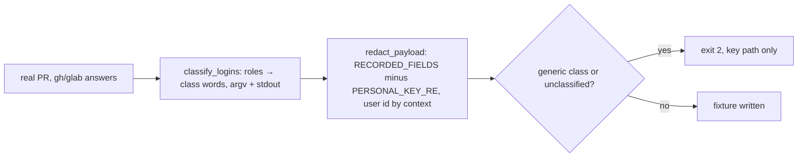

# The forge recorder redacts by class at record time

## Intent

Child 2 of SP-REPO-CARRIES-NO-PERSONAL-DATA. SP-SCRUB-PERSONAL-DATA-AT-HEAD
rewrites the recorded forge fixtures by hand to class words; this spec
makes the recorder write that shape itself, so the next
`scripts/record_forge_fixture.py` run against a real pull request
cannot bring a handle, a real name, an avatar URL or a user id back
into `tests/fixtures/forge/`.

## Context

### Measured on `origin/develop` `0be2a56` (2026-11-18)

| # | Fact | Where |
|---|---|---|
| F1 | The recorder keeps an allow-list of keys and drops everything else, recursively; `login`, `name`, `username` and `id` are kept | `src/repoach/forge/recording.py:32` (`RECORDED_FIELDS`), `:74` (`"login"`), `:82` (`"name"`), `:124` (`"username"`), `:142-145` (`redact_payload`) |
| F2 | Secret-shaped keys are dropped by name: token, secret, password, private_key, api_key, `node_id`, email | `src/repoach/forge/recording.py:138` (`SECRET_KEY_RE`), `:191-194` (`_secret_keys`) |
| F3 | Three fixtures carry the maintainer's handle as `login`, the real name as `name` and the GitHub user node id as the `id` of the recorded `author` object | `tests/fixtures/forge/gate/pr202_capture.json:17`; `tests/fixtures/forge/github/open_pull_requests.json:24`; `tests/fixtures/forge/github/pull_request.json:19` (parent F9) |
| F4 | Twelve fixtures carry the handle, in `login`/`username` values and in recorded argv (`collaborators/<handle>/permission`, `members/all?query=<handle>`) | `tests/fixtures/forge/github/*.json` (7), `tests/fixtures/forge/gitlab/is_maintainer*.json` (4), `tests/fixtures/forge/gate/pr202_capture.json` (parent F8) |
| F5 | Replay is argv-for-argv: the first argv that differs from the recording fails the conformance suite | `src/repoach/forge/recording.py:1-13` (module docstring), `:285-300` (`ReplaySpawn.__call__`) |
| F6 | The recording script is a frontier file (no owner) and imports the recording module; the recording module is owned by SP-UNIVERSAL-FORGE | `scripts/record_forge_fixture.py:18,29-37`; `Registry.owner_of("src/repoach/forge/recording.py")` → `SP-UNIVERSAL-FORGE`, `owner_of("scripts/record_forge_fixture.py")` → `None` |
| F7 | The redaction rule the fixtures follow is SP-SCRUB-PERSONAL-DATA-AT-HEAD D1 (`format:redaction-rule`): login → class word, name and user id dropped, host → placeholder | that spec's D1 table |

## Decisions (2026-11-18)

- D1. **Personal keys are dropped by name, beside the secret keys.**
  `src/repoach/forge/recording.py` gains `PERSONAL_KEY_RE =
  re.compile(r"^(name|full_name|avatar_url|web_url|html_url|email|
  public_email|node_id)$", re.I)` next to `SECRET_KEY_RE` (`:138`), and
  `redact_payload` (`:142`) drops a key matching it; the `id` key of an
  object that also holds `login` or `username` (a user object) is
  dropped too, while `id` elsewhere (a thread, a comment, a note) is
  kept, since the forges read those. `RECORDED_FIELDS` loses `"name"`
  (`:82`). This is an edit to SP-UNIVERSAL-FORGE's file, declared in
  `depends_on`.
- D2. **Logins are classified at record time.** `classify_logins(payload,
  roles: dict[str, str]) -> object` replaces, recursively, every value of
  a `login`, `username`, `author`, `resolved_by` or `user` key that is a
  string by `roles[value]`; the recorder builds `roles` from what it
  knows: the change request's author is `author`, the account whose
  `is_maintainer` call it records is `maintainer`, a login ending in
  `[bot]` is `bot`, and every further distinct login is `author-2`,
  `author-3`, … in order of first appearance. The same mapping is applied
  to the recorded argv (F4), so `collaborators/<handle>/permission`
  becomes `collaborators/maintainer/permission`, and to the recorded
  stdout before `redact_payload`.
- D3. **The recorder refuses what it cannot classify.**
  `scripts/record_forge_fixture.py` raises `UnclassifiedValueError`
  (exit 2, naming the key path, never the value) when a login-bearing
  value is not in `roles` after D2, or when any recorded string matches
  one of the generic classes of SP-NO-PERSONAL-DATA-GATE D1 (a home path,
  a public address, a mailbox outside the documentation domains): the
  three regexes are copied into the script with a comment naming their
  source, since that module lands later and the script must not import
  a module that may be absent.
- D4. **The existing fixtures already have the target shape.**
  SP-SCRUB-PERSONAL-DATA-AT-HEAD D2 rewrote them by hand to class words
  and dropped `name` and the author's `id`; this spec changes no
  fixture, and the conformance suite (`tests/unit/test_forge_conformance.py`)
  is its regression oracle: a recorder that drops a key the forges read
  would be red there.

## End state

`scripts/record_forge_fixture.py` run against a real pull request
writes a fixture in which every `login`/`username` is a class word,
no `name`, `avatar_url`, `html_url`, `web_url`, `email` or user `id`
key exists, every argv embeds a class word where a login stood, and the
script exits 2 naming the key path when a value stays unclassified or
matches a generic class; `tests/unit/test_forge_conformance.py` is
green on the existing fixtures unchanged.

## Easy solution rejected

Rewriting the fixtures by hand each time (what SP-SCRUB-PERSONAL-DATA-AT-HEAD
does once): rejected, the next recording brings the strings back, and
a review of a JSON diff does not catch a `name` key reliably (three
fixtures carried one for months, F3). Dropping `login` altogether:
rejected, both forges read it (`forge/recording.py:74,124` keep it
because `is_maintainer` and the thread posts compare logins). A
post-recording `sed`: rejected, it needs the strings to replace, which
is the leak.

## Hard part

The class word must be stable across one fixture and across the suite:
a `login` in a thread's `author` and the same login in a `resolved_by`
must map to the same word, or the replayed logic (owner resolves a
finding, `tests/integration/test_owner_resolves_a_finding_end_to_end.py`)
breaks on replay; so `roles` is built once per recording from the
calls the recorder made, and the mapping is applied to argv and stdout
alike. The second hard part is `id`: the same key is a user id in an
`author` object and a thread id elsewhere, so the drop is decided by
the sibling keys of the object, not by the key name alone.

## Goals

- G1: personal keys dropped by name and the user object's `id` by context (D1).
- G2: logins classified at record time in argv and stdout, with a stable mapping (D2).
- G3: the recorder refuses an unclassified or generic-class value, exit 2, without printing it (D3).
- G4: the existing fixtures and the conformance suite are unchanged (D4).

## Non-Goals

- NG1: rewriting the existing fixtures (SP-SCRUB-PERSONAL-DATA-AT-HEAD D2).
- NG2: the generic lint (SP-NO-PERSONAL-DATA-GATE); this spec copies three regexes, it does not run the gate.
- NG3: redacting secrets (F2 does it already).

## Assumptions

- A1: SP-SCRUB-PERSONAL-DATA-AT-HEAD has merged, so the fixtures hold class words and the conformance suite expects them.
- A2: no forge reads `name`, `avatar_url`, `html_url`, `web_url` or a user object's `id` (`git grep -n -E '\["(name|avatar_url|html_url|web_url)"\]|\.get\("(name|avatar_url|html_url|web_url)"' src/repoach/forge` → 0 at `0be2a56`, re-measured by the implementer and written beside AC1).

## Interface

Inputs:
- `classify_logins(payload: object, roles: dict[str, str]) -> object` in `src/repoach/forge/recording.py`.
- `PERSONAL_KEY_RE` in `src/repoach/forge/recording.py`.
- `scripts/record_forge_fixture.py` (existing CLI, unchanged arguments).

Outputs:
- a fixture file whose every login-bearing value is a class word and that holds no personal key; or exit 2 with `unclassified: <key path>` on stderr.

Errors:
- `UnclassifiedValueError` (`scripts/record_forge_fixture.py`): a login-bearing key whose value is not in `roles`, or a string value matching a generic class; the message carries the key path, never the value.

## Behavior

### Nominal

The implementer adds D1 and D2 to the recording module, D3 to the
script, writes the test, runs the conformance suite unchanged, and
records one fixture against a real pull request to check the shape
(the fixture is not committed unless a test needs it).

### Edge cases

- A login appears only in argv (`members/all?query=<handle>`) and never in a stdout value → the recorder knows it from the call it made (`is_maintainer(<login>)`), so `roles` has it.
- A `[bot]` login → `bot`; two different bots → `bot`, `bot-2`.
- An `id` in an object with no `login`/`username` sibling → kept (a thread or note id the forges read).

### Failure scenarios

- A value not in `roles` → exit 2, `unclassified: exchanges[3].stdout.author.login`, no fixture written.
- A stdout value holding a home path (a CI log quoted in a comment body) → exit 2, `generic class home_path at exchanges[5].stdout.body`; the recorder's author trims the body or records another pull request.

## Tests

| Test | What it pins | Mutation that must turn it red |
|---|---|---|
| `tests/unit/test_forge_recording_redaction.py::test_personal_keys_are_dropped_and_user_id_by_context` | D1: a payload with `name`, `avatar_url`, `html_url`, `node_id`, an `author` object with `id` and `login`, and a thread object with `id` and `comments` → the recorded object keeps the thread `id`, drops the author `id` and every personal key | keep `name`, or drop the thread `id` |
| `::test_logins_are_classified_in_stdout_and_argv_with_a_stable_mapping` | D2: `roles={"x": "maintainer", "y": "author"}`; `login: x` in two objects and `resolved_by: x` → `maintainer` three times; argv `["api", "repos/o/r/collaborators/x/permission"]` → `collaborators/maintainer/permission`; a `z[bot]` login → `bot` | map one occurrence differently |
| `::test_recorder_refuses_an_unclassified_or_generic_value_without_printing_it` | D3: a stdout with `login: q` not in `roles` → exit 2 and `unclassified: …login` on stderr; a body with a literal home path (`/home/<x>/y`, spelled in the test, which is allow entry 8 of SP-NO-PERSONAL-DATA-GATE D4) → exit 2 and `generic class home_path`; `capsys` holds neither `q` nor the path's user segment | print the value, or exit 0 |
| `tests/unit/test_forge_conformance.py` (existing) | D4: green on the fixtures as SP-SCRUB-PERSONAL-DATA-AT-HEAD left them | drop a key a forge reads |

## Success conditions

- C1 (oracle: pytest, CI): `pytest -q tests/unit/test_forge_recording_redaction.py tests/unit/test_forge_conformance.py tests/unit/test_review_gate_forge_parity.py` → green.
- C2 (oracle: git): `git diff origin/develop --stat -- tests/fixtures/forge` → empty (D4).
- C3 (oracle: the script, by the implementer, output written beside AC2): one recording against a real pull request → the written fixture passes `python -c` over its JSON: no key in `{name, avatar_url, html_url, web_url, email, node_id}` anywhere, no `id` beside a `login`, every `login`/`username` value in the class words or `author-<n>`/`bot-<n>`.

## Architecture Impact

- Adds dependency: SP-RECORDER-REDACTS-BY-CLASS -> SP-UNIVERSAL-FORGE (`src/repoach/forge/recording.py` is its; D1 and D2 edit it; the script imports it)
- Adds dependency: -> SP-SCRUB-PERSONAL-DATA-AT-HEAD (the fixture shape and the redaction rule `format:redaction-rule` this spec produces at record time, F7, D4)
- New / changed coupling, cycles, or shared state: none; this spec owns one frontier script and one new test, imported by nothing. The 27 cycles and the 5 conflicts of the parent's F20 are unchanged.

## Diagram

## Acceptance Criteria

- [ ] AC1: C1 green; C2 empty; A2's grep count written here by the implementer.
- [ ] AC2: C3's check output written here by the implementer.
- [ ] AC3: `repoach arch check --base origin/develop` → `edge-honesty: ok`; `repoach arch graph --check 2>&1 | grep -c '^dependency cycle'` → `27`; the `ownership conflict` lines are the parent's five.

## Open Questions

- None.
