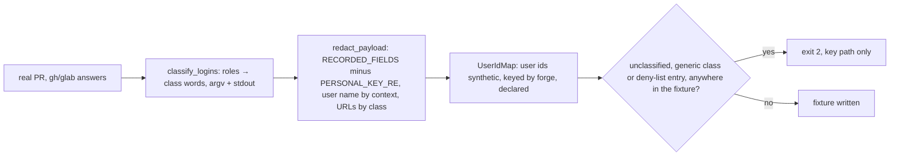

# The forge recorder redacts by class at record time

Amendment (0.2, 2026-11-18): the verifier's NO-GO on 0.1 re-measured.
The forges read `web_url` (`gitlab.py:223,982,1021`), `url`
(`github.py:501`) and `name` (`github.py:281,1776,1809`,
`gitlab.py:1016`, check-run and job names), so those keys are not
dropped: URL values are redacted by class with their path shape kept
(D1b), and `name` is dropped only inside a user object, like `id`
(D1). A test replays a redacted recording through the forge readers.

Amendment (0.3, 2026-11-18): the verifier's NO-GO on 0.2. `id` is
kept everywhere: `gitlab.py:728` builds `Review(id=_int(user.get("id")))`
from `approved_by[].user`, and `reviews_two_approvals.json` expects
11 and 12 (F1c); an id is an opaque number in none of the owner's
classes. Only `name` is dropped in a user object. The user-object keys
the readers consume are swept (F1c) and the replay test covers
approvals.

Amendment (0.4, 2026-11-18, reconstructed from git, commit `70b0cf1`
"approve the personal-data cleanup family"): status `reviewed` →
`approved`; no other line changed. The text of this entry was not recorded
at the time and is written here at 0.8 from `git diff 77817ab 70b0cf1`.

Amendment (0.5, 2026-11-18, reconstructed from git, commit `06b82c3`
"hold the recorder regexes equal to the gate and fix D2"): D3 gained
"and held equal by a test in SP-NO-PERSONAL-DATA-GATE" after "a comment
naming their source"; no other line of this spec changed. The text of this
entry was not recorded at the time and is written here at 0.8 from
`git diff 70b0cf1 06b82c3`.

Amendment (0.6, 2026-11-18, the implementer, measured on `origin/develop`
`7fd31af`): D4 was false. Parent F27: after child 1 the fixtures still
held 115 `url`/`web_url`/`html_url` values on the real forge hosts, in 33
files (`git grep -o -E '(url|web_url|html_url)\\?": \\?"https://(github\.com|gitlab\.com)' 7fd31af -- tests/fixtures/forge`
→ 115, `-l` → 33; the parent counted 34), and 149 forge-host URLs in 41
files once `api.github.com`, `link` values, argv, stdin, stderr and text
stdout are counted (`docs.*` links excluded). The namespace SCRUB wrote
(`maintainer`) is itself a real account on those hosts. So D4 and G4 are
replaced: the fixtures are rewritten by the recorder's own functions,
offline (`scripts/redact_forge_fixtures.py`, D4 below), and C2 is a fixed
point instead of an empty diff. Other claims measured wrong against the
code and corrected here: (a) `RECORDED_FIELDS` is not "every key the forges
read" — `_squash_body_from_view` reads `commits[].messageHeadline` and
`messageBody` (`github.py:170-175`); applying `redact_payload` to
`github/merge.json` dropped them and turned `test_merge[github]` red, so
the three keys are added (D1 no longer leaves `RECORDED_FIELDS` unchanged);
(b) a user object keeps `state` beside `login`/`username` and `id`
(GitLab), so "exactly what the readers consume" is false; its URL keys
(`web_url`, `html_url`, `url`, a profile link) are now dropped with `name`;
(c) GitHub's `gh pr checks` link is under `link`, a URL key the spec did not
name: `link` joins `url`/`web_url`/`html_url`; (d) URLs also stand in free
text (a `glab` error, `gh pr create` output, a check link passed as a method
argument), so text URLs are redacted too, RFC 2606 and loopback hosts kept;
(e) the hand-written placeholder logins `alice`, `bob`, `dev`, `devops` are
also real accounts, and one GitLab project-bot username names a real project
id: the transform maps them to `author-<n>` and `service`; (f) the recorder
also classifies the method's arguments and the forge's bot login (`bot`),
since replay compares argv and trust compares the bot login; the result is
recomputed by replaying the redacted exchanges. The F1 line numbers are those
of `0be2a56`.

Amendment (0.7, 2026-11-18, owner decision on O1): a user `id` is still
kept as a key, but its value is remapped to a synthetic one (D1c). The
readers consume the GitLab approval user id (`gitlab.py:728`) only as an
opaque number, so a stable synthetic value replays identically. Measured on
the fixtures at `fc8df78`: 58 user-object ids, 52 of them real, 10 distinct
accounts before and after.

Amendment (0.8, 2026-11-18, the verifier's NO-GO on `4f78a96`, every item
fixed, measured on the branch over `origin/develop` `7fd31af`):
(a) defect 1 — the test held a salted SHA-256 of the maintainer's two real
ids, and the salt was in the tree: enumerating every candidate id reverses
it in about a minute, the very argument D1c makes against a hash. The
hashes are gone from the branch's whole history (the commit that added them
was rewritten before any push); the real ids are read at test time from the
maintainer's untracked deny-list, SP-NO-PERSONAL-DATA-GATE D3's own
mechanism, and the test skips with that reason when the deny-list is absent
(D1c, D3). (b) defect 2 — End state, D1, G1 and the Hard part still said
"every id is kept/as recorded" and D1 that `RECORDED_FIELDS` was unchanged;
both were false since 0.6/0.7 and are corrected below, as is
`docs/security_posture.md`. (c) defect 3 — the offline map was keyed by
the number alone, so a GitHub and a GitLab account with the same number
merged, and `apply_known` remapped any result `id` equal to a user id seen
earlier; the map is now keyed by `(forge, id)` and a result id follows its
account only where it is one, a GitLab `Review.id` (D1c). (d) defect 4 —
one map per fixture (M11) and a sequence restarting at 1001 over the
existing 1001–1004 (M13) both survived mutation; two tests over
temporary corpora now kill them (Tests). (e) the 10000 threshold kept any
small real id silently (P2): a fixture now declares its synthetic ids under
`synthetic_user_ids`, the recorder writes the declaration, and an
undeclared id is remapped whatever its size (D1c). (f) a recorded `source`
named the checkout's folder (`m3`, the private repository's name, or the recorder's own) and D3
ran before the field existed (P1): `source` names the forge, the offline
transform rewrites the 30 that did, and D3 judges the whole fixture (D3,
D4). (g) the real-account rule was implicit and uneven — the recorder
mapped `repoach-bot` to `bot` while the offline transform kept it, and a
GitLab project bot became `bot-<n>` in one and `service` in the other
(P3): one rule, D2. (h) an `@<handle>` in free text was neither replaced
nor refused (P5): it becomes a class word, in both tools (D2). (i) the
tests outside the fixtures still held `gitlab.com/maintainer/<private repository>` and
its scp and API forms, derived from a real remote and naming the real
account `maintainer` (P4): this spec takes them on (D5). Wrong facts
corrected: AC1's C1 count was 131, the measured count was 134; the
out-of-fixture forge URLs are 56 occurrences on 54 lines (54 without the
two `docs.*` links), not 52; `LEGACY_LOGINS` also held `owner`, which D4
did not list (it is now gone: D4 states the general rule); a `test:`
commit edited this spec at 0.7 without a bump (`4f78a96`), which this entry
supersedes.

Amendment (0.9, 2026-11-18, the second verifier's NO-GO on `58b928a`, every
item fixed, measured on the branch over `origin/develop` `7fd31af`):
(a) defect 1 — the suite's autouse `_hermetic_xdg_dirs` points
`XDG_CONFIG_HOME` at a scratch directory, so under pytest `read_denylist()`
never saw `~/.config/repoach/personal-denylist`: with the real file present
(10 entries, mode 600) the deny-list test skipped, and D1c, O2 and C1, which
say the file and the variable are merged, were false under pytest. The
test now asks for `real_user_config_dir`, a session fixture of
`tests/conftest.py` that names the directory from `XDG_CONFIG_HOME` as the
process found it, before the override; `read_denylist(config_dir)` reads the
file there; every other test stays hermetic; the skip names the path it
checked (home written `~`); a test pins the file route (D1c, D3).
(b) defect 2 — `clone git@github.com:<login>/r.git` kept the login and the
real host: `_login_pattern` refused a token after `:` (to keep `:owner`),
and text URLs were `http(s)` only. An scp remote `<user>@<host>:<ns>/<repo>`
and an `ssh://`/`git://` URL now get the placeholder host, namespace and
repository in both tools; a login after `<host>:` is a token (not after `/:`
or `::`); and D3 refuses any URL or remote left on a host the redaction
rewrites (`unredacted host at <path>`). (c) preference 1 — `@pytest.fixture`,
`@dataclass` and `@property` were handles, and the bare word was then
replaced everywhere (`import dataclass` became `import author-3`): a dotted
name, a decorator call, a standard-library decorator and anything in a
Markdown code span are no handle, and a login known only from a mention is
replaced in its `@<handle>` form only (D2). (d) preference 2 — a declared
id was trusted at any value, so a real one could be declared: only
`1001..1999` is trusted, a declaration outside it is remapped, and the six
hand-written ids 0.8 declared (3, 7, 8, 9, 11, 12) are now remapped like any
real id, so the D4 reproduction declares nothing (D1c, D4). (e) preference
3 — commit `2122754` (`test(forge)`) edited this spec at 0.7 without a bump;
its row was folded into the 0.8 `docs(specs)` commit before any push. (f)
preference 4 — a login equal to a git word (`main`) is replaced in every
value, branch fields and prose included; that is the safer option and is
stated in D2. (g) preference 5 — the private project name stood in 30 URLs
and a GitLab project object of the fixtures: the repository segment of
every recorded URL is `project`, and a repository object's `name`/`path`
too (D1b). (h) preference 6 — the repository secret
`REPOACH_PERSONAL_DENYLIST` reaches the unit-test step of `ci.yml` (O2).
Wrong facts corrected: D1c, O2 and C1 said the file was read under pytest,
false until (a); D2's claim that `@pytest.fixture` in a diff "stays" held
for diffs but not for the same decorator in prose, true after (c); AC1's
C1 figure is now measured by the file route.

## Intent

Child 2 of SP-REPO-CARRIES-NO-PERSONAL-DATA. SP-SCRUB-PERSONAL-DATA-AT-HEAD
rewrites the recorded forge fixtures by hand to class words; this spec
makes the recorder write that shape itself, so the next
`scripts/record_forge_fixture.py` run against a real pull request
cannot bring a handle, a real name, an avatar URL or a user id back
into `tests/fixtures/forge/`.

## Context

### Measured on `origin/develop` `0be2a56` (2026-11-18)

| # | Fact | Where |
|---|---|---|
| F1 | The recorder keeps an allow-list of keys and drops everything else, recursively; `login`, `name`, `username`, `id`, `url` and `web_url` are kept | `src/repoach/forge/recording.py:32` (`RECORDED_FIELDS`), `:74` (`"login"`), `:82` (`"name"`), `:122` (`"url"`), `:124` (`"username"`), `:125` (`"web_url"`), `:142-145` (`redact_payload`) |
| F1b | The forges read `name` as a check-run or job name, `url` as a pull request's URL and `web_url` as a merge request's, a pipeline's and a job's URL; none reads `avatar_url`, `html_url`, `full_name` or `email` | `src/repoach/forge/github.py:281,1776,1809` (`entry.get("name")`, `r.get("name")`), `:501` (`payload.get("url")`); `src/repoach/forge/gitlab.py:223` (`mr.get("web_url")`), `:982` (`pipeline.get("web_url")`), `:1016` (`job.get("name")`), `:1021` (`job.get("web_url")`); `git grep -n -E '\.get\("(avatar_url\|html_url\|full_name\|email)"' src/repoach/forge` → 0 |
| F1c | The keys the readers consume from a user object (`user`, `author`, `approved_by[].user`): `login` (`github.py:239,489`), `username` (`gitlab.py:171,725`) and the numeric `id` (`gitlab.py:728`, `Review(id=_int(user.get("id")) or 0)`); no reader consumes a user's `name`. The GitLab approvals fixture expects the user ids `11` and `12`; a dropped user `id` would replay as `0` | `git grep -n -E '(user\|author)\.get\("' src/repoach/forge/{github,gitlab}.py` → those five lines; `tests/fixtures/forge/gitlab/reviews_two_approvals.json` (`"id": 11`, `"id": 12`); the GitHub GraphQL `author.id` is the user's node id (`MDQ6…`), read by nothing, present in the three fixtures of F3 |
| F2 | Secret-shaped keys are dropped by name: token, secret, password, private_key, api_key, `node_id`, email | `src/repoach/forge/recording.py:138` (`SECRET_KEY_RE`), `:191-194` (`_secret_keys`) |
| F3 | Three fixtures carry the maintainer's handle as `login`, the real name as `name` and the GitHub user node id as the `id` of the recorded `author` object | `tests/fixtures/forge/gate/pr202_capture.json:17`; `tests/fixtures/forge/github/open_pull_requests.json:24`; `tests/fixtures/forge/github/pull_request.json:19` (parent F9) |
| F4 | Twelve fixtures carry the handle, in `login`/`username` values and in recorded argv (`collaborators/<handle>/permission`, `members/all?query=<handle>`) | `tests/fixtures/forge/github/*.json` (7), `tests/fixtures/forge/gitlab/is_maintainer*.json` (4), `tests/fixtures/forge/gate/pr202_capture.json` (parent F8) |
| F5 | Replay is argv-for-argv: the first argv that differs from the recording fails the conformance suite | `src/repoach/forge/recording.py:1-13` (module docstring), `:285-300` (`ReplaySpawn.__call__`) |
| F6 | The recording script is a frontier file (no owner) and imports the recording module; the recording module is owned by SP-UNIVERSAL-FORGE | `scripts/record_forge_fixture.py:18,29-37`; `Registry.owner_of("src/repoach/forge/recording.py")` → `SP-UNIVERSAL-FORGE`, `owner_of("scripts/record_forge_fixture.py")` → `None` |
| F7 | The redaction rule the fixtures follow is SP-SCRUB-PERSONAL-DATA-AT-HEAD D1 (`format:redaction-rule`): login → class word, name and user id dropped, host → placeholder | that spec's D1 table |

## Decisions (2026-11-18)

- D1. **Personal keys are dropped by name, beside the secret keys;
  `name` by context; `id` kept as a key (0.8: a user object's id value is
  synthetic, D1c).** `src/repoach/forge/recording.py`
  gains `PERSONAL_KEY_RE = re.compile(r"^(full_name|avatar_url|email|
  public_email|node_id)$", re.I)` next to `SECRET_KEY_RE` (`:138`), and
  `redact_payload` (`:142`) drops a key matching it. In an object that
  also holds `login` or `username` (a user object), `name` is dropped
  too, with its URL keys (`url`, `web_url`, `html_url`, `link`);
  elsewhere `name` is kept, since the forges read it as a check-run or job
  name (F1b). The `id` key is kept in every object: the readers consume it
  as a user id (`gitlab.py:728`), a thread, note, comment, review or
  pipeline id (F1b, F1c). A thread's, note's, review's or pipeline's id
  keeps its recorded value; a user object's id value is replaced by a
  synthetic one (D1c, 0.7). A user object keeps `login`/`username` as a
  class word, `id` as a synthetic value and, on GitLab, `state` (0.6 b).
  `RECORDED_FIELDS` gains `commits`, `messageHeadline` and `messageBody`,
  which `_squash_body_from_view` reads (0.6 a); no other key is added.
  This is an edit to SP-UNIVERSAL-FORGE's file, declared in `depends_on`.
- D1b. **URL values are redacted by class, their shape kept.** A string
  value under `url`, `web_url` or `html_url` goes through
  `redact_url(value) -> str`: the scheme is kept, the host becomes
  `forge.example.com`, the namespace (every path segment before the
  repository name — the first segment on GitHub, everything before the
  last segment preceding `/-/` or the last segment on GitLab) becomes
  `org`, the repository name becomes `project` (0.9; a `.git` suffix
  kept), and the rest of the path is kept, so
  `https://<forge>/<owner>/<repo>/pull/12` records as
  `https://forge.example.com/org/project/pull/12` and
  `https://<gitlab>/<group>//<repo>/-/merge_requests/7` as
  `https://forge.example.com/org/project/-/merge_requests/7`. A value
  that does not parse as a URL of `URL_SCHEMES` (`http`, `https`, `ssh`,
  `git`) is dropped. The forges pass
  these strings through (`url=str(mr.get("web_url") or "")`,
  `gitlab.py:223`), so a replayed recording yields the redacted URL
  unchanged, which the test pins by replaying through the readers.
  (0.9) A repository's name is its owner's as much as its namespace: in a
  repository object — one whose URL names a repository and nothing under
  it, such as GitLab's `projects/:id` answer — a `name` or `path` equal to
  that repository's name becomes `project` too. In free text, an `http(s)`,
  `ssh://` or `git://` URL and an scp remote `<user>@<host>:<ns>/<repo>`
  (the path holding a `/`, so a mailbox before `:` and a port are not
  remotes) get the same placeholders, unless the host is an RFC 2606 or
  loopback host other than `forge.example.com` itself, which is redacted
  again so a hand-written URL gets the placeholder path. A repository name
  inside prose (a body naming the project) is not replaced by class; a
  private project name belongs in the deny-list, which D3 refuses.
- D1c (0.7, 0.8). **User ids are synthetic, and declared.** The `id` of
  every user object (one holding `login` or `username`) is replaced by
  `UserIdMap` (`src/repoach/forge/recording.py`): a sequence in order of
  first appearance, the first account `1001`, the next `1002`…; a node id
  becomes `U_<n>`. Every form of one account's id names one number
  (`user_id_key`): the REST id, its digit string, a legacy node id (base64
  of `04:User<n>`), a current-format node id (`U_` and base64url of
  MessagePack `[0, <n>]`) and the synthetic `U_<n>`. The map is keyed by
  `(forge, number)`, so the same number on GitHub and on GitLab names two
  accounts and gets two synthetic ids (0.8). In a result, only the
  positions of `RESULT_USER_ID_METHODS` — `("gitlab", "reviews")`, whose
  `Review.id` is the approver's user id (`gitlab.py:728`) — follow their
  account; every other result id (a GitHub review's, a check's, a
  comment's) is the object's own and is left as it is, even when its number
  equals a user id (0.8). A fixture declares the synthetic ids it holds
  under `synthetic_user_ids` (`SYNTHETIC_IDS_KEY`), a sorted list of their
  numbers: the recorder and the offline transform write it, and the
  offline transform keeps exactly the declared ids and remaps every other
  one, whatever its size (0.8, replacing the "below 10000" rule). Only a
  declared number in `1001..1999` (`SYNTHETIC_ID_START..SYNTHETIC_ID_END`,
  `trusted_declaration`) is trusted (0.9): a declaration outside the range
  — a real id typed into a fixture by hand — is remapped like an
  undeclared id, so a fixture cannot keep a real id by declaring it; a map
  that would hand out a number past 1999 raises
  `SyntheticIdsExhaustedError` (exit 2, nothing written). The six
  hand-written ids 0.8 declared (`gitlab/is_maintainer.json` 7,
  `is_maintainer_admin.json` 3, `is_maintainer_developer.json` 8 and 9,
  `reviews_two_approvals.json` 11 and 12) are therefore remapped into the
  range with the rest of the corpus, and no reader or test needs their old
  values. A real account numbered 1001–1999 could still be declared by
  hand; the deny-list test catches the maintainer's own. The recorder remaps every id with one map per recording;
  `scripts/redact_forge_fixtures.py` uses one map for the whole corpus,
  starting after the highest number any fixture declares, so a new number
  never collides with a declared one and one account keeps one number
  across the files it transforms. Two separate recordings may give one
  account two numbers, or two accounts one number; no reader relates ids
  across fixtures. A sequence was chosen over a hash because user ids are
  small and enumerable: a hash of the id, salted or truncated, is reversed
  by hashing every candidate, while a sequence number carries nothing about
  the id it replaces and the mapping is never written. The maintainer's
  real ids are therefore never written either, not even hashed: the test
  that no fixture holds them reads them at run time from the untracked
  deny-list of SP-NO-PERSONAL-DATA-GATE D3 — the file
  `user_config_dir()/personal-denylist` and the variable
  `REPOACH_PERSONAL_DENYLIST`, merged — and skips, naming that reason,
  when neither holds an entry (O2). Under pytest the file is read from the
  real configuration directory (0.9): the suite's autouse
  `_hermetic_xdg_dirs` points `XDG_CONFIG_HOME` at a scratch directory, so
  the test asks for the session fixture `real_user_config_dir`
  (`tests/conftest.py`), which resolves `user_config_dir()` with
  `XDG_CONFIG_HOME` as the process found it, and passes it to
  `read_denylist(config_dir)`; the skip message names the file it checked,
  the home directory written `~`.
- D2. **Logins are classified at record time.** `classify_logins(payload,
  roles: dict[str, str]) -> object` replaces, recursively, every value of
  a `login`, `username`, `author`, `resolved_by` or `user` key that is a
  string by `roles[value]`; the recorder builds `roles` from what it
  knows: the change request's author is `author`, the account whose
  `is_maintainer` call it records is `maintainer`, a login ending in
  `[bot]` is `bot`, and every further distinct login is `author-2`,
  `author-3`, … in order of first appearance. The same mapping is applied
  to the recorded argv (F4), so `collaborators/<handle>/permission`
  becomes `collaborators/maintainer/permission`, and to the recorded
  stdout before `redact_payload`.
  The real-account rule (0.8), applied alike by the recorder and the
  offline transform (D4): wherever a string stands for an actor — a value
  under a login key, the bot login, a login in argv, an `@<handle>` in the
  free text of a `PROSE_KEYS` value (`body`, `description`, `title`,
  `message`, `messageHeadline`, `messageBody`) — it becomes a class word,
  whatever it was, since every placeholder short enough to type is
  someone's account (`alice`, `bob`, `dev`, `devops`, `owner` all are).
  The only logins kept are `NON_PERSON_LOGINS`: `github-actions[bot]`,
  the platform's service account and the default trusted bot
  (`repoach.project.resolve.GITHUB_DEFAULT_BOT`), and `repoach-bot`, this
  project's own bot; neither names a person. A further `[bot]` login is
  `bot-<n>`, a GitLab project bot (`project_<id>_bot_<hex>`, named after a
  real project id) is `service`, then `service-<n>`, and an `@<handle>`
  mention is `author-<n>` like any further login. A mention is replaced,
  not refused: refusing would make every pull request whose discussion
  names a colleague unrecordable, and the replacement keeps the replay
  self-consistent since the result is recomputed. Text outside
  `PROSE_KEYS` (a diff, a log) is the repository's or the runner's content
  and is not searched for mentions — a decorator such as `@pytest.fixture`
  in a recorded diff stays — though a classified login is still replaced
  there as a token.
  What a handle is (0.9): `@` then GitHub/GitLab handle characters, not
  followed by a handle character, by `.` and a word character (a dotted
  name: `@pytest.fixture`, and so a dotted GitLab username such as
  `@a.b`, which the mention rule does not catch — the deny-list does for
  the maintainer's own) or by `(` (a decorator call); not a
  standard-library decorator name (`PYTHON_DECORATORS`: `@dataclass`,
  `@property`, `@staticmethod`…); not inside a Markdown code span or fenced
  block. So the same decorator stays in prose as in a diff. A login known
  only from a mention is keyed `@<login>` in `roles`
  (`MENTION_ONLY_PREFIX`) and is replaced in its `@<handle>` form only,
  everywhere; its bare word (`import dataclass`, a branch, a path, an
  argv segment offline) is left alone, since nothing says it stands for
  that person there. Seen later as a login, it is re-keyed with the same
  word and replaced as a token. A classified login is a token after a
  host's `:` too (`git@<host>:<login>/r`, 0.9), but not after `/:` or `::`
  (`repos/:owner/:repo` names a placeholder).
  A login equal to a common word (0.9, owner preference 4): the recorder
  replaces a login as a whole token in every value, so a login `main`
  turns a `baseRefName` `main` and the prose `merge into main` into
  `author` (a `main-fix` branch stays, `-` being a word character). This is
  the option chosen, as the safer one: narrowing the replacement in branch
  and ref fields would keep the login's string beside the account's class
  word, and would have to agree argv by argv with the replayed reads; a
  value that disagrees fails the replay loudly (`ReplayMismatchError`)
  instead of being written. The fixture then reads oddly — a branch named
  `author` — and still replays, since the result is recomputed from the
  classified exchanges; the recorder's author may record another change
  request. A URL namespace in a test written from scratch as a
  parser input on a real forge host (`o/r`, `owner/repo`, `acme/…`, 45
  occurrences) is not an actor, names no one in context, and stays, since
  host detection needs the real host; a namespace derived from a real
  remote does not (D5).
- D3. **The recorder refuses what it cannot classify.**
  `scripts/record_forge_fixture.py` raises `UnclassifiedValueError`
  (exit 2, naming the key path, never the value) when a login-bearing
  value is neither a class word nor a `NON_PERSON_LOGINS` entry after D2,
  or when any string of the fixture about to be written — every exchange
  first, then `source`, `case`, the arguments and the result (0.8: the
  check runs on the built fixture, so it covers `source`) — matches
  one of the generic classes of SP-NO-PERSONAL-DATA-GATE D1 (a home path,
  a public address, a mailbox outside the documentation domains), holds a
  URL or an scp remote on a host the redaction rewrites (0.9,
  `unredacted host at <path>`, `unredacted_host`: after redaction none is
  left, so one found means a value escaped it), or an
  entry of the maintainer's deny-list (0.8; `deny-list entry <n> at
  <path>`, by ordinal; a node-id-shaped string is also judged by the
  account number it encodes). The deny-list is read as
  SP-NO-PERSONAL-DATA-GATE D3 defines it (`read_denylist`: the file and the
  variable merged, `#` comments, newline or comma separated, an entry under
  4 characters refused with exit 2 and its ordinal), copied for the same
  reason as the regexes. `source` is `recorded <date> from a live <forge>
  change request` and never names the checkout's folder (0.8): the
  three regexes are copied into the script with a comment naming their
  source and held equal by a test in SP-NO-PERSONAL-DATA-GATE, since that module lands later and the script must not import
  a module that may be absent.
- D4 (0.6, 0.8). **The existing fixtures are rewritten by the recorder's own
  functions, offline.** `scripts/redact_forge_fixtures.py` applies
  `redact_payload` to every recorded JSON stdout, `redact_urls_in_text` to
  text stdout, stdin and stderr, and `redact_urls_in_value` to a fixture's
  `args` and `result`; it re-records nothing and makes no network call.
  Logins follow D2's real-account rule: every login that is neither a class
  word nor a `NON_PERSON_LOGINS` entry — under a login key, as the
  fixture's `bot_username`, as a whole argument or a path segment, as an
  `@<handle>` in free text — becomes the next free `author-<n>` (from 2,
  since the offline transform cannot tell the change request's author), a
  `[bot]` login `bot`/`bot-<n>`, a GitLab project bot `service`. On
  `7fd31af` that rule replaced 117 values: the placeholders `alice`, `bob`,
  `dev`, `devops` and `owner` and one project-bot username (0.8: `owner`
  was in the 0.7 list of the code and missing here). User ids follow D1c
  (keyed by `(forge, id)`, one corpus map starting after every declared
  number, declarations written back); the forge of a fixture is its `forge`
  key, else its directory's (`FORGE_OF_DIRECTORY`: `gate/` holds read-only
  `gh` captures, GitHub), and an unknown one is exit 2. A recorded `source`
  whose head names a folder or a repository (`recorded <date> from <x>`)
  becomes `recorded <date> from a live <forge> change request`, the rest
  kept. `--check` exits 1 when a file would change; the fixtures are its
  fixed point, and the conformance suite
  (`tests/unit/test_forge_conformance.py`) stays the regression oracle: a
  redaction that drops a key the forges read is red there (it was, on
  `commits`, amendment (a)). Reproduction (0.9, replacing 0.8's, which
  first declared six hand-written ids): the fixtures of `7fd31af`,
  untouched, run through the script (62 files changed), are
  byte-identical to the branch's fixtures, a second run changes 0 files,
  and `--check` exits 0. The transform computes every file before it
  writes any, so a refusal leaves the corpus as it was.
- D5 (0.8). **Placeholders derived from a real remote are replaced in the
  tests too.** `gitlab.com/maintainer/<private repository>`, its scp form
  `git@gitlab.com:maintainer/<private repository>.git` and its API form
  `projects/maintainer%2F<private repository>` came from the maintainer's real remote
  (SP-SCRUB-PERSONAL-DATA-AT-HEAD replaced the handle only), and
  `maintainer` is itself a real account (0.6 e). They become
  `group/project` on the same public host, which host detection needs, in
  `tests/unit/test_forge_select.py` (3 lines), `tests/unit/test_gh_glab_shim.py`
  (1), `tests/unit/test_init_foreign_repo.py` (2, and the clone folder of
  the same test), the docstring of `tests/unit/test_forge_conformance.py`
  and the `source` of `tests/fixtures/generated_artefacts/yoob_322/shape.json`.
  These files belong to SP-UNIVERSAL-FORGE, SP-GH-GLAB-SHIM,
  SP-UNIVERSAL-PROJECT-CONFIG and SP-GENERATED-FILES-ARE-VERIFIED-NOT-READ;
  ownership is disjoint, so this spec does not take them over: it owns the
  edit (a string change, no import, no behaviour), and this entry is its
  record. Measured after it with `git grep -o -E
  "https?://([a-z0-9.-]+\.)?(github|gitlab)\.com[^ \"')]*" -- tests
  ':!tests/fixtures'`: 56 occurrences on 54 lines — 45 from-scratch parser
  placeholders (`o`, `owner`, `acme`, `x` and two `o%2Fr` API paths), 7 of
  this project's public `repoachhq/repoach`, 2 `group/project`, 2 `docs.*`
  links; the scp forms are 8 `o`, 3 `owner`, 2 `repoachhq`, 4
  `group`.
- D6 (0.9). **The deny-list test runs where the deny-list is.** Two
  edits outside this spec's files, each its record here like D5's:
  `tests/conftest.py` (SP-STRUCTLOG-CACHE-TEST-FIXTURE's) gains the
  session fixture `real_user_config_dir` and the snapshot
  `_SESSION_XDG_CONFIG_HOME` it reads, which no autouse fixture uses, so
  every other test stays hermetic; `.github/workflows/ci.yml`
  (SP-CI-JOBS-NO-OP-WHEN-NOT-AFFECTED's) passes the repository secret
  `REPOACH_PERSONAL_DENYLIST` to the `Pytest` step of the `test` job, as
  that step's env only. The step runs `pytest` alone — no `set -x`, no
  `echo`, no `env` — the test prints counts and ordinals, never an entry,
  and GitHub masks the value in the log. A pull request from a fork gets
  no secret: GitHub passes the expression as an empty string, so the
  variable is empty, and with no file on the runner the test skips
  naming the reason (measured locally: `REPOACH_PERSONAL_DENYLIST=` and an
  empty configuration directory → `1 skipped`); the `test` job's
  `REPOACH_ALLOWED_ACTORS` guard already keeps an unknown actor's pull
  request off the runner. A test pins the wiring.

## End state

`scripts/record_forge_fixture.py` run against a real pull request
writes a fixture in which every `login`/`username` is a class word or a
`NON_PERSON_LOGINS` entry, every `@<handle>` in free text a class word,
no `avatar_url`, `email`, `node_id` or user `name` key exists, every
user object's `id` is a synthetic number in `1001..1999` declared under
`synthetic_user_ids` while every other `id` is as recorded, every
`url`/`web_url`/`html_url`/`link` value, every URL and scp remote in text,
has the placeholder host, namespace and repository (`org/project`) with
its path shape kept, every argv embeds a class word
where a login stood, `source` names the forge and not the checkout's
folder, and the script exits 2 naming the key path when a value of the
fixture stays unclassified, matches a generic class or a deny-list entry;
`scripts/redact_forge_fixtures.py --check` leaves the existing fixtures
unchanged with no real forge-host URL in them (0.6),
`tests/unit/test_forge_conformance.py` is green on them, every fixture's
user ids are exactly the ones it declares, no deny-list entry is in any
fixture, and the forge readers return the redacted URL, the
check-run names, the approvals' synthetic user ids and the class word as
author from a redacted recording.

## Easy solution rejected

Rewriting the fixtures by hand each time (what SP-SCRUB-PERSONAL-DATA-AT-HEAD
does once): rejected, the next recording brings the strings back, and
a review of a JSON diff does not catch a `name` key reliably (three
fixtures carried one for months, F3). Dropping `login` altogether:
rejected, both forges read it (`forge/recording.py:74,124` keep it
because `is_maintainer` and the thread posts compare logins). A
post-recording `sed`: rejected, it needs the strings to replace, which
is the leak. Dropping `web_url`, `html_url` and `name` by key: rejected
by measurement (F1b), the forges read the merge request's, pipeline's
and job's URL and the check-run and job names; a dropped key would
replay as an empty string and the conformance suite would pin the
regression as the expected value. Dropping a user object's `id`:
rejected by measurement (F1c), `Review(id=…)` reads it and the
approvals fixture pins 11 and 12. Keeping it as recorded (0.3–0.6):
rejected by the owner (O1, 0.7), a user id names an account. Hashing it,
salted or not (0.7's test): rejected, a small enumerable id is reversed
by hashing every candidate (0.8 a). Treating every id under a threshold
as synthetic (0.7): rejected, it keeps an early real account silently;
the fixture declares its synthetic ids instead (0.8 e).

## Hard part

The class word must be stable across one fixture and across the suite:
a `login` in a thread's `author` and the same login in a `resolved_by`
must map to the same word, or the replayed logic (owner resolves a
finding, `tests/integration/test_owner_resolves_a_finding_end_to_end.py`)
breaks on replay; so `roles` is built once per recording from the
calls the recorder made, and the mapping is applied to argv and stdout
alike. The second hard part is that the same key is personal in one
object and functional in another: `name` is a person's in an `author`
object and a check run's elsewhere, and a URL carries the owner's
namespace in a value the forges must keep reading — so the drop of
`name` is decided by the sibling keys of the object, a URL is rewritten
to a placeholder host and namespace with its shape kept rather than
dropped, and `id` is never dropped, since the readers consume it in
every object kind (F1b, F1c): its value is replaced only in a user
object, and only at the result positions that carry a user id. The third
hard part (0.8) is that a synthetic id must not be mistaken for a real
one nor a real one for a synthetic one: magnitude cannot tell them apart,
so the fixture declares which ids are synthetic, and the numbers are
keyed by forge so that no two accounts ever share one inside a corpus.

## Goals

- G1: personal keys dropped by name, the user object's `name` and URLs by context, the `id` key kept everywhere with a user object's value synthetic and declared (D1c), URL values redacted by class with their shape kept (D1, D1b).
- G2: logins and free-text mentions classified at record time in argv and stdout, with a stable mapping and one real-account rule for both tools (D2, D4).
- G3: the recorder refuses an unclassified, generic-class or deny-listed value anywhere in the fixture, `source` included, exit 2, without printing it (D3).
- G5 (0.8): no string derived from a real remote in the tests outside the fixtures either (D5).
- G4 (0.6): the existing fixtures are the fixed point of the same redaction, no URL on a real forge host is left in them, and the conformance suite is green on them (D4).

## Non-Goals

- NG1 (0.6): re-recording the existing fixtures live; they are transformed offline (D4).
- NG2: the generic lint (SP-NO-PERSONAL-DATA-GATE); this spec copies three regexes, it does not run the gate.
- NG3: redacting secrets (F2 does it already).

## Assumptions

- A1: SP-SCRUB-PERSONAL-DATA-AT-HEAD has merged, so the fixtures hold class words and the conformance suite expects them.
- A3 (0.8): SP-NO-PERSONAL-DATA-GATE has not landed; when it does, its reader and its D1 regexes are the ones this script copies, held equal by its own test (D3).
- A2: no forge reads `avatar_url`, `html_url`, `full_name`, `email`, or the `name` of a user object (`git grep -n -E '\.get\("(avatar_url|html_url|full_name|email)"' src/repoach/forge` → 0 at `0be2a56`; the `name` readers of F1b read check runs and jobs; the user-object readers of F1c consume `login`, `username` and `id` only — re-measured by the implementer and written beside AC1).

## Interface

Inputs:
- `classify_logins(payload: object, roles: dict[str, str]) -> object` in `src/repoach/forge/recording.py`.
- `PERSONAL_KEY_RE` and `redact_url(value: str) -> str` in `src/repoach/forge/recording.py`.
- (0.8) `UserIdMap.synthetic/apply(…, *, forge, keep)`, `UserIdMap.apply_result(result, *, forge, method, keep)`, `user_id_key`, `user_id_values`, `declared_user_ids`, `SYNTHETIC_IDS_KEY`, `RESULT_USER_ID_METHODS`, `NON_PERSON_LOGINS`, `PROSE_KEYS`, `mentions`, `recorded_source` in `src/repoach/forge/recording.py`; `read_denylist`, `denylist_patterns`, `denylist_hit` in `scripts/record_forge_fixture.py`.
- (0.8) the deny-list: `user_config_dir()/personal-denylist` and `REPOACH_PERSONAL_DENYLIST` (SP-NO-PERSONAL-DATA-GATE D3).
- (0.9) `PLACEHOLDER_PROJECT`, `URL_SCHEMES`, `unredacted_host(text) -> bool`, `mention_pattern(login)`, `MENTION_ONLY_PREFIX`, `PYTHON_DECORATORS`, `SYNTHETIC_ID_END`, `is_synthetic_number`, `trusted_declaration`, `SyntheticIdsExhaustedError` in `src/repoach/forge/recording.py`; `denylist_file(config_dir=None)`, `read_denylist(config_dir=None)` in `scripts/record_forge_fixture.py`; the session fixture `real_user_config_dir` in `tests/conftest.py` (D6).
- `scripts/record_forge_fixture.py` (existing CLI, unchanged arguments).

Outputs:
- a fixture file whose every login-bearing value is a class word or a non-person login, that holds no personal key and declares its synthetic user ids; or exit 2 with `unclassified: <key path>`, `generic class <rule> at <key path>`, `unredacted host at <key path>` (0.9), `deny-list entry <n> at <key path>`, `deny-list entry <n>: too short` or `synthetic user id <n> past 1999` (0.9) on stderr.

Errors:
- `UnclassifiedValueError` (`scripts/record_forge_fixture.py`): a login-bearing key whose value is not a class word or a non-person login, or a string value matching a generic class or a deny-list entry; the message carries the key path, never the value.
- `DenylistError` (0.8): an entry under 4 characters; the message carries its ordinal, never the entry.
- `UnknownForgeError` (0.8, `scripts/redact_forge_fixtures.py`): a fixture with no `forge` key outside the directories of `FORGE_OF_DIRECTORY`, exit 2.

## Behavior

### Nominal

The implementer adds D1 and D2 to the recording module, D3 to the
script, writes the test, runs the conformance suite unchanged, and
records one fixture against a real pull request to check the shape
(the fixture is not committed unless a test needs it).

### Edge cases

- A login appears only in argv (`members/all?query=<handle>`) and never in a stdout value → the recorder knows it from the call it made (`is_maintainer(<login>)`), so `roles` has it.
- A `[bot]` login → `bot`; two different bots → `bot`, `bot-2`.
- A `name` in an object with no `login`/`username` sibling → kept (a check-run or job name the forges read); an `id` key anywhere → kept, its value synthetic in a user object only (D1c).
- (0.8) The same raw number on GitHub and GitLab → two synthetic ids. A GitHub review's or a check's result id equal to a user id → kept. A hand-written id the fixture does not declare → remapped and declared.
- (0.8) `@<handle>` in a body → `@author-<n>`; `@pytest.fixture` in a diff → kept; `a@b.example` → not a mention.
- (0.9) `@pytest.fixture`, `@dataclass`, `@lru_cache(…)`, `` `@x` `` in a body → kept, not a mention; `cc @someone` and `x = someone` in a diff → `cc @author-2`, `x = someone`.
- (0.9) `clone git@<real host>:<login>/r.git` → `clone git@forge.example.com:org/project.git`; `ssh://git@<real host>/<ns>/r.git` → `ssh://git@forge.example.com/org/project.git`; one left unredacted → exit 2, `unredacted host at <path>`.
- (0.9) A declared `4321987` or `7` → remapped; a declared `1500` → kept; a map past `1999` → exit 2.
- (0.9) A login `main` → `author` in `baseRefName` and prose; `main-fix` kept.
- A `web_url` whose path has no namespace (`https://<gitlab>/-/jobs/5`) → host replaced, path kept.

### Failure scenarios

- A value not in `roles` → exit 2, `unclassified: exchanges[3].stdout.author.login`, no fixture written.
- A stdout value holding a home path (a CI log quoted in a comment body) → exit 2, `generic class home_path at exchanges[5].stdout.body`; the recorder's author trims the body or records another pull request.
- (0.8) A value holding a deny-list entry, a real user id in node-id form included → exit 2, `deny-list entry <n> at <key path>`.
- (0.8) The deny-list is absent → the recorder judges with none (as the gate does, A2 of SP-NO-PERSONAL-DATA-GATE) and the fixture test skips, naming the reason.

## Tests

| Test | What it pins | Mutation that must turn it red |
|---|---|---|
| `tests/unit/test_forge_recording_redaction.py::test_personal_keys_are_dropped_and_user_name_by_context_ids_kept` | D1: a payload with `avatar_url`, `node_id`, an `author` object with `id`, `login` and `name`, a thread object with `id` and `comments`, and a check-run object with `name` → `redact_payload` keeps the author `id` (its value made synthetic by the separate D1c step, 0.8), the thread `id` and the check-run `name`, drops the author `name` and every `PERSONAL_KEY_RE` key | keep the author `name`, drop any `id`, or drop the check-run `name` |
| `::test_url_values_keep_their_shape_with_placeholder_host_and_namespace` | D1b: `https://a.example/o/r/pull/12` → `https://forge.example.com/org/project/pull/12`; `https://b.example/g/s/r/-/merge_requests/7` → `https://forge.example.com/org/project/-/merge_requests/7`; `https://b.example/-/jobs/5` → `https://forge.example.com/-/jobs/5`; a non-URL value under `web_url` → dropped | keep the host, or drop the path |
| `::test_the_repository_name_is_a_placeholder_in_every_url_and_repository_object` (0.9) | D1b, preference 5: a repository segment, with or without `.git`, is `project`; a repository object's `name`/`path` are `project`, idempotently, a merge request's `name` kept; a hand-written text URL on `forge.example.com` gets the placeholder path; every repository segment of the committed corpus is `project` | keep the segment, the object's name, or a placeholder-host text URL |
| `::test_an_scp_or_ssh_remote_gets_the_placeholder_host_namespace_and_project` (0.9) | Defect 2: scp, `ssh://` and `git://` remotes redacted in text (both tools), a mailbox before `:` and a port kept, a login after `<host>:` classified and `:owner` not; a remote surviving `classify_calls` → `unredacted host at exchanges[0]…` | redact `http(s)` only, skip scp, keep the `:` lookbehind, or drop the refusal |
| `::test_a_mention_is_a_handle_not_a_decorator_nor_a_dotted_name_and_replaces_only_its_at_form` (0.9) | Preference 1: the verifier's example — `@pytest.fixture`, `@dataclass` kept, `cc @author-2`, the diff (`import dataclass`, `x = someone-x`) unchanged in the recorder, offline and through the CLI; code spans and decorator calls are no mention; a mention seen later as a login is re-keyed | treat a decorator, a dotted name or a code span as a handle, or replace a mention-only login's bare word |
| `::test_a_declaration_outside_the_synthetic_range_is_not_trusted` (0.9) | Preference 2: `trusted_declaration` keeps `1001..1999` only; a declared `4321987` and a declared `7` are remapped and the declarations rewritten; a map past 1999 raises | trust any declared int, or drop the upper bound |
| `::test_a_login_equal_to_a_git_word_is_replaced_everywhere` (0.9) | Preference 4, D2: login `main` → `author` in `baseRefName` and prose, `main-fix` kept; a CLI recording replays to a consistent result | keep a ref field's value |
| `::test_the_denylist_file_route_is_read_under_pytest` (0.9) | Defect 1, D1c, O2: `real_user_config_dir` is not the suite's scratch directory; the deny-list test asks for it and reads through it; a file-only deny-list (variable unset) is found in the corpus by ordinal | read the deny-list through the hermetic `user_config_dir()`, or ignore `config_dir` |
| `::test_ci_passes_the_denylist_secret_to_the_unit_tests_only_and_never_echoes_it` (0.9) | D6: the secret appears once in `ci.yml`, as the env of the `test` job's `Pytest` step, whose `run` prints nothing | pass it to another step, or echo it |
| `::test_forge_readers_work_on_a_redacted_recording` | D1b, F1b: a GitLab recording whose merge-request, pipeline and job answers carry redacted `web_url` values and job `name`s, replayed through `ReplaySpawn` into the forge's merge-request and pipeline readers → the returned `url`/`link` equal the redacted URLs and the job names are intact; a GitLab approvals answer with two `approved_by[].user` objects redacted to `username: maintainer` / `author-2` and ids `11`, `12` replayed through the reviews reader (`gitlab.py:725-728`) → two `Review`s with the synthetic ids `1001` and `1002` in the same order (0.7); a GitHub recording's `author.login` redacted to `author` replayed through the change-request reader (`github.py:489`) → the author field is `author`, and its check-run `name`s (`github.py:281,1776`) are intact | drop `web_url`, `name` or a user `id` by key |
| `::test_logins_are_classified_in_stdout_and_argv_with_a_stable_mapping` | D2: `roles={"x": "maintainer", "y": "author"}`; `login: x` in two objects and `resolved_by: x` → `maintainer` three times; argv `["api", "repos/o/r/collaborators/x/permission"]` → `collaborators/maintainer/permission`; a `z[bot]` login → `bot` | map one occurrence differently |
| `::test_recorder_refuses_an_unclassified_or_generic_value_without_printing_it` | D3: a stdout with `login: q` not in `roles` → exit 2 and `unclassified: …login` on stderr; a body with a literal home path (`/home/<x>/y`, spelled in the test, which is allow entry 8 of SP-NO-PERSONAL-DATA-GATE D4) → exit 2 and `generic class home_path`; `capsys` holds neither `q` nor the path's user segment | print the value, or exit 0 |
| `::test_recorder_writes_class_words_and_a_replayed_result` (0.6, 0.8) | End state: a recording through the CLI against a fake forge writes class words, no user `name` or URL, `bot_username` `bot`, `synthetic_user_ids` `[1001]`, a `source` naming the forge and not the folder, and the result replayed from the redacted exchanges | keep a raw login, write the live result, or name the folder |
| `::test_fixtures_declare_exactly_their_synthetic_user_ids` (0.8, 0.9) | D1c: every user id of every fixture is numeric-shaped and is exactly the set its fixture declares, no stale declaration, every declared number in `1001..1999` | keep one undeclared id, leave a stale one, or declare one out of range |
| `::test_fixtures_hold_no_denylisted_value` (0.8, replaces 0.7's hashed-id test; 0.9) | D1c, O2: no deny-list entry (the maintainer's real ids, read at run time from the real configuration directory's file and the variable) in any file under `tests/fixtures/forge/` (the corpus the recorder writes, where all 14 files holding them on `7fd31af` were; the tree-wide scan is SP-NO-PERSONAL-DATA-GATE's), node ids judged by the number they encode; skipped, naming the file checked, when the deny-list is absent; a failure names the file and the ordinal | keep one real id |
| `::test_denylist_is_read_from_the_file_and_the_variable_and_never_printed` (0.8) | D3: file and variable merged, comments and duplicates handled, whole-word with `-` a word character, a legacy and a current node id caught by their number, a 3-character entry refused by ordinal; the recorder exits 2 on a deny-listed body naming the ordinal and the path, and on a short entry | print an entry, or skip node ids |
| `::test_recorded_source_names_the_forge_and_the_refusal_covers_it` (0.8) | P1: four `source` rewrites; a `source` holding a home path is exit 2, `generic class home_path at source` | name the folder, or skip `source` in D3 |
| `::test_an_unknown_mention_in_free_text_becomes_a_class_word` (0.8) | D2: `mentions` finds body and title handles, not a decorator in a diff, an email, a class word or a non-person login; the recorder and the offline transform both write `@author-2` | ignore mentions in either tool |
| `::test_non_person_logins_are_kept_and_every_other_login_is_classified` (0.8) | D2, D4: `NON_PERSON_LOGINS`; the recorder and the offline transform keep the two, classify `owner`, a project bot (`service`), a further `[bot]` and an unknown bot login | classify `repoach-bot`, or keep `owner` |
| `::test_user_ids_map_to_a_stable_sequence_keyed_by_forge` (0.7, 0.8, 0.9) | D1c: 1001, 1002 in order; REST, legacy and current node ids of one account share a number; a non-user `id` untouched; the same number on GitLab is another account; a declared in-range id kept, a declared 11 remapped | hash the id, key by number only, or remap a check-run id |
| `::test_offline_ids_are_keyed_by_forge_so_two_accounts_never_merge` (0.8) | defect 3: a GitHub and a GitLab account with the same raw number in a two-file corpus → 1001 and 1002 | key the map by the number alone |
| `::test_a_result_id_follows_its_account_only_where_it_is_a_user_id` (0.8) | defect 3: a GitLab reviews result id follows its approver; a GitLab checks result id and a GitHub reviews result id equal to a user id stay | remap every result id |
| `::test_offline_sequence_is_one_per_corpus_and_starts_after_every_declared_id` (0.8) | M11, M13: a two-file corpus holding a declared 1001 and raw ids → 1001, 1002, 1003 in the first file and the shared account's 1003 in the second, declarations written | one map per fixture (M11), or start at 1001 (M13) |
| `::test_an_undeclared_small_id_is_remapped_not_kept` (0.8, 0.9) | P2: an undeclared 7 → 1001; a declared 1500 → 1500 | keep ids by magnitude |
| `::test_offline_transform_remaps_a_result_id_with_its_account` (0.7) | D1c: a result `Review.id` follows its approver's synthetic id offline, and is declared | leave the result id raw |
| `::test_existing_fixtures_are_a_fixed_point_of_the_redaction` (0.6) | D4, C2: `scripts/redact_forge_fixtures.py --check` changes nothing and no fixture holds a real forge-host URL | revert one fixture URL, or change the redaction without re-running the script |
| `tests/unit/test_forge_conformance.py` (existing) | D4 (0.6): green on the fixtures as `scripts/redact_forge_fixtures.py` leaves them; `test_reviews_two_approvals` expects `author-2`/`author-3` | drop a key a forge reads |

## Success conditions

- C1 (oracle: pytest, CI): `pytest -q tests/unit/test_forge_recording_redaction.py tests/unit/test_forge_conformance.py tests/unit/test_review_gate_forge_parity.py` → green; with the maintainer's deny-list present (O2) the deny-list test runs, without it it is the one skip, named (0.8); the deny-list counts as present when the file of the real configuration directory holds an entry, the variable unset (0.9).
- C2 (0.6, oracle: the script and git): `scripts/redact_forge_fixtures.py --check` → `forge fixtures: 0 would change`, exit 0; `git grep -o -E 'https?://([a-z0-9.-]+\.)?(github|gitlab)\.com' -- tests/fixtures | grep -v '//docs\.' | wc -l` → `0` (D4).
- C3 (oracle: the script, by the implementer, output written beside AC2): one recording against a real pull request, with the maintainer's login and numeric ids as deny-list → the written fixture passes a check over its JSON: no key in `{avatar_url, full_name, email, public_email, node_id}` anywhere, no `name` beside a `login`/`username`, every `login`/`username` value a class word, `author-<n>`/`bot-<n>` or a `NON_PERSON_LOGINS` entry, every `url`/`web_url`/`html_url`/`link` value starting with `https://forge.example.com/`, `synthetic_user_ids` equal to the fixture's user ids, `source` free of the checkout's folder name, and the login and ids absent from every file (0.8).

## Architecture Impact

- Adds dependency: SP-RECORDER-REDACTS-BY-CLASS -> SP-UNIVERSAL-FORGE (`src/repoach/forge/recording.py` is its; D1 and D2 edit it; the script imports it)
- Adds dependency: -> SP-SCRUB-PERSONAL-DATA-AT-HEAD (the fixture shape and the redaction rule `format:redaction-rule` this spec produces at record time, F7, D4)
- New / changed coupling, cycles, or shared state: none; this spec owns one frontier script and one new test, imported by nothing. The 27 cycles and the 5 conflicts of the parent's F20 are unchanged.

## Diagram

## Acceptance Criteria

- [x] AC1: C1 green; C2 empty; A2's grep count written here by the implementer.
  Measured 2026-11-18 on the branch (0.8; the 0.7 entry said `131 passed`, the verifier measured 134 at `4f78a96`): C1 `142 passed, 1 skipped` without a deny-list, the skip naming its reason, and `143 passed` with the maintainer's two numeric ids as `REPOACH_PERSONAL_DENYLIST`; C2 `forge fixtures: 0 would change`, real-host URL count `0` (before: 115 under URL keys in 33 files, 149 in all in 41 files; 3 `docs.github.com`/`docs.gitlab.com` documentation links in `source` fields stay); A2 grep → `0`; the user-object readers are `github.py:239,489`, `gitlab.py:171,725,728`, unchanged; 58 user ids in 22 fixtures, 10 `(forge, account)` pairs on `7fd31af` and on the branch, all 22 declarations exact.
  Re-measured 2026-11-18 on the branch (0.9), the deny-list by the FILE route (the maintainer's file, 10 entries, mode 600; `REPOACH_PERSONAL_DENYLIST` unset): C1 `150 passed`, the deny-list test `PASSED`; with an empty configuration directory and the variable unset `149 passed, 1 skipped`, the skip naming the file it checked; the variable empty, as on a fork's pull request, `1 skipped`. C2 `forge fixtures: 0 would change`, exit 0; real-host URLs `0`, scp remotes on a real host `0`, the private project name in `0` files, every repository segment `project` (98). 58 user ids in 22 fixtures, 10 `(forge, account)` pairs, all 22 declarations exact and in `1001..1999`. D4 reproduction: `7fd31af`'s fixtures, untouched, `62 changed`, byte-identical to the branch's, second run `0 changed`, `--check` exit 0. Full `tests/unit -n 4` with ruff 0.15.4 first on PATH: `4558 passed, 64 skipped`, 0 failed. Mutation proof: 21 of 22 mutants killed; the survivor reads `XDG_CONFIG_HOME` at the session fixture's setup instead of the snapshot, which is equivalent because pytest sets a session fixture up before the function-scoped autouse fixtures of the same test.
- [x] AC2: C3's check output written here by the implementer.
  Recorded 2026-11-18 (0.8), read-only, against repoachhq/repoach PR #316 (`--trim 5`, output under `tmp/`, not committed), the maintainer's login and two numeric ids as deny-list: `pull_request`, `conversation_comments`, `reviews`, `checks`, `review_threads` and `is_maintainer(<the gh user>)`, each exit 0; the check found 0 violations in each file (URL values 2/3/0/10/0/0 under `url`/`web_url`/`html_url`/`link`, every one on `https://forge.example.com/`; logins 1/3/4/0/0/1 and user ids 1/3/4/0/0/1, every declaration exact; every `source` free of the folder name), 0 real-host URLs, and the account's login and ids absent from every file (0 whole-word hits).
  Re-recorded 2026-11-18 (0.9), same six calls against PR #316, the deny-list by the file route: each exit 0, 0 violations and 0 real-value hits in all six files, 0 real-host URLs, every repository segment `project` (17), 0 stderr lines naming the account.
- [x] AC3: `repoach arch check --base origin/develop` → `edge-honesty: ok`; `repoach arch graph --check 2>&1 | grep -c '^dependency cycle'` → `27`; the `ownership conflict` lines are the parent's five.
  Measured 2026-11-18 on the branch (0.8): `edge-honesty: ok`; 27 `dependency cycle` lines and 5 `ownership conflict` lines, identical to `origin/develop` `7fd31af` line for line.
  Re-measured 2026-11-18 on the branch (0.9): `edge-honesty: ok`; 27 `dependency cycle` and 5 `ownership conflict` lines, identical to `origin/develop` `7fd31af` line for line.

## Open Questions

- O1 (0.6): resolved by the owner on 2026-11-18, user ids become synthetic (D1c, 0.7).
- O2 (0.8, owner, once): add the maintainer's numeric GitHub and GitLab user ids to the deny-list of SP-NO-PERSONAL-DATA-GATE O1 (the file on each machine, and the repository secret), so `test_fixtures_hold_no_denylisted_value` runs instead of skipping; until then it skips by name. Resolved (0.9): the file exists on the maintainer's machine (10 entries, mode 600) and is read under pytest (D1c); the repository secret `REPOACH_PERSONAL_DENYLIST` exists on repoachhq/repoach and reaches the unit-test step (D6).
