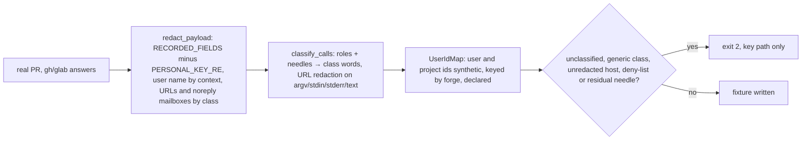

# The forge recorder redacts by class at record time

Amendment (0.2, 2026-11-18): the verifier's NO-GO on 0.1 re-measured.
The forges read `web_url` (`gitlab.py:223,982,1021`), `url`
(`github.py:501`) and `name` (`github.py:281,1776,1809`,
`gitlab.py:1016`, check-run and job names), so those keys are not
dropped: URL values are redacted by class with their path shape kept
(D1b), and `name` is dropped only inside a user object, like `id`
(D1). A test replays a redacted recording through the forge readers.

Amendment (0.3, 2026-11-18): the verifier's NO-GO on 0.2. `id` is
kept everywhere: `gitlab.py:728` builds `Review(id=_int(user.get("id")))`
from `approved_by[].user`, and `reviews_two_approvals.json` expects
11 and 12 (F1c); an id is an opaque number in none of the owner's
classes. Only `name` is dropped in a user object. The user-object keys
the readers consume are swept (F1c) and the replay test covers
approvals.

Amendment (0.4, 2026-11-18, reconstructed from git, commit `70b0cf1`
"approve the personal-data cleanup family"): status `reviewed` →
`approved`; no other line changed. The text of this entry was not recorded
at the time and is written here at 0.8 from `git diff 77817ab 70b0cf1`.

Amendment (0.5, 2026-11-18, reconstructed from git, commit `06b82c3`
"hold the recorder regexes equal to the gate and fix D2"): D3 gained
"and held equal by a test in SP-NO-PERSONAL-DATA-GATE" after "a comment
naming their source"; no other line of this spec changed. The text of this
entry was not recorded at the time and is written here at 0.8 from
`git diff 70b0cf1 06b82c3`.

Amendment (0.6, 2026-11-18, the implementer, measured on `origin/develop`
`7fd31af`): D4 was false. Parent F27: after child 1 the fixtures still
held 115 `url`/`web_url`/`html_url` values on the real forge hosts, in 33
files (`git grep -o -E '(url|web_url|html_url)\\?": \\?"https://(github\.com|gitlab\.com)' 7fd31af -- tests/fixtures/forge`
→ 115, `-l` → 33; the parent counted 34), and 149 forge-host URLs in 41
files once `api.github.com`, `link` values, argv, stdin, stderr and text
stdout are counted (`docs.*` links excluded). The namespace SCRUB wrote
(`maintainer`) is itself a real account on those hosts. So D4 and G4 are
replaced: the fixtures are rewritten by the recorder's own functions,
offline (`scripts/redact_forge_fixtures.py`, D4 below), and C2 is a fixed
point instead of an empty diff. Other claims measured wrong against the
code and corrected here: (a) `RECORDED_FIELDS` is not "every key the forges
read" — `_squash_body_from_view` reads `commits[].messageHeadline` and
`messageBody` (`github.py:170-175`); applying `redact_payload` to
`github/merge.json` dropped them and turned `test_merge[github]` red, so
the three keys are added (D1 no longer leaves `RECORDED_FIELDS` unchanged);
(b) a user object keeps `state` beside `login`/`username` and `id`
(GitLab), so "exactly what the readers consume" is false; its URL keys
(`web_url`, `html_url`, `url`, a profile link) are now dropped with `name`;
(c) GitHub's `gh pr checks` link is under `link`, a URL key the spec did not
name: `link` joins `url`/`web_url`/`html_url`; (d) URLs also stand in free
text (a `glab` error, `gh pr create` output, a check link passed as a method
argument), so text URLs are redacted too, RFC 2606 and loopback hosts kept;
(e) the hand-written placeholder logins `alice`, `bob`, `dev`, `devops` are
also real accounts, and one GitLab project-bot username names a real project
id: the transform maps them to `author-<n>` and `service`; (f) the recorder
also classifies the method's arguments and the forge's bot login (`bot`),
since replay compares argv and trust compares the bot login; the result is
recomputed by replaying the redacted exchanges. The F1 line numbers are those
of `0be2a56`.

Amendment (0.7, 2026-11-18, owner decision on O1): a user `id` is still
kept as a key, but its value is remapped to a synthetic one (D1c). The
readers consume the GitLab approval user id (`gitlab.py:728`) only as an
opaque number, so a stable synthetic value replays identically. Measured on
the fixtures at `fc8df78`: 58 user-object ids, 52 of them real, 10 distinct
accounts before and after.

Amendment (0.8, 2026-11-18, the verifier's NO-GO on `4f78a96`, every item
fixed, measured on the branch over `origin/develop` `7fd31af`):
(a) defect 1 — the test held a salted SHA-256 of the maintainer's two real
ids, and the salt was in the tree: enumerating every candidate id reverses
it in about a minute, the very argument D1c makes against a hash. The
hashes are gone from the branch's whole history (the commit that added them
was rewritten before any push); the real ids are read at test time from the
maintainer's untracked deny-list, SP-NO-PERSONAL-DATA-GATE D3's own
mechanism, and the test skips with that reason when the deny-list is absent
(D1c, D3). (b) defect 2 — End state, D1, G1 and the Hard part still said
"every id is kept/as recorded" and D1 that `RECORDED_FIELDS` was unchanged;
both were false since 0.6/0.7 and are corrected below, as is
`docs/security_posture.md`. (c) defect 3 — the offline map was keyed by
the number alone, so a GitHub and a GitLab account with the same number
merged, and `apply_known` remapped any result `id` equal to a user id seen
earlier; the map is now keyed by `(forge, id)` and a result id follows its
account only where it is one, a GitLab `Review.id` (D1c). (d) defect 4 —
one map per fixture (M11) and a sequence restarting at 1001 over the
existing 1001–1004 (M13) both survived mutation; two tests over
temporary corpora now kill them (Tests). (e) the 10000 threshold kept any
small real id silently (P2): a fixture now declares its synthetic ids under
`synthetic_user_ids`, the recorder writes the declaration, and an
undeclared id is remapped whatever its size (D1c). (f) a recorded `source`
named the checkout's folder (`m3`, the private repository's name, or the recorder's own) and D3
ran before the field existed (P1): `source` names the forge, the offline
transform rewrites the 30 that did, and D3 judges the whole fixture (D3,
D4). (g) the real-account rule was implicit and uneven — the recorder
mapped `repoach-bot` to `bot` while the offline transform kept it, and a
GitLab project bot became `bot-<n>` in one and `service` in the other
(P3): one rule, D2. (h) an `@<handle>` in free text was neither replaced
nor refused (P5): it becomes a class word, in both tools (D2). (i) the
tests outside the fixtures still held `gitlab.com/maintainer/<private repository>` and
its scp and API forms, derived from a real remote and naming the real
account `maintainer` (P4): this spec takes them on (D5). Wrong facts
corrected: AC1's C1 count was 131, the measured count was 134; the
out-of-fixture forge URLs are 56 occurrences on 54 lines (54 without the
two `docs.*` links), not 52; `LEGACY_LOGINS` also held `owner`, which D4
did not list (it is now gone: D4 states the general rule); a `test:`
commit edited this spec at 0.7 without a bump (`4f78a96`), which this entry
supersedes.

Amendment (0.9, 2026-11-18, the second verifier's NO-GO on `58b928a`, every
item fixed, measured on the branch over `origin/develop` `7fd31af`):
(a) defect 1 — the suite's autouse `_hermetic_xdg_dirs` points
`XDG_CONFIG_HOME` at a scratch directory, so under pytest `read_denylist()`
never saw `~/.config/repoach/personal-denylist`: with the real file present
(10 entries, mode 600) the deny-list test skipped, and D1c, O2 and C1, which
say the file and the variable are merged, were false under pytest. The
test now asks for `real_user_config_dir`, a session fixture of
`tests/conftest.py` that names the directory from `XDG_CONFIG_HOME` as the
process found it, before the override; `read_denylist(config_dir)` reads the
file there; every other test stays hermetic; the skip names the path it
checked (home written `~`); a test pins the file route (D1c, D3).
(b) defect 2 — `clone git@github.com:<login>/r.git` kept the login and the
real host: `_login_pattern` refused a token after `:` (to keep `:owner`),
and text URLs were `http(s)` only. An scp remote `<user>@<host>:<ns>/<repo>`
and an `ssh://`/`git://` URL now get the placeholder host, namespace and
repository in both tools; a login after `<host>:` is a token (not after `/:`
or `::`); and D3 refuses any URL or remote left on a host the redaction
rewrites (`unredacted host at <path>`). (c) preference 1 — `@pytest.fixture`,
`@dataclass` and `@property` were handles, and the bare word was then
replaced everywhere (`import dataclass` became `import author-3`): a dotted
name, a decorator call, a standard-library decorator and anything in a
Markdown code span are no handle, and a login known only from a mention is
replaced in its `@<handle>` form only (D2). (d) preference 2 — a declared
id was trusted at any value, so a real one could be declared: only
`1001..1999` is trusted, a declaration outside it is remapped, and the six
hand-written ids 0.8 declared (3, 7, 8, 9, 11, 12) are now remapped like any
real id, so the D4 reproduction declares nothing (D1c, D4). (e) preference
3 — commit `2122754` (`test(forge)`) edited this spec at 0.7 without a bump;
its row was folded into the 0.8 `docs(specs)` commit before any push. (f)
preference 4 — a login equal to a git word (`main`) is replaced in every
value, branch fields and prose included; that is the safer option and is
stated in D2. (g) preference 5 — the private project name stood in 30 URLs
and a GitLab project object of the fixtures: the repository segment of
every recorded URL is `project`, and a repository object's `name`/`path`
too (D1b). (h) preference 6 — the repository secret
`REPOACH_PERSONAL_DENYLIST` reaches the unit-test step of `ci.yml` (O2).
Wrong facts corrected: D1c, O2 and C1 said the file was read under pytest,
false until (a); D2's claim that `@pytest.fixture` in a diff "stays" held
for diffs but not for the same decorator in prose, true after (c); AC1's
C1 figure is now measured by the file route.

Amendment (0.10, 2026-11-18, the third verifier's NO-GO on `7066d3a` and
the analyst's class plan, every class fixed, measured on the branch over
`origin/develop` `7fd31af`): rounds 2 and 3 each found a known value in a
string position the redactor's grammar had not foreseen (after `:`, after
`.`, uppercase, a userinfo, a display `name`, a query), and the refusal was
built from the same grammar. 0.10 changes what is judged. (K1, I1) one
token boundary, `TOKEN_CHARS` and `token_pattern`, for the login replacer,
the `@` replacer and the deny-list; the `:owner` exception is gone, the
tools' own literals (`:owner`, `:repo`, `:id`, `/dev/null`) are declared
instead (D2). (K2, I2) every recogniser of a scheme, host or login is
`re.I`, the case-sensitive ones named by a test; the oracle casefolds. (K3,
I3) a closure oracle by needles, built from the raw exchanges and from
facts and independent of every redaction regex, judges the built fixture
casefolded and URL-decoded; the recorder and the offline transform exit 2
on a hit (D3, D4). (K4, I4) a repository object's `name`/`path` are
`project` by key and its `description` is dropped (D1b). (K5, I5) an scp
remote is normalised through `redact_url`, a userinfo is never kept, the
query and any fragment but a comment anchor are dropped (D1b). (K6, I6)
each exit path and grammar alternative has a test that names it (Tests).
(K8) both scripts log to stderr, the deny-list is opaque, the secret
reaches one step (D3, D6). Owner decisions of 2026-11-18 (Open Questions):
Q1, the client project's code identifiers in recorded prose and diffs (12
lines in 10 files: `git grep -c -i yoob 7066d3a -- tests/fixtures/forge`)
were rewritten once by hand to `acme` in the same case, and their 21 forms
added to the maintainer's deny-list file and secret; Q2, a repository id
is synthetic in `2001..2999` (D1c); Q3, the residual is named (NG4); Q4,
masking measured (D6). Wrong facts corrected: AC1's "21 of 22" was typed
from memory, the 0.10 list is in AC1 by id with its command; D6's "GitHub
masks the value" held for the whole value only, now measured line by line;
D2 called a project bot's id "a real project id" while the same number
stood as the project `id` of `gitlab/branch_protection.json`, now `2001`; "98 segments" had no command,
AC1 names one; D1b said the private name "belongs in the deny-list" while
the list did not hold it, it does now; and the commit that redacted the
fixtures (`24cce22` before the rewrite) added 21 lines naming the private
repository that a later commit removed: the unpushed history was rebuilt
so that no commit adds one (AC1, the per-commit count). Two hand edits
precede the offline transform in the D4 reproduction: Q1's, and the three
`source` fields that cited documentation by a URL on a forge host now cite
it by title, since the oracle judges every forge-host string.

Amendment (0.11, 2026-11-18, the fourth verifier's NO-GO on `5393cb6`,
every item fixed, measured on the branch over `origin/develop`
`7fd31af`). (R1) The oracle shared the replacer's token boundary, in
which `-` and `_` were token characters, so `<login>-patch-1` (GitHub's
web-edit branch, through `headRefName`), `x-<v>`, `_<v>` and `<v>_x`
escaped both, for every needle kind: `TOKEN_CHARS` is now letters and
digits only, for the replacer, the `@` replacer, the deny-list and the
oracle alike, so the replacer clears the branch name and the oracle's
doubt resolves toward refusing (D2). (R2) Logins under keys the
redaction drops never became needles: `raw_logins` reads them from the
raw decoded stdout, as needles and as roles (D3). (R3) Segments came only
from the public forges and the remote's host: they now come from the
recorded project (the remote's path, an ssh alias's included, the argv's
API paths), from every URL on the remote's host when it is a private
one, and from every URL on any private host when the remote names none
(D3). (R4) A node id inside a longer string was not decoded: every
node-id-shaped run is, in `residual` and `denylist_hit` alike
(`embedded_id_numbers`). (R5) Dict keys were never judged: every key
outside `CODE_KEYS` is, and a path names it by ordinal. (R6) A
third-party link made an ordinary pull request unrecordable (PR #316's
`conversation_comments` exited 2 on `residual segment 4 at forge`): a
public third party's project is no needle, and the recorder's
`CONSTANT_FIELDS` and `source` head are judged by the deny-list only.
The oracle also judges every encoded and lookalike form (`oracle_forms`:
double percent, HTML entities, `\u` escapes, full-width, invisible and
lookalike letters), and finds hosts with its own reader (`locations`),
so the independence claim is now stated exactly (D3). (R7) The
verifier's eight survivors (V4-05, 06, 07, 08, 10, 11, 13, 14) and V4-16
are killed by named tests; the new code has its own mutants (AC1).
Two findings of this round's own re-measurement are fixed as well: with
`-` a delimiter, a placeholder login became a word of a spec identifier
(`SP-OWNER-…`, the D4 reproduction refused) and a raw login a word of the
kept `github-actions[bot]` (a live recording refused); spec identifiers
and the non-person logins are declared literals, and the deny-list judges
the text with the literals kept. Wrong
facts corrected: AC2's explanation of the 0.10 refusal (it was the
segment `github` hitting `forge`, not a deny-list entry); the claim that
a later round could only find a missing needle source (D3); "independent
of every redaction regex" (D3, now exact); AC1's "each of the seven
needle sources dropped" (the remote-host segment source had no mutant);
and D5, which did not declare `tests/merge_wait_fakes.py` (`e7d23f1`) or
`docs/security_posture.md`. C3 now lists the six methods, each with its
allowed outcome.

Amendment (0.12, 2026-11-18, owner decision on the threat model and the
fifth verifier's NO-GO on `1b90c23`, every realistic defect fixed,
measured on the branch over `origin/develop` `7fd31af`). Owner decision:
the threat model is **accidental leaks** from real pull requests, not an
adversary crafting text on purpose to evade the recorder (new **Threat
model** section below). NG4 is extended to name, as accepted and out of
scope, the adversarial forms: Unicode confusables of any case (Cyrillic,
Greek, full-width) and invisible characters (D1), Markdown-split or
escaped values (`**zqx**jdoe7`, `zq\_jdoe`), values in non-node-id
base64, and JSON-in-a-string escapes (D8). What 0.11 already does for
these forms is kept intact without extending it, and every claim that
they are caught in general is dropped. Realistic defects fixed: (D2)
`embedded_id_numbers` scans current-format `U_…` runs independently of
base64 runs and finds the legacy `MDQ6VXNl` prefix anywhere in a run
(URL paths, branch names, prefixed or suffixed strings), in both
`residual()` and `Denylist.hit()`; (D3) spec-id literals in
`CLI_PLACEHOLDER_RE` are bounded to actual `docs/specs/` spec ids
(`SPEC_IDS`, 329 ids) so invented `SP-<value>` tokens never hide a real
login, segment or id, deny-list judgement keeps literals intact, and
free-form `case` is removed from `CONSTANT_FIELDS` (`forge` and `method`
only); (D4) `path_identity` (plus `_repository_root` and `_api_project`)
collapses empty segments from double slashes (`org//repo`, `repos//o/r`,
`users//u`) so segments never shift or leak; (D5) `classify_calls` (and
offline `_exchanges`) runs `redact_urls_in_value` on `call["args"]`, and
redacts URLs and noreply mailboxes before `classify_logins`; (D6) GitHub
and GitLab noreply mailboxes (`@users.noreply.github.com`,
`@users.noreply.gitlab.com`, self-hosted `@users.noreply.<host>`) redact
their local part and host by class (`author@users.noreply.forge.example.com`
/ `bot@users.noreply.forge.example.com`) instead of failing as
`generic class mailbox`, `_personal_mailbox` requires `/` after `:`
before skipping an scp remote (catching `real.person@private-mail.org:25`
and `:hello`), `locations()` rejects un-led code expressions
(`self.ms/1000`, `README.md/foo`, `foo.py:80/bar`) and accepts a DNS
trailing dot, and `needles()` infers the forge host from `URL_KEYS`
under an ssh-alias remote so third-party links like `docs.python.org` do
not raise `NeedleError`; (D7) all realistic surviving V5 mutants
(`V5-03`, `06`, `08`, `10`, `11`, `14`; `V5-07` concerns the confusable
table, now NG4) and 11 new 0.12 mutants are killed by named tests (AC1).
Wrong facts corrected: D1b now lists `link` beside `url`/`web_url`/
`html_url`; D2 and the diagram reflect that `redact_payload` runs before
`classify_logins`; D2, Edge cases and the Tests table no longer claim
`main-fix` or `_jdoe`/`jdoe_x` stay or that `-` is a word character
(false since 0.11 R1); D5 names the actual commit count for
`docs/security_posture.md` (5 at 0.11, 6 at 0.12, not 4) and marks the
0.8 out-of-fixture URL count by version; AC1 notes the 0.11 `grep`
command's `94 project` / `1 project\` quirk vs the 0.10 command's
`99 project`.

Amendment (0.13, 2026-11-19, the sixth verifier's NO-GO on `83ab01f`,
every item fixed, measured on the branch over `origin/develop`
`7fd31af`). (R6-D1) Markdown delimiters — backtick, `*`, `|` in
`_URL_IN_TEXT_RE` and `_AFTER_HOST_RE`, and trailing boundary `~` and
`_` via `_URL_TRIM_TAIL` in `redact_urls_in_text`, `unredacted_host` and
`locations()` — terminate text URLs without being eaten, so backticked
RFC 2606 / loopback URLs stay unchanged and backticked/bold/table/tilde/
underscore self-hosted URLs yield clean segment needles; `_SCP_IN_TEXT_RE`
accepts an optional DNS trailing dot and `URL_SCHEMES` / `_URL_IN_TEXT_RE`
include `ftp`/`ftps`. (R6-D2) Any `<name>[bot]` login (such as
`dependabot[bot]`, `renovate[bot]`) shares one consistent class word
across its login key, `@<name>` mention and bare prose stem (in
`build_roles`, `classify_text`, `needles` and offline `legacy_roles`/
`_rename`), while `@github-actions` is skipped via `_names_no_one`;
`_MENTION_END` rejects `/[A-Za-z0-9_.-]` so npm scoped packages
(`@types/node`, `@vue/cli`, `@babel/core`, `@actions/checkout`) are not
mentions; `PYTHON_DECORATORS` is checked case-insensitively (`@Override`).
(R6-D3) `locations()` replaces the growing `_NON_HOST_TLDS` denylist with
a positive DNS TLD allowlist (`_KNOWN_HOST_TLDS`) plus `known_hosts`
(the forge/remote host), rejecting code expressions
(`config.dir/sub/file.toml`, `obj.total/count/100`, `this.base/api/v1`,
`components.tsx/Header/index`, `cfg.root/sub/file`) and wheel paths
(`*.dist-info/…`) while still finding real schemeless hosts
(`gitlab.corp-x.io/grp-x/proj-x`, trailing-dot form) and custom-TLD
known hosts; scheme- or user-led IPv4 URLs (`https://10.20.30.40/…`)
are also parsed by `locations()` and collected as host and segment
needles so self-hosted IPv4 mirrors cannot leak prose repo names.
(R6-D4) All 10 round-6 surviving mutants (`V5-11`, `R5-D2b`/`V6-03`,
`V6-01`, `V6-11`, `V6-17`, `V6-18`, `V6-22`, `V6-24`, `V6-25`, `V6-26`)
plus 17 new 0.13 mutants are killed in a detached git worktree with a
verified green baseline and strict `rc == 1` kill criterion (AC1).
(R6-D5) Numeric GitLab project ids in `api/v4/projects/<id>/…` URLs map
through the same `UserIdMap.for_projects()` (`2001..2999`), are declared
under `synthetic_project_ids`, and are collected by `project_id_values`;
offline `scripts/redact_forge_fixtures.py` also redacts `kwargs`, and
`redact_urls_in_text` rewrites system noreply mailboxes
(`noreply@github.com`, `noreply@<self-hosted>`) to
`noreply@forge.example.com`. (Preferences 2–4) `needles()` infers the
public forge host from `URL_KEYS` when `remote=""` so third-party links
like `docs.python.org` do not raise `NeedleError`; well-known public
reference hosts (`PUBLIC_REFERENCE_HOSTS`: `docker.io`, `ghcr.io`,
`golang.org`, `k8s.io`, `pypi.org`, `npmjs.com`, `www.npmjs.com`,
`registry.npmjs.org`, `pkg.go.dev`, `proxy.golang.org`,
`docs.github.com`, `docs.gitlab.com`) stay intact in free text
(`docs.github.com` and `docs.gitlab.com` are literals in
`CLI_PLACEHOLDER_RE` so they do not collide with `FORGE_HOSTS`);
`CONFUSABLES` docstring aligned with 0.12 NG4. (Preference 1 — RFC 2606
subdomain mailboxes, `actions@github.com`, 4-part versions `from … to …`,
and Windows `C:\Users\<unknown>\…` — belongs to the shared constants of
SP-NO-PERSONAL-DATA-GATE and is left unchanged here.) Wrong facts
corrected: 0.12 AC1's "26 of 26 mutants killed" was false (`tmp/r5/mutate.py`
omitted `prompts/` and crashed `rc=4` on unmodified HEAD; real count was
24/26, `V5-11` and `R5-D2b` survived); schemeless `10.0.0.5/…` is a
schemeless private IPv4 path, not CIDR-shaped, and is now named in NG4;
`fixture_needles` docstring corrected to state `min_length=1`.

## Intent

Child 2 of SP-REPO-CARRIES-NO-PERSONAL-DATA. SP-SCRUB-PERSONAL-DATA-AT-HEAD
rewrites the recorded forge fixtures by hand to class words; this spec
makes the recorder write that shape itself, so the next
`scripts/record_forge_fixture.py` run against a real pull request
cannot bring a handle, a real name, an avatar URL or a user id back
into `tests/fixtures/forge/`.

## Threat model

(0.12, owner decision 2026-11-18.) The recorder protects against
personal data that leaks **by accident** from real pull requests —
logins, real names, user and repository ids, private hosts, namespaces,
repository names, home paths, public IPv4 addresses, personal mailboxes,
branch names, Co-authored-by noreply trailers, URLs with userinfo or
double slashes, and embedded GitHub user node ids. It does **not**
protect against an adversary who crafts text on purpose to evade the
recorder or its closure oracle. Forms that require deliberate
obfuscation (Unicode confusables, invisible characters, Markdown
splitting or escaping, non-node-id base64 payloads, JSON-in-a-string
escapes) are out of scope and accepted under NG4: what 0.11 already
handles for them is kept as best-effort defence-in-depth, without any
claim that they are caught in general.

## Context

### Measured on `origin/develop` `0be2a56` (2026-11-18)

| # | Fact | Where |
|---|---|---|
| F1 | The recorder keeps an allow-list of keys and drops everything else, recursively; `login`, `name`, `username`, `id`, `url` and `web_url` are kept | `src/repoach/forge/recording.py:32` (`RECORDED_FIELDS`), `:74` (`"login"`), `:82` (`"name"`), `:122` (`"url"`), `:124` (`"username"`), `:125` (`"web_url"`), `:142-145` (`redact_payload`) |
| F1b | The forges read `name` as a check-run or job name, `url` as a pull request's URL and `web_url` as a merge request's, a pipeline's and a job's URL; none reads `avatar_url`, `html_url`, `full_name` or `email` | `src/repoach/forge/github.py:281,1776,1809` (`entry.get("name")`, `r.get("name")`), `:501` (`payload.get("url")`); `src/repoach/forge/gitlab.py:223` (`mr.get("web_url")`), `:982` (`pipeline.get("web_url")`), `:1016` (`job.get("name")`), `:1021` (`job.get("web_url")`); `git grep -n -E '\.get\("(avatar_url\|html_url\|full_name\|email)"' src/repoach/forge` → 0 |
| F1c | The keys the readers consume from a user object (`user`, `author`, `approved_by[].user`): `login` (`github.py:239,489`), `username` (`gitlab.py:171,725`) and the numeric `id` (`gitlab.py:728`, `Review(id=_int(user.get("id")) or 0)`); no reader consumes a user's `name`. The GitLab approvals fixture expects the user ids `11` and `12`; a dropped user `id` would replay as `0` | `git grep -n -E '(user\|author)\.get\("' src/repoach/forge/{github,gitlab}.py` → those five lines; `tests/fixtures/forge/gitlab/reviews_two_approvals.json` (`"id": 11`, `"id": 12`); the GitHub GraphQL `author.id` is the user's node id (`MDQ6…`), read by nothing, present in the three fixtures of F3 |
| F2 | Secret-shaped keys are dropped by name: token, secret, password, private_key, api_key, `node_id`, email | `src/repoach/forge/recording.py:138` (`SECRET_KEY_RE`), `:191-194` (`_secret_keys`) |
| F3 | Three fixtures carry the maintainer's handle as `login`, the real name as `name` and the GitHub user node id as the `id` of the recorded `author` object | `tests/fixtures/forge/gate/pr202_capture.json:17`; `tests/fixtures/forge/github/open_pull_requests.json:24`; `tests/fixtures/forge/github/pull_request.json:19` (parent F9) |
| F4 | Twelve fixtures carry the handle, in `login`/`username` values and in recorded argv (`collaborators/<handle>/permission`, `members/all?query=<handle>`) | `tests/fixtures/forge/github/*.json` (7), `tests/fixtures/forge/gitlab/is_maintainer*.json` (4), `tests/fixtures/forge/gate/pr202_capture.json` (parent F8) |
| F5 | Replay is argv-for-argv: the first argv that differs from the recording fails the conformance suite | `src/repoach/forge/recording.py:1-13` (module docstring), `:285-300` (`ReplaySpawn.__call__`) |
| F6 | The recording script is a frontier file (no owner) and imports the recording module; the recording module is owned by SP-UNIVERSAL-FORGE | `scripts/record_forge_fixture.py:18,29-37`; `Registry.owner_of("src/repoach/forge/recording.py")` → `SP-UNIVERSAL-FORGE`, `owner_of("scripts/record_forge_fixture.py")` → `None` |
| F7 | The redaction rule the fixtures follow is SP-SCRUB-PERSONAL-DATA-AT-HEAD D1 (`format:redaction-rule`): login → class word, name and user id dropped, host → placeholder | that spec's D1 table |

## Decisions (2026-11-18)

- D1. **Personal keys are dropped by name, beside the secret keys;
  `name` by context; `id` kept as a key (0.8: a user object's id value is
  synthetic, D1c).** `src/repoach/forge/recording.py`
  gains `PERSONAL_KEY_RE = re.compile(r"^(full_name|avatar_url|email|
  public_email|node_id)$", re.I)` next to `SECRET_KEY_RE` (`:138`), and
  `redact_payload` (`:142`) drops a key matching it. In an object that
  also holds `login` or `username` (a user object), `name` is dropped
  too, with its URL keys (`url`, `web_url`, `html_url`, `link`);
  elsewhere `name` is kept, since the forges read it as a check-run or job
  name (F1b). The `id` key is kept in every object: the readers consume it
  as a user id (`gitlab.py:728`), a thread, note, comment, review or
  pipeline id (F1b, F1c). A thread's, note's, review's or pipeline's id
  keeps its recorded value; a user object's id value is replaced by a
  synthetic one (D1c, 0.7). A user object keeps `login`/`username` as a
  class word, `id` as a synthetic value and, on GitLab, `state` (0.6 b).
  `RECORDED_FIELDS` gains `commits`, `messageHeadline` and `messageBody`,
  which `_squash_body_from_view` reads (0.6 a); no other key is added.
  This is an edit to SP-UNIVERSAL-FORGE's file, declared in `depends_on`.
- D1b. **URL values are redacted by class, their shape kept.** A string
  value under `url`, `web_url`, `html_url` or `link` (0.6 c) goes through
  `redact_url(value) -> str`: the scheme is kept, the host becomes
  `forge.example.com`, the namespace (every path segment before the
  repository name — the first segment on GitHub, everything before the
  last segment preceding `/-/` or the last segment on GitLab; empty
  segments from double slashes such as `org//repo`, `repos//o/r`,
  `users//u` collapsed first, 0.12 D4) becomes
  `org`, the repository name becomes `project` (0.9; a `.git` suffix
  kept), and the rest of the path is kept, so
  `https://<forge>/<owner>/<repo>/pull/12` records as
  `https://forge.example.com/org/project/pull/12` and
  `https://<gitlab>/<group>//<repo>/-/merge_requests/7` as
  `https://forge.example.com/org/project/-/merge_requests/7`. A value
  that does not parse as a URL of `URL_SCHEMES` (`http`, `https`, `ssh`,
  `git`) is dropped. The forges pass
  these strings through (`url=str(mr.get("web_url") or "")`,
  `gitlab.py:223`), so a replayed recording yields the redacted URL
  unchanged, which the test pins by replaying through the readers.
  (0.9, 0.10) A repository's name is its owner's as much as its
  namespace: in a repository object — one whose URL names a repository and
  nothing under it, such as GitLab's `projects/:id` answer — `name` and
  `path` become `project` by key, whatever their value
  (`REPOSITORY_NAME_KEYS`), and `description` is dropped
  (`REPOSITORY_DROPPED_KEYS`: prose about a possibly private project;
  `gitlab.py:217` reads a merge request's `description`, never a
  project's) — the context decides, as for a user object's `name` (I4,
  0.10; the 0.9 rule "equal to that repository's name" kept a display name
  `Secretproj` beside a path `secretproj`). In free text, an `http(s)`,
  `ssh://` or `git://` URL and an scp remote `<user>@<host>:<ns>/<repo>`,
  in any case (`re.I`, I2), get the same placeholders, unless the host is
  an RFC 2606 or loopback host other than `forge.example.com` itself,
  which is redacted again so a hand-written URL gets the placeholder path.
  (0.10, I5) One normaliser: an scp remote is read as
  `ssh://<user>@<host>/<path>`, passed through `redact_url` and written
  back as `git@forge.example.com:org/project`; `redact_url` never keeps a
  userinfo (a login or a credential), writes `git@` for an `ssh` or `git`
  URL that had one, writes the scheme and host lowercase, drops the query
  and drops the fragment unless it is a comment, note or review anchor
  (`FRAGMENT_ANCHOR_RE`: `issuecomment-`, `note_`, `discussion_r`,
  `pullrequestreview-`, `discussion_` then hex digits, which a reader
  parses). A mailbox followed by `:<port>/<path>` (`jdoe@corp.io:8080/x`)
  is therefore read as a remote and written `git@forge.example.com:org/project`:
  the redactor's doubt resolves toward redacting, the oracle's (D3) toward
  refusing, neither toward keeping. A repository name or namespace inside
  prose is replaced as a token by the pipeline when it is a segment needle
  (D3), and refused if it survives; a private project name also belongs in
  the deny-list (Q1). (0.12, D5, D6) `classify_calls` (and offline
  `_exchanges`) also runs `redact_urls_in_value` on every exchange's
  `args`, and `redact_urls_in_text` runs before `classify_logins` on
  `args`, non-JSON `stdout`, `stdin`, `stderr` and top-level `args`/
  `kwargs`. Forge noreply mailboxes (`<local>@users.noreply.<host>` and
  `<local>@noreply.<host>`, covering GitHub `<id>+<login>@users.noreply.github.com`
  and GitLab `<id>-<user>@users.noreply.gitlab.com`) have their local
  part and host redacted by class to
  `author@users.noreply.forge.example.com` (or
  `bot@users.noreply.forge.example.com` when the local part is `bot` or
  ends in `[bot]`), so Co-authored-by trailers neither leak ids/logins
  nor trigger a `generic class mailbox` refusal. (0.13, R6-D1, R6-D5,
  Pref 3) Markdown delimiters (`` ` ``, `*`, `|`, and trailing boundary
  `~`, `_`) terminate text URLs without being eaten; `_SCP_IN_TEXT_RE`
  accepts an optional DNS trailing dot; `URL_SCHEMES` and
  `_URL_IN_TEXT_RE` include `ftp`/`ftps`; system noreply mailboxes
  (`noreply@github.com`, `noreply@<self-hosted>`) become
  `noreply@forge.example.com`; well-known public reference hosts
  (`PUBLIC_REFERENCE_HOSTS`: `docker.io`, `ghcr.io`, `golang.org`,
  `k8s.io`, `pypi.org`, `npmjs.com`, `www.npmjs.com`,
  `registry.npmjs.org`, `pkg.go.dev`, `proxy.golang.org`,
  `docs.github.com`, `docs.gitlab.com`) stay intact in free text.
- D1c (0.7, 0.8). **User ids are synthetic, and declared.** The `id` of
  every user object (one holding `login` or `username`) is replaced by
  `UserIdMap` (`src/repoach/forge/recording.py`): a sequence in order of
  first appearance, the first account `1001`, the next `1002`…; a node id
  becomes `U_<n>`. Every form of one account's id names one number
  (`user_id_key`): the REST id, its digit string, a legacy node id (base64
  of `04:User<n>`), a current-format node id (`U_` and base64url of
  MessagePack `[0, <n>]`) and the synthetic `U_<n>`. The map is keyed by
  `(forge, number)`, so the same number on GitHub and on GitLab names two
  accounts and gets two synthetic ids (0.8). In a result, only the
  positions of `RESULT_USER_ID_METHODS` — `("gitlab", "reviews")`, whose
  `Review.id` is the approver's user id (`gitlab.py:728`) — follow their
  account; every other result id (a GitHub review's, a check's, a
  comment's) is the object's own and is left as it is, even when its number
  equals a user id (0.8). A fixture declares the synthetic ids it holds
  under `synthetic_user_ids` (`SYNTHETIC_IDS_KEY`), a sorted list of their
  numbers: the recorder and the offline transform write it, and the
  offline transform keeps exactly the declared ids and remaps every other
  one, whatever its size (0.8, replacing the "below 10000" rule). Only a
  declared number in `1001..1999` (`SYNTHETIC_ID_START..SYNTHETIC_ID_END`,
  `trusted_declaration`) is trusted (0.9): a declaration outside the range
  — a real id typed into a fixture by hand — is remapped like an
  undeclared id, so a fixture cannot keep a real id by declaring it; a map
  that would hand out a number past 1999 raises
  `SyntheticIdsExhaustedError` (exit 2, nothing written). The six
  hand-written ids 0.8 declared (`gitlab/is_maintainer.json` 7,
  `is_maintainer_admin.json` 3, `is_maintainer_developer.json` 8 and 9,
  `reviews_two_approvals.json` 11 and 12) are therefore remapped into the
  range with the rest of the corpus, and no reader or test needs their old
  values. A real account numbered 1001–1999 could still be declared by
  hand; the deny-list test catches the maintainer's own. The recorder remaps every id with one map per recording;
  `scripts/redact_forge_fixtures.py` uses one map for the whole corpus,
  starting after the highest number any fixture declares, so a new number
  never collides with a declared one and one account keeps one number
  across the files it transforms. Two separate recordings may give one
  account two numbers, or two accounts one number; no reader relates ids
  across fixtures. A sequence was chosen over a hash because user ids are
  small and enumerable: a hash of the id, salted or truncated, is reversed
  by hashing every candidate, while a sequence number carries nothing about
  the id it replaces and the mapping is never written. The maintainer's
  real ids are therefore never written either, not even hashed: the test
  that no fixture holds them reads them at run time from the untracked
  deny-list of SP-NO-PERSONAL-DATA-GATE D3 — the file
  `user_config_dir()/personal-denylist` and the variable
  `REPOACH_PERSONAL_DENYLIST`, merged — and skips, naming that reason,
  when neither holds an entry (O2). Under pytest the file is read from the
  real configuration directory (0.9): the suite's autouse
  `_hermetic_xdg_dirs` points `XDG_CONFIG_HOME` at a scratch directory, so
  the test asks for the session fixture `real_user_config_dir`
  (`tests/conftest.py`), which resolves `user_config_dir()` with
  `XDG_CONFIG_HOME` as the process found it, and passes it to
  `read_denylist(config_dir)`; the skip message names the file it checked,
  the home directory written `~`.
  (0.10, Q2) A repository id names a project as a user id names an
  account: the `id` of a repository object (D1b) is remapped by the same
  `UserIdMap`, built with `UserIdMap.for_projects()` over
  `SYNTHETIC_PROJECT_ID_START..SYNTHETIC_PROJECT_ID_END` (`2001..2999`),
  keyed by `(forge, number)`, declared under `synthetic_project_ids`
  (`SYNTHETIC_PROJECT_IDS_KEY`, `declared_project_ids`), trusted only in
  range, one map per recording and one per corpus offline, starting after
  every declared number; exhausting it raises
  `SyntheticIdsExhaustedError` (`synthetic project id <n> past 2999`).
  The corpus held one, `gitlab/branch_protection.json`, now `2001`; no
  reader consumes a project's `id`. A GitLab project bot is `service` by
  its class — a service account — not because its name holds an id.
  (0.13, R6-D5) Numeric project ids in `api/v4/projects/<id>/…` URLs and
  paths (`_API_PROJECT_ID_RE`) are collected by `project_id_values`,
  remapped by the same `UserIdMap.for_projects()` (`apply_projects`) to
  `2001..2999`, and declared under `synthetic_project_ids`.
- D2. **Logins are classified at record time.** `classify_logins(payload,
  roles: dict[str, str]) -> object` replaces, recursively, every value of
  a `login`, `username`, `author`, `resolved_by` or `user` key that is a
  string by `roles[value]`; the recorder builds `roles` from what it
  knows: the change request's author is `author`, the account whose
  `is_maintainer` call it records is `maintainer`, a login ending in
  `[bot]` is `bot`, and every further distinct login is `author-2`,
  `author-3`, … in order of first appearance. The same mapping is applied
  to the recorded argv (F4), so `collaborators/<handle>/permission`
  becomes `collaborators/maintainer/permission`, and to the recorded
  stdout after `redact_payload` (0.12 correction: `redact_stdout` runs
  first in `record()`, and `classify_calls` also redacts text URLs and
  noreply mailboxes before classifying logins).
  The real-account rule (0.8), applied alike by the recorder and the
  offline transform (D4): wherever a string stands for an actor — a value
  under a login key, the bot login, a login in argv, an `@<handle>` in the
  free text of a `PROSE_KEYS` value (`body`, `description`, `title`,
  `message`, `messageHeadline`, `messageBody`) — it becomes a class word,
  whatever it was, since every placeholder short enough to type is
  someone's account (`alice`, `bob`, `dev`, `devops`, `owner` all are).
  The only logins kept are `NON_PERSON_LOGINS`: `github-actions[bot]`,
  the platform's service account and the default trusted bot
  (`repoach.project.resolve.GITHUB_DEFAULT_BOT`), and `repoach-bot`, this
  project's own bot; neither names a person. A further `[bot]` login is
  `bot-<n>`, a GitLab project bot (`project_<id>_bot_<hex>`, named after a
  real project id) is `service`, then `service-<n>`, and an `@<handle>`
  mention is `author-<n>` like any further login. A mention is replaced,
  not refused: refusing would make every pull request whose discussion
  names a colleague unrecordable, and the replacement keeps the replay
  self-consistent since the result is recomputed. Text outside
  `PROSE_KEYS` (a diff, a log) is the repository's or the runner's content
  and is not searched for mentions — a decorator such as `@pytest.fixture`
  in a recorded diff stays — though a classified login is still replaced
  there as a token.
  What a handle is (0.9, 0.13 R6-D2): `@` then GitHub/GitLab handle characters, not
  followed by a handle character, by `.` and a word character (a dotted
  name: `@pytest.fixture`, and so a dotted GitLab username such as
  `@a.b`, which the mention rule does not catch — the deny-list does for
  the maintainer's own), by `/` and a package character (an npm scoped
  package: `@types/node`, `@vue/cli`, `@babel/core`, `@actions/checkout`)
  or by `(` (a decorator call); not a standard-library decorator name
  (`PYTHON_DECORATORS`, matched case-insensitively so `@Override` is
  skipped); not a `NON_PERSON_LOGINS` stem (`@github-actions`); not
  inside a Markdown code span or fenced block. So the same decorator
  stays in prose as in a diff. A `<name>[bot]` login (such as
  `dependabot[bot]`, `renovate[bot]`) shares one consistent class word
  across its login key, `@<name>` mention and bare prose stem (when the
  stem is at least `NEEDLE_MIN_LENGTH` and not a class word or
  placeholder), so bot PR templates neither split into two identities
  nor refuse on bare prose mentions. A login known
  only from a mention is keyed `@<login>` in `roles`
  (`MENTION_ONLY_PREFIX`) and is replaced in its `@<handle>` form only,
  everywhere; its bare word (`import dataclass`, a branch, a path, an
  argv segment offline) is left alone, since nothing says it stands for
  that person there. Seen later as a login, it is re-keyed with the same
  word and replaced as a token.
  One boundary (0.10, I1; 0.11): `TOKEN_CHARS` (`A-Za-z0-9`; 0.10 had `A-Za-z0-9_-`) and
  `token_pattern(word)` (whole token, `re.I`) are the only source of a
  whole-word pattern; the login replacer (`_login_pattern`), the `@`
  replacer (`mention_pattern`, `token_pattern("@" + login)`), the
  deny-list (`denylist_patterns`) and the closure oracle (D3) all call it,
  and a test holds the first three equal modulo the word. `.`, `:`, `@`,
  `/`, `[`, `]`, `?`, `=`, `#` and quotes delimit a token, and since 0.11
  (R1) `-` and `_` too: only a letter or a digit is inside one, so
  `<login>-patch-1` (GitHub's web-edit branch), `x-<v>`, `_<v>` and
  `<v>_x` hold `<v>` as a token, for the replacer and the oracle alike.
  The replacer clears the branch name (`author-patch-1`); the oracle's
  doubt resolves toward refusing; logins are replaced longest first, so
  `q-handle-x` is not cut by `q-handle`. A login is replaced wherever the token stands,
  after a host's `:` (`git@<host>:<login>/r`), after `/:` or a `.` too:
  the 0.9 exception for `repos/:owner/:repo` is gone. What it protected is
  declared instead (`CLI_PLACEHOLDER_RE`): the tools' own literals — the
  argv templates `:owner`, `:repo` and `:id` the forge code writes and the
  CLI expands, git's `/dev/null`, the project's actual specification
  identifiers from `docs/specs/` (`SPEC_IDS`, 0.12 D3: bounded to real
  spec files so an invented `SP-<login>` or `SP-<id>` never hides a real
  value), `docs.github.com` and `docs.gitlab.com` (0.13 Pref 3: public
  forge documentation hosts kept in free text), and `NON_PERSON_LOGINS` with or without `[bot]` — carry no
  recorded value, so the replacer leaves them alone and the oracle does
  not judge them (the deny-list always judges with literals kept); a login
  `owner` therefore cannot make the forge's own argv one the replay does
  not issue. `MENTION_RE` stays the finder of unknown handles — it decides
  which words become a role and nothing is kept or refused by it — and is
  documented as a finder, not a boundary.
  A login equal to a common word (0.9, owner preference 4): the recorder
  replaces a login as a whole token in every value, so a login `main`
  turns a `baseRefName` `main`, a `headRefName` `main-fix` (since 0.11
  R1, where `-` is a delimiter, `main-fix` becomes `author-fix`) and the
  prose `merge into main` into `author`. This is
  the option chosen, as the safer one: narrowing the replacement in branch
  and ref fields would keep the login's string beside the account's class
  word, and would have to agree argv by argv with the replayed reads; a
  value that disagrees fails the replay loudly (`ReplayMismatchError`)
  instead of being written. The fixture then reads oddly — a branch named
  `author` — and still replays, since the result is recomputed from the
  classified exchanges; the recorder's author may record another change
  request. A URL namespace in a test written from scratch as a
  parser input on a real forge host (`o/r`, `owner/repo`, `acme/…`, 45
  occurrences) is not an actor, names no one in context, and stays, since
  host detection needs the real host; a namespace derived from a real
  remote does not (D5).
- D3. **The recorder refuses what it cannot classify.**
  `scripts/record_forge_fixture.py` raises `UnclassifiedValueError`
  (exit 2, naming the key path, never the value) when a login-bearing
  value is neither a class word nor a `NON_PERSON_LOGINS` entry after D2,
  or when any string of the fixture about to be written — every exchange
  first, then `source`, `case`, the arguments and the result (0.8: the
  check runs on the built fixture, so it covers `source`) — matches
  one of the generic classes of SP-NO-PERSONAL-DATA-GATE D1 (a home path,
  a public address, a mailbox outside the documentation domains), holds a
  URL or an scp remote on a host the redaction rewrites (0.9,
  `unredacted host at <path>`, `unredacted_host`: after redaction none is
  left, so one found means a value escaped it), or an
  entry of the maintainer's deny-list (0.8; `deny-list entry <n> at
  <path>`, by ordinal; a node-id-shaped string is also judged by the
  account number it encodes). The deny-list is read as
  SP-NO-PERSONAL-DATA-GATE D3 defines it (`read_denylist`: the file and the
  variable merged, `#` comments, newline or comma separated, an entry under
  4 characters refused with exit 2 and its ordinal), copied for the same
  reason as the regexes. `source` is `recorded <date> from a live <forge>
  change request` and never names the checkout's folder (0.8): the
  three regexes are copied into the script with a comment naming their
  source and held equal by a test in SP-NO-PERSONAL-DATA-GATE, since that module lands later and the script must not import
  a module that may be absent.
  The closure oracle (0.10, I3; 0.11). The four predicates above are built
  from the redactor's own grammar and can only see what it sees. A fifth
  is not: `needles(raw, *, roles, remote, denylist, min_length) ->
  Needles` builds, from the raw exchanges before any rewrite (stdout,
  stdin, stderr, argv), the method's arguments and the checkout's
  `origin` remote — never from the redactor's output — the values the
  fixture must not hold, casefolded, by kind:
  - `login`: every key of `roles` (a mention-only key without its `@`)
    and every login of the raw decoded stdout (`raw_logins`, 0.11 R2), so
    a login under a key the redaction drops (`assignees[].login`,
    `mergedBy.login`) is a needle; the recorder also gives it a role
    (`build_roles(..., also=raw_logins(raw))`), so it is replaced, not
    refused;
  - `host`: the public forges' own (`FORGE_HOSTS`: `github.com`,
    `api.github.com`, `gitlab.com`), the remote's, and every host
    `locations` finds in a raw string, but an RFC 2606, loopback or
    `PUBLIC_REFERENCE_HOSTS` one (0.13 Pref 3);
  - `segment` (0.11 R3, R6; 0.12 D6; 0.13 Pref 2 & R6-D3): the RECORDED
    project's namespace and repository — the remote's path, an ssh
    alias's (`alias:grp/repo`) included, and the argv's API paths
    (`repos/<o>/<r>`, `projects/<g>%2F<r>`, double slashes collapsed,
    the CLI templates aside) — plus the namespace and repository of
    every raw URL on the remote's host when that host is not a public
    forge's (`is_public_forge_host`: `github.com`, `gitlab.com`,
    `githubusercontent.com` and their subdomains), and of every
    scheme- or user-led IPv4 URL (`https://10.20.30.40/…`, 0.13). When
    the remote is an ssh alias (naming a path but no host), or when
    `remote=""` and raw `URL_KEYS` identify a public forge host
    (0.13 Pref 2), the forge host is inferred from `_raw_url_host`, so
    third-party links in prose (such as
    `docs.python.org/3/library/re.html`) never become segment needles or
    raise `NeedleError`; only when `remote=""` and no public forge is
    identified does every private host contribute segments.
    A third party's project on a public forge (`github.com/python/cpython`,
    `pypa/pip`, `git/git`) is not a needle: it names no one of the
    recording, is never refused, never rewrites prose (`upgrade python`
    stays) and never raises `NeedleError` on a short segment. Its URL is
    still rewritten to `forge.example.com/org/project` by D1b;
  - `id`: every raw user id and repository id, as its digits and as a node
    id's own string;
  - `deny-list`: the entries.
  A `NON_PERSON_LOGINS` login, `[bot]` suffix or not, is no needle (D2). A
  needle shorter than `NEEDLE_MIN_LENGTH` (4) or equal to a class word or
  a placeholder is a configuration error, `NeedleError` (`needle <kind>
  <n>: too short`, `needle <kind> <n>: a class word or placeholder`, exit
  2), never a skip: the oracle could not tell it from everything else.
  `residual(fixture, needles) -> (kind, n, path) | None` walks every
  string of the built fixture (`scanned_strings`, exchanges first; a
  number is judged as its digits), every key outside `CODE_KEYS` included
  (0.11 R5: `RECORDED_FIELDS`, the fixture's own schema keys and the
  protocol models' fields are the code's words; any other key is recorded
  data, judged as a string and named in a path by its ordinal,
  `{key <i>}`, never by itself). It judges each string in every
  `oracle_forms` form (0.11, 0.12): the text with the literals blanked
  (`CLI_PLACEHOLDER_RE`: the CLI templates, `/dev/null`, the actual
  specification identifiers `SPEC_IDS` from `docs/specs/` and the
  `NON_PERSON_LOGINS`, `[bot]` suffix or not; the replacer leaves them
  alone too), except for the deny-list, which judges the text with its
  literals kept, so no literal hides an entry;
  each layer of percent, HTML-entity and `\uXXXX` encoding peeled off in
  turn (four rounds, so `%2525xx` is read); 0.11's best-effort NFKC,
  `Cf` format-character removal and `CONFUSABLES` pass (kept as
  defence-in-depth, with no claim that adversarial Unicode confusables or
  invisible characters are caught in general — see Threat model and NG4);
  all casefolded; and the account number of every user node id any of them
  holds, wherever it stands (`embedded_id_numbers`, 0.11 R4, 0.12 D2:
  current-format `U_…` runs scanned independently of base64 runs so a
  preceding URL path or alpha prefix never eats `U`, and legacy
  `MDQ6VXNl` prefixes found anywhere in a run, padded, unpadded or
  suffixed, in URL paths, branch names and prose). Each form is
  searched for each needle with `token_pattern`, whose boundary is letters
  and digits only (0.11 R1). Only the recorder's closed-enum
  `CONSTANT_FIELDS` (`forge`, `method` — 0.12 D3 removes free-form `case`,
  which is now judged by every needle) are judged by the deny-list only,
  and `source` without its `recorded <date> from a live <forge> change
  request` head (`RECORDED_SOURCE_HEAD_RE`, 0.11 R6). The first hit is
  reported; `refuse_unclassified` raises `residual <kind> <n> at <path>`
  (the ordinal within the kind, never the value). `denylist_hit` judges
  the same `oracle_forms(text, literals=False)`, so a deny entry holding a
  numeric id catches its node ids in URL paths, branch names and affixed
  strings (D2). `_personal_mailbox` skips `:` after a mailbox only when
  followed by an scp path containing `/` (`_SCP_AFTER_MAILBOX_RE`), so
  `user@host:25` and `user@host:word` are refused as `generic class
  mailbox` (0.12 D6).
  Independence, stated exactly (0.11, 0.12, 0.13): the oracle shares no
  recogniser with the redactor. Hosts and segments are found by
  `locations`, a reader of hosts by their context (`//` or `<user>@`
  before, including scheme- or user-led IPv4 hosts such as
  `https://10.20.30.40/…`, or a path after with optional DNS trailing
  dot; un-led candidates require a TLD in the positive DNS allowlist
  `_KNOWN_HOST_TLDS` or membership in `known_hosts`, a first label
  outside `_NON_HOST_FIRST_LABELS`, and at least two non-empty
  non-all-digit segments when no port is present, rejecting code
  expressions such as `config.dir/sub/file.toml`, `this.base/api/v1`,
  `components.tsx/Header/index` and wheel paths `*.dist-info/…`,
  0.13 R6-D3; Markdown delimiters terminate URLs and trailing `.:;~_`
  are trimmed, 0.13 R6-D1) that is not
  `_URL_IN_TEXT_RE` or `_SCP_IN_TEXT_RE`, so a schemeless
  `gitlab.corp.io/grp/repo` in prose is found; the forms are built by
  decoding, never by a redaction regex. Three readers are
  shared on purpose and named: `path_identity` (which segment of a path
  is a namespace and which the repository, the one reading `redact_url`
  also uses), `user_id_key` (which string encodes which account) and
  `login_values` (which keys hold a login). A defect in one of the three
  is a missing needle, not a blind position. The 0.10 claim that a later
  round "can only find a missing needle source" was wrong: round 4 found
  a boundary the oracle shared with the replacer (R1), keys never judged
  (R5), node ids inside longer strings (R4) and third-party segments
  taken as the project's (R6), none of them a missing source.
  The pipeline uses the same needles for quality: the hosts and segments
  are replaced as tokens beside the roles (`Needles.mapping()`: a host by
  `forge.example.com`, a namespace by `org`, a repository by `project`),
  so the name of the recorded project in a body or a diff is replaced, not
  refused. Accepted refusals, where the pipeline knowingly leaves the
  value to the oracle (`ACCEPTED_REFUSALS` in the test): a raw id standing
  in free text (ids are replaced under an id key only), a deny-list entry
  (the list refuses, it never redacts), a needle right after a
  percent-escape (`%2F<n>`), a needle in an encoded or lookalike form
  (entities, `\u` escapes, full-width, invisible or lookalike letters:
  the replacer does not decode), a value as a key outside `CODE_KEYS`
  (keys are never rewritten, since a forge reads them), and a
  mention-only login's bare word (D2: the word is not replaced, the
  oracle refuses it).
  The deny-list is opaque (0.10, K8): `read_denylist` returns a
  `Denylist` whose `repr` is `<denylist: n entries>` and which answers
  `hit(text)` by ordinal; `Needles` likewise reprs as a count; a test runs
  a failing deny-list check under `pytest -l` and finds no entry in its
  output. Both scripts call `route_default_logs_to_stderr()` first, so
  stdout is the one result line, or empty on a refusal.
- D4 (0.6, 0.8). **The existing fixtures are rewritten by the recorder's own
  functions, offline.** `scripts/redact_forge_fixtures.py` applies
  `redact_payload` to every recorded JSON stdout, `redact_urls_in_text` to
  text stdout, stdin and stderr, and `redact_urls_in_value` to a fixture's
  `args`, `kwargs` (0.13 R6-D5) and `result`; it re-records nothing and makes no network call.
  Logins follow D2's real-account rule: every login that is neither a class
  word nor a `NON_PERSON_LOGINS` entry — under a login key, as the
  fixture's `bot_username`, as a whole argument or a path segment, as an
  `@<handle>` in free text — becomes the next free `author-<n>` (from 2,
  since the offline transform cannot tell the change request's author), a
  `[bot]` login `bot`/`bot-<n>`, a GitLab project bot `service`. On
  `7fd31af` that rule replaced 117 values: the placeholders `alice`, `bob`,
  `dev`, `devops` and `owner` and one project-bot username (0.8: `owner`
  was in the 0.7 list of the code and missing here). User ids follow D1c
  (keyed by `(forge, id)`, one corpus map starting after every declared
  number, declarations written back); the forge of a fixture is its `forge`
  key, else its directory's (`FORGE_OF_DIRECTORY`: `gate/` holds read-only
  `gh` captures, GitHub), and an unknown one is exit 2. A recorded `source`
  whose head names a folder or a repository (`recorded <date> from <x>`)
  becomes `recorded <date> from a live <forge> change request`, the rest
  kept. `--check` exits 1 when a file would change; the fixtures are its
  fixed point, and the conformance suite
  (`tests/unit/test_forge_conformance.py`) stays the regression oracle: a
  redaction that drops a key the forges read is red there (it was, on
  `commits`, amendment (a)). Reproduction (0.9, replacing 0.8's, which
  first declared six hand-written ids): the fixtures of `7fd31af`,
  untouched, run through the script (62 files changed), are
  byte-identical to the branch's fixtures, a second run changes 0 files,
  and `--check` exits 0. The transform computes every file before it
  writes any, so a refusal leaves the corpus as it was (0.10: pinned, I6
  b). (0.10, I3) Before writing anything, every transformed fixture is
  judged by `residual` against the needles the transform can know
  (`fixture_needles`): the logins `legacy_roles` finds in the fixture as
  it was, `FORGE_HOSTS` and the deny-list; a hit is
  `ResidualValueError`, `residual <kind> <n> at <file>:<path>`, exit 2,
  nothing written. A hand-written login is judged whatever its length
  (`min_length=1`): the corpus is committed and reviewed, so a false
  refusal is seen and fixed, while live a short needle stays a
  configuration error. Repository ids follow D1c's project map. The
  reproduction (0.10): `7fd31af`'s fixtures run through the script exit 2
  writing nothing (`residual deny-list <n>`: Q1's identifiers); with the
  branch's two hand edits applied first (Q1's `acme`, and the three
  documentation citations by title), they change 62 files and are
  byte-identical to the branch's fixtures; a second run changes 0 and
  `--check` exits 0 (AC1).
- D5 (0.8). **Placeholders derived from a real remote are replaced in the
  tests too.** `gitlab.com/maintainer/<private repository>`, its scp form
  `git@gitlab.com:maintainer/<private repository>.git` and its API form
  `projects/maintainer%2F<private repository>` came from the maintainer's real remote
  (SP-SCRUB-PERSONAL-DATA-AT-HEAD replaced the handle only), and
  `maintainer` is itself a real account (0.6 e). They become
  `group/project` on the same public host, which host detection needs, in
  `tests/unit/test_forge_select.py` (3 lines), `tests/unit/test_gh_glab_shim.py`
  (1), `tests/unit/test_init_foreign_repo.py` (2, and the clone folder of
  the same test), the docstring of `tests/unit/test_forge_conformance.py`
  and the `source` of `tests/fixtures/generated_artefacts/yoob_322/shape.json`.
  These files belong to SP-UNIVERSAL-FORGE, SP-GH-GLAB-SHIM,
  SP-UNIVERSAL-PROJECT-CONFIG and SP-GENERATED-FILES-ARE-VERIFIED-NOT-READ;
  ownership is disjoint, so this spec does not take them over: it owns the
  edit (a string change, no import, no behaviour), and this entry is its
  record. Measured at 0.8 with `git grep -o -E
  "https?://([a-z0-9.-]+\.)?(github|gitlab)\.com[^ \"')]*" -- tests
  ':!tests/fixtures'`: 56 occurrences on 54 lines — 45 from-scratch parser
  placeholders (`o`, `owner`, `acme`, `x` and two `o%2Fr` API paths), 7 of
  this project's public `repoachhq/repoach`, 2 `group/project`, 2 `docs.*`
  links; the scp forms are 8 `o`, 3 `owner`, 2 `repoachhq`, 4
  `group` (at 0.12: 74 occurrences on 71 lines; at 0.13: 85 occurrences
  on 82 lines after adding synthetic test cases in
  `test_forge_recording_redaction.py`).
  Two further edits outside this spec's files, declared here (0.11, 0.12):
  the fake pull request URL of `tests/merge_wait_fakes.py`
  (SP-AUTO-MERGE-WAITS-FOR-CHECKS-NOT-ITSELF's fixture forge, commit
  `e7d23f1`, one line) is written on `forge.example.com/org/<repository>`,
  the placeholder host and namespace the recorded fixtures carry (D1b);
  and
  `docs/security_posture.md` (the project's posture page) states the
  recorded forge URL, the synthetic user and project ids, the real-account
  rule, the remote normaliser, the closure oracle, the noreply rule,
  public reference hosts, bot stems, IPv4 rules and the accidental-leak
  threat model, in seven commits (0.12 correction: five at 0.11, not
  four; six at 0.12; seven at 0.13).
  Both are string or prose edits, no import and no behaviour; ownership
  stays where it was.
- D6 (0.9). **The deny-list test runs where the deny-list is.** Two
  edits outside this spec's files, each its record here like D5's:
  `tests/conftest.py` (SP-STRUCTLOG-CACHE-TEST-FIXTURE's) gains the
  session fixture `real_user_config_dir` and the snapshot
  `_SESSION_XDG_CONFIG_HOME` it reads, which no autouse fixture uses, so
  every other test stays hermetic; `.github/workflows/ci.yml`
  (SP-CI-JOBS-NO-OP-WHEN-NOT-AFFECTED's) passes the repository secret
  `REPOACH_PERSONAL_DENYLIST` (0.10, K8) to one step of the `test` job
  only, `Pytest — fixture deny-list`, which runs
  `pytest -q tests/unit/test_forge_recording_redaction.py -k denylisted`
  (the one deny-list test) with the secret as that step's env; the
  unit-suite `Pytest` step gets nothing. The step runs `pytest` alone — no
  `set -x`, no `echo`, no `env` — and the test prints counts and
  ordinals, never an entry: that is the protection. Masking is the second
  layer, measured (0.10, Q4) rather than assumed: the runner masks a
  secret's whole value and each of its CR/LF-separated lines, trimmed
  (`actions/runner` v2.338.2, `src/Runner.Worker/Worker.cs`,
  `InitializeSecretMasker`, "Also add each individual line"), and splits
  on nothing else, so an entry of a comma-separated secret was never
  masked on its own. The secret was re-created from the file, one entry
  per line, so each entry is masked by itself. A pull request from a fork gets
  no secret: GitHub passes the expression as an empty string, so the
  variable is empty, and with no file on the runner the test skips
  naming the reason (measured locally: `REPOACH_PERSONAL_DENYLIST=` and an
  empty configuration directory → `1 skipped`); the `test` job's
  `REPOACH_ALLOWED_ACTORS` guard already keeps an unknown actor's pull
  request off the runner. A test pins the wiring.

## End state

`scripts/record_forge_fixture.py` run against a real pull request
writes a fixture in which every `login`/`username` is a class word or a
`NON_PERSON_LOGINS` entry, every `@<handle>` in free text a class word,
no `avatar_url`, `email`, `node_id` or user `name` key exists, every
user object's `id` is a synthetic number in `1001..1999` declared under
`synthetic_user_ids` while every other `id` is as recorded, every
`url`/`web_url`/`html_url`/`link` value, every URL and scp remote in text,
has the placeholder host, namespace and repository (`org/project`) with
its path shape kept, every argv embeds a class word
where a login stood, `source` names the forge and not the checkout's
folder, every repository id is a declared synthetic number in
`2001..2999` (0.10), and the script exits 2 naming the key path when a
value of the fixture stays unclassified, matches a generic class or a
deny-list entry, or when any needle of the recording is still in it
(0.10, the closure oracle);
`scripts/redact_forge_fixtures.py --check` leaves the existing fixtures
unchanged with no real forge-host URL in them (0.6),
`tests/unit/test_forge_conformance.py` is green on them, every fixture's
user ids are exactly the ones it declares, no deny-list entry is in any
fixture, and the forge readers return the redacted URL, the
check-run names, the approvals' synthetic user ids and the class word as
author from a redacted recording.

## Easy solution rejected

Rewriting the fixtures by hand each time (what SP-SCRUB-PERSONAL-DATA-AT-HEAD
does once): rejected, the next recording brings the strings back, and
a review of a JSON diff does not catch a `name` key reliably (three
fixtures carried one for months, F3). Dropping `login` altogether:
rejected, both forges read it (`forge/recording.py:74,124` keep it
because `is_maintainer` and the thread posts compare logins). A
post-recording `sed`: rejected, it needs the strings to replace, which
is the leak. Dropping `web_url`, `html_url` and `name` by key: rejected
by measurement (F1b), the forges read the merge request's, pipeline's
and job's URL and the check-run and job names; a dropped key would
replay as an empty string and the conformance suite would pin the
regression as the expected value. Dropping a user object's `id`:
rejected by measurement (F1c), `Review(id=…)` reads it and the
approvals fixture pins 11 and 12. Keeping it as recorded (0.3–0.6):
rejected by the owner (O1, 0.7), a user id names an account. Hashing it,
salted or not (0.7's test): rejected, a small enumerable id is reversed
by hashing every candidate (0.8 a). Treating every id under a threshold
as synthetic (0.7): rejected, it keeps an early real account silently;
the fixture declares its synthetic ids instead (0.8 e).

## Hard part

The class word must be stable across one fixture and across the suite:
a `login` in a thread's `author` and the same login in a `resolved_by`
must map to the same word, or the replayed logic (owner resolves a
finding, `tests/integration/test_owner_resolves_a_finding_end_to_end.py`)
breaks on replay; so `roles` is built once per recording from the
calls the recorder made, and the mapping is applied to argv and stdout
alike. The second hard part is that the same key is personal in one
object and functional in another: `name` is a person's in an `author`
object and a check run's elsewhere, and a URL carries the owner's
namespace in a value the forges must keep reading — so the drop of
`name` is decided by the sibling keys of the object, a URL is rewritten
to a placeholder host and namespace with its shape kept rather than
dropped, and `id` is never dropped, since the readers consume it in
every object kind (F1b, F1c): its value is replaced only in a user
object, and only at the result positions that carry a user id. The third
hard part (0.8) is that a synthetic id must not be mistaken for a real
one nor a real one for a synthetic one: magnitude cannot tell them apart,
so the fixture declares which ids are synthetic, and the numbers are
keyed by forge so that no two accounts ever share one inside a corpus.

## Goals

- G1: personal keys dropped by name, the user object's `name` and URLs by context, the `id` key kept everywhere with a user object's value synthetic and declared (D1c), URL values redacted by class with their shape kept (D1, D1b).
- G2: logins and free-text mentions classified at record time in argv and stdout, with a stable mapping and one real-account rule for both tools (D2, D4).
- G3: the recorder refuses an unclassified, generic-class or deny-listed value anywhere in the fixture, `source` included, exit 2, without printing it (D3).
- G5 (0.8): no string derived from a real remote in the tests outside the fixtures either (D5).
- G4 (0.6): the existing fixtures are the fixed point of the same redaction, no URL on a real forge host is left in them, and the conformance suite is green on them (D4).

## Non-Goals

- NG1 (0.6): re-recording the existing fixtures live; they are transformed offline (D4).
- NG2: the generic lint (SP-NO-PERSONAL-DATA-GATE); this spec copies three regexes, it does not run the gate.
- NG3: redacting secrets (F2 does it already).
- NG4 (0.10, owner decision Q3; extended 0.12, owner decision 2026-11-18): accepted residuals and out-of-scope adversarial forms under the **accidental-leak** threat model:
  1. A login the recording never learns — one that stands only as a bare word in prose, under no login key and with no `@`, or one spelled like a common word cited alone. Nothing makes it a needle, and refusing every unknown word would make every pull request unrecordable. Covers: the maintainer's own accounts are in the deny-list, which refuses them anywhere; for anyone else, the recorder's author trims (`--trim`) or records another change request.
  2. Schemeless private IPv4 paths without `//` or `<user>@` (such as `10.0.0.5/zqotherns/zqotherrepo`, 0.13 Wrong Fact 2): un-led dotted-quad strings are not parsed as hosts by `locations()` so RFC 1918 addresses and version-like numbers in logs/code are not corrupted. Scheme- or user-led IPv4 URLs (`https://10.20.30.40/…`) ARE parsed, redacted and checked for prose repo leaks since 0.13.
  3. Adversarial evasion forms crafted on purpose to defeat the recorder (0.12):
     - Unicode confusables of any case (Cyrillic, Greek, full-width, combining marks) and invisible characters (`U+034F`, `U+FE0F`, etc.) (D1);
     - Markdown-split or escaped values (`**zqx**jdoe7`, `*zqx*jdoe7`, `` `zqx`jdoe7 ``, `zq\_jdoe`, `zq\-jdoe`, HTML comment/tag splits, newline splits);
     - values encoded in non-node-id base64 (arbitrary base64 blobs, JWT payloads);
     - JSON-in-a-string escapes (`\\uXXXX`, `\/` escaped slashes, raw JSON snippets embedded mid-prose) (D8), and other non-standard evasion encodings (5+ rounds of percent-encoding, `\x`, `\U`, `\u{…}`, hyphen/underscore swaps, or substring concatenation inside a larger alphanumeric token without a delimiter).
     What 0.11 already handles for these forms (`CONFUSABLES`, `Cf` removal, NFKC, 4-round URL/entity/`\uXXXX` decoding) is kept intact as best-effort defence-in-depth, not extended, and no claim is made that they are caught in general. Accepted, named and bounded: a finding of any of these forms is NG4, not a defect.

## Assumptions

- A1: SP-SCRUB-PERSONAL-DATA-AT-HEAD has merged, so the fixtures hold class words and the conformance suite expects them.
- A3 (0.8): SP-NO-PERSONAL-DATA-GATE has not landed; when it does, its reader and its D1 regexes are the ones this script copies, held equal by its own test (D3).
- A2: no forge reads `avatar_url`, `html_url`, `full_name`, `email`, or the `name` of a user object (`git grep -n -E '\.get\("(avatar_url|html_url|full_name|email)"' src/repoach/forge` → 0 at `0be2a56`; the `name` readers of F1b read check runs and jobs; the user-object readers of F1c consume `login`, `username` and `id` only — re-measured by the implementer and written beside AC1).

## Interface

Inputs:
- `classify_logins(payload: object, roles: dict[str, str]) -> object` in `src/repoach/forge/recording.py`.
- `PERSONAL_KEY_RE` and `redact_url(value: str) -> str` in `src/repoach/forge/recording.py`.
- (0.8) `UserIdMap.synthetic/apply(…, *, forge, keep)`, `UserIdMap.apply_result(result, *, forge, method, keep)`, `user_id_key`, `user_id_values`, `declared_user_ids`, `SYNTHETIC_IDS_KEY`, `RESULT_USER_ID_METHODS`, `NON_PERSON_LOGINS`, `PROSE_KEYS`, `mentions`, `recorded_source` in `src/repoach/forge/recording.py`; `read_denylist`, `denylist_patterns`, `denylist_hit` in `scripts/record_forge_fixture.py`.
- (0.8) the deny-list: `user_config_dir()/personal-denylist` and `REPOACH_PERSONAL_DENYLIST` (SP-NO-PERSONAL-DATA-GATE D3).
- (0.9) `PLACEHOLDER_PROJECT`, `URL_SCHEMES`, `unredacted_host(text) -> bool`, `mention_pattern(login)`, `MENTION_ONLY_PREFIX`, `PYTHON_DECORATORS`, `SYNTHETIC_ID_END`, `is_synthetic_number`, `trusted_declaration`, `SyntheticIdsExhaustedError` in `src/repoach/forge/recording.py`; `denylist_file(config_dir=None)`, `read_denylist(config_dir=None)` in `scripts/record_forge_fixture.py`; the session fixture `real_user_config_dir` in `tests/conftest.py` (D6).
- (0.10) `TOKEN_CHARS`, `token_pattern(word)`, `CLI_PLACEHOLDER_RE`, `FRAGMENT_ANCHOR_RE`, `PathIdentity`, `path_identity(segments)`, `REPOSITORY_NAME_KEYS`, `REPOSITORY_DROPPED_KEYS`, `SYNTHETIC_PROJECT_ID_START`, `SYNTHETIC_PROJECT_ID_END`, `SYNTHETIC_PROJECT_IDS_KEY`, `UserIdMap.for_projects`, `UserIdMap.apply_projects`, `is_repository_object`, `project_id_values`, `declared_project_ids`, `fixture_strings`, `scanned_strings`, (0.11) `FIXTURE_SCHEMA_KEYS`, `CODE_KEYS`, `embedded_id_numbers`, `oracle_forms`, `CONFUSABLES`, `PUBLIC_FORGE_DOMAINS`, `Location`, `locations(text, *, known_hosts=frozenset())` (0.13: `known_hosts` optional kwarg), `remote_location`, `is_public_forge_host`, `raw_logins`, `CONSTANT_FIELDS` (0.12: `{"forge", "method"}`, `case` removed), `RECORDED_SOURCE_HEAD_RE` (0.10's `NODE_ID_SHAPE_RE` removed), `NEEDLE_MIN_LENGTH`, `FORGE_HOSTS`, `NEEDLE_KINDS`, `NeedleError`, `Needles`, `needles(raw, *, roles, remote="", denylist=(), min_length=4)` (0.11: `remote` replaces `hosts`), `residual(fixture, needles)`, (0.12) `SPEC_IDS` (actual `docs/specs/` spec identifiers bounding `CLI_PLACEHOLDER_RE`), (0.13) `PUBLIC_REFERENCE_HOSTS` (kept public registries, module hosts and forge docs hosts) and `URL_SCHEMES` extended with `ftp`/`ftps` in `src/repoach/forge/recording.py`; `Denylist` (opaque), `origin_url(cwd)`, `build_roles(..., also=())` (0.11) in `scripts/record_forge_fixture.py` (0.10's `_remote_hosts` removed); `fixture_needles`, `ResidualValueError`, `recorder()` in `scripts/redact_forge_fixtures.py`; both scripts call `route_default_logs_to_stderr()`.
- `scripts/record_forge_fixture.py` (existing CLI, unchanged arguments).

Outputs:
- a fixture file whose every login-bearing value is a class word or a non-person login, that holds no personal key and declares its synthetic user ids; or exit 2 with `unclassified: <key path>`, `generic class <rule> at <key path>`, `unredacted host at <key path>` (0.9), `deny-list entry <n> at <key path>`, `deny-list entry <n>: too short` or `synthetic user id <n> past 1999` (0.9), `residual <kind> <n> at <key path>`, `needle <kind> <n>: too short`, `needle <kind> <n>: a class word or placeholder` or `synthetic project id <n> past 2999` (0.10) on stderr, stdout empty.

Errors:
- `UnclassifiedValueError` (`scripts/record_forge_fixture.py`): a login-bearing key whose value is not a class word or a non-person login, or a string value matching a generic class or a deny-list entry; the message carries the key path, never the value.
- `DenylistError` (0.8): an entry under 4 characters; the message carries its ordinal, never the entry.
- `UnknownForgeError` (0.8, `scripts/redact_forge_fixtures.py`): a fixture with no `forge` key outside the directories of `FORGE_OF_DIRECTORY`, exit 2.
- `NeedleError` (0.10, `recording.py`): a needle the oracle cannot judge, by kind and ordinal; exit 2 in both scripts.
- `ResidualValueError` (0.10, `scripts/redact_forge_fixtures.py`): a transformed fixture still holds a needle, `residual <kind> <n> at <file>:<path>`; exit 2, nothing written. The recorder reports the same finding as an `UnclassifiedValueError`.

## Behavior

### Nominal

The implementer adds D1 and D2 to the recording module, D3 to the
script, writes the test, runs the conformance suite unchanged, and
records one fixture against a real pull request to check the shape
(the fixture is not committed unless a test needs it).

### Edge cases

- A login appears only in argv (`members/all?query=<handle>`) and never in a stdout value → the recorder knows it from the call it made (`is_maintainer(<login>)`), so `roles` has it.
- A `[bot]` login → `bot`; two different bots → `bot`, `bot-2`.
- A `name` in an object with no `login`/`username` sibling → kept (a check-run or job name the forges read); an `id` key anywhere → kept, its value synthetic in a user object only (D1c).
- (0.8) The same raw number on GitHub and GitLab → two synthetic ids. A GitHub review's or a check's result id equal to a user id → kept. A hand-written id the fixture does not declare → remapped and declared.
- (0.8) `@<handle>` in a body → `@author-<n>`; `@pytest.fixture` in a diff → kept; `a@b.example` → not a mention.
- (0.9, 0.10) `@pytest.fixture`, `@dataclass`, `@lru_cache(…)`, `` `@x` `` in a body → kept, not a mention; `cc @someone` → `cc @author-2`, and `x = someone` in a diff of the same recording → left by the replacer, then refused by the oracle (`residual login <n>`, an accepted refusal, D3).
- (0.9) `clone git@<real host>:<login>/r.git` → `clone git@forge.example.com:org/project.git`; `ssh://git@<real host>/<ns>/r.git` → `ssh://git@forge.example.com/org/project.git`; one left unredacted → exit 2, `unredacted host at <path>`.
- (0.9) A declared `4321987` or `7` → remapped; a declared `1500` → kept; a map past `1999` → exit 2.
- (0.9, updated 0.11) A login `main` → `author` in `baseRefName` and prose; `main-fix` → `author-fix` since 0.11 R1 (`-` delimits).
- A `web_url` whose path has no namespace (`https://<gitlab>/-/jobs/5`) → host replaced, path kept.
- (0.10, updated 0.11) `ping x.jdoe`, `JDoe`, `git@h:jdoe/r`, `?u=jdoe#jdoe`, `_jdoe`, `jdoe_x`, `jdoe-patch-1`, `x-jdoe` with `jdoe` a role → every one replaced (`_` and `-` delimit since 0.11); `xjdoe`, `jdoe2` → other tokens, kept and not judged; `repos/:owner/:repo`, `projects/:id/members`, `--- /dev/null`, and actual `docs/specs/` `SP-…` ids with logins `owner`, `repo`, `id`, `dev` → kept, declared literals (invented `SP-<login>` is not a literal, 0.12 D3).
- (0.10) `HTTPS://GITHUB.COM/jdoe/r` → `https://forge.example.com/org/project`; `jdoe@corp.io:8080/x` → `git@forge.example.com:org/project`; `https://u:p@h/g/r?x=1#jdoe` → `https://forge.example.com/org/project`; `…/pull/4#issuecomment-5` → anchor kept.
- (0.10) A repository object `{name: Secretproj, path: secretproj, description: …}` → `name`/`path` `project`, `description` dropped, `id` `2001`.
- (0.10) The recorded project's name in a body or check name (`repoach`, from the `origin` remote) → `project`; a `NON_PERSON_LOGINS` login (`repoach-bot`) or its app path is no needle and stays.
- (0.10) A participant whose login has under four characters, a raw user id under four digits, or a namespace spelled like a class word → exit 2, `needle <kind> <n>: …`, nothing written.
- (0.12) Double-slash URLs (`https://github.com/o//r`, `repos//o/r`, `users//u`) → empty segments collapsed, no segment leaked (D4); URLs in `call["args"]` redacted in both tools (D5); `175728472+Copilot@users.noreply.github.com` and `1234-bob@users.noreply.gitlab.com` → `author@users.noreply.forge.example.com` (or `bot@…` for `[bot]`), not refused as `generic class mailbox` (D6); `self.ms/1000`, `README.md/foo`, `foo.py:80/bar` untouched by `locations()` (D6); `https://docs.python.org/3/library/re.html` under ssh-alias remote `mygh:o/r.git` written without `NeedleError` (D6); `MDQ6VXNl…` and `U_…` inside URL paths, branch names and affixed strings refused by `residual()` and `Denylist.hit()` (D2); `case` holding a login or segment refused (D3).
- (0.13) Backticked, bold, table-pipe, tilde and underscore-delimited URLs (`\`https://example.com\``, `**https://git.corp.io/g/r**`, `|url|`, `~~url~~`, `_url_`) keep delimiters intact and yield clean segment needles (R6-D1); `dependabot[bot]` / `@dependabot` / bare `Dependabot` (and `renovate[bot]`, `github-actions[bot]`) stay one consistent identity, `@scope/pkg` and `@Override` are not mentions (R6-D2); `config.dir/sub/file.toml`, `this.base/api/v1`, `components.tsx/Header/index`, `*.dist-info/…`, `_obj.io/a/b`, `self.io/a/b`, `foo.io/bar`, `foo.io/100/200` rejected by `locations()`, while `https://10.20.30.40/g/r` is parsed and redacted (R6-D3, Wrong Fact 2); `api/v4/projects/<id>/…` maps to synthetic `2001..2999`, offline `redact_forge_fixtures.py` redacts `kwargs`, and `noreply@github.com` becomes `noreply@forge.example.com` (R6-D5); `https://docs.python.org/3/library/re.html` under `remote=""` (public forge `URL_KEYS`) writes without `NeedleError` (Pref 2); `PUBLIC_REFERENCE_HOSTS` (`docker.io`, `ghcr.io`, `golang.org`, `k8s.io`, `pypi.org`, `npmjs.com`, `docs.github.com`, `docs.gitlab.com`) stay intact in prose (Pref 3).

### Failure scenarios

- A value not in `roles` → exit 2, `unclassified: exchanges[3].stdout.author.login`, no fixture written.
- A stdout value holding a home path (a CI log quoted in a comment body) → exit 2, `generic class home_path at exchanges[5].stdout.body`; the recorder's author trims the body or records another pull request.
- (0.8) A value holding a deny-list entry, a real user id in node-id form included → exit 2, `deny-list entry <n> at <key path>`.
- (0.8) The deny-list is absent → the recorder judges with none (as the gate does, A2 of SP-NO-PERSONAL-DATA-GATE) and the fixture test skips, naming the reason.

## Tests

| Test | What it pins | Mutation that must turn it red |
|---|---|---|
| `tests/unit/test_forge_recording_redaction.py::test_personal_keys_are_dropped_and_user_name_by_context_ids_kept` | D1: a payload with `avatar_url`, `node_id`, an `author` object with `id`, `login` and `name`, a thread object with `id` and `comments`, and a check-run object with `name` → `redact_payload` keeps the author `id` (its value made synthetic by the separate D1c step, 0.8), the thread `id` and the check-run `name`, drops the author `name` and every `PERSONAL_KEY_RE` key | keep the author `name`, drop any `id`, or drop the check-run `name` |
| `::test_url_values_keep_their_shape_with_placeholder_host_and_namespace` | D1b: `https://a.example/o/r/pull/12` → `https://forge.example.com/org/project/pull/12`; `https://b.example/g/s/r/-/merge_requests/7` → `https://forge.example.com/org/project/-/merge_requests/7`; `https://b.example/-/jobs/5` → `https://forge.example.com/-/jobs/5`; a non-URL value under `web_url` → dropped | keep the host, or drop the path |
| `::test_the_repository_name_is_a_placeholder_in_every_url_and_repository_object` (0.9) | D1b, preference 5: a repository segment, with or without `.git`, is `project`; a repository object's `name`/`path` are `project`, idempotently, a merge request's `name` kept; a hand-written text URL on `forge.example.com` gets the placeholder path; every repository segment of the committed corpus is `project` | keep the segment, the object's name, or a placeholder-host text URL |
| `::test_an_scp_or_ssh_remote_gets_the_placeholder_host_namespace_and_project` (0.9) | Defect 2: scp, `ssh://` and `git://` remotes redacted in text (both tools), a mailbox before `:` with no path kept, a login after `<host>:` classified and the `:owner` template kept (0.10: as a declared tool literal); a remote surviving `classify_calls` → `unredacted host at exchanges[0]…` | redact `http(s)` only, skip scp, keep the `:` lookbehind, or drop the refusal |
| `::test_a_mention_is_a_handle_not_a_decorator_nor_a_dotted_name_and_replaces_only_its_at_form` (0.9) | Preference 1: the verifier's example — `@pytest.fixture`, `@dataclass` kept, `cc @author-2`, the diff (`import dataclass`, `x = someone-x`) unchanged in the recorder, offline and through the CLI; code spans and decorator calls are no mention; a mention seen later as a login is re-keyed | treat a decorator, a dotted name or a code span as a handle, or replace a mention-only login's bare word |
| `::test_a_declaration_outside_the_synthetic_range_is_not_trusted` (0.9) | Preference 2: `trusted_declaration` keeps `1001..1999` only; a declared `4321987` and a declared `7` are remapped and the declarations rewritten; a map past 1999 raises | trust any declared int, or drop the upper bound |
| `::test_a_login_equal_to_a_git_word_is_replaced_everywhere` (0.9, 0.11) | Preference 4, D2: login `main` → `author` in `baseRefName`, `headRefName` (`main-fix` → `author-fix` since 0.11) and prose; a CLI recording replays to a consistent result | keep a ref field's value |
| `::test_the_denylist_file_route_is_read_under_pytest` (0.9) | Defect 1, D1c, O2: `real_user_config_dir` is not the suite's scratch directory; the deny-list test asks for it and reads through it; a file-only deny-list (variable unset) is found in the corpus by ordinal | read the deny-list through the hermetic `user_config_dir()`, or ignore `config_dir` |
| `::test_ci_passes_the_denylist_secret_to_the_denylist_test_only_and_never_echoes_it` (0.9, 0.10) | D6: the secret appears once in `ci.yml`, as the env of the `Pytest — fixture deny-list` step, which runs `-k denylisted` and selects exactly `test_fixtures_hold_no_denylisted_value`; the unit-suite step has no env; no `run` prints | pass it to another step, select another test, or echo it |
| `::test_forge_readers_work_on_a_redacted_recording` | D1b, F1b: a GitLab recording whose merge-request, pipeline and job answers carry redacted `web_url` values and job `name`s, replayed through `ReplaySpawn` into the forge's merge-request and pipeline readers → the returned `url`/`link` equal the redacted URLs and the job names are intact; a GitLab approvals answer with two `approved_by[].user` objects redacted to `username: maintainer` / `author-2` and ids `11`, `12` replayed through the reviews reader (`gitlab.py:725-728`) → two `Review`s with the synthetic ids `1001` and `1002` in the same order (0.7); a GitHub recording's `author.login` redacted to `author` replayed through the change-request reader (`github.py:489`) → the author field is `author`, and its check-run `name`s (`github.py:281,1776`) are intact | drop `web_url`, `name` or a user `id` by key |
| `::test_logins_are_classified_in_stdout_and_argv_with_a_stable_mapping` | D2: `roles={"x": "maintainer", "y": "author"}`; `login: x` in two objects and `resolved_by: x` → `maintainer` three times; argv `["api", "repos/o/r/collaborators/x/permission"]` → `collaborators/maintainer/permission`; a `z[bot]` login → `bot` | map one occurrence differently |
| `::test_recorder_refuses_an_unclassified_or_generic_value_without_printing_it` | D3: a stdout with `login: q` not in `roles` → exit 2 and `unclassified: …login` on stderr; a body with a literal home path (`/home/<x>/y`, spelled in the test, which is allow entry 8 of SP-NO-PERSONAL-DATA-GATE D4) → exit 2 and `generic class home_path`; `capsys` holds neither `q` nor the path's user segment | print the value, or exit 0 |
| `::test_recorder_writes_class_words_and_a_replayed_result` (0.6, 0.8) | End state: a recording through the CLI against a fake forge writes class words, no user `name` or URL, `bot_username` `bot`, `synthetic_user_ids` `[1001]`, a `source` naming the forge and not the folder, and the result replayed from the redacted exchanges | keep a raw login, write the live result, or name the folder |
| `::test_fixtures_declare_exactly_their_synthetic_user_ids` (0.8, 0.9) | D1c: every user id of every fixture is numeric-shaped and is exactly the set its fixture declares, no stale declaration, every declared number in `1001..1999` | keep one undeclared id, leave a stale one, or declare one out of range |
| `::test_fixtures_hold_no_denylisted_value` (0.8, replaces 0.7's hashed-id test; 0.9) | D1c, O2: no deny-list entry (the maintainer's real ids, read at run time from the real configuration directory's file and the variable) in any file under `tests/fixtures/forge/` (the corpus the recorder writes, where all 14 files holding them on `7fd31af` were; the tree-wide scan is SP-NO-PERSONAL-DATA-GATE's), node ids judged by the number they encode; skipped, naming the file checked, when the deny-list is absent; a failure names the file and the ordinal | keep one real id |
| `::test_denylist_is_read_from_the_file_and_the_variable_and_never_printed` (0.8, 0.11) | D3: file and variable merged, comments and duplicates handled, whole-word with letters and digits (`-` delimits since 0.11), a legacy and a current node id caught by their number, a 3-character entry refused by ordinal; the recorder exits 2 on a deny-listed body naming the ordinal and the path, and on a short entry | print an entry, or skip node ids |
| `::test_recorded_source_names_the_forge_and_the_refusal_covers_it` (0.8) | P1: four `source` rewrites; a `source` holding a home path is exit 2, `generic class home_path at source` | name the folder, or skip `source` in D3 |
| `::test_an_unknown_mention_in_free_text_becomes_a_class_word` (0.8) | D2: `mentions` finds body and title handles, not a decorator in a diff, an email, a class word or a non-person login; the recorder and the offline transform both write `@author-2` | ignore mentions in either tool |
| `::test_non_person_logins_are_kept_and_every_other_login_is_classified` (0.8) | D2, D4: `NON_PERSON_LOGINS`; the recorder and the offline transform keep the two, classify `owner`, a project bot (`service`), a further `[bot]` and an unknown bot login | classify `repoach-bot`, or keep `owner` |
| `::test_user_ids_map_to_a_stable_sequence_keyed_by_forge` (0.7, 0.8, 0.9) | D1c: 1001, 1002 in order; REST, legacy and current node ids of one account share a number; a non-user `id` untouched; the same number on GitLab is another account; a declared in-range id kept, a declared 11 remapped | hash the id, key by number only, or remap a check-run id |
| `::test_offline_ids_are_keyed_by_forge_so_two_accounts_never_merge` (0.8) | defect 3: a GitHub and a GitLab account with the same raw number in a two-file corpus → 1001 and 1002 | key the map by the number alone |
| `::test_a_result_id_follows_its_account_only_where_it_is_a_user_id` (0.8) | defect 3: a GitLab reviews result id follows its approver; a GitLab checks result id and a GitHub reviews result id equal to a user id stay | remap every result id |
| `::test_offline_sequence_is_one_per_corpus_and_starts_after_every_declared_id` (0.8) | M11, M13: a two-file corpus holding a declared 1001 and raw ids → 1001, 1002, 1003 in the first file and the shared account's 1003 in the second, declarations written | one map per fixture (M11), or start at 1001 (M13) |
| `::test_an_undeclared_small_id_is_remapped_not_kept` (0.8, 0.9) | P2: an undeclared 7 → 1001; a declared 1500 → 1500 | keep ids by magnitude |
| `::test_offline_transform_remaps_a_result_id_with_its_account` (0.7) | D1c: a result `Review.id` follows its approver's synthetic id offline, and is declared | leave the result id raw |
| `::test_existing_fixtures_are_a_fixed_point_of_the_redaction` (0.6) | D4, C2: `scripts/redact_forge_fixtures.py --check` changes nothing and no fixture holds a real forge-host URL | revert one fixture URL, or change the redaction without re-running the script |
| `::test_one_token_boundary_for_replacer_mention_and_denylist` (0.10, 0.11) | I1: `_login_pattern`, `mention_pattern` and `denylist_patterns` equal `token_pattern` modulo the word, flags included; `x.jdoe`, `jdoe.`, `JDoe`, `_jdoe`, `jdoe_x`, `jdoe-patch-1`, `x-jdoe`, `a:jdoe`, `x/:jdoe`, `[jdoe]`, `?u=jdoe#jdoe` replaced (`xjdoe`, `jdoe2` not); the tools' literals kept | I1-a, I1-b, I1-c, I1-d, I1-e |
| `::test_residual_needles_are_seen_in_every_generated_form` (0.10, property) | I3, I2: seven needles (two logins, the forge host and a raw host, a segment, an id, a deny entry) × four cases × sixteen neighbours, and eleven carriers, at nine positions, plus the two node forms of the id: the oracle reports each, `refuse_unclassified` raises; (0.11) `_<n>`, `<n>_x`, `x-<n>` and `<n>-patch-1` are hits, `x<n>` and `<n>2` other tokens; the remote gives the segment; a casefold-only match (`Straße`) is a hit | I2-a, I3-a … I3-n, I3-i |
| `::test_redactor_clears_every_generated_form` (0.10, property) | Quality: the same samples through `redact → classify → ids` at the seven recordable positions leave no needle, but `ACCEPTED_REFUSALS` (an id in text, a deny entry, `%2F<n>`) | I1-a, I2-b, I2-c, I2-d, I5-a |
| `::test_a_needle_the_oracle_cannot_judge_is_a_configuration_error` (0.10) | I3: a 3-character login, a class-word segment, a 1-digit id → `NeedleError` by kind and ordinal; `Needles` reprs as a count; the replacements of hosts and segments | I3-k, I3-l, K8-d |
| `::test_branch_names_holding_a_login_are_replaced_and_the_rest_refused` (0.11) | R1: `<login>-patch-1` and `x-<login>` replaced; a deny entry with `-`/`_` neighbours refused, `x<entry>` another token | V4-03 |
| `::test_logins_under_dropped_keys_are_needles_and_roles` (0.11) | R2: `assignees[].login`, `mergedBy.login` are needles and roles; the recorder writes the fixture with neither | M01, M02 |
| `::test_segments_come_from_the_recorded_project_and_any_private_host_it_cannot_tell` (0.11) | R3, R6: remote path (scp, alias), argv API paths (templates aside), the remote's private host, any private host without a remote; a public third party is no needle and `upgrade python` stays | V4-06, V4-07a, V4-07b, M04, M22, M24 |
| `::test_hosts_are_found_without_the_redactors_regexes` (0.11, 0.12) | I3, D6, D7: `locations` reads schemeless, scp, port, `//`, mailbox, uppercase and trailing-dot hosts, casefolds them, and rejects file names, decorators and code expressions (`self.ms/1000`, `README.md/foo`, `foo.py:80/bar`) | M19, M20, M21, M23, V5-01, V5-03, V5-04, R5-D6b |
| `::test_node_ids_inside_longer_strings_are_judged_by_their_number` (0.11, 0.12) | R4, D2, D7: legacy and `U_` node ids in URL paths, branch names, prefixed/suffixed/1-mod-4 strings and uint64 `U_` ids, in `residual()` and `Denylist.hit()` | M16, M17, M18, V4-04, V5-10, V5-11, R5-D2a, R5-D2b |
| `::test_an_opaque_raw_id_is_a_needle_by_its_own_string` (0.11) | D3: an id that decodes to no number is judged by its string | V4-08 |
| `::test_dict_keys_are_judged_and_never_named` (0.11) | R5: a key outside `CODE_KEYS` is judged and named `{key <i>}`; a code key is not judged | V4-01, M05, M06 |
| `::test_the_recorders_constant_fields_are_judged_by_the_denylist_only` (0.11, 0.12) | R6, D3: `forge`, `method` and the `source` head are closed constants; `case` and the rest of `source` are judged by every needle | V4-05, M07, M08, M09, R5-D3b |
| `::test_residual_ordinals_count_within_their_kind` (0.11) | D3: the ordinal within the kind | V4-05 |
| `::test_the_tools_templates_are_not_judged` (0.11, 0.12) | D3, D7: `:owner`, `:repo`, `:id`, `/dev/null` and actual `docs/specs/` spec ids blanked, invented `SP-<value>` and lowercase judged; a deny entry inside a real spec id still refused | V4-10, V5-14, R5-D3a, M27, M28, M30, M31 |
| `::test_the_offline_needles_accept_a_short_hand_written_login` (0.11) | D4: `min_length=1` offline | V4-11 |
| `::test_longer_logins_are_replaced_first` (0.11) | D2: longest first | V4-13 |
| `::test_non_person_logins_are_no_needles` (0.11) | D2: `NON_PERSON_LOGINS` as login and as segment; their words are literals, `github` outside them judged and replaced | V4-14, M29 |
| `::test_the_oracle_judges_encoded_and_lookalike_forms` (0.11, 0.12) | I2, I3, D7: `<n>%41` (raw), 1/2/3-round percent, entities, `\u`, decoded-stage invisible chars (`%E2%80%8B`, `&#x200b;`), full-width, zero-width, soft hyphen, Cyrillic | V4-16, V5-06, V5-08, V5-09, M10 … M15 |
| `::test_double_slash_urls_do_not_leak_segments` (0.12) | D4: `org//repo`, `repos//o/r`, `users//u`, GitLab `//-/`, `%2F%2F`, `_repository_root`, `_api_project` | R5-D4 |
| `::test_call_args_urls_are_redacted_in_both_tools` (0.12) | D5: URLs with userinfo, query and third-party paths in `call["args"]` redacted in `classify_calls` and offline `_exchanges` | R5-D5a, R5-D5b |
| `::test_noreply_mailboxes_are_redacted_by_class_and_not_refused` (0.12) | D6: GitHub/GitLab noreply mailboxes redacted to `author@users.noreply.forge.example.com` / `bot@…` in stdout and stderr; `real.person@private-mail.org:25` and `:hello` refused as `mailbox` | R5-D6a, R5-D6d |
| `::test_python_code_and_third_party_links_under_ssh_alias_are_not_corrupted_or_refused` (0.12) | D6: `self.ms/1000`, `README.md/foo`, `foo.py:80/bar` uncorrupted; `docs.python.org` under ssh-alias remote `mygh:o/r.git` does not raise `NeedleError`, while self-hosted ssh-alias still collects its own instance's segments | R5-D6b, R5-D6c |
| `::test_markdown_delimiters_terminate_urls_and_preserve_kept_hosts` (0.13) | R6-D1: backticks, `*`, `|`, trailing `~`/`_` terminate text URLs and `locations()`, keeping RFC 2606/loopback hosts unchanged and extracting clean segments; trailing-dot scp and `ftp://` redacted | R6-D1a, R6-D1b, R6-D1c |
| `::test_bots_scoped_packages_and_case_insensitive_decorators` (0.13) | R6-D2: `dependabot[bot]` / `@dependabot` / bare `Dependabot` (and `renovate[bot]`, mention-first, offline) share one identity; `@github-actions` skipped; `@types/node`, `@vue/cli`, `@babel/core`, `@actions/checkout` and `@Override` not mentions; `@zqcolleague` still classified | R6-D2a, R6-D2b, R6-D2c, R6-D2d, R6-D2e |
| `::test_locations_uses_positive_host_rule_and_scheme_led_ipv4` (0.13) | R6-D3, R6-D4, Wrong Fact 2: positive `_KNOWN_HOST_TLDS` / `known_hosts` rule rejects code/wheel/diff expressions and `_obj.io/a/b`, `self.io/a/b`, `cls.dev/x/y`, `foo.io/bar`, `foo.io/100/200`, `10.0.0.5/…`; scheme-led `https://10.20.30.40/…` parsed and redacted | V6-22, V6-24, V6-25, V6-26, R6-D3a, R6-D3b, R6-D3c |
| `::test_gitlab_api_numeric_project_ids_and_offline_kwargs_and_system_noreply` (0.13) | R6-D5: `api/v4/projects/<id>/…` maps to `2001..2999` (shared with repository objects), declared under `synthetic_project_ids`; offline redacts `kwargs` and `noreply@github.com` idempotently | R6-D5a, R6-D5b, R6-D5c |
| `::test_third_party_links_under_empty_remote_and_public_reference_hosts` (0.13) | Prefs 2 & 3: `docs.python.org` under `remote=""` with public-forge `URL_KEYS` does not raise `NeedleError`; `PUBLIC_REFERENCE_HOSTS` (`docker.io`, `ghcr.io`, `golang.org`, `k8s.io`, `pypi.org`, `www.npmjs.com`, `docs.github.com`, `docs.gitlab.com`) kept intact without colliding with `FORGE_HOSTS` while still catching path leaks | R6-P2, R6-P3a, R6-P3b |
| `::test_a_repository_object_name_and_path_are_placeholders_by_key` (0.10) | I4, Q2: `Secretproj`/`secretproj-x` → `project`, `description` dropped, idempotent; a merge request's `name` and `description` kept; the project map's `2001`, its end at 2999 | I4-a, I4-b |
| `::test_a_repository_id_is_synthetic_in_both_tools` (0.10) | Q2: the recorder and the offline transform remap a repository id to `2001` and declare it | I4-c, I4-d |
| `::test_fixtures_declare_exactly_their_synthetic_project_ids` (0.10) | Q2: every repository id of the corpus is in `2001..2999` and declared | keep a real project id |
| `::test_a_remote_userinfo_is_never_kept` (0.10) | I5, I2: scp in any case, `mailbox:port/path`, `ssh://u@`, `https://u:p@`, query and fragment, an uppercase scheme and host; the `#issuecomment-5` anchor kept | I5-a … I5-f, I2-c, I2-d |
| `::test_every_refusal_class_of_the_recorder_exits_2_and_writes_nothing` (0.10, parametrised) | I6 a, V18: each of the four classes of the recorder's `except` → rc 2, one stderr line, empty stdout, nothing written | I6-a1 … I6-a4 |
| `::test_every_refusal_class_of_the_offline_transform_exits_2_and_writes_nothing` (0.10, parametrised) | I6 a: each of the five classes of the offline `except` likewise | I6-a5 … I6-a9 |
| `::test_offline_transform_writes_nothing_when_one_file_refuses` (0.10) | I6 b, V14: a two-file corpus whose second file refuses (`UnknownForgeError`, then a residual login) leaves the first file's bytes unchanged | I6-b, I3-j |
| `::test_mention_grammar_alternatives_each_have_a_witness` (0.10) | I6 c, V6: `@retry(3)`, `@x.y`, a code span, a fenced block, `@dash-` and an email are no mention, each beside a real one | I6-c1 … I6-c4 |
| `::test_case_insensitive_patterns_are_flagged` (0.10) | I2: every module-level pattern of `recording.py` and the two scripts is `re.I` but the named case-sensitive ones (encodings, the class words, the tools' literals, the gate's copied regexes) | I2-c, I2-d |
| `::test_scripts_print_one_line_and_log_to_stderr` (0.10) | K8: in a fresh interpreter, each script's stdout is its one line on success and empty on a refusal, and its logs reach stderr | K8-a, K8-b |
| `::test_denylist_entries_never_reach_a_local_or_a_repr` (0.10) | K8: `read_denylist` is opaque; a failing deny-list check under `pytest -l` prints no entry | K8-c |
| `tests/unit/test_forge_conformance.py` (existing) | D4 (0.6): green on the fixtures as `scripts/redact_forge_fixtures.py` leaves them; `test_reviews_two_approvals` expects `author-2`/`author-3` | drop a key a forge reads |

## Success conditions

- C1 (oracle: pytest, CI): `pytest -q tests/unit/test_forge_recording_redaction.py tests/unit/test_forge_conformance.py tests/unit/test_review_gate_forge_parity.py` → green; with the maintainer's deny-list present (O2) the deny-list test runs, without it it is the one skip, named (0.8); the deny-list counts as present when the file of the real configuration directory holds an entry, the variable unset (0.9).
- C2 (0.6, oracle: the script and git): `scripts/redact_forge_fixtures.py --check` → `forge fixtures: 0 would change`, exit 0; `git grep -o -E 'https?://([a-z0-9.-]+\.)?(github|gitlab)\.com' -- tests/fixtures | grep -v '//docs\.' | wc -l` → `0` (D4).
- C3 (oracle: the script, by the implementer, output written beside AC2): one recording against a real pull request, with the maintainer's login and numeric ids as deny-list → the written fixture passes a check over its JSON: no key in `{avatar_url, full_name, email, public_email, node_id}` anywhere, no `name` beside a `login`/`username`, every `login`/`username` value a class word, `author-<n>`/`bot-<n>` or a `NON_PERSON_LOGINS` entry, every `url`/`web_url`/`html_url`/`link` value starting with `https://forge.example.com/`, `synthetic_user_ids` equal to the fixture's user ids, `source` free of the checkout's folder name, and the login and ids absent from every file (0.8). C3 per method (0.11): the six calls `pull_request`, `conversation_comments`, `reviews`, `checks`, `review_threads` and `is_maintainer(<the recorder's login>)`, recorded read-only against one real pull request with the deny-list by the file route; each has exactly one of two allowed outcomes: written, its stdout the fixture's path alone, and clean by the check above; or exit 2 with stderr's last line `deny-list entry <n> at <path>` or `residual deny-list <n> at <path>`, stdout empty and nothing written. The deny-list refuses, it never redacts. Any other refusal (`residual <login|host|segment|id> …`, `unredacted host`, `generic class`, `NeedleError`) is a defect of the redaction, not an allowed outcome.

## Architecture Impact

- Adds dependency: SP-RECORDER-REDACTS-BY-CLASS -> SP-UNIVERSAL-FORGE (`src/repoach/forge/recording.py` is its; D1 and D2 edit it; the script imports it)
- Adds dependency: -> SP-SCRUB-PERSONAL-DATA-AT-HEAD (the fixture shape and the redaction rule `format:redaction-rule` this spec produces at record time, F7, D4)
- New / changed coupling, cycles, or shared state: none; this spec owns one frontier script and one new test, imported by nothing. The 27 cycles and the 5 conflicts of the parent's F20 are unchanged.

## Diagram

## Acceptance Criteria

- [x] AC1: C1 green; C2 empty; A2's grep count written here by the implementer.
  Measured 2026-11-18 on the branch (0.8; the 0.7 entry said `131 passed`, the verifier measured 134 at `4f78a96`): C1 `142 passed, 1 skipped` without a deny-list, the skip naming its reason, and `143 passed` with the maintainer's two numeric ids as `REPOACH_PERSONAL_DENYLIST`; C2 `forge fixtures: 0 would change`, real-host URL count `0` (before: 115 under URL keys in 33 files, 149 in all in 41 files; 3 `docs.github.com`/`docs.gitlab.com` documentation links in `source` fields stay); A2 grep → `0`; the user-object readers are `github.py:239,489`, `gitlab.py:171,725,728`, unchanged; 58 user ids in 22 fixtures, 10 `(forge, account)` pairs on `7fd31af` and on the branch, all 22 declarations exact.
  Re-measured 2026-11-18 on the branch (0.9), the deny-list by the FILE route (the maintainer's file, 10 entries, mode 600; `REPOACH_PERSONAL_DENYLIST` unset): C1 `150 passed`, the deny-list test `PASSED`; with an empty configuration directory and the variable unset `149 passed, 1 skipped`, the skip naming the file it checked; the variable empty, as on a fork's pull request, `1 skipped`. C2 `forge fixtures: 0 would change`, exit 0; real-host URLs `0`, scp remotes on a real host `0`, the private project name in `0` files, every repository segment `project` (98). 58 user ids in 22 fixtures, 10 `(forge, account)` pairs, all 22 declarations exact and in `1001..1999`. D4 reproduction: `7fd31af`'s fixtures, untouched, `62 changed`, byte-identical to the branch's, second run `0 changed`, `--check` exit 0. Full `tests/unit -n 4` with ruff 0.15.4 first on PATH: `4558 passed, 64 skipped`, 0 failed. Mutation proof: 21 of 22 mutants killed; the survivor reads `XDG_CONFIG_HOME` at the session fixture's setup instead of the snapshot, which is equivalent because pytest sets a session fixture up before the function-scoped autouse fixtures of the same test.
  Re-measured 2026-11-18 on the branch (0.10), each figure with its command, at the head. C1 by the FILE route (the maintainer's file, 31 entries, mode 600; `REPOACH_PERSONAL_DENYLIST` unset): `pytest -q tests/unit/test_forge_recording_redaction.py tests/unit/test_forge_conformance.py tests/unit/test_review_gate_forge_parity.py` → `172 passed`, `-k denylisted` → `test_fixtures_hold_no_denylisted_value PASSED`; with `XDG_CONFIG_HOME` at an empty directory → `171 passed, 1 skipped`. C2: `scripts/redact_forge_fixtures.py --check` → `forge fixtures: 0 would change`, exit 0; `git grep -o -E 'https?://([a-z0-9.-]+\.)?(github|gitlab)\.com' -- tests/fixtures | wc -l` → `0`; `git grep -o -i -E '(github|gitlab)\.com' -- tests/fixtures/forge | wc -l` → `0` (the three documentation links now cite by title); every repository segment `project`: `git grep -o -h -E 'forge\.example\.com(/api/v4/projects/[^/"\\ ]+|/repos/org/[^/"\\ ]+|/org/[^/"\\ ]+)' -- tests/fixtures/forge | sed -E 's/.*(org%2F|org\/)//' | sort | uniq -c` → `99 project` (0.9's "98" had no command). D4 reproduction (`tmp/` script, not committed): `7fd31af`'s fixtures through the script → exit 2, `residual deny-list 31 at gate/pr202_capture.json:…`, 0 files written; with the two hand edits first → `62 changed`, `diff -r` against the branch's fixtures 0 lines, second run `0 changed`, `--check` exit 0. Full `tests/unit -n 4` with ruff 0.15.4 first on PATH: `4580 passed, 64 skipped`, 0 failed. Per commit of `origin/develop..HEAD`, needles from `gh api user`, `glab api user` and the deny-list (35 needles, casefolded, URL-decoded, on `token_pattern`'s boundary): 0 hits in the added lines and in the message of every commit. Mutation proof (the implementer's runner, `tmp/r3/mutate.py`, not committed; each mutant applied alone, then `pytest -x tests/unit/test_forge_recording_redaction.py tests/unit/test_forge_conformance.py`): 51 mutants, 51 killed, 0 survivors — I1-a … I1-e (a private lookbehind in each replacer and the deny-list, `.` a token character, the `:<word>` exception), I2-a … I2-d (no casefold, no `re.I` on `token_pattern`, the URL or the scp regex), I3-a … I3-n (no URL-decoding, each of the needle sources dropped but one — 0.11 correction: the remote host's segment source had no mutant, and the verifier's V4-06 and V4-07 survived it —, `residual` dropped from either tool, a short or class-word needle skipped, node ids or numbers not judged), I4-a … I4-d (the equality rule, `description` kept, a repository id kept by either tool), I5-a … I5-f (scp user, ssh and http userinfo, query, any fragment kept, a mailbox before `:<port>/` not a remote), I6-a1 … I6-a9 (each member of both `except` tuples), I6-b (write as it goes), I6-c1 … I6-c4 (each mention alternative), K8-a … K8-d (either script logging to stdout, either repr showing values). Two survivors of a first run, I2-a and I4-c/I4-d, were killed by adding a casefold-only sample (`Straße`) and `test_a_repository_id_is_synthetic_in_both_tools`.
  Re-measured 2026-11-18 on the branch (0.11), at `046e79a` (the spec commit adds no code), each figure with its command. C1 by the FILE route (31 entries, mode 600; `REPOACH_PERSONAL_DENYLIST` and `XDG_CONFIG_HOME` unset): `pytest -q tests/unit/test_forge_recording_redaction.py tests/unit/test_forge_conformance.py tests/unit/test_review_gate_forge_parity.py` → `186 passed`, `test_fixtures_hold_no_denylisted_value` and `test_the_denylist_file_route_is_read_under_pytest` PASSED; with `XDG_CONFIG_HOME` at an empty directory → `185 passed, 1 skipped`. C2: `scripts/redact_forge_fixtures.py --check` → `forge fixtures: 0 would change`, exit 0; real-host URLs in `tests/fixtures` 0, scp remotes on a real host 0; `git grep -h -o -E 'forge\.example\.com[:/]org/[^/" ]+' -- tests/fixtures/forge | sed -E 's#.*org/##' | sort | uniq -c` → `94 project` and `1 project\` (0.12 correction: 0.11 omitted `\\` from the character class and wrote `95 project`), and 0.10's command (with the `api/v4/projects` and `repos/org` forms) → `99 project`: no segment but `project`. D4 reproduction (`tmp/r4/rebuild.sh`, not committed): `7fd31af`'s fixtures → exit 2, `residual deny-list 31 at gate/pr202_capture.json:{key 4}.stdout.body` (a key outside `CODE_KEYS` is named by ordinal, R5), corpus unchanged; with the two hand edits first → `62 changed`, 0 files not byte-identical (96 vs 96), second run `0 changed`, `--check` exit 0. Full `tests/unit -n 4`, ruff 0.15.4 first on PATH: see AC3's 0.11 line. The verifier's probes `tmp/verify4/probe.py` … `probe6.py` (one call signature in `probe.py` changed from `hosts=` to `remote=`): `probe.py` 1012 rows, 0 survivors, the key-only fixture refused (`residual login 1 at result.{key 0}`); every node-id, `-patch`, deny-list, dropped-key and self-hosted form of `probe2`–`probe5` refused or written with 0 detections; `probe6`'s four third-party links written, `upgrade python` kept. Mutation proof (`tmp/r4/mutate.py`, not committed; each mutant alone, then `pytest -x -n 4` on the redaction and conformance tests): 48 mutants, 48 killed — the verifier's V4-01 … V4-16 re-targeted at 0.11 (V4-07 as 07a, the public-host test inverted, and 07b, the instance condition dropped), and M01 … M31 on the new code (raw logins and `also`, remote path, API path and its templates, keys judged and named by ordinal, constant fields full and none, `source` head, one decoding round, no NFKC, no entities, no `\u`, no lookalikes, no format-character removal, no embedded ids, base64 offsets, `U_` prefixes, the `//` and `<user>@` leads, a file path read as a host, an alias kept as a host, public subdomains, spec ids judged or any case, kept logins judged, the deny-list on blanked forms in either tool, `residual` off in either tool). The verifier's own `tmp/verify4/mutate.py`, run unchanged on a worktree at `0f61a9b`: the 8 mutants whose text still exists killed, the other 8 not applicable, being re-targeted above. V4-16 is not equivalent: `<n>%41` is a hit on the raw form only, since URL-decoding makes `<n>A` another token (`test_the_oracle_judges_encoded_and_lookalike_forms`). Per commit of `origin/develop..HEAD`: see AC3's 0.11 line.
  Re-measured 2026-11-18 on the branch (0.12), at `9e27f44`/`3540131` (the spec commit adds no code). C1 by the FILE route (31 entries, mode 600; `REPOACH_PERSONAL_DENYLIST` and `XDG_CONFIG_HOME` unset): `190 passed`; with `XDG_CONFIG_HOME` at an empty directory: `189 passed, 1 skipped`. C2: `scripts/redact_forge_fixtures.py --check` → `forge fixtures: 0 would change`, exit 0; real-host URLs `0`; repo segments (0.10 command) `99 project`. D4 reproduction from `origin/develop` (`7fd31af`): raw develop → exit 2 (`residual deny-list 31 at gate/pr202_capture.json:{key 4}.stdout.body`), corpus unchanged; with hand edits → `62 changed`, 0 files not byte-identical (96 vs 96), second run `0 changed`, `--check` exit 0. Probes (`tmp/verify5/adversarial.py`, `tmp/verify5/overrefusal.py`): every realistic form in Sections C–G redacted or refused (every remaining survivor is in NG4, plus intentional declared literals `:owner`, `/dev/null`, `github-actions[bot]`, and schemeless private IPv4 `10.0.0.5/...` — 0.13 correction: `0.12` misdescribed this as "CIDR-shaped"; it is a schemeless private IPv4 path with non-digit segments and is now named in NG4); every ordinary PR over-refusal and corruption case (`docs.python.org` under ssh alias, GitHub/GitLab noreply mailboxes, `self.ms/1000`, `README.md/foo`, `foo.py:80/bar`) written cleanly without corruption. Mutation proof (`tmp/r5/mutate.py`): 0.13 correction — 0.12's claim of "26 of 26 mutants killed, 0 survived" was false because `tmp/r5/mutate.py`'s `copy_tree()` omitted `prompts/`, causing pytest collection to crash (`rc=4`) on unmodified HEAD without a baseline check; re-running the 26 mutants in a valid detached git worktree gave **24 killed, 2 survived** (`V5-11`, `R5-D2b`).
  Re-measured 2026-11-19 on the branch (0.13), at `a1e7c27`/`60ae815` (the spec commit adds no code). C1 by the FILE route (31 entries, mode 600; `REPOACH_PERSONAL_DENYLIST` and `XDG_CONFIG_HOME` unset): `195 passed`; `-k 'denylisted or file_route'` → `2 passed`; with `XDG_CONFIG_HOME` at an empty directory: `194 passed, 1 skipped`; fork-PR simulation (`REPOACH_PERSONAL_DENYLIST=` + empty config dir): `1 skipped`. C2: `scripts/redact_forge_fixtures.py --check` → `forge fixtures: 0 would change`, exit 0; real-host URLs `0`; `github`/`gitlab.com` in `tests/fixtures/forge` `0`; repo segments (0.10 command) `99 project`; A2 grep `0`. D4 reproduction from `origin/develop` (`7fd31af`): raw develop → exit 2 (`residual deny-list 31 at gate/pr202_capture.json:{key 4}.stdout.body`), corpus unchanged; with hand edits → `62 changed`, 0 diff lines vs HEAD, 0 files not byte-identical (96 vs 96), second run `0 changed`, `--check` exit 0. Probes: `tmp/verify5/adversarial.py` every survivor is in NG4 (including schemeless `10.0.0.5/…`) or declared literals (`:owner`, `/dev/null`, `github-actions[bot]`); `tmp/verify6/r6_realistic_sweep.py` fixes all in-scope defects (`planted_survivors=1` — only Preference 1 Windows `C:\Users\<unknown>\…` deferred to SP-NO-PERSONAL-DATA-GATE; `ordinary_refused=3` — only Preference 1 `actions@github.com`, `from 1.2.3.4 to 1.2.3.5`, `demo@sub.example.com` deferred to SP-NO-PERSONAL-DATA-GATE; `ordinary_corrupted=1` — only `|Ruff|https://pypi.org/project/ruff/|` intentionally kept per Preference 3 with closing `|` intact). Mutation proof (`tmp/r6/mutate.py`, detached git worktree, unmodified baseline verified GREEN `193 passed in 9.03s`, strict `rc == 1` with failing test name required per kill): **27 of 27 killed, 0 survived, 0 crashed, 0 not_applied** — all 10 round-6 survivors (`V5-11`, `V6-01`, `V6-03`/`R5-D2b`, `V6-11`, `V6-17`, `V6-18`, `V6-22`, `V6-24`, `V6-25`, `V6-26`) plus 17 new 0.13 mutants (`R6-D1a..c`, `R6-D2a..e`, `R6-D3a..c`, `R6-D5a..c`, `R6-P2`, `R6-P3a..b`).
- [x] AC2: C3's check output written here by the implementer.
  Recorded 2026-11-18 (0.8), read-only, against repoachhq/repoach PR #316 (`--trim 5`, output under `tmp/`, not committed), the maintainer's login and two numeric ids as deny-list: `pull_request`, `conversation_comments`, `reviews`, `checks`, `review_threads` and `is_maintainer(<the gh user>)`, each exit 0; the check found 0 violations in each file (URL values 2/3/0/10/0/0 under `url`/`web_url`/`html_url`/`link`, every one on `https://forge.example.com/`; logins 1/3/4/0/0/1 and user ids 1/3/4/0/0/1, every declaration exact; every `source` free of the folder name), 0 real-host URLs, and the account's login and ids absent from every file (0 whole-word hits).
  Re-recorded 2026-11-18 (0.9), same six calls against PR #316, the deny-list by the file route: each exit 0, 0 violations and 0 real-value hits in all six files, 0 real-host URLs, every repository segment `project` (17), 0 stderr lines naming the account.
  Re-recorded 2026-11-18 (0.10), read-only, same six calls against PR #316 (`--trim 5`, `--cwd` this repository, whose `origin` gives the segment needles), the deny-list by the file route: `pull_request`, `reviews`, `checks`, `review_threads` and `is_maintainer` exit 0, the closure oracle passing, each stdout one line; the check finds 0 violations, 0 real-host URLs and 0 real-value hits in all five files (URLs 2/0/10/0/0, logins and user ids 1/4/0/0/1); `conversation_comments` exits 2, `deny-list entry 31 at exchanges[0].stdout[0][0].body`, nothing written — a comment of that pull request cites a file name Q1 put on the deny-list, the refusal working as specified; 0 stderr lines name the account in any of the six.
  Correction (0.11): the 0.10 entry above misread its own refusal. Re-measured by the fourth verifier on `5393cb6`, `conversation_comments` exited 2 on `residual segment 4 at forge`: a comment linked a third party's repository on `github.com`, its namespace `github` became a segment needle and hit the fixture's own `forge` field. That was R6, a false refusal, not the deny-list working.
  Re-recorded 2026-11-18 (0.11), read-only, the six calls of C3 against repoachhq/repoach PR #316 (`--trim 5`, `--cwd` this repository, the deny-list by the file route, 31 entries, `tmp/verify4/c3.sh` and its checker): all six exit 0, stdout one line each, and C3's check over the six files finds 0 violations and 0 real-value hits on a letters-and-digits boundary (the gh account's login, id and node id, the 31 entries, `github.com`, `gitlab.com`), every URL on `forge.example.com`; 2 stderr lines each, none naming the account. `conversation_comments` is now written clean: the third-party links its comments hold neither refuse nor rewrite it (R6). An intermediate commit is recorded for what it taught: on `14b1aad` one run of the call ended on `deny-list entry 31` (an allowed refusal) and a later one on `residual login 2 at …user.login`, a true finding of R2's new source — a six-character login needle (measured by length only) equal to a word of the kept `github-actions[bot]`, which `-` now delimits — fixed in `046e79a` by making the non-person logins literals (D3). The pull request is live, so each recording measures its comments at that moment.
  Re-recorded 2026-11-18 (0.12), read-only, all six calls of C3 against repoachhq/repoach PR #316 (`--trim 5`, FILE-route deny-list, 31 entries): all six exit 0, stdout 1 line each, `tmp/verify5/c3check.py` reports 0 violations and 0 real-value hits in all six JSON files (URLs 10/1/0/2/0/0, logins 0/1/1/1/0/4) and 0 real-value hits in all six stderr logs (2 lines each).
  Re-recorded 2026-11-19 (0.13), read-only, all six calls of C3 against repoachhq/repoach PR #316 (`--trim 5`, FILE-route deny-list, 31 entries, 38 needles): all six exit 0, stdout 1 line each, `tmp/verify6/r6_c3_check.py` reports 0 violations and 0 real-value hits in all six JSON files (URLs 10/1/0/2/0/0, logins 0/2/1/2/0/8) and `total_stderr_real_hits=0` (2 lines each).
- [x] AC3: `repoach arch check --base origin/develop` → `edge-honesty: ok`; `repoach arch graph --check 2>&1 | grep -c '^dependency cycle'` → `27`; the `ownership conflict` lines are the parent's five.
  Measured 2026-11-18 on the branch (0.8): `edge-honesty: ok`; 27 `dependency cycle` lines and 5 `ownership conflict` lines, identical to `origin/develop` `7fd31af` line for line.
  Re-measured 2026-11-18 on the branch (0.9): `edge-honesty: ok`; 27 `dependency cycle` and 5 `ownership conflict` lines, identical to `origin/develop` `7fd31af` line for line.
  Re-measured 2026-11-18 on the branch (0.10): `edge-honesty: ok`; 27 `dependency cycle` and 5 `ownership conflict` lines, `diff` against `origin/develop` `7fd31af`'s empty.
  Re-measured 2026-11-18 on the branch (0.11): `edge-honesty: ok`; 27 `dependency cycle` and 5 `ownership conflict` lines, identical to `origin/develop` `7fd31af`'s line for line; `ruff check` and `ruff format --check` (0.15.4) on `src tests scripts` exit 0; full `tests/unit -n 4` with ruff 0.15.4 first on PATH: `4594 passed, 64 skipped`, 0 failed, with the two docs commits over `046e79a` applied. Per commit of `origin/develop..HEAD` (`tmp/r4/history.py`, needles from `gh api user`, `glab api user`, the private remote's repository and the 31 entries, casefolded and URL-decoded, on both the 0.10 boundary and the letters-and-digits one): 45 commits, 0 hits on either boundary in the added lines and the message of every commit; every commit Conventional, English, noreply author and committer, no attribution trailer.
  Re-measured 2026-11-18 on the branch (0.12): `edge-honesty: ok`; 27 `dependency cycle` and 5 `ownership conflict` lines, identical to `origin/develop` `7fd31af`; `ruff check`, `ruff format --check` (0.15.4), `lint_no_inline_comments.py` (`total=0`) and `lint_no_silent_except.py` (`total=0`) exit 0. Post-commit full unit suite, graph diff and history scan recorded in `tmp/REPORT-r5.md`.
  Re-measured 2026-11-19 on the branch (0.13): `edge-honesty: ok`; 27 `dependency cycle` and 5 `ownership conflict` lines, identical to `origin/develop` `7fd31af`; `ruff check`, `ruff format --check` (0.15.4, 696 files), `lint_no_inline_comments.py` (`total=0`) and `lint_no_silent_except.py` (`total=0`) exit 0; post-commit full `tests/unit -n 4` (clean env), history scan and commit hygiene recorded in `tmp/REPORT-r6-fix.md`.

## Open Questions

- O1 (0.6): resolved by the owner on 2026-11-18, user ids become synthetic (D1c, 0.7).
- O2 (0.8, owner, once): add the maintainer's numeric GitHub and GitLab user ids to the deny-list of SP-NO-PERSONAL-DATA-GATE O1 (the file on each machine, and the repository secret), so `test_fixtures_hold_no_denylisted_value` runs instead of skipping; until then it skips by name. Resolved (0.9): the file exists on the maintainer's machine (10 entries, mode 600) and is read under pytest (D1c); the repository secret `REPOACH_PERSONAL_DENYLIST` exists on repoachhq/repoach and reaches the unit-test step (D6). Updated (0.10): the file holds 31 entries, one per line, mode 600 (Q1 added 21, none duplicated), and the secret was re-created from it, newline-separated, reaching the deny-list step only (D6, Q4).
- Q1 (0.10, owner, 2026-11-18): the client project's code identifiers in recorded prose and diffs — its module, header and environment-variable names and its repository's — are no class the recorder has. Answer: rewritten once by hand to `acme` in the same case (12 lines in 10 files on `7066d3a`, in the commit that redacted the fixtures, so no commit of the branch adds one), and their 21 forms added to the deny-list file and secret, so the deny-list test and the oracle refuse a return. The bare project name is public (this repository cites it as a client) and is not an entry.
- Q2 (0.10, owner, 2026-11-18): a repository id is synthetic, in `2001..2999`, declared under `synthetic_project_ids` (D1c); the GitLab project bot is `service` by its class, not by its id.
- Q3 (0.10, owner, 2026-11-18): the residual the oracle cannot close — a login cited only as a bare word, or spelled like a common word, that the recording never learns — is accepted and named (NG4), with its two covers.
- Q4 (0.10, owner, 2026-11-18): measure, do not assume. Measured in `actions/runner` v2.338.2 (`src/Runner.Worker/Worker.cs`, `InitializeSecretMasker`): a secret is masked whole and line by line, never by comma. The file was already one entry per line; the secret was re-created from it (D6).
