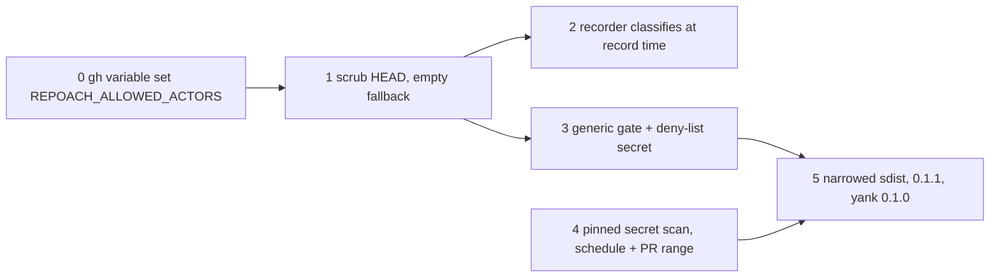

# Umbrella — the repository carries no personal data

Amendment (0.2, 2026-11-18): the verifier's NO-GO on 0.1 re-measured.
Five children instead of four (the recorder redaction is its own
child); the inventory corrected (F1, F5, F7, F8, F9, F11, F13, F23);
the ordering step for the actor variable named first (D1); the kept
attribution positions named by what each one carries (D3); every
example string in this file is of a shape the gate does not flag.

Amendment (0.3, 2026-11-18): F9's node id is kept, not scrubbed — a
forge id is an opaque identifier in none of the five classes, and the
GitLab readers consume a user's `id` (SP-RECORDER-REDACTS-BY-CLASS 0.3
F1c); only the real name leaves the recorded user objects.

## Intent

Owner principle (2026-11-17): repoach is for everyone. No maintainer
path, login, host, address or mailbox belongs in code, defaults, docs,
fixtures, oracles or shipped artefacts; an operator's deployment facts
live in that operator's own repository, or in one labelled example
written with placeholders. Owner decision (2026-11-18): clean up from
now on, never rewrite history. This umbrella names what the tree and
the published 0.1.0 carry today, and splits the cleanup into five
children with one landing order.

## Context

### repoach, measured on `origin/develop` `0be2a56` (2026-11-18)

Read-only, from a fresh worktree. The strings themselves are named by
class, never spelled: the maintainer's system login (`<login>`), the
maintainer's home path (`/home/<login>/…`), the maintainer's directory
layout under the home (`<layout>`, two path segments), the service
account on the production host (`<svc-user>`), the production host's
public IPv4 (`<prod-ip>`), the two short hostnames (`<host-a>`,
`<host-b>`), the maintainer's GitHub handle (`<gh-login>`), the
maintainer's real name (`<name>`), the maintainer's git `user.name`
(`<user-name>`, a short name that is neither the login nor the handle),
the maintainer's GitHub user node id, and the owner's other product's
domain (`<product-domain>`).

| # | Fact | Where (file:line) |
|---|---|---|
| F1 | An absolute home path `/home/<login>/…` is in 6 files, 3 lines of them in the plan; the gate's `home_path` rule (child 2 D1) also fires on 2 test files whose `HOME` is a synthetic one-word `/home/<x>` value, 8 files in all | `bench/results/2026-10-21_planted_claude_code.json:4` (`corpus_root`); `docs/plans/2026-10-18_yoob-production-plan.md:3-4,27`; `docs/specs/2026-10-19_SP-CONVENTIONS-GATE_*.md:51`; `docs/specs/2026-10-19_SP-PIN-TOOLCHAIN_*.md:39`; `docs/specs/2026-10-25_SP-CLAUDE-CODE-FIRST-CLASS_*.md:157`; `docs/specs/2026-10-26_SP-JOB-PROXY-IS-PRIVATE-TO-ITS-JOB_*.md:40`; synthetic: `tests/unit/test_review_planner_cc.py:139,142`, `tests/unit/test_secret_env.py:25,38` |
| F2 | The system login alone is in 3 more files, two of them as a grep oracle that spells the login it forbids; 9 files carry it in all | `docs/specs/2026-11-15_SP-REVIEW-DELTA-FIRST_*.md:345`; `docs/specs/2026-11-15_SP-REVIEW-SETTLED-STAYS-SETTLED_*.md:319`; `tests/fixtures/generated_artefacts/yoob_322/embeddings.diff.template:16` (`"produced_on"`) |
| F3 | The service account is in 1 file | `docs/plans/2026-10-18_yoob-production-plan.md:100,112` |
| F4 | The production IPv4 is in 1 file, inside a section labelled as the owner's example | `docs/specs/2026-11-17_SP-GITLAB-NOTE-RECEIVER_*.md:751` |
| F5 | The short hostnames are in 9 files; three of them are grep oracles that spell the hostname they forbid | `<host-a>` (8 files): `docs/plans/2026-10-18_*.md:96-98,100,112,122-123`; `…SP-UNIVERSAL-REPO_*.md:203,218`; `…SP-CI-LEDGER-PERSISTS_*.md:302`; `…SP-ANONYMISED-GAP-SIGNAL_*.md:287`; `…SP-REVIEW-MEMORY-LOOP_*.md:134`; `…SP-REVIEW-DELTA-FIRST_*.md:345`; `…SP-REVIEW-SETTLED-STAYS-SETTLED_*.md:319`; `…SP-GITLAB-NOTE-RECEIVER_*.md:734,740,744`. `<host-b>` (2 files): `docs/plans/2026-10-18_*.md:97`; `…SP-REFUTER-JUDGES-WHAT-IT-CAN_*.md:176` ("on the loaded `<host-b>`", a real host). A generic English compound in `src/repoach/cli/release_cmds.py:58` and `src/repoach/review/release_gate.py:79` contains `<host-b>` as a substring and is not the host (a false positive the deny-list rule avoids by treating a hyphen as a word character, SP-NO-PERSONAL-DATA-GATE D1) |
| F6 | The other product's domain is in 4 files: one spec example and one recorded merge-request fixture with the test that asserts its strings | `…SP-GITLAB-NOTE-RECEIVER_*.md:751`; `tests/fixtures/generated_artefacts/yoob_322/corpus.diff:9-10,18-19`; `…/yoob_322/user_guide.diff:9-10,18-19,27-28`; `tests/integration/test_generated_artefacts_replay_yoob_322.py:118,124,125` |
| F7 | The three user units and their README hard-code the checkout at `%h/<layout>/repoach`; the layout string is in 10 files in all (the three units, the README, the bench result, the plan, four specs) | `deploy/systemd/repoach-chainpilot.service:7-8`; `deploy/systemd/repoach-llm-proxy.service:9,29,32-33`; `deploy/systemd/repoach-nim-health.service:9,12,14-15`; `deploy/systemd/README.md:4-11,30`; `docs/specs/2026-11-12_SP-MEMORY-BACKEND-LIVENESS_*.md:136-142` (this checkout's layout and another operator service's, both `%h/<two segments>`); the other five files are F1's; `git grep -l '<layout>' -- . ':!tmp' \| wc -l` → 10; `git grep -n '%h/' -- deploy docs \| grep -v -c 'Environment=PATH='` → 16 |
| F8 | The maintainer's GitHub handle is in 42 files: the committed fallback of the actor allow-list in 12 workflow lines (4 files), 2 recorded workflow fixtures (5 lines), 12 forge fixtures, 12 test modules and fakes, 5 docs, and 7 spec bodies (13 lines). The 81 `author:` frontmatter lines carry `<user-name>`, not the handle (`git grep -c '^author: <gh-login>' docs/specs` → 0) | `.github/workflows/ci.yml:39,115,211`; `auto-review.yml:82,107,153,656,722,1296`; `merge-on-ci.yml:71,77`; `shellcheck.yml:32`; `tests/fixtures/merge_wait/auto-review.before.yml:72,297,636`; `tests/fixtures/merge_wait/ci.before-gate.yml:35,122`; `tests/fixtures/forge/github/*.json` (7), `tests/fixtures/forge/gitlab/is_maintainer*.json` (4), `tests/fixtures/forge/gate/pr202_capture.json:17`; `tests/unit/test_owner_commands.py` (37 lines), `tests/unit/test_finding_posts.py` (14), `tests/unit/test_forge_conformance.py` (5), `tests/integration/test_owner_resolves_a_finding_end_to_end.py` (5), `tests/integration/test_finding_thread_ids_end_to_end.py` (4), `tests/github_concurrency_sim.py` (4), `tests/merge_wait_fakes.py` (3), `tests/forge_fakes.py:109`, `tests/unit/test_auto_review_replies_do_not_review.py` (3), `tests/unit/test_open_threads_block_the_merge.py` (3), `tests/integration/test_open_threads_block_the_merge_end_to_end.py:102`, `tests/unit/test_ci_portability.py:72` (a former handle, spelled as the literal the test forbids); `SECURITY.md:31`; `docs/languages.md:14-15`; `docs/getting_started.md:325`; `docs/security_posture.md:18,47,53,69`; `docs/plans/2026-10-18_*.md:38,48,52`; `…SP-CI-SUPPLY-CHAIN-HARDEN_*.md:47,69,97,145`; `…SP-AUTOMERGE-EVENT-DRIVEN_*.md:151`; `…SP-FINDING-THREAD-IDS_*.md:48`; `…SP-AUTO-MERGE-WAITS-FOR-CHECKS-NOT-ITSELF_*.md:62,390`; `…SP-GATE-NAMES-FORMAT-SKEW_*.md:56`; `…SP-RELEASE-PR-CI-RUNS-FOR-THE-BOT-ACTOR_*.md:43,47,57`; `…SP-SKIPPED-REQUIRED-CHECK-IS-NOT-GREEN_*.md:48` |
| F9 | The maintainer's real name and GitHub node id are in 3 recorded fixtures, as the `name` and `id` keys of the recorded `author` object; the real name is also the copyright holder and the package author. The name is scrubbed; the node id is an opaque identifier in none of the five classes and stays, like every recorded `id` (child 2 D1, F1c) | `tests/fixtures/forge/gate/pr202_capture.json:17`; `tests/fixtures/forge/github/open_pull_requests.json:24`; `tests/fixtures/forge/github/pull_request.json:19`; `LICENSE:3`; `pyproject.toml` (`authors`) |
| F10 | No personal mailbox is in the tree; every `@` token is a documentation domain, a forge noreply, an scp-style remote or a URL userinfo in a test | `git grep -h -o -E '[A-Za-z0-9._%+-]+@[A-Za-z0-9.-]+\.[A-Za-z]{2,}'` → 30 `t@example.invalid`, 29 `test@example.invalid`, 10 `noreply@anthropic.com`, 21 scp-style remotes (`git@gitlab.com:…` 13, `git@github.com:…` 8, every one followed by `:` and a path; 0 bare), and single URL-userinfo dummies (`https://tok@github.com/…`, `https://s3cret@gitlab.com/…`, `https://pass@pypi.internal/…`) |
| F11 | The commit identity was a personal mailbox: 23 of the 320 commits on `develop` carry it, 297 carry the GitHub noreply. On 2026-11-18 the owner set the repository-local `user.email` to the noreply address; the global config still holds the personal one, so the effective value in this repository is the noreply | `git log --format=%ae origin/develop \| sed 's/^.*@/@/' \| sort \| uniq -c` → `297 @users.noreply.github.com`, `23 @<a personal mailbox provider>`; `git config --show-origin --get-all user.email` → two lines, `~/.gitconfig` (personal) then `.git/config` (noreply); `git config --get user.email` → the noreply |
| F12 | No real secret in the tree or the history: the owner's full-history scan with gitleaks `8.30.1` and the default rules found 0 leaks (2026-11-18); reproduced here with the same binary, `gitleaks git --log-opts=--all` over the 758 commits reachable from every ref of the worktree → `no leaks found`, and `gitleaks dir` over the checkout → its only 2 findings are in the untracked `tmp/` (the tool's own README examples), 0 in tracked files. No scanner is installed in CI or named in the tree | `command -v gitleaks trufflehog detect-secrets` → none; `git grep -i gitleaks` → 0; the dummies of child 3 F4 match no default rule |
| F13 | The published `repoach-0.1.0.tar.gz` (5 026 285 B, 2026-11-17) is the whole tracked tree: `tests` 523 members, `docs` 415, `src` 272, `bench` 35, `.claude` 18, `scripts` 14, `prompts` 12, `.github` 11, `deploy` 6, `.githooks` 3, `assets` 3, `tmp` 1, plus 12 top-level files (`.env.example`, `.gitignore`, `CLAUDE.md`, `CODE_OF_CONDUCT.md`, `CONTRIBUTING.md`, `LICENSE`, `PKG-INFO`, `README.md`, `SECURITY.md`, `pyproject.toml`, `repoach.toml`, and the `licenses` directory). It carries the home path in 8 files (6 the maintainer's), the login in 7, the production address in 1, `<host-a>` in 5, `<host-b>` in 2, the layout in 10, the handle in 38, the service account in 1, the product domain in 4. The wheel (1 048 693 B) carries `repoach/` and `repoach/prompts/` only | `pyproject.toml:78-93`: hatchling + hatch-vcs, a `[tool.hatch.build.targets.wheel]` with `packages` and `force-include`, and no sdist target, so the sdist is every VCS-tracked file; `tar tzf` and `grep -rl` over the downloaded sdist (`pip download --no-deps --no-binary :all: repoach==0.1.0`) |
| F14 | PyPI holds two releases, neither yanked: `0.0.1` (a 1 394 B sdist and a 1 569 B wheel, 2026-07-19, a name reservation) and `0.1.0` (2026-11-17) | `https://pypi.org/pypi/repoach/json` → `releases` keys and `yanked: false` on all four files (re-read 2026-11-18) |
| F15 | Three specs already anonymise fixtures, each with a hard-coded grep of the owner's strings as its oracle; SP-GITLAB-NOTE-RECEIVER 0.3 made its deployment an example and kept the strings in its AC3 and example section | `…SP-REVIEW-SETTLED-STAYS-SETTLED_*.md:319` ("every login replaced by its class `maintainer` / `author` / `bot` / `agent`, every host and path by a placeholder"); `…SP-REVIEW-DELTA-FIRST_*.md:345`; `…SP-CI-LEDGER-PERSISTS_*.md:302`; `…SP-GITLAB-NOTE-RECEIVER_*.md:734,740-758` |
| F16 | The recording layer already redacts at record time, by key: token-, secret-, `node_id`- and `email`-named keys are dropped; `login`, `name`, `username` and the `id` of a user object are kept | `src/repoach/forge/recording.py:138` (`SECRET_KEY_RE`), `:74` (`"login"`), `:82` (`"name"`), `:124` (`"username"`), `RECORDED_FIELDS` from `:32`, `redact_payload` `:142`; `src/repoach/core/redaction.py:14-26` (`SECRET_VALUE_PATTERNS`, `_URL_USERINFO`) |
| F17 | The tree gates follow one pattern: a scanner module under `src/repoach/lint/`, a CLI under `scripts/lint_*.py` with exit 0/1/2 and a last line `<name>: ok`, a tree suite under `tests/unit/test_*_gate.py` listed in `[gate].pytest` of the affected-jobs table, run by the `gate` job | `src/repoach/lint/no_inline_comments.py:51,69,97,164,172`; `scripts/lint_no_ai_attribution.py:9-21`; `tests/unit/test_no_inline_comments_gate.py:31-56`; `.github/affected-jobs.toml:3-45`; `.github/workflows/ci.yml:35-106`; `rows.docs` runs no job and relies on the gate (`affected-jobs.toml:47-50`); `.github/` and `pyproject.toml` are `[full]` (`:62-64`) |
| F18 | `tests/unit/test_ci_portability.py` pins the workflow allow-list shape: a former handle's literal must be absent (`:72`, spelled) and every `github.actor` gate must read `vars.REPOACH_ALLOWED_ACTORS` (`:75-83`); it does not forbid the current handle as the fallback | `tests/unit/test_ci_portability.py:68-83` |
| F19 | The release path: `publish.yml` builds once (`python -m build --sdist --wheel`, `twine check`, `:60-64`), smokes the wheel, publishes from the `pypi` environment on GitHub-hosted (`:128-147`), then installs from the index (`:191-240`); `docs/releasing.md:32-57` names the owner's one-time steps and `:61-110` each release, ending "a published version cannot be replaced" | `.github/workflows/publish.yml`; `docs/releasing.md` |
| F20 | The architecture baseline this umbrella must not move: `repoach arch check --base origin/develop` → `edge-honesty: ok`; `repoach arch graph --check` → 27 dependency cycles, 5 ownership conflicts (`always_reviewed.py`, `globs.py`, `budget.py`, `agent_overrides.py`, `finding_verifiers.py`), 61 frontier specs, exit 2 | measured in the worktree at `0be2a56`; the two lists are reproduced in each child's AC |
| F21 | The claim "SP-REVIEW-FABLE-TIER changed in #314 without a version bump" is refuted: #314 (`06202c2` → `0be2a56`) moved it `0.3` → `0.5` with amendments 0.4 and 0.5 written | `git diff 06202c2 0be2a56 -- docs/specs/2026-11-15_SP-REVIEW-FABLE-TIER_*.md` lines 4 and 26-44 |
| F22 | The owner's config directory helper exists for a per-user file | `src/repoach/core/paths.py:163-170` (`user_config_dir()` → `$XDG_CONFIG_HOME/repoach`) |
| F23 | gitleaks' newest release is `v8.30.1` (2026-03-21); its assets are the platform tarballs and `gitleaks_8.30.1_checksums.txt`, with no signature or SBOM asset (`.sig`, `.pem`, `.sigstore`: none); `gitleaks/gitleaks-action` `v3.0.0` is commit `e0c47f4f8be36e29cdc102c57e68cb5cbf0e8d1e`; the action needs a licence key on an organisation repository, the binary does not | `gh api repos/gitleaks/gitleaks/releases/latest` (asset names re-read 2026-11-18); `gh api repos/gitleaks/gitleaks-action/git/ref/tags/v3.0.0` |
| F24 | The actor allow-list variable is not set on the repository: `gh variable list` shows `REPOACH_REVIEW_RUNNER` only. The `gate` job's `if` (`ci.yml:37-39`) runs it on a pull request only for an actor in `fromJSON(vars.REPOACH_ALLOWED_ACTORS \|\| '["<gh-login>"]')`, and every other job needs `gate`, so with an empty fallback and the variable unset no pull request would run any job | `gh variable list` (2026-11-18); `.github/workflows/ci.yml:35-39` |

## Decisions (2026-11-18)

- D1. **Five children, one order, one step before them.** (0) The
  owner's go, then `gh variable set REPOACH_ALLOWED_ACTORS` (child 1,
  O0): the variable must exist before the empty fallback lands (F24).
  (1) SP-SCRUB-PERSONAL-DATA-AT-HEAD rewrites every occurrence of
  F1–F9 at HEAD under one redaction rule and makes the units
  installable anywhere; (2) SP-RECORDER-REDACTS-BY-CLASS makes the
  forge recorder write fixtures in that shape, so a re-recording never
  brings a login or a name back; (3) SP-NO-PERSONAL-DATA-GATE adds the
  generic gate that would have refused today's tree and keeps the
  scrubbed one clean; (4) SP-SECRET-SCAN-IS-AN-ORACLE adds the pinned
  full-history secret scan; (5) SP-RELEASE-0-1-1-IS-CLEAN narrows the
  sdist, releases 0.1.1 from the scrubbed tree and names the owner's
  yank of 0.1.0. (1) lands first so (3) is green on arrival; (2)
  follows (1) and is independent of (3); (4) is independent of (1)–(3);
  (5) lands last.
- D2. **The rule is generic, the owner's strings are never committed.**
  The gate detects classes (an absolute home path, a public address, a
  mailbox outside documentation domains). Strings no class can detect
  (a hostname, a system login, a handle, a directory layout) are caught
  by an untracked per-maintainer deny-list that the CI reads from a
  repository secret and the maintainer keeps under `user_config_dir()`
  (F22); a hit names the entry's ordinal and the location, never the
  string. A spec, a test or an oracle therefore never spells a personal
  string again (F2, F5 and F15 did).
- D3. **Public attribution is not personal data; everything else is.**
  Five positions name who is accountable for the project and stay: the
  copyright holder in `LICENSE:3` and the `authors` entry of
  `pyproject.toml` (both the real name), the security contact in
  `SECURITY.md:31` and the maintainer column of `docs/languages.md:14-15`
  (both the handle), and the `author:` line of a spec (the git
  `user.name`, 81 lines). The gate's allow-list declares the two
  positions a rule would fire on — the handle in `SECURITY.md` and
  `docs/languages.md`, rule `denylist`, reason `attribution`; the real
  name and the `user.name` are in no class and not in the recommended
  deny-list (child 3 O1), so `LICENSE`, `pyproject.toml` and the
  `author:` lines need no entry. The same handle as a workflow fallback
  (F8, 12 lines), in a fixture, in a test, in a doc or in an oracle is
  a default or a recording and is scrubbed. The owner may flip this
  decision before (1) opens; then the five positions are rewritten too
  and the two entries are not created.
- D4. **History stays.** No rebase, no filter-repo, no force push: the
  validated states are the commits themselves and the published 0.1.0
  cannot be replaced (F19). The future is cleaned at three points: the
  tree (1, 2), the gate (3) and the next release with the yank (5). The
  commit identity is already the noreply in this repository (F11);
  child 3 judges the author and committer mailboxes of every commit a
  pull request adds, so the setting cannot silently lapse.
- D5. **The live gateway is not touched by a merge.** The three units
  run from copies under `~/.config/systemd/user/`
  (`deploy/systemd/README.md:31-33,46-49,70-73`); editing the tracked
  files changes nothing installed. The owner's migration of the
  installed copies is an optional operator note in child 1, separate
  from the conditions.
- D6. **The other product's name in paths is kept.** The fixture
  directory `tests/fixtures/generated_artefacts/yoob_322/` and the plan
  file `docs/plans/2026-10-18_yoob-production-plan.md` carry a product
  name, not a path, login, host, address or mailbox; renaming them is
  not in the owner's five classes and would move 46 lines of
  `tests/fixtures/affected_jobs/pr_runs.json` for no privacy gain. The
  domain inside the fixture (F6) is a host and is rewritten.

## End state

`git grep` for any of the owner's strings on `develop` returns only the
five attribution positions of D3; `repoach-0.1.1.tar.gz` downloaded
from PyPI holds `src/`, `prompts/`, the spec template, `README.md`,
`LICENSE`, `licenses/`, `pyproject.toml`, `PKG-INFO` and the
`.gitignore` hatchling always adds, and the gate's lint over its
extracted tree prints `personal-data: ok`; PyPI shows 0.1.0 yanked
with a reason and 0.1.1 current; a pull request by an allowed actor
that adds a home path, a public address, a personal mailbox or a
deny-listed string is red in `gate` with `file:line` and the class,
never the string; a weekly workflow scans the full history with a
pinned gitleaks and prints a redacted report; every commit after
2026-11-18 carries the GitHub noreply mailbox; `REPOACH_ALLOWED_ACTORS`
is set and the workflows' fallback is `'[]'`.

## Easy solution rejected

Rewriting history with `git filter-repo`: rejected by the owner
(2026-11-18) — it invalidates every validated SHA, every pinned action
in `release-verify.yml`, every `tests/fixtures/forge/gate/*` capture
and every merge-request thread that cites a commit, for strings that
are already public on PyPI. A hard-coded list of the owner's strings as
the gate: rejected, since the list is itself the leak (F2, F5 and F15
show four specs doing exactly that) and it protects one maintainer, not
a fork's. Yanking 0.1.0 without a clean 0.1.1: rejected, `pipx install
repoach` would then resolve to the 1 394-byte 0.0.1 reservation (F14).
Landing the empty actor fallback before the variable exists: rejected,
the pull request that lands it would be the last one to run CI (F24).

## Hard part

A generic detector produces false positives on exactly the strings a
test suite is full of: `$work/home/.local/share`
(`scripts/wheel_smoke.sh:64`) is not a home path, `git@gitlab.com:org/
repo.git` is an scp-style remote and `https://tok@github.com/x` a URL
userinfo, `127.0.0.1:8084` is loopback, `100.64.0.1` is carrier NAT,
`8.30.1` has three components and `v4.2.1.3` is a version by its
prefix; a bare four-component public token with no version context is
a finding, declared when it is not an address. Each class therefore has
a measured negative set in child 3's scanner tests, and a declared
false positive is one allow entry with a path, a rule and a reason,
judged stale when it no longer matches anything. The second hard part
is that the strings no class can detect are precisely the ones that
must never be written down in the repository, so the deny-list lives
outside the tree and the gate's output is redacted by construction,
the printed path included.

## Goals

- G1: every F1–F9 occurrence is rewritten at HEAD under child 1's redaction rule, and every test that read a rewritten fixture is green.
- G2: the forge recorder writes fixtures in that shape and refuses what it cannot classify (child 2).
- G3: a CI gate refuses the classes of D2 and a per-maintainer deny-list, with a declared allow-list and redacted output, and would have refused `0be2a56`.
- G4: a pinned secret scanner runs over the full history on a schedule and over the pull request's range on every pull request, with redacted output.
- G5: 0.1.1 is released from the scrubbed tree with a narrowed sdist, and 0.1.0 is yanked by the owner with a reason.
- G6: the architecture baseline (F20) does not move: `edge-honesty: ok`, 27 cycles, the same 5 conflicts.

## Non-Goals

- NG1: rewriting history or deleting the published 0.1.0 (D4).
- NG2: a change to the installed units on the live host by a merge (D5).
- NG3: renaming paths that carry a product name (D6).
- NG4: scrubbing the five attribution positions (D3, unless the owner flips it).
- NG5: a secret-scan verdict on history that blocks a pull request for a commit the pull request did not add.

## Assumptions

- A1: the owner's measurement of 2026-11-18 (F12) found no real secret; child 4 reproduces it with a pinned tool, and a real finding there is a red that stops the line and an owner rotation, not a scrub.
- A2: a repository secret is readable by `gate` on `pull_request` from a branch of this repository (true today for the provider keys, `docs/getting_started.md:321-322`). On this repository a pull request by an actor outside `REPOACH_ALLOWED_ACTORS` runs no job at all (F24), gate included; the case "the secret is absent, the four classes alone judge" is a fork running the workflow in its own repository, where the secret does not exist.
- A3: PyPI's yank is a web action by a project owner with 2FA (`docs/releasing.md:32-40`); no agent holds those credentials.

## Interface

The children define the interfaces. This umbrella adds none.

## Behavior

### Nominal

The owner gives the go and the variable is set (child 1 O0); child 1
merges; child 2 merges; child 3 merges and is green on the scrubbed
tree; child 4 merges and its first scheduled run prints zero findings;
child 5 merges, the owner tags `v0.1.1`, approves the `pypi`
deployment, verifies C5 on the downloaded sdist, then yanks 0.1.0.

### Edge cases

- A child's pull request itself contains a personal string (a diff that quotes the old text) → child 3's gate judges the tree, not the diff, so a quote in a commit message is not judged; a quote in a file is red.
- A fork runs the workflows in its own repository → the deny-list secret is absent there; the four classes judge; the fork's own personal data is its own.
- An outsider opens a pull request on this repository → no job runs (F24); the maintainer reviews the diff by hand before adding the actor, which is the existing trust boundary (`docs/security_posture.md:47-69`).

### Failure scenarios

- The gate is red on a string that is not personal → the author adds an allow entry with a reason in the same pull request; child 3's stale-entry rule removes it when it stops matching.
- Child 4 finds a real secret → red; the owner rotates it; nothing else in this umbrella changes.

## Architecture Impact

- Adds dependency: SP-REPO-CARRIES-NO-PERSONAL-DATA -> SP-SCRUB-PERSONAL-DATA-AT-HEAD (child 1)
- Adds dependency: -> SP-RECORDER-REDACTS-BY-CLASS (child 2)
- Adds dependency: -> SP-NO-PERSONAL-DATA-GATE (child 3)
- Adds dependency: -> SP-SECRET-SCAN-IS-AN-ORACLE (child 4)
- Adds dependency: -> SP-RELEASE-0-1-1-IS-CLEAN (child 5)
- New / changed coupling, cycles, or shared state: none; this umbrella owns nothing and the children own only new files or frontier files, so the 27 cycles and the 5 conflicts of F20 are unchanged.

## Diagram

## Acceptance Criteria

- [ ] AC1: the five children are `approved`, each with its own AC green; `repoach arch check --base origin/develop` → `edge-honesty: ok`; `repoach arch graph --check 2>&1 | grep -c '^dependency cycle'` → `27`; `repoach arch graph --check 2>&1 | grep '^ownership conflict' | sort` is byte-identical to the same command on `origin/develop` `0be2a56` (five lines, F20).
- [ ] AC2 (the owner's measurement, written beside this line by the verifier): on `develop` after child 1, the deny-list run of child 3's lint (`scripts/lint_no_personal_data.py --tree .` with `REPOACH_PERSONAL_DENYLIST` holding the owner's seven entries of child 3 O1) prints `personal-data: ok (<n> files, <k> findings allowed by 8 entries, 0 stale)`, the eight entries of child 3 D4, and `deny-list: 7 entries`.
- [ ] AC3: `pip download --no-deps --no-binary :all: repoach==0.1.1` then `tar xzf` and `scripts/lint_no_personal_data.py --tree <extracted dir>` → `personal-data: ok`; `curl -s https://pypi.org/pypi/repoach/0.1.0/json | python -c 'import json,sys; print({f["yanked"] for f in json.load(sys.stdin)["urls"]})'` → `{True}`.
- [ ] AC4: `gh variable list | grep -c '^REPOACH_ALLOWED_ACTORS'` → `1` before child 1's pull request opens (child 1 O0), written here with the date.

## Open Questions

- None. D3 and D6 carry a default the owner may flip before child 1's pull request opens; a flip amends child 1, not this umbrella.
