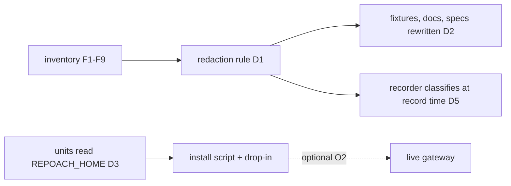

# Every owner string at HEAD becomes a placeholder

## Intent

Child 1 of SP-REPO-CARRIES-NO-PERSONAL-DATA. It rewrites, at HEAD and
once, every occurrence its parent measured (F1–F9), under one written
redaction rule that the recording layer and every future fixture
follow; it makes the three user units install anywhere; and it names
the owner's steps (commit identity, migration of the live units) as
steps, not conditions.

## Context

The parent's F1–F9 and F15–F16 are the inventory; this spec cites them
by number. What matters for the edits:

- Three specs use a grep that spells the forbidden strings as their
  oracle (F15). Those oracles are replaced by the class-based lint of
  SP-NO-PERSONAL-DATA-GATE, which lands after this spec; until then the
  oracle line reads `scripts/lint_no_personal_data.py --tree <path>`
  and is judged when child 2 lands (D6).
- The recording layer keeps `login`, `name` and `username` (F16): a
  re-recorded fixture would carry the handle again. The rule has to be
  applied where fixtures are written, not only to today's files.
- The workflows' fallback `'["<gh-login>"]'` is a default (F8, 12
  lines); the guard test `tests/unit/test_ci_portability.py:72` checks
  only the pre-variable literal, so it passes today and must be
  tightened to pin the new fallback.
- The units' `%h/Documents/work/repoach` (F7) is the maintainer's
  layout; systemd's `%h` is the invoking user's home, so the path is
  not personal by itself, but the layout under it is one maintainer's
  and `deploy/systemd/README.md:4-11` says so ("adjust … if either
  differs"). SP-GITLAB-NOTE-RECEIVER D10 already made its unit pair
  carry no operator value and pinned it with `systemd-analyze verify`
  on a rewritten `ExecStart` (its Tests table, two rows).

## Decisions (2026-11-18)

- D1. **One redaction rule (`format:redaction-rule`), written in
  `docs/security_posture.md` as a new section "Personal data in
  fixtures and docs", one table.** Every future fixture, bench result,
  doc and spec obeys it; the lint of child 2 enforces the classes it
  can detect and the deny-list the rest. The rule:

  | Class | Replacement | Note |
  |---|---|---|
  | absolute home path (`/home/<x>/…`, `/Users/<x>/…`) | `~/…` in prose; `<repo>/…` when the path is a checkout; `/path/to/…` in a recorded JSON value | never `%h/<layout>` either |
  | system login, service account | `<user>`; in a recorded JSON value, the class word (`maintainer`, `author`, `bot`, `agent`, `service`) | SP-REVIEW-SETTLED-STAYS-SETTLED 0.7 rule, generalised |
  | forge handle in a fixture or test | the class word with a stable suffix when several are needed: `maintainer`, `author`, `author-2`, `bot` | GitHub `login`, GitLab `username` alike |
  | real name, forge node id, user id | dropped: the key is removed from the recorded object | `login`/`username` are read by the forges and stay as class words (`forge/recording.py:31-130`); `name` is not read and is dropped (D5); `node_id` is already dropped (`:138`) |
  | hostname (short or FQDN) | `<host>`; in a URL, `example.com` or a subdomain of it | RFC 2606 |
  | public IPv4 | `203.0.113.<n>` (RFC 5737 TEST-NET-3) | `192.0.2.<n>` and `198.51.100.<n>` are also accepted by the gate |
  | public IPv6 | `2001:db8::<n>` (RFC 3849) | |
  | mailbox | `<user>@example.com`; a forge noreply stays as is | |
  | a domain of the owner's other product | `example.com`, or `product.example.com` when the sentence needs a product | the product's name alone is not personal data (parent D6) |

- D2. **The scrub list, file by file, is the parent's F1–F9**, with the
  replacement each gets:
  - `bench/results/2026-10-21_planted_claude_code.json:4`: `"corpus_root": "bench/corpus/planted"` — a repository-relative path. `repoach bench score` resolves `Path(result.corpus_root)` relative to the working directory (`src/repoach/cli/bench_cmds.py:152,237`), so a relative value works from the checkout root and the file documents it in a sibling `README.md` line.
  - `docs/plans/2026-10-18_yoob-production-plan.md:3-4,96-100,112,122-123`: home paths → `<repo>`; the service account → `<service user>`; the two hostnames → `<host-a>`, `<host-b>` (the plan compares two machines, so two placeholders).
  - the six specs of F1–F2 and the five of F5: the spelled strings → the D1 placeholders; the grep oracles of F15 → `scripts/lint_no_personal_data.py --tree <fixture path>` → `personal-data: ok` (D6). Each edited spec gets a version bump and an amendment paragraph of two sentences naming this spec (D7).
  - `…SP-GITLAB-NOTE-RECEIVER_*.md:734,740-758`: AC3's grep → the lint; the example section keeps its structure with `<host>`, `203.0.113.10`, `example.com` and `product.example.com` in place of the measured values, and its title says "an operator's host, values replaced by placeholders".
  - `tests/fixtures/generated_artefacts/yoob_322/embeddings.diff.template:16`: `"produced_on": "maintainer"`; `corpus.diff:9-10,18-19` and `user_guide.diff:9-10,18-19,27-28`: the two product hosts → `product.example.com` and `studio.product.example.com`; `tests/integration/test_generated_artefacts_replay_yoob_322.py:118,124,125`: the same two strings. The test is green because it asserts the fixture's strings, not the live product's (`:118-125` build the expected tree from literals).
  - `tests/fixtures/forge/github/*.json`, `tests/fixtures/forge/gitlab/is_maintainer*.json`, `tests/fixtures/forge/gate/pr202_capture.json`: `login`/`username` → `maintainer`; `name` keys removed; node ids removed; the URL paths that embed the handle (`collaborators/<handle>/permission`, `members/all?query=<handle>`) → `maintainer`. `tests/unit/test_forge_conformance.py:267,279,595-608`, `tests/unit/test_review_gate_forge_parity.py:52` and the fixtures' `args` move together, since `ReplaySpawn` fails on the first argv that differs (`forge/recording.py:1-13`).
  - the nine test modules and two fakes of F8: the handle → `maintainer` (a module constant `MAINTAINER = "maintainer"` where it repeats ≥ 3 times: `test_owner_commands.py`, `test_finding_posts.py`, `github_concurrency_sim.py`, `merge_wait_fakes.py`).
  - `.github/workflows/{ci,auto-review,merge-on-ci,shellcheck}.yml` (12 lines) and the two recorded workflow fixtures `tests/fixtures/merge_wait/*.yml`: `vars.REPOACH_ALLOWED_ACTORS || '["<gh-login>"]'` → `vars.REPOACH_ALLOWED_ACTORS || '[]'`. Fail closed: with the variable unset, no pull request from anyone runs on the self-hosted runner. `docs/getting_started.md:323-326` and `docs/security_posture.md:47-69` say the variable is required, no longer "defaults to the maintainer". `tests/unit/test_ci_portability.py` gains `test_actor_allowlist_has_no_login_fallback`: every `fromJSON(vars.REPOACH_ALLOWED_ACTORS || …)` fallback is the literal `'[]'`.
  - `…SP-CI-SUPPLY-CHAIN-HARDEN_*.md:47,69,97,145`: the handle → "the maintainer's handle", A2 → "the repository variable names the trusted actors".
  - `SECURITY.md:31`, `docs/languages.md:14-15`, `LICENSE`, `pyproject.toml` `authors`, the 81 `author:` frontmatter lines: kept (parent D3), each covered by one allow entry of child 2 with reason `attribution` — five entries, the 81 frontmatters under one path glob `docs/specs/*.md` with rule `handle` restricted to the `author:` line.
- D3. **The units read `REPOACH_HOME`.** Each unit sets
  `Environment=REPOACH_HOME=%h/.local/share/repoach` as the documented
  default and uses `${REPOACH_HOME}` in `WorkingDirectory=`,
  `ExecStart=`, `StandardOutput=` and `StandardError=`; systemd expands
  `${VAR}` in these settings from the unit's own `Environment=` (the
  `systemd.service(5)` rule for `ExecStart=`; `WorkingDirectory=` and
  `StandardOutput=append:` take `%`-specifiers and, since systemd 250,
  environment expansion through a drop-in is the documented way to
  change them). An operator whose checkout lives elsewhere writes one
  drop-in, `~/.config/systemd/user/<unit>.service.d/path.conf`, holding
  `[Service]` and `Environment=REPOACH_HOME=/their/path`, and never
  edits the tracked unit. `scripts/install_user_units.sh [--home
  <path>]` copies the three units and their timers, writes that drop-in
  when `--home` is given, runs `daemon-reload` and `systemd-analyze
  --user verify` on the installed names, and prints what it installed;
  it refuses to run when `systemctl --user` is unavailable, with the
  reason. `deploy/systemd/README.md` documents the default, the
  drop-in and the script in place of its lines 4-10 and the three
  `cp …` blocks. `…SP-MEMORY-BACKEND-LIVENESS_*.md:137,140` cites the
  new convention (D7).
- D4. **The live units are not touched by this change.** The gateway
  runs copies under `~/.config/systemd/user/` (`README.md:31-33,46-49,70-73`); a
  merge changes the tracked files only. The owner's migration is the
  operator note O2 below, optional and outside the conditions.
- D5. **Recording redacts by class at record time.**
  `src/repoach/forge/recording.py` gains, beside `SECRET_KEY_RE`
  (`:138`), a `PERSONAL_KEY_RE = re.compile(r"^(name|full_name|
  avatar_url|web_url|html_url|email|public_email|node_id)$", re.I)`
  whose keys are dropped, and a `classify_logins(payload, roles)` step
  that replaces every `login`/`username`/`author`/`resolved_by` value by
  its class word, the mapping decided by the recorder from
  `is_maintainer` (`maintainer`) and the change request's author
  (`author`), with `author-2`… for further distinct values and `bot`
  for a `[bot]`-suffixed login. `scripts/record_forge_fixture.py`
  refuses to write a fixture in which a value matches the generic
  classes of child 2 (a home path, a public address, a mailbox) or
  survives as a value that `classify_logins` did not map, and says
  which key. Existing fixtures are rewritten by hand to the same shape
  (D2), so `tests/unit/test_forge_conformance.py` replays unchanged
  argv except the handle.
- D6. **The oracle of "no personal string in a fixture" is child 2's
  lint, never a grep that spells the string.** The four oracles of F15
  become `scripts/lint_no_personal_data.py --tree <fixture path>` →
  `personal-data: ok`, run with the maintainer's deny-list present
  (the secret in CI, the config file locally). Until child 2 lands the
  line is written and marked "judged when SP-NO-PERSONAL-DATA-GATE
  lands"; the verifier of this spec judges the four fixtures with
  `git grep -c` of the owner's strings on their own machine and writes
  the counts (all zero) beside AC2.
- D7. **Every edited spec is bumped.** `version` + 0.1 (or + 1 on the
  minor when the spec is ≥ 1.0), `updated: <date>`, and one amendment
  paragraph after the title: "Amendment (<v>, <date>): personal
  strings replaced by placeholders (SP-SCRUB-PERSONAL-DATA-AT-HEAD D2);
  the fixture oracle is the class lint (D6)." The list: SP-CONVENTIONS-GATE
  0.2→0.3, SP-PIN-TOOLCHAIN 0.1→0.2, SP-CLAUDE-CODE-FIRST-CLASS 0.2→0.3,
  SP-JOB-PROXY-IS-PRIVATE-TO-ITS-JOB 1.1→1.2, SP-REVIEW-DELTA-FIRST
  0.7→0.8, SP-REVIEW-SETTLED-STAYS-SETTLED 0.8→0.9, SP-CI-LEDGER-PERSISTS
  0.4→0.5, SP-GITLAB-NOTE-RECEIVER 0.6→0.7, SP-UNIVERSAL-REPO 0.2→0.3,
  SP-ANONYMISED-GAP-SIGNAL 0.1→0.2, SP-REVIEW-MEMORY-LOOP 0.1→0.2,
  SP-MEMORY-BACKEND-LIVENESS 0.1→0.2, SP-CI-SUPPLY-CHAIN-HARDEN 0.1→0.2.
  SP-REVIEW-FABLE-TIER is not edited (parent F21: its bump happened).
- D8. **The commit identity is an owner step (O1), and from then on a
  gate.** The owner runs, in the repository: `git config user.email
  "<id>+<handle>@users.noreply.github.com"` (the address GitHub shows
  under Settings → Emails, "Keep my email addresses private"). Child
  2's lint judges the author and committer mailbox of every commit a
  pull request adds against the mailbox class (a noreply or a declared
  organisation domain), so the step cannot silently lapse. The 23 past
  commits (parent F11) stay.

## End state

`git grep -n -E '/home/[A-Za-z0-9_.-]+/|/Users/[A-Za-z0-9_.-]+/' -- . ':!tmp'`
on `develop` prints only `scripts/wheel_smoke.sh:64` (a temporary
directory named `home`); the owner's `git grep` for each of their
strings prints the five attribution positions and nothing else; the
three units verify on a host with no checkout under the maintainer's
layout; `pytest -q tests/unit/test_forge_conformance.py
tests/unit/test_review_gate_forge_parity.py
tests/integration/test_generated_artefacts_replay_yoob_322.py
tests/unit/test_ci_portability.py tests/unit/test_owner_commands.py
tests/unit/test_finding_posts.py` is green; the live gateway's units
are byte-identical to before the merge until the owner runs O2.

## Easy solution rejected

A `sed` over the tree with the owner's strings and no written rule:
rejected, the next recorded fixture brings them back (F16 keeps
`login`, `name`, `username`) and the next spec quotes them in an
oracle (F15 did, three times). Keeping `%h/Documents/work/repoach` with
a comment "adjust if different": rejected, it is what the README says
today (`:8-10`) and every operator edits a tracked file. A
`REPOACH_HOME` read by the Python code at runtime: rejected, the units
need the path before any Python runs (`ExecStart=` names the
interpreter). Replacing the handle in `SECURITY.md` and
`docs/languages.md`: rejected by parent D3, a project needs a named
contact and a maintainer column.

## Hard part

The forge fixtures are replayed argv-for-argv (`forge/recording.py:
1-13`): the handle sits inside recorded `args` (`collaborators/<handle>/
permission`, `members/all?query=<handle>`) and inside JSON stdout; the
tests that build expectations (`test_forge_conformance.py:595-608`)
and the fakes that answer them (`tests/forge_fakes.py:109`,
`tests/merge_wait_fakes.py:249-297`) must all move to the same class
word in one pull request, or the conformance suite is red on the first
argv. The second hard part is the systemd expansion: `${VAR}` from the
unit's own `Environment=` works in `ExecStart=`, `WorkingDirectory=`
and `StandardOutput=append:` on the systemd the units target (≥ 250,
SP-GITLAB-NOTE-RECEIVER's floor), and the test must prove it on CI's
systemd rather than assert the text, so AC3 runs `systemd-analyze
verify` and `systemctl --user show -p WorkingDirectory` on a loaded
copy.

## Goals

- G1: every occurrence of the parent's F1–F9 outside the five attribution positions is rewritten under D1 (D2).
- G2: the three units and their README take `REPOACH_HOME` with a documented default and a drop-in; an install script installs and verifies them (D3).
- G3: the recording layer applies the rule at record time and the recorder refuses what it cannot classify (D5).
- G4: the four spelled-string oracles are replaced by the class lint (D6); every edited spec is bumped (D7).
- G5: the workflows' actor fallback is empty and pinned by a test (D2); the docs say the variable is required.

## Non-Goals

- NG1: touching the installed units (D4; O2 is the owner's).
- NG2: rewriting history (parent D4).
- NG3: the generic lint itself (child 2), the secret scan (child 3), the release (child 4).
- NG4: renaming `yoob_322` or the plan file (parent D6).

## Assumptions

- A1: systemd ≥ 250 on every host the units target (the floor SP-GITLAB-NOTE-RECEIVER G4 set); CI's runner has `systemd-analyze` (its Tests table runs it today).
- A2: `repoach bench score` is run from the checkout root (`bench/corpus/README.md:10` runs it so).
- A3: the owner approves parent D3 (attribution kept) before this pull request opens.

## Interface

Inputs:
- `REPOACH_HOME`: path — the checkout the units run from; default `%h/.local/share/repoach` in the unit; overridden by a drop-in.
- `scripts/install_user_units.sh [--home <path>] [--dry-run]`: copies the five files of `deploy/systemd/`, writes the drop-in when `--home` is given, reloads and verifies.
- `classify_logins(payload: dict, roles: dict[str, str]) -> dict` in `forge/recording.py`: replaces every login-bearing value by its class word.

Outputs:
- `install_user_units.sh`: one line per installed file, `verified: <unit>` per unit, exit 0; exit 2 with the reason when `systemctl --user` is unavailable or `systemd-analyze verify` prints anything.
- `record_forge_fixture.py`: a fixture whose every login-bearing value is a class word, or exit 2 naming the key it could not classify.

Errors:
- `UnclassifiedValueError` (`record_forge_fixture.py`): a login-bearing key whose value is not in `roles`.

## Behavior

### Nominal

The implementer rewrites D2 file by file, runs the six suites of the
End state, runs `systemd-analyze --user verify` on the three units
copied to a temporary user config with `REPOACH_HOME` set to a
temporary checkout, bumps the thirteen specs (D7), and opens one pull
request titled `refactor(repo): replace personal strings by placeholders`.

### Edge cases

- A fixture value is both a login and a reason text (`owner-resolved by <handle>: …` in `test_owner_commands.py:211`) → the test builds the string from `MAINTAINER`, the fixture holds `maintainer`.
- A spec cites a path under the maintainer's home as evidence of a measurement (`…SP-PIN-TOOLCHAIN_*.md:39`) → the path becomes `<repo>/.venv`, the measurement stays.

### Failure scenarios

- `ReplaySpawn` red on an argv → the fixture's `args` and the test's expectation disagree on the class word; both are in this pull request.
- `systemd-analyze verify` names an unexpanded `${REPOACH_HOME}` → the setting does not expand on that systemd; the unit falls back to the `%h` default literal for that setting and the README says which (none expected on ≥ 250, A1).

### Operator steps

- O1 (owner, once, before the first commit of this pull request): `git config user.email "<id>+<handle>@users.noreply.github.com"` in the repository; verify with `git config --get user.email`.
- O2 (owner, optional, live gateway): `scripts/install_user_units.sh --home <the live checkout path>` then `systemctl --user restart repoach-llm-proxy.service` and `systemctl --user list-timers`; before it, `systemctl --user cat repoach-llm-proxy.service | grep -c Documents` is `4`, after it `0` and the drop-in holds the path. Skipping O2 leaves the gateway running on the old copies with no functional change.

## Tests

| Test | What it pins | Mutation that must turn it red |
|---|---|---|
| `tests/unit/test_user_units_take_an_install_path.py::test_units_name_no_layout_and_expand_repoach_home` | D3: no tracked unit contains `Documents/`; each contains `Environment=REPOACH_HOME=` and `${REPOACH_HOME}` in `WorkingDirectory=` and `ExecStart=`; the three units and two timers copied to a temp `XDG_CONFIG_HOME` with a drop-in `REPOACH_HOME=<tmp checkout>` (holding a `.venv/bin/repoach` stub) pass `systemd-analyze --user verify` with empty output (skipped with the reason when `systemd-analyze` is absent) | put the layout back, or drop the drop-in |
| `::test_install_script_writes_the_drop_in_and_refuses_without_user_systemd` | D3: `--dry-run --home /x` prints the five copies and the drop-in content; with `PATH` holding no `systemctl`, exit 2 and the reason | print nothing, or exit 0 |
| `tests/unit/test_ci_portability.py::test_actor_allowlist_has_no_login_fallback` | D2: every `fromJSON(vars.REPOACH_ALLOWED_ACTORS \|\| …)` in `.github/workflows/*.yml` has the fallback `'[]'` | put a handle back |
| `tests/unit/test_forge_conformance.py` (existing, re-pointed) | D2, D5: every replayed argv and every expected `login`/`username` is `maintainer`; `test_forge_conformance.py:595-608` builds `members/all?query=maintainer` | keep one `args` with the handle |
| `tests/unit/test_forge_recording_redaction.py::test_personal_keys_are_dropped_and_logins_classified` | D5: a payload with `name`, `avatar_url`, `node_id`, `login: <x>`, `username: <y>` recorded with `roles={x: "maintainer", y: "author"}` keeps no `name`/`avatar_url`/`node_id` and holds the two class words; a `login` not in `roles` raises `UnclassifiedValueError` naming the key | keep `name`, or map an unknown login silently |
| `tests/integration/test_generated_artefacts_replay_yoob_322.py` (existing) | D2: green with `product.example.com` in fixture and test | change one of the two |
| `tests/unit/test_bench_score.py` and `tests/unit/test_bench_cli.py` (existing) | D2: `corpus_root` relative resolves from the working directory | an absolute path in the result fixture |

## Success conditions

- C1 (oracle: git, any machine): `git grep -n -E '/home/[A-Za-z0-9_.-]+/|/Users/[A-Za-z0-9_.-]+/|%h/Documents' -- . ':!tmp'` → exactly one line, `scripts/wheel_smoke.sh:64`.
- C2 (oracle: the owner's `git grep` on their machine, counts written beside AC2 by the verifier): for each of the owner's strings, `git grep -l <string> -- . ':!tmp'` names only files among `LICENSE`, `pyproject.toml`, `SECURITY.md`, `docs/languages.md`, `docs/specs/*.md` (`author:` lines only, checked with `git grep -n <handle> docs/specs | grep -v ':author: '` → 0).
- C3 (oracle: pytest, CI): the six suites of the End state green, plus `tests/unit/test_user_units_take_an_install_path.py` and `tests/unit/test_forge_recording_redaction.py`.
- C4 (oracle: systemd, CI or a fresh machine): `systemd-analyze --user verify` on the installed copies → empty output; `systemctl --user show -p WorkingDirectory repoach-llm-proxy.service` → the drop-in's path.
- C5 (oracle: git): `for f in <the 13 specs of D7>; do grep -m1 '^version:' $f; done` shows each bumped value; `git diff origin/develop -- docs/specs | grep '^+version:' | wc -l` → `13`.
- C6 (oracle: git, after O1): `git log -1 --format=%ae` on the pull request's head ends with `@users.noreply.github.com`.

## Architecture Impact

- Adds dependency: SP-SCRUB-PERSONAL-DATA-AT-HEAD -> SP-UNIVERSAL-FORGE (`forge/recording.py` D5 and `tests/fixtures/forge/` D2 are its)
- Adds dependency: -> SP-PRECISION-MEASUREMENT (`bench/results/*.json` D2 is its)
- Adds dependency: -> SP-GENERATED-FILES-ARE-VERIFIED-NOT-READ (`tests/fixtures/generated_artefacts/` and its replay test, D2)
- Adds dependency: -> SP-OWNER-SETTLES-A-FINDING, -> SP-FINDING-THREAD-IDS (their tests carry the handle, D2)
- Adds dependency: -> SP-CI-JOBS-NO-OP-WHEN-NOT-AFFECTED (`.github/workflows/ci.yml` fallback, D2), -> SP-CI-SUPPLY-CHAIN-HARDEN (the actor allow-list it introduced, D2), -> SP-AUTO-MERGE-WAITS-FOR-CHECKS-NOT-ITSELF (`tests/fixtures/merge_wait/*.yml`, D2)
- Adds dependency: -> SP-CONTRIBUTING (`docs/languages.md` allow entry, D2)
- Adds dependency: -> SP-GITLAB-NOTE-RECEIVER (the example section and AC3, D2; the unit-pair convention D3 follows), -> SP-MEMORY-BACKEND-LIVENESS (`README.md` convention it cites, D3)
- Adds dependency: -> SP-CI-LEDGER-PERSISTS, -> SP-REVIEW-DELTA-FIRST, -> SP-REVIEW-SETTLED-STAYS-SETTLED (their oracles, D6), -> SP-UNIVERSAL-REPO, -> SP-ANONYMISED-GAP-SIGNAL, -> SP-REVIEW-MEMORY-LOOP, -> SP-CONVENTIONS-GATE, -> SP-PIN-TOOLCHAIN, -> SP-CLAUDE-CODE-FIRST-CLASS, -> SP-JOB-PROXY-IS-PRIVATE-TO-ITS-JOB (their text, D2, D7)
- New resource: `format:redaction-rule` (the D1 table). No table. No new cycle: this spec owns only the three units, the README, one new test and one new script, none imported by anything; every edge above is a document or fixture edit, not an import.

## Diagram

## Acceptance Criteria

- [ ] AC1: C1 and C5 as written; `pytest -q tests/unit/test_user_units_take_an_install_path.py tests/unit/test_forge_recording_redaction.py tests/unit/test_ci_portability.py tests/unit/test_forge_conformance.py tests/unit/test_review_gate_forge_parity.py tests/integration/test_generated_artefacts_replay_yoob_322.py tests/unit/test_owner_commands.py tests/unit/test_finding_posts.py tests/unit/test_bench_score.py tests/unit/test_bench_cli.py` → green.
- [ ] AC2: C2's counts written here by the verifier; C4's two outputs written here.
- [ ] AC3: `repoach arch check --base origin/develop` → `edge-honesty: ok`; `repoach arch graph --check 2>&1 | grep -c '^dependency cycle'` → `27`; the `ownership conflict` lines are the five of the parent's F20.
- [ ] AC4: the live gateway, before O2: `systemctl --user is-active repoach-llm-proxy.service` → `active` after the merge, and `systemctl --user cat repoach-llm-proxy.service | grep -c Documents` → `4` (unchanged); written here by the owner.

## Open Questions

- None. A3 (parent D3) is the owner's default; a flip amends D2's last bullet before the pull request opens.
