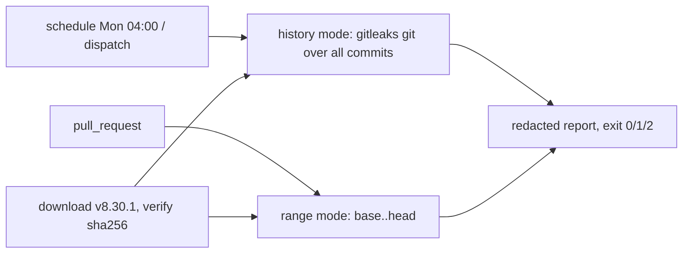

# The secret scan is an oracle, pinned and recurring

## Intent

Child 3 of SP-REPO-CARRIES-NO-PERSONAL-DATA. The owner's measurement of
2026-11-18 (1869 commits, the 0.1.0 sdist and wheel, no real secret;
parent F12) was done once, by hand, with no tool in the repository.
This spec makes it reproducible: a pinned gitleaks with entropy
detection, a baseline that names the test dummies and why they are
dummies, redacted output, run weekly over the full history and on
every pull request over the commits it adds.

## Context

### Measured 2026-11-18

| # | Fact | Where |
|---|---|---|
| F1 | No secret scanner is installed locally or named in the tree | `command -v gitleaks trufflehog detect-secrets` → none; `git grep -n -i -E 'gitleaks\|trufflehog\|detect-secrets'` → 0 |
| F2 | gitleaks' newest release is `v8.30.1`, published 2026-03-21; it ships `gitleaks_8.30.1_linux_x64.tar.gz` and `gitleaks_8.30.1_checksums.txt` | `gh api repos/gitleaks/gitleaks/releases/latest` |
| F3 | `gitleaks/gitleaks-action` `v3.0.0` is commit `e0c47f4f8be36e29cdc102c57e68cb5cbf0e8d1e`; the action requires a `GITLEAKS_LICENSE` on an organisation-owned repository, the binary does not | `gh api repos/gitleaks/gitleaks-action/git/ref/tags/v3.0.0`; the action's README |
| F4 | The secret-shaped strings in the tree are test dummies | `tests/unit/test_ci_doctor.py`, `tests/unit/test_open_threads_block_the_merge.py`, `tests/unit/test_review_notifier.py` (parent F12); `src/repoach/core/redaction.py:14-25` names the token prefixes repoach itself redacts (`glrt-`, `glpat-`, `GR1348941`, `gh[pousr]_`, `github_pat_`) |
| F5 | Every action in the workflows is pinned by commit SHA with a version comment; every job's `runs-on` is the configurable runner expression, pinned by a test | `.github/workflows/ci.yml:51,56`; `tests/unit/test_ci_portability.py:50-60,68-83` |
| F6 | Untrusted pull-request code never runs on the self-hosted runner without the actor allow-list | `ci.yml:36-39`; SP-CI-SUPPLY-CHAIN-HARDEN; `docs/security_posture.md:47-69` |
| F7 | A separate workflow is not in the affected-jobs table and is not gated by `gate`; `test_affected_workflow_wiring.py` judges `ci.yml` only | `src/repoach/affected/select.py` (`DEFAULT_WORKFLOW_PATH`); `.github/affected-jobs.toml` names three jobs of `ci.yml` |

## Decisions (2026-11-18)

- D1. **The binary, not the action.** `scripts/secret_scan.sh` downloads `https://github.com/gitleaks/gitleaks/releases/download/v8.30.1/gitleaks_8.30.1_linux_x64.tar.gz` into a temporary directory, verifies its SHA-256 against the value committed in the script (`GITLEAKS_SHA256=<64 hex>`, recorded by the implementer from `gitleaks_8.30.1_checksums.txt` and written beside AC1), refuses on a mismatch with exit 2, and runs the binary. No licence key, no third-party action, no Docker (the self-hosted runner has none, `tests/unit/test_ci_portability.py:40-44`). A cached binary under `$RUNNER_TEMP` with the right checksum is reused.
- D2. **Two modes.** `scripts/secret_scan.sh history` runs `gitleaks git --redact=100 --config .gitleaks.toml --report-format json --report-path <tmp>/report.json .` over the full history (`fetch-depth: 0`); `scripts/secret_scan.sh range <base>..<head>` runs the same with `--log-opts="<base>..<head>"` over the commits a pull request adds. Both print the finding count and, per finding, `rule`, `file`, `commit`, `line` and the fingerprint, never the secret: `--redact=100` replaces the whole match. Exit 0 on no finding, 1 on a finding, 2 on a download, checksum or invocation error.
- D3. **The baseline is a config, not a list of secrets.** `.gitleaks.toml` extends the default rules (`[extend] useDefault = true`). Declaring a dummy by fingerprint (`<commit>:<file>:<rule>:<line>` in `[allowlist] fingerprints`) is refused: a fingerprint pins one commit, and the dummies live at HEAD and move. Instead `[allowlist] paths` names the three test modules of F4 with a `regexTarget = "match"` regex that admits only the documented dummy shapes (`ghp_` followed by one letter repeated, `glpat-` followed by one letter repeated), and a `# reason:` comment line above each entry. A dummy that does not fit the shape is a finding until the test is rewritten to a shape or the entry is extended with its reason. Entropy detection stays on (the default `generic-api-key` rule).
- D4. **Where it runs.** `.github/workflows/secret-scan.yml`: `on: schedule: cron: "0 4 * * 1"` (history mode, Mondays 04:00 UTC), `on: pull_request` (range mode, `${{ github.event.pull_request.base.sha }}..${{ github.event.pull_request.head.sha }}`), `on: workflow_dispatch` (history mode). One job, `secret-scan`, `runs-on: ${{ vars.REPOACH_RUNNER || 'self-hosted' }}` (F5's test), `if: github.event_name != 'pull_request' || contains(fromJSON(vars.REPOACH_ALLOWED_ACTORS || '[]'), github.actor)` (F6, with child 1's empty fallback), `permissions: contents: read`, checkout pinned by SHA with `fetch-depth: 0`. The job runs no code from the pull request: the script and the config are read from the checked-out head, and a pull request that edits `.gitleaks.toml` or `scripts/secret_scan.sh` is reviewed like any `.github/` change (`[full]` row).
- D5. **Recurring, and a red stops the line.** The scheduled run is recurring by D4. A finding in history mode is a real secret or an undeclared dummy; the owner rotates a real secret (the workflow does not and cannot) and the pull request that follows declares a dummy with its reason. A finding in range mode blocks the pull request like any red check; the owner may add the job to the required checks once it has run green three Mondays (an owner step, O1), so a transport failure does not block merges on day one.
- D6. **The report is an artefact, redacted.** The JSON report is uploaded with `actions/upload-artifact` (pinned SHA, 14-day retention) only when findings exist; its `Secret` field is the redacted string by `--redact=100`, and `tests/unit/test_secret_scan_workflow.py` pins the flag's presence in the script so a later edit cannot drop it.

## End state

Every Monday a run of `secret-scan.yml` prints `secret-scan: 0
finding(s) over <n> commits` on the repository's full history with
gitleaks `8.30.1`, the binary's checksum verified; every pull request
runs the same over the commits it adds; `.gitleaks.toml` names the
three dummy files with the shape and the reason; a planted token in a
pull request is red with the rule, the file, the commit and the line,
and the log holds only `REDACTED` where the token was.

## Easy solution rejected

`gitleaks/gitleaks-action`: rejected, it needs a licence key on an
organisation repository (F3) and adds a third-party action for a
single static binary. `pip install detect-secrets` in the test job:
rejected, it scans a tree, not history, and its baseline is a file of
hashed secrets committed to the repository. A one-off scan written as
a `## Measured` line: rejected, that is what the parent's F12 is, and it
is unreproducible without the tool and its version. Making the job a
required check on day one: rejected (D5), a download failure would
block every merge before the job has a record.

## Hard part

The scan must be useful (entropy detection on) and quiet (no finding on
the three dummy files) without ever committing a secret-like string as
an allow entry: the baseline is therefore a shape per file with a
reason, not a value, and the test suite's dummies must be of a
recognisable shape (repeated letters) rather than realistic. The second
hard part is the supply chain: a binary downloaded at run time is
trusted only through a checksum the repository holds, so the checksum
is the pin, the version is in the URL, and a mismatch is a red that
names the two values.

## Goals

- G1: a pinned, checksum-verified gitleaks `8.30.1` runs in CI on the full history weekly and on each pull request's range (D1, D2, D4).
- G2: the baseline declares the dummies by path and shape with reasons; entropy rules stay on (D3).
- G3: no secret reaches a log or an artefact (`--redact=100`, D2, D6).
- G4: the job obeys the repository's workflow rules: pinned actions, configurable runner, actor gate (F5, F6).

## Non-Goals

- NG1: detecting personal data (child 2).
- NG2: rotating a found secret (the owner's).
- NG3: a required check from day one (D5, O1).
- NG4: scanning the published artefacts for secrets (the parent's F12 covered 0.1.0 by hand; child 4's artefact check is for personal data; a secret in `src/` is in the history scan).

## Assumptions

- A1: the self-hosted runner can reach `github.com` releases (it checks out from there).
- A2: gitleaks `8.30.1` runs on the runner's `linux/x64` (a static Go binary).
- A3: the three dummy files keep dummies of a repeated-letter shape, or their entry's reason is extended.

## Interface

Inputs:
- `scripts/secret_scan.sh history | range <base>..<head>`; env `GITLEAKS_VERSION` (default `8.30.1`), `GITLEAKS_SHA256` (committed default), `RUNNER_TEMP` (cache dir, default a `mktemp -d`).
- `.gitleaks.toml`: `[extend] useDefault = true`; `[allowlist]` with `paths` and `regexTarget = "match"` regexes, each preceded by a `# reason:` line.

Outputs:
- stdout: `gitleaks 8.30.1 verified (<sha256 prefix>)`, then per finding `rule=<id> file=<path> commit=<sha12> line=<n> fingerprint=<fp>`, then `secret-scan: <k> finding(s) over <n> commits`; exit 0 / 1 / 2.
- artefact `secret-scan-report` (JSON, redacted) when k > 0.

Errors:
- exit 2: download failure, checksum mismatch (`checksum: expected <a> got <b>`), unknown mode, range that does not resolve.

## Behavior

### Nominal

Monday: history mode, 0 findings, exit 0. Pull request: range mode, 0
findings, exit 0.

### Edge cases

- A pull request whose range is empty (a re-run on the same head) → `secret-scan: 0 finding(s) over 0 commits`, exit 0.
- A merge commit in the range → judged like any commit (`gitleaks git` reads every commit the log lists).
- A dummy that matches the default `generic-api-key` rule but fits the declared shape → allowed by the path entry, counted in `allowed: <n>`.

### Failure scenarios

- Checksum mismatch → exit 2, the two values printed, the job red; nobody runs the binary.
- A real token in history → exit 1, the redacted report uploaded, the owner rotates it (D5); the fingerprint is not added to the allow-list.

### Operator steps

- O1 (owner, after three green scheduled runs): add `secret-scan` to the required checks of `develop` and `main` in the repository rulesets.

## Tests

| Test | What it pins | Mutation that must turn it red |
|---|---|---|
| `tests/unit/test_secret_scan_workflow.py::test_workflow_is_scheduled_pull_request_gated_and_pinned` | D4: `secret-scan.yml` has `schedule` with the cron, `pull_request`, `workflow_dispatch`; one job with the runner expression, the actor gate reading `vars.REPOACH_ALLOWED_ACTORS` with fallback `'[]'`, `permissions.contents == read`, `fetch-depth: 0`, every `uses:` a 40-hex SHA with a version comment | drop the schedule, or a SHA pin |
| `::test_script_pins_version_checksum_and_redaction` | D1, D2, D6: the script contains `GITLEAKS_VERSION="${GITLEAKS_VERSION:-8.30.1}"`, a 64-hex `GITLEAKS_SHA256`, `--redact=100`, and refuses an unknown mode with exit 2 (run with `bash scripts/secret_scan.sh bogus`) | drop `--redact`, or accept any mode |
| `::test_script_refuses_a_checksum_mismatch_without_running` | D1: with `GITLEAKS_SHA256=0000…` and a fake tarball served from a `file://` URL via `GITLEAKS_URL`, exit 2 with `checksum: expected 0000` and no `gitleaks` process (a `PATH` spy) | run after a mismatch |
| `::test_baseline_names_only_the_three_dummy_files_with_reasons` | D3: `.gitleaks.toml` parses; `useDefault` is true; every `[allowlist]` path is one of the three F4 files; every entry is preceded by a `# reason:` line; no `fingerprints` key | add a path without a reason, or a fingerprint |
| `::test_planted_dummy_shape_is_allowed_and_a_realistic_token_is_not` (skipped with the reason when the binary is absent and `REPOACH_SECRET_SCAN_LIVE` is unset) | D3: in a temp repository with the config, a commit holding `ghp_` + 36 × `x` in one of the three paths → 0 findings; the same string in another path → 1 finding; a 40-character high-entropy token in a test path → 1 finding | widen the shape |
| `tests/unit/test_ci_portability.py` (existing) | F5: the new workflow's `runs-on` is the configurable expression | hard-code a runner |

## Success conditions

- C1 (oracle: pytest, CI): `pytest -q tests/unit/test_secret_scan_workflow.py tests/unit/test_ci_portability.py` → green.
- C2 (oracle: the workflow, by the implementer, run URL written beside AC2): `workflow_dispatch` on the pull request's branch → `gitleaks 8.30.1 verified (…)` then `secret-scan: 0 finding(s) over <n> commits` with n ≥ 1869.
- C3 (oracle: a deliberately red pull request, closed unmerged, URL written beside AC3): a pull request adding a file with `ghp_` followed by 36 random alphanumerics → `secret-scan` red, one finding line naming the file and the commit, and `grep -c ghp_ <log>` → `0` beyond the rule name.
- C4 (oracle: the scheduled run, URL of the first Monday run written beside AC2 by the owner): same output as C2.

## Architecture Impact

- Adds dependency: SP-SECRET-SCAN-IS-AN-ORACLE -> SP-CI-SUPPLY-CHAIN-HARDEN (the SHA pins, the actor gate, the "untrusted code never runs on the runner" rule the workflow obeys; no import)
- New / changed coupling, cycles, or shared state: none; this spec owns one workflow, one config, one script and one test, imported by nothing. The 27 cycles and the 5 conflicts of the parent's F20 are unchanged.

## Diagram

## Acceptance Criteria

- [ ] AC1: C1 green; the `GITLEAKS_SHA256` value and the line of `gitleaks_8.30.1_checksums.txt` it was read from, written here by the implementer.
- [ ] AC2: C2's run URL and its two output lines written here; C4's first Monday URL written here by the owner.
- [ ] AC3: C3's pull request URL written here.
- [ ] AC4: `repoach arch check --base origin/develop` → `edge-honesty: ok`; `repoach arch graph --check 2>&1 | grep -c '^dependency cycle'` → `27`; the `ownership conflict` lines are the parent's five.

## Open Questions

- None.
