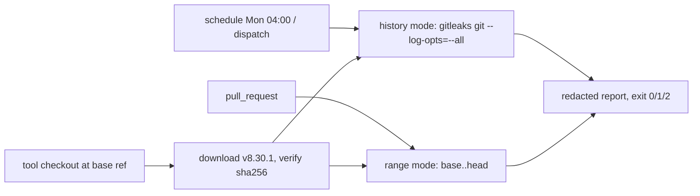

# The secret scan is an oracle, pinned and recurring

Amendment (0.2, 2026-11-18): the verifier's NO-GO on 0.1 re-measured.
No baseline: the default rules of `8.30.1` find 0 leaks over the full
history (the owner's scan and this spec's reproduction), so there is no
`.gitleaks.toml` and nothing to allow; the tool is checked out from the
pull request's base ref, so a pull request cannot edit the scanner that
judges it; the checksum is measured and written; the release publishes
no signature, so cosign is not a step.

Amendment (0.3, 2026-11-18): the verifier's NO-GO on 0.2. The pull
request that introduces the tool has no `scripts/secret_scan.sh` at
its base, so its range job is skipped with a named reason and its
commits are judged by the `workflow_dispatch` history run (D4b, C6);
every later pull request runs the tool from its base.

## Intent

Child 4 of SP-REPO-CARRIES-NO-PERSONAL-DATA. The owner's measurement of
2026-11-18 (full history, gitleaks `8.30.1`, default rules, 0 leaks;
parent F12) was done once, by hand, with no tool in the repository.
This spec makes it reproducible: a pinned gitleaks with the default
rules, entropy detection included, redacted output, run weekly over the
full history and on every pull request over the commits it adds, from a
script the pull request cannot change.

## Context

### Measured 2026-11-18

| # | Fact | Where |
|---|---|---|
| F1 | No secret scanner is installed locally or named in the tree | `command -v gitleaks trufflehog detect-secrets` → none; `git grep -n -i -E 'gitleaks\|trufflehog\|detect-secrets'` → 0 |
| F2 | gitleaks' newest release is `v8.30.1`, published 2026-03-21; it ships `gitleaks_8.30.1_linux_x64.tar.gz` (SHA-256 `551f6fc83ea457d62a0d98237cbad105af8d557003051f41f3e7ca7b3f2470eb`, read from `gitleaks_8.30.1_checksums.txt` and matched by `sha256sum` on the downloaded tarball) and `gitleaks_8.30.1_checksums.txt`; the release has no signature or SBOM asset (`.sig`, `.pem`, `.sigstore`: none), so the checksum is the only pin available | `gh api repos/gitleaks/gitleaks/releases/latest`; the tarball holds `gitleaks`, `LICENSE`, `README.md` |
| F3 | `gitleaks/gitleaks-action` `v3.0.0` is commit `e0c47f4f8be36e29cdc102c57e68cb5cbf0e8d1e`; the action requires a `GITLEAKS_LICENSE` on an organisation-owned repository (this one is), the binary does not | `gh api repos/gitleaks/gitleaks-action/git/ref/tags/v3.0.0`; the action's README |
| F4 | Ten lines in five test files carry a token-prefixed dummy (`glpat-…` in `tests/unit/test_ci_doctor.py:18`, `tests/unit/test_ci_init.py:34-35`, `tests/unit/test_ci_review.py:56,73-74,204`, `tests/unit/test_generated_artefacts_gate.py:325`; `ghp_…` in `tests/unit/test_open_threads_block_the_merge.py:161,164`); the default rules of `8.30.1` match none of them: `gitleaks git --log-opts=--all` over the worktree (758 commits reachable from every ref) → `no leaks found`; `gitleaks dir` over the checkout → 2 findings, both in the untracked `tmp/` (the tool's own README examples), 0 in a tracked file | `git grep -n -o -E '(ghp_\|glpat-\|github_pat_\|glrt-)[A-Za-z0-9_-]{6,}'`; the two runs, 2026-11-18, `8.30.1` |
| F5 | Every action in the workflows is pinned by commit SHA with a version comment; every job's `runs-on` is the configurable runner expression, pinned by a test | `.github/workflows/ci.yml:51,56`; `tests/unit/test_ci_portability.py:50-60,68-83` |
| F6 | On a pull request, `gate` runs only for an actor in the allow-list, and every other job needs `gate`, so an outsider's pull request runs no job; the self-hosted runner never runs an outsider's code | `ci.yml:35-39`; SP-CI-SUPPLY-CHAIN-HARDEN; `docs/security_posture.md:47-69`; parent F24 |
| F7 | A separate workflow is not in the affected-jobs table and is not gated by `gate`; `test_affected_workflow_wiring.py` judges `ci.yml` only | `src/repoach/affected/select.py` (`DEFAULT_WORKFLOW_PATH`); `.github/affected-jobs.toml` names three jobs of `ci.yml` |
| F8 | `--redact` takes a percentage, default 100; `--log-opts` passes git log options; `--exit-code` defaults to 1 on leaks; a config, when one is wanted, declares exceptions as `[[allowlists]]` whose criteria combine with `OR` unless `condition = "AND"` is set, with `regexTarget` one of `secret` (default), `match`, `line` | the tarball's `README.md:180,346-367,382-395`; `gitleaks git --help` |
| F9 | On `pull_request`, `actions/checkout` without `ref` checks out the merge of the head into the base, so a script read from that checkout is the pull request's version | GitHub Actions documentation for the `pull_request` event (`GITHUB_SHA` is the merge commit); `ci.yml:51-53` |

## Decisions (2026-11-18)

- D1. **The binary, not the action.** `scripts/secret_scan.sh` downloads `https://github.com/gitleaks/gitleaks/releases/download/v8.30.1/gitleaks_8.30.1_linux_x64.tar.gz` into a temporary directory, verifies its SHA-256 against `GITLEAKS_SHA256` committed in the script (F2's value), refuses on a mismatch with exit 2 printing the two values, and runs the binary. No licence key, no third-party action, no Docker (the self-hosted runner has none, `tests/unit/test_ci_portability.py:40-44`). A cached binary under `$RUNNER_TEMP` with the right checksum is reused. No signature verification: the release publishes none (F2); a later release that does gets a cosign step by an amendment, not a stub now.
- D2. **Two modes, default rules.** `scripts/secret_scan.sh history <repo dir>` runs `gitleaks git --redact=100 --no-banner --report-format json --report-path <tmp>/report.json --log-opts=--all <repo dir>` over the full history (`fetch-depth: 0`); `scripts/secret_scan.sh range <base>..<head> <repo dir>` runs the same with `--log-opts="<base>..<head>"` over the commits a pull request adds. No `--config`: the default rules of the pinned version are the rule set (D3). Both print the finding count and, per finding, `rule`, `file`, `commit`, `line` and the fingerprint, never the secret: `--redact=100` replaces the whole match (F8). Exit 0 on no finding, 1 on a finding, 2 on a download, checksum or invocation error.
- D3. **No baseline.** The default rules find nothing over the full history (F4, parent F12), so there is no `.gitleaks.toml`, no fingerprint, no path exception, and `tests/unit/test_secret_scan_workflow.py` pins that no `.gitleaks.toml` exists and that the script passes no `--config`. A future finding on a dummy is resolved by reshaping the dummy (a prefix with too few characters for the rule, as the ten dummies of F4 are today), not by an exception; if an exception ever becomes necessary, this spec is amended and the config uses `[[allowlists]]` with `condition = "AND"`, `paths` and `regexes` with `regexTarget = "match"`, each preceded by a `# reason:` line — never `OR`, which would allow anything in the named paths (F8).
- D4. **Where it runs, and from which ref.** `.github/workflows/secret-scan.yml`: `on: schedule: cron: "0 4 * * 1"` (history mode, Mondays 04:00 UTC), `on: pull_request` (range mode, `${{ github.event.pull_request.base.sha }}..${{ github.event.pull_request.head.sha }}`), `on: workflow_dispatch` (history mode). One job, `secret-scan`, `runs-on: ${{ vars.REPOACH_RUNNER || 'self-hosted' }}` (F5's test), `if: github.event_name != 'pull_request' || contains(fromJSON(vars.REPOACH_ALLOWED_ACTORS || '[]'), github.actor)` (F6, with child 1's empty fallback), `permissions: contents: read`. Two checkouts, both pinned by SHA: the data at `path: repo` (`fetch-depth: 0`, the event's ref, so the pull request's commits are present), and the tool at `path: tool` with `ref: ${{ github.event.pull_request.base.sha || github.sha }}` and `sparse-checkout: scripts/secret_scan.sh`; the job runs `tool/scripts/secret_scan.sh … repo`. The trust model, stated: the script and its checksum come from the base ref, so a pull request cannot change the scanner that judges it; the workflow file itself is GitHub's choice for the event (the merge ref on `pull_request`, F9), and the actor gate on the job is what keeps an outsider's workflow edit from running on the runner (F6) — a pull request by an allowed actor that edits `secret-scan.yml` is reviewed like any `.github/` change (`[full]` row).
- D4b. **The bootstrap pull request is skipped by name, and the next one proves the tool.** On the pull request that introduces `scripts/secret_scan.sh`, the base ref has no such file, so the `tool` checkout holds nothing to run. The job's `Scan` step begins with `if [ ! -f tool/scripts/secret_scan.sh ]; then echo "secret-scan: skipped, base ${BASE_SHA::12} has no scripts/secret_scan.sh (bootstrap: the tool lands with this pull request; its commits are judged by the workflow_dispatch history run, C2)"; exit 0; fi`, so the step concludes green with the reason in the log and nothing is scanned by a script the pull request wrote. The condition can only hold on a pull request whose base predates the tool — after the merge every base has the file, and a pull request that deletes the file still runs its base's copy. The implementer's `workflow_dispatch` run on the bootstrap branch (C2, history mode over `--all`, the branch's commits included) is the measurement that covers the skipped range; the first pull request after the merge proves the tool runs from base (C6).
- D5. **Recurring, and a red stops the line.** The scheduled run is recurring by D4. A finding in history mode is a real secret or a dummy the rules match; the owner rotates a real secret (the workflow does not and cannot) and the pull request that follows reshapes a dummy (D3). A finding in range mode blocks the pull request like any red check; the owner may add the job to the required checks once it has run green three Mondays (an owner step, O1), so a transport failure does not block merges on day one.
- D6. **The report is an artefact, redacted.** The JSON report is uploaded with `actions/upload-artifact` (pinned SHA, 14-day retention) only when findings exist; its `Secret` field is the redacted string by `--redact=100`, and `tests/unit/test_secret_scan_workflow.py` pins the flag's presence in the script so a later edit cannot drop it.

## End state

Every Monday a run of `secret-scan.yml` prints `secret-scan: 0
finding(s) over <n> commits` on the repository's full history with
gitleaks `8.30.1`, the binary's checksum verified, the script taken from
the base ref; every pull request runs the same over the commits it
adds; no `.gitleaks.toml` exists; a planted token in a pull request is
red with the rule, the file, the commit and the line, and the log holds
only `REDACTED` where the token was.

## Easy solution rejected

`gitleaks/gitleaks-action`: rejected, it needs a licence key on an
organisation repository (F3) and adds a third-party action for a
single static binary. `pip install detect-secrets` in the test job:
rejected, it scans a tree, not history, and its baseline is a file of
hashed secrets committed to the repository. A one-off scan written as
a `## Measured` line: rejected, that is what the parent's F12 is, and it
is unreproducible without the tool and its version. Making the job a
required check on day one: rejected (D5), a download failure would
block every merge before the job has a record. A baseline of path
exceptions "for the dummies": rejected by measurement (F4), the rules
match none of them, and an `OR` allow-list would have allowed anything
in five test files (F8). Reading the script from the pull request's
checkout: rejected, the judged code would supply the judge (F9).

## Hard part

The scan must stay useful (the default rules, entropy detection on) and
quiet (0 findings) without an exception list, so the only lever is the
shape of the test suite's dummies: a prefix with too few characters to
match the rule, which is what the ten lines of F4 are today, and a
dummy that grows into a match is a red run and a reshaped dummy, not an
allow entry. The second hard part is the supply chain: a binary
downloaded at run time is trusted only through a checksum the
repository holds, and the script holding that checksum must be the base
ref's, not the pull request's — two checkouts, one for the data and one
for the tool, in one job; which leaves exactly one pull request, the
one that introduces the tool, with no tool at its base, and that one is
skipped by name rather than judged by its own script (D4b).

## Goals

- G1: a pinned, checksum-verified gitleaks `8.30.1` runs in CI on the full history weekly and on each pull request's range (D1, D2, D4).
- G2: no baseline, pinned by a test; the rule set is the pinned version's default (D3).
- G3: no secret reaches a log or an artefact (`--redact=100`, D2, D6).
- G4: the job obeys the repository's workflow rules: pinned actions, configurable runner, actor gate, tool from the base ref (F5, F6, D4).

## Non-Goals

- NG1: detecting personal data (child 3).
- NG2: rotating a found secret (the owner's).
- NG3: a required check from day one (D5, O1).
- NG4: scanning the published artefacts for secrets (the parent's F12 covered 0.1.0 by hand; child 5's artefact check is for personal data; a secret in `src/` is in the history scan).
- NG5: signature verification of the binary (F2: none is published).

## Assumptions

- A1: the self-hosted runner can reach `github.com` releases (it checks out from there).
- A2: gitleaks `8.30.1` runs on the runner's `linux/x64` (a static Go binary; it ran on the maintainer's machine, F4).
- A3: the five dummy files keep dummies the default rules do not match (F4), or the red run reshapes them (D3).

## Interface

Inputs:
- `scripts/secret_scan.sh history <repo dir> | range <base>..<head> <repo dir>`; env `GITLEAKS_VERSION` (default `8.30.1`), `GITLEAKS_SHA256` (committed default), `GITLEAKS_URL` (default the release URL, overridable for the test's `file://` tarball), `RUNNER_TEMP` (cache dir, default a `mktemp -d`).

Outputs:
- stdout: `gitleaks 8.30.1 verified (<sha256 prefix>)`, then per finding `rule=<id> file=<path> commit=<sha12> line=<n> fingerprint=<fp>`, then `secret-scan: <k> finding(s) over <n> commits`; exit 0 / 1 / 2.
- artefact `secret-scan-report` (JSON, redacted) when k > 0.

Errors:
- exit 2: download failure, checksum mismatch (`checksum: expected <a> got <b>`), unknown mode, missing repo dir, range that does not resolve.

## Behavior

### Nominal

Monday: history mode, 0 findings, exit 0. Pull request: range mode, 0
findings, exit 0.

### Edge cases

- A pull request whose range is empty (a re-run on the same head) → `secret-scan: 0 finding(s) over 0 commits`, exit 0.
- A merge commit in the range → judged like any commit (`gitleaks git` reads every commit the log lists).
- A pull request that edits `scripts/secret_scan.sh` → the base ref's script judges it; the edited script runs only once merged, on the next pull request.
- The pull request that introduces the tool → `secret-scan: skipped, base <sha12> has no scripts/secret_scan.sh (bootstrap …)`, exit 0 (D4b); its commits are in the `workflow_dispatch` history run of C2.

### Failure scenarios

- Checksum mismatch → exit 2, the two values printed, the job red; nobody runs the binary.
- A real token in history → exit 1, the redacted report uploaded, the owner rotates it (D5); no exception is added.
- A dummy grows into a rule match → exit 1 on the pull request that grew it; the dummy is reshaped in the same pull request.

### Operator steps

- O1 (owner, after three green scheduled runs): add `secret-scan` to the required checks of `develop` and `main` in the repository rulesets.

## Tests

| Test | What it pins | Mutation that must turn it red |
|---|---|---|
| `tests/unit/test_secret_scan_workflow.py::test_workflow_is_scheduled_pull_request_gated_pinned_and_takes_the_tool_from_base` | D4: `secret-scan.yml` has `schedule` with the cron, `pull_request`, `workflow_dispatch`; one job with the runner expression, the actor gate reading `vars.REPOACH_ALLOWED_ACTORS` with fallback `'[]'`, `permissions.contents == read`; two checkout steps, one with `path: repo` and `fetch-depth: 0`, one with `path: tool` and a `ref:` reading `base.sha`; the `run:` tests `tool/scripts/secret_scan.sh` for existence first, prints `secret-scan: skipped, base` with the bootstrap reason and exits 0 when it is absent (D4b), and otherwise invokes `tool/scripts/secret_scan.sh`; every `uses:` a 40-hex SHA with a version comment | drop the schedule, a SHA pin, the bootstrap guard, or run `repo/scripts/…` |
| `::test_script_pins_version_checksum_and_redaction_and_passes_no_config` | D1, D2, D3, D6: the script contains `GITLEAKS_VERSION="${GITLEAKS_VERSION:-8.30.1}"`, `GITLEAKS_SHA256` equal to F2's 64 hex, `--redact=100`, no `--config`; it refuses an unknown mode with exit 2 (`bash scripts/secret_scan.sh bogus .`) | drop `--redact`, add `--config`, or accept any mode |
| `::test_script_refuses_a_checksum_mismatch_without_running` | D1: with `GITLEAKS_SHA256=0000…` and a fake tarball served from a `file://` URL via `GITLEAKS_URL`, exit 2 with `checksum: expected 0000` and no `gitleaks` process (a `PATH` spy) | run after a mismatch |
| `::test_no_baseline_config_exists` | D3: `.gitleaks.toml` is absent from the tree root | add the file |
| `::test_default_rules_are_quiet_on_the_tree_and_loud_on_a_realistic_token` (skipped with the reason when the binary is absent and `REPOACH_SECRET_SCAN_LIVE` is unset) | D3: `gitleaks dir` over `git ls-files` of the checkout → 0 findings; a temp repository with one commit holding `ghp_` + 36 random alphanumerics → 1 finding | grow a dummy to a rule match |
| `tests/unit/test_ci_portability.py` (existing) | F5: the new workflow's `runs-on` is the configurable expression | hard-code a runner |

## Success conditions

- C1 (oracle: pytest, CI): `pytest -q tests/unit/test_secret_scan_workflow.py tests/unit/test_ci_portability.py` → green.
- C2 (oracle: the workflow, by the implementer, run URL written beside AC2): `workflow_dispatch` on the pull request's branch → `gitleaks 8.30.1 verified (551f6fc8)` then `secret-scan: 0 finding(s) over <n> commits` with n ≥ 320 (`git rev-list --count origin/develop` on 2026-11-18).
- C3 (oracle: a deliberately red pull request, closed unmerged, URL written beside AC3): a pull request adding a file with `ghp_` followed by 36 random alphanumerics → `secret-scan` red, one finding line naming the file and the commit, and `grep -c ghp_ <log>` → `0` beyond the rule name.
- C4 (oracle: the scheduled run, URL of the first Monday run written beside AC2 by the owner): same output as C2.
- C5 (oracle: git, any machine): `test ! -e .gitleaks.toml` → exit 0; `grep -c -- '--config' scripts/secret_scan.sh` → `0`.
- C6 (oracle: two CI logs, URLs written beside AC3): the `secret-scan` job of this spec's own pull request shows the line `secret-scan: skipped, base <sha12> has no scripts/secret_scan.sh` and concludes success; the `secret-scan` job of the first pull request opened after the merge shows `gitleaks 8.30.1 verified (551f6fc8)` and `secret-scan: <k> finding(s) over <n> commits` with n ≥ 1 — the tool ran from base.

## Architecture Impact

- Adds dependency: SP-SECRET-SCAN-IS-AN-ORACLE -> SP-CI-SUPPLY-CHAIN-HARDEN (the SHA pins, the actor gate, the "untrusted code never runs on the runner" rule the workflow obeys; no import)
- New / changed coupling, cycles, or shared state: none; this spec owns one workflow, one script and one test, imported by nothing. The 27 cycles and the 5 conflicts of the parent's F20 are unchanged.

## Diagram

## Acceptance Criteria

- [ ] AC1: C1 green; C5 as written.
- [ ] AC2: C2's run URL and its two output lines written here; C4's first Monday URL written here by the owner.
- [ ] AC3: C3's pull request URL written here; C6's two job URLs and their lines written here.
- [ ] AC4: `repoach arch check --base origin/develop` → `edge-honesty: ok`; `repoach arch graph --check 2>&1 | grep -c '^dependency cycle'` → `27`; the `ownership conflict` lines are the parent's five.

## Open Questions

- None.
